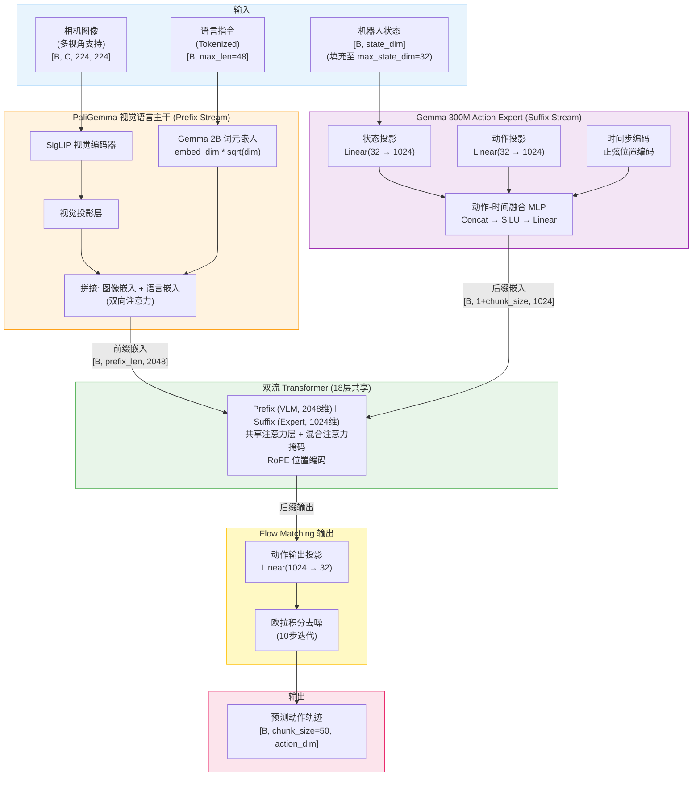
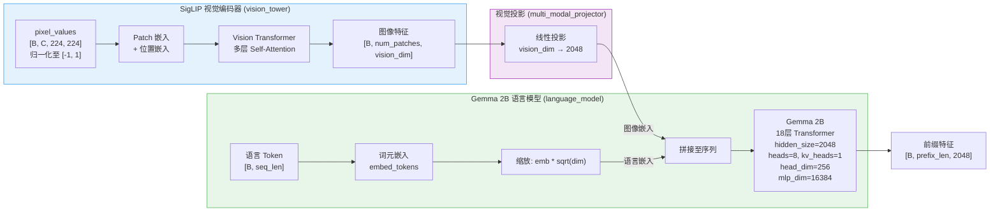
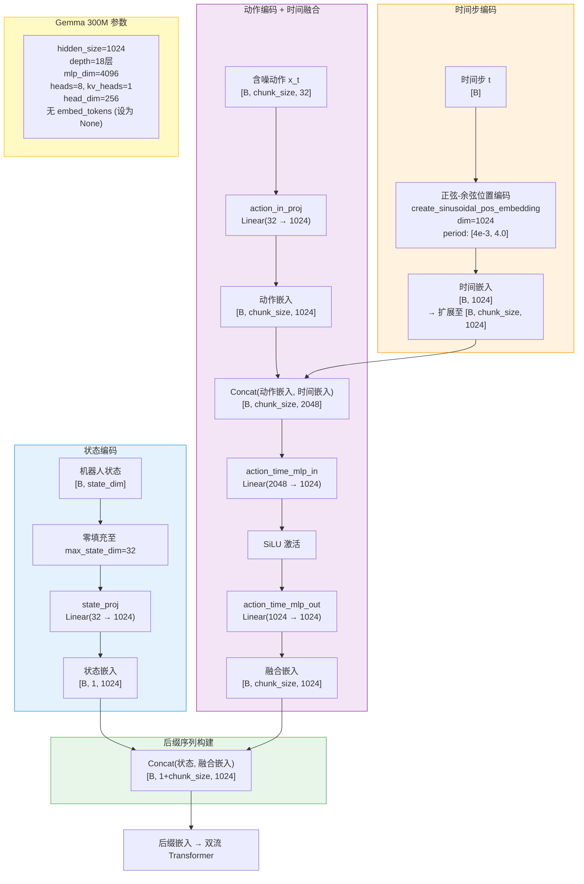
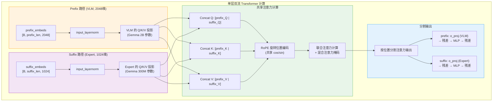
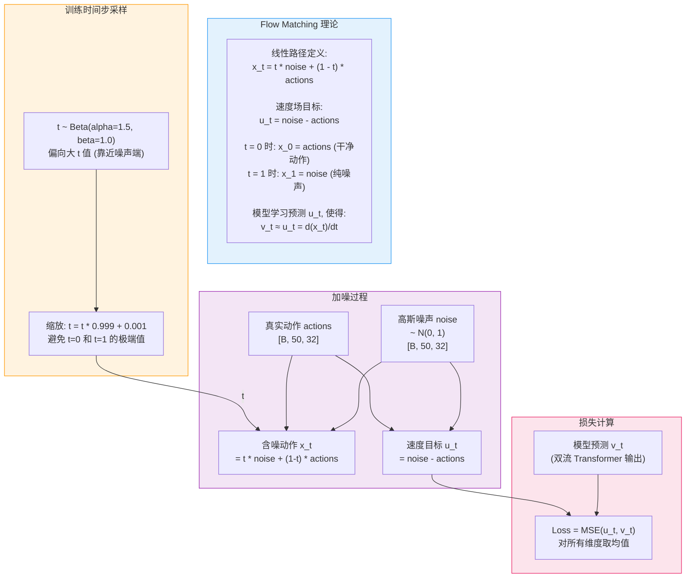
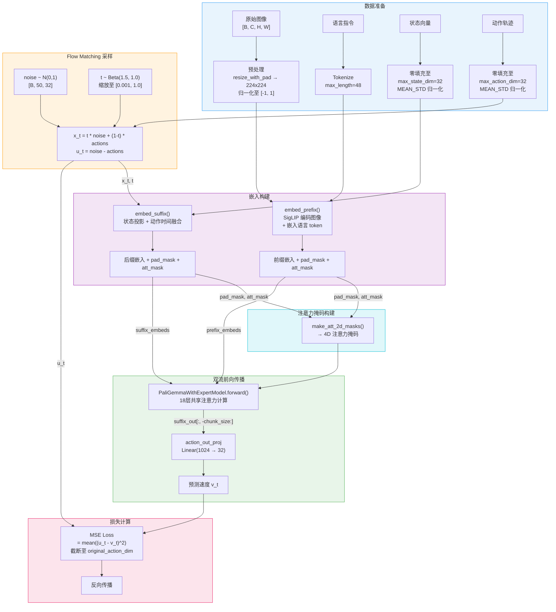
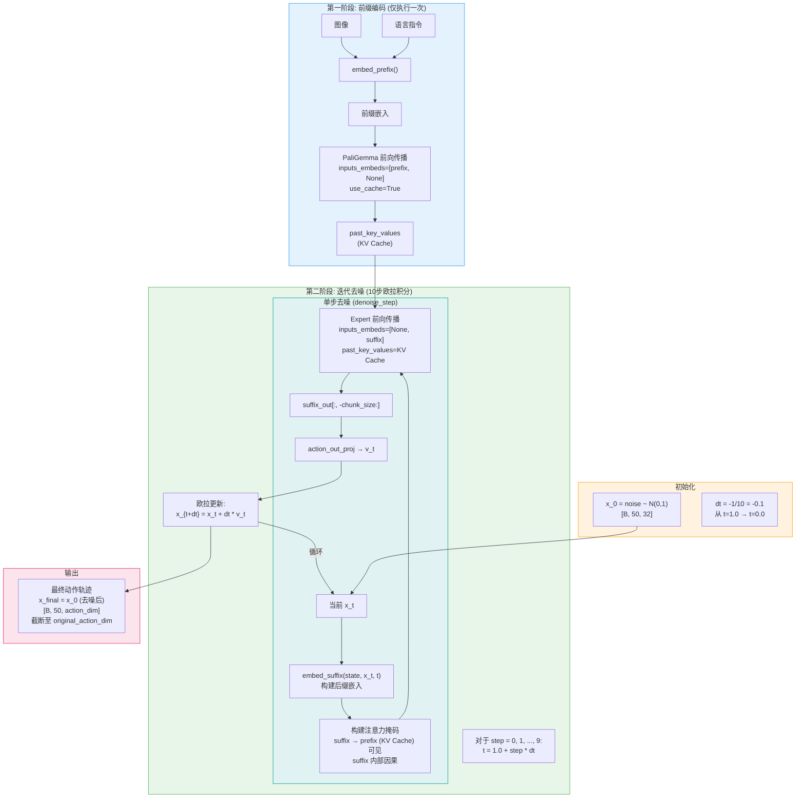
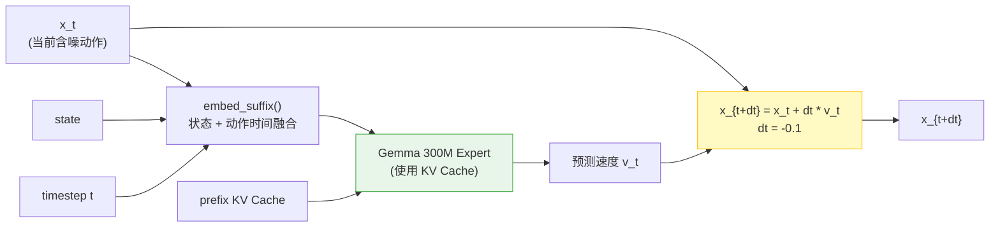

# Pi0 (Physical Intelligence Zero) 模型架构

## 1. 整体架构概览

Pi0 是 Physical Intelligence 提出的视觉-语言-动作 (VLA) 模型，采用 **PaliGemma (SigLIP + Gemma 2B)** 作为视觉语言主干网络，配合独立的 **Gemma 300M Action Expert** 进行动作生成。其核心创新在于 **双流 Transformer 注意力机制**——VLM 前缀序列与动作专家后缀序列共享同一组 Transformer 层，通过精心设计的混合注意力掩码实现信息的单向流动；动作生成采�� **Flow Matching** 而非标准扩散模型，通过欧拉积分将高斯噪声迭代映射为动作轨迹。

---

## 2. 核心组件详解

### 2.1 PaliGemma 视觉语言模型 (SigLIP + Gemma 2B)

PaliGemma 是 Google 提出的视觉语言模型，由 **SigLIP 视觉编码器** 和 **Gemma 2B 语言模型** 组成。在 Pi0 中，PaliGemma 的作用是将图像和语言指令编码为统一的视觉语言特征序列，作为双流 Transformer 的前缀 (Prefix) 输入。

**关键细节：**

- SigLIP 输入图像需归一化至 `[-1, 1]` 范围，支持 `resize_with_pad` 保持宽高比
- 语言嵌入在送入 Transformer 前需乘以 `sqrt(embed_dim)` 进行缩放
- 多相机图像逐一编码后拼接，缺失相机用 `-1` 填充并设置掩码为 0
- PaliGemma 使用 `vocab_size=257152`，`image_token_index=257152`

---

### 2.2 Action Expert (Gemma 300M)

Action Expert 是一个独立的 Gemma 300M 模型，负责处理机器人状态、含噪动作和时间步信息。它与 VLM 共享 Transformer 层的注意力计算，但拥有独立的参数（自己的 Q/K/V 投影、MLP 等）。

**关键细节：**

- Action Expert 的 `embed_tokens` 被设为 `None`，不使用词元嵌入
- 状态嵌入作为单个 token 插入后缀序列开头，注意力掩码标记为 `1`（因果起点）
- 动作 token 使用特殊的注意力掩码：首个动作 token 标记为 `1`，其余为 `0`，形成分块因果结构

---

### 2.3 双流 Transformer 注意力机制

Pi0 的核心创新是双流 Transformer：**VLM 前缀序列 (Prefix)** 和 **Action Expert 后缀序列 (Suffix)** 共享同一组 18 层 Transformer，但通过混合注意力掩码实现差异化的信息流动。

#### 混合注意力掩码

注意力掩码通过 `att_masks` 整数向量和 `make_att_2d_masks` 函数构建，实现以下规则：

**掩码规则：**

- **Prefix ↔ Prefix**：双向注意力（图像和语言 token 互相可见）
- **Suffix → Prefix**：允许（动作 token 可以看到所有 VLM token）
- **Prefix → Suffix**：阻断（VLM token 不能看到动作 token）
- **Suffix ↔ Suffix**：因果注意力（动作 token 仅看到自身及之前的 token）

**注意力矩阵示意：**

| Q \ K | img | lang | state | act_0 | act_1 | ... |
|--------|-----|------|-------|-------|-------|-----|
| img    |  ✓  |  ✓   |   ✗   |   ✗   |   ✗   |  ✗  |
| lang   |  ✓  |  ✓   |   ✗   |   ✗   |   ✗   |  ✗  |
| state  |  ✓  |  ✓   |   ✓   |   ✗   |   ✗   |  ✗  |
| act_0  |  ✓  |  ✓   |   ✓   |   ✓   |   ✗   |  ✗  |
| act_1  |  ✓  |  ✓   |   ✓   |   ✓   |   ✓   |  ✗  |
| ...    |  ✓  |  ✓   |   ✓   |   ✓   |   ✓   |  ✓  |

**实现方式：**

- 图像和语言 token 的 `att_mask = 0`（双向）
- 状态 token 的 `att_mask = 1`（因果起点）
- 首个动作 token 的 `att_mask = 1`，其余动作 token 的 `att_mask = 0`
- 通过 `cumsum` 累积求和构造 2D 注意力掩码：`cumsum[:, None, :] <= cumsum[:, :, None]`

---

### 2.4 Flow Matching 扩散机制

Pi0 采用 Flow Matching（流匹配）而非标准扩散模型来生成动作。

#### 直觉理解：从噪声到动作的"导航"

想象你站在一片浓雾（随机噪声）中，你的目标是走到一个精确的目的地（真实的机器人动作）。Flow Matching 要做的事情就是：**训练一个"导航仪"，告诉你在雾中的每一个位置应该朝哪个方向、以多快的速度走，才能最终到达目的地。**

具体来说，分三步理解：

**第一步——定义一条"直线公路"（线性插值路径）**

在噪声和真实动作之间，画一条最简单的直线路径。用时间 $t$ 来标记你在这条路上的位置：

$$x_t = t \times \text{noise} + (1 - t) \times \text{actions}$$

- $t = 0$ 时：$x_0 = \text{actions}$，你就在目的地（干净动作）
- $t = 1$ 时：$x_1 = \text{noise}$，你在纯噪声中，完全迷路
- $t = 0.5$ 时：$x_{0.5}$ 是噪声和动作各占一半的混合体

这条路径是人为规定的，不需要学习——它只是告诉我们"从噪声到动作，中间状态长什么样"。

**第二步——计算"速度场"（训练目标）**

既然路径是一条直线，那沿着这条路走的"速度"（方向 + 快慢）在任何位置都是恒定的：

$$u_t = \frac{d\,x_t}{d\,t} = \text{noise} - \text{actions}$$

这就是**速度场**——它的含义是"从动作指向噪声的方向"。反过来说，如果我们沿 $-u_t$ 方向走，就是从噪声走向动作。训练时，我们让模型去学习预测这个速度场 $u_t$。

**第三步——推理时"逆向行走"（欧拉积分）**

推理时，我们从纯噪声 $x_1$ 出发，用模型预测的速度场一步一步走回 $x_0$（干净动作）：

$$x_{t - \Delta t} = x_t + \Delta t \times v_t \quad (\Delta t = -0.1, \text{共走 10 步})$$

其中 $v_t$ 是模型对速度场的预测。每走一步，动作就变得更"清晰"一点，10 步之后就从一团噪声变成了合理的动作轨迹。

> **类比总结：** 标准扩散模型像是在迷宫里摸索（随机微分方程，路径弯曲复杂，需要几百步），而 Flow Matching 像是在笔直的公路上开车（常微分方程，路径简单直接，10 步就到）。公路是人为修好的（线性插值），模型只需要学会"沿着公路开"（预测速度场）。

**与标准扩散模型的区别：**

| 特性 | 标准扩散 (DDPM) | Flow Matching (Pi0) |
|---|---|---|
| 噪声调度 | 固定余弦/线性调度 | 线性插值路径 |
| 预测目标 | 预测噪声 epsilon | 预测速度场 u_t |
| 推理步数 | 通常 50-1000 步 | 仅 10 步 |
| 时间步采样 | 均匀采样 | Beta(1.5, 1.0) 分布 |
| 数学基础 | 随机微分方程 (SDE) | 常微分方程 (ODE) |

---

## 3. 训练流水线

训练时，模型接收图像、语言、状态和真实动作，通过 Flow Matching 加噪后预测速度场，以 MSE 损失进行优化。

---

## 4. 推理流水线

推理时，模型采用 **KV Cache 优化**：先对前缀（图像+语言）做一次前向传播并缓存 Key/Value，后续 10 步去噪仅需处理后缀（状态+动作），大幅减少计算量。

### 欧拉积分细节 -- 单步展开

**推理优化要点：**

- 前缀仅编码一次，KV Cache 在 10 步去噪中复用
- 推理时设置 `_attn_implementation = "eager"`，确保兼容自定义注意力掩码
- 时间步从 `t=1.0`（纯噪声）线性递减至 `t≈0.0`（干净动作）

---

## 5. 关键超参数表

### 模型结构参数

| 参数 | 值 | 说明 |
|---|---|---|
| `paligemma_variant` | `gemma_2b` | VLM 主干变体 |
| `action_expert_variant` | `gemma_300m` | 动作专家变体 |
| VLM hidden_size | 2048 | Gemma 2B 隐藏维度 |
| VLM depth | 18 | Gemma 2B Transformer 层数 |
| VLM mlp_dim | 16384 | Gemma 2B MLP 中间维度 |
| VLM num_heads / kv_heads | 8 / 1 | Gemma 2B 注意力头数 (GQA) |
| VLM head_dim | 256 | 每个注意力头的维度 |
| Expert hidden_size | 1024 | Gemma 300M 隐藏维度 |
| Expert depth | 18 | Gemma 300M Transformer 层数 |
| Expert mlp_dim | 4096 | Gemma 300M MLP 中间维度 |
| Expert num_heads / kv_heads | 8 / 1 | Gemma 300M 注意力头数 (GQA) |
| Expert head_dim | 256 | 每个注意力头的维度 |
| `vocab_size` | 257152 | 词表大小 |
| `image_resolution` | (224, 224) | 输入图像分辨率 |
| `hidden_activation` | `gelu_pytorch_tanh` | 激活函数 |

### 动作生成参数

| 参数 | 值 | 说明 |
|---|---|---|
| `chunk_size` | 50 | 预测的动作步数 (action_horizon) |
| `n_action_steps` | 50 | 执行的动作步数 |
| `max_state_dim` | 32 | 状态向量最大维度 (零填充) |
| `max_action_dim` | 32 | 动作向量最大维度 (零填充) |

### Flow Matching 参数

| 参数 | 值 | 说明 |
|---|---|---|
| `num_inference_steps` | 10 | 推理去噪步数 |
| `time_sampling_beta_alpha` | 1.5 | Beta 分布 alpha 参数 |
| `time_sampling_beta_beta` | 1.0 | Beta 分布 beta 参数 |
| `time_sampling_scale` | 0.999 | 时间步缩放因子 |
| `time_sampling_offset` | 0.001 | 时间步偏移量 |
| `min_period` | 4e-3 | 正弦编码最小周期 |
| `max_period` | 4.0 | 正弦编码最大周期 |

### 训练参数

| 参数 | 值 | 说明 |
|---|---|---|
| `optimizer_lr` | 2.5e-5 | 峰值学习率 |
| `optimizer_betas` | (0.9, 0.95) | AdamW beta 参数 |
| `optimizer_weight_decay` | 0.01 | 权重衰减 |
| `optimizer_grad_clip_norm` | 1.0 | 梯度裁剪范数 |
| `scheduler_warmup_steps` | 1000 | 学习率预热步数 |
| `scheduler_decay_steps` | 30000 | 余弦衰减总步数 |
| `scheduler_decay_lr` | 2.5e-6 | 最终学习率 |
| `tokenizer_max_length` | 48 | 语言 token 最大长度 |
| `dtype` | `float32` / `bfloat16` | 训练精度 |
| `freeze_vision_encoder` | False | 是否冻结视觉编码器 |
| `train_expert_only` | False | 是否仅训练 Expert |
| `gradient_checkpointing` | False | 梯度检查点 (省显存) |

---

## 6. 关键源文件表

| 组件 | 类名 | 文件路径 |
|---|---|---|
| 策略入口 | `PI0Policy` | `lerobot/policies/pi0/modeling_pi0.py:926` |
| 核心模型 | `PI0Pytorch` | `lerobot/policies/pi0/modeling_pi0.py:536` |
| 双流模型 | `PaliGemmaWithExpertModel` | `lerobot/policies/pi0/modeling_pi0.py:330` |
| 模型配置 | `PI0Config` | `lerobot/policies/pi0/configuration_pi0.py:31` |
| Gemma 配置 | `GemmaConfig` / `get_gemma_config` | `lerobot/policies/pi0/modeling_pi0.py:294` |
| 注意力掩码 | `make_att_2d_masks` | `lerobot/policies/pi0/modeling_pi0.py:103` |
| 层计算 | `compute_layer_complete` | `lerobot/policies/pi0/modeling_pi0.py:221` |
| 正弦位置编码 | `create_sinusoidal_pos_embedding` | `lerobot/policies/pi0/modeling_pi0.py:75` |
| Beta 采样 | `sample_beta` | `lerobot/policies/pi0/modeling_pi0.py:95` |
| 图像处理 | `resize_with_pad_torch` | `lerobot/policies/pi0/modeling_pi0.py:146` |
| 预训练加载 | `PaliGemmaForConditionalGeneration` | `transformers` (HuggingFace) |
| 动作专家 | `GemmaForCausalLM` | `transformers` (HuggingFace) |
