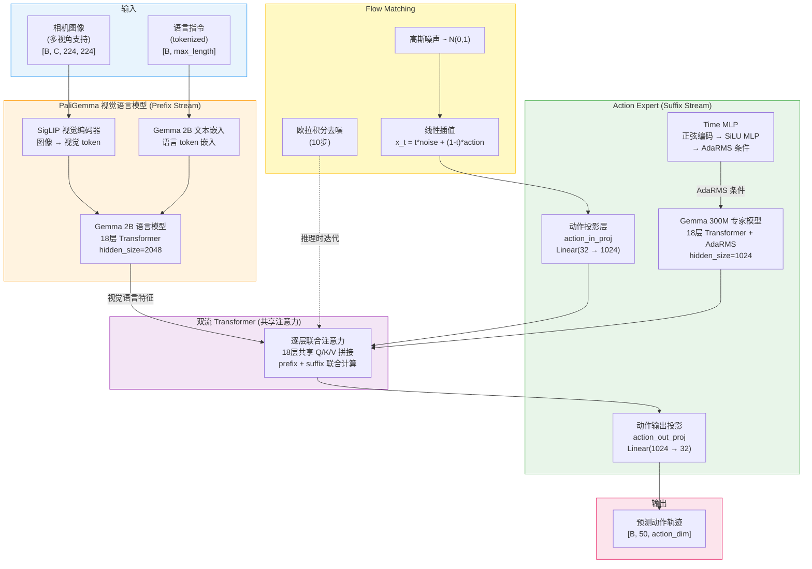
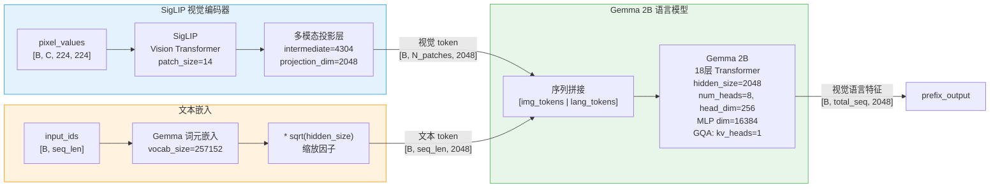
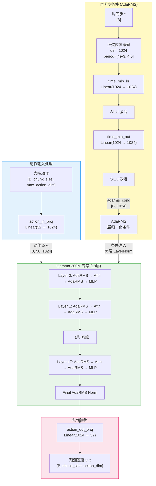
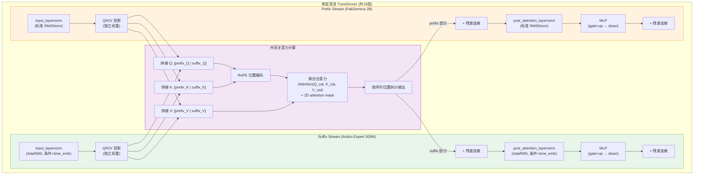
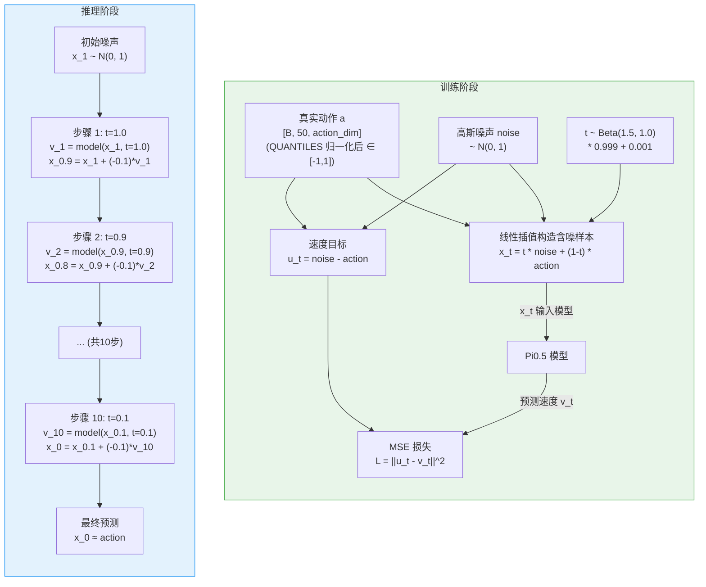
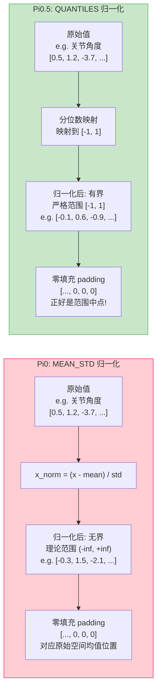
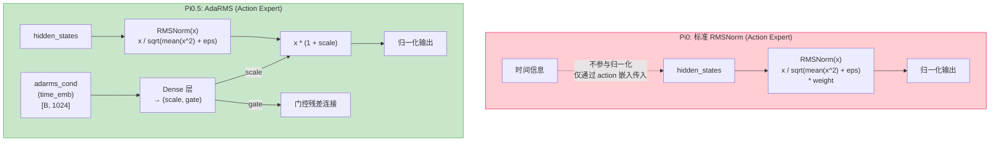
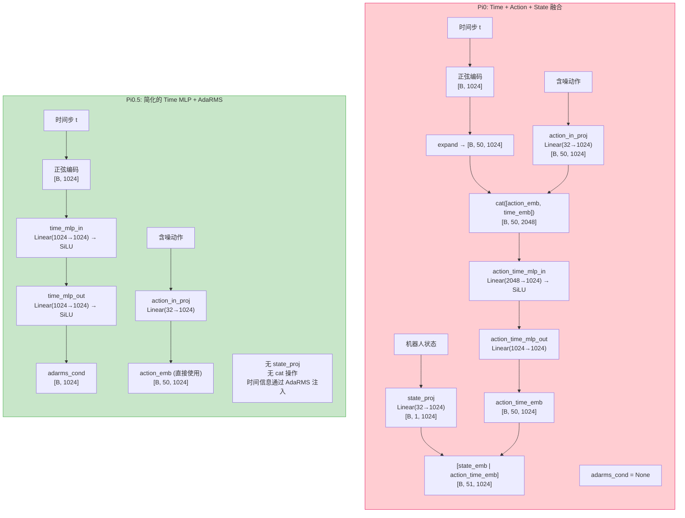
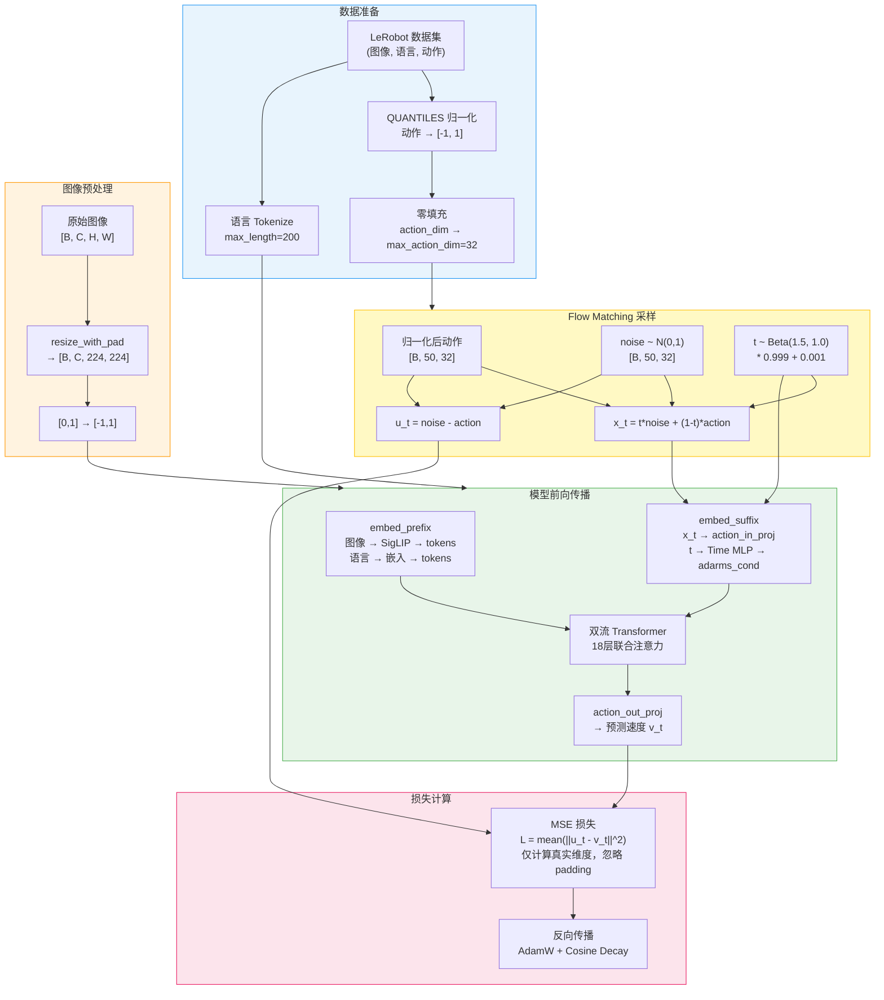
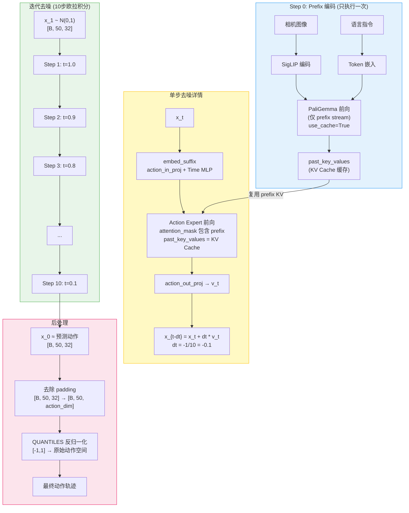

# Pi0.5 模型架构

## 1. 整体架构概览

Pi0.5 (Physical Intelligence 0.5) 是 Physical Intelligence 推出的视觉-语言-动作 (VLA) 模型，在架构上与 Pi0 几乎完全相同，均采用 PaliGemma 视觉语言模型作为感知主干、Gemma 300M 作为动作专家 (Action Expert)，通过双流 Transformer 实现视觉语言特征与动作特征的联合处理，并使用 Flow Matching 进行连续动作空间的生成。Pi0.5 相对于 Pi0 的核心改进在于三个方面：(1) 将状态和动作的归一化方式从 MEAN_STD 改为 QUANTILES，将所有值映射到 [-1, 1] 的有界空间，从根本上解决了零填充 (padding) 对 Flow Matching 稳定性的干扰问题；(2) 在动作专家中引入 AdaRMS (Adaptive Root Mean Square) 层归一化，以时间步信息对归一化进行条件调制；(3) 简化了 Time MLP 架构，将时间信息从与动作拼接融合改为通过 AdaRMS 注入。



---

## 2. 核心组件详解

### 2.1 PaliGemma 视觉语言模型

PaliGemma 由 Google 开发，是 Pi0/Pi0.5 的感知主干网络，负责将图像和语言指令编码为统一的视觉语言特征序列。它由 SigLIP 视觉编码器和 Gemma 2B 语言模型组成。



**关键特性：**
- **SigLIP** 将 224x224 图像编码为一系列视觉 token，通过投影层映射到 Gemma 的 2048 维空间
- **多相机支持**：每个相机图像独立编码，缺失的相机用全 -1 填充（SigLIP 的 padding 值），并通过 `img_mask` 标记为无效
- **图像预处理**：图像从 [0,1] 归一化到 [-1,1]，非方形图像通过 `resize_with_pad` 保持比例缩放后黑边填充
- **Prefix-LM 注意力**：图像 token 和语言 token 使用双向注意力（`att_mask=0`），即它们之间可以相互 attend

#### SigLIP vs CLIP/GLIP 对比

Pi0/Pi0.5 选择 **SigLIP** 而非更常见的 CLIP 作为视觉编码器，主要原因在于 SigLIP 的训练目标和效率优势：

| 特性 | CLIP | GLIP | SigLIP |
|---|---|---|---|
| **提出者** | OpenAI (2021) | Microsoft (2022) | Google (2023) |
| **训练目标** | 对比学习 (InfoNCE) | 对比学习 + 短语级 Grounding | **Sigmoid 损失** (pairwise) |
| **损失函数** | softmax 归一化的交叉熵，需要全局 batch 内负样本 | 同 CLIP + 区域-短语对齐 | 每对样本独立的 sigmoid 二分类损失 |
| **batch 依赖** | 强：性能随 batch size 增大而提升，小 batch 性能下降明显 | 强 | **弱**：每对样本独立计算，不需要大 batch 内的负样本对比 |
| **核心区别** | 对一个 batch 的 N 个图文对做 NxN 矩阵 softmax | CLIP 基础上增加了目标检测和定位能力 | 对每个图文对独立做"是否匹配"的二分类 |
| **优势** | 开创性的图文对齐方法 | 支持开放词汇目标检测，细粒度区域-语言对齐 | 训练效率高、小模型性能好、与 Gemma 同属 Google 生态 |
| **典型应用** | 通用图文检索、零样本分类 | 开放词汇检测、视觉定位 (grounding) | VLM 视觉编码器 (PaLI, PaliGemma) |

**为什么 Pi0.5 用 SigLIP 而不是 CLIP？**

1. **Sigmoid vs Softmax 的关键区别**：CLIP 使用 softmax，意味着每个图像的正确文本概率 = 1/N（N 为 batch size），所有负样本参与归一化。SigLIP 使用 sigmoid，每对图文独立判断匹配/不匹配，不依赖 batch 内其他样本。这使得 SigLIP 在小 batch 微调时更稳定——而机器人学习的 batch size 通常远小于互联网规模预训练
2. **Google 生态一致性**：SigLIP 是 PaliGemma 的原生视觉编码器，与 Gemma 语言模型在预训练阶段已经对齐，直接使用避免了跨生态适配的额外工程
3. **小模型效率**：SigLIP 在 ViT-B/16 等较小模型上的性能显著优于同等规模的 CLIP，更适合实时机器人控制的延迟需求

> **简单理解**：CLIP 像"从 N 个候选中选最匹配的"（排名问题），SigLIP 像"判断这一对是否匹配"（分类问题）。后者更简单、更稳定，尤其在 batch 不大的时候。

---

### 2.2 Action Expert (Gemma 300M)

动作专家是一个独立的 Gemma 300M 模型，专门处理动作序列。与 PaliGemma 的 Gemma 2B 共享相同的层数（18层），但每层的宽度更小。Pi0.5 的核心改进之一是在 Action Expert 中启用了 **AdaRMS 层归一化**。



**Gemma 300M 配置：**

| 参数 | 值 |
|---|---|
| hidden_size (width) | 1024 |
| num_hidden_layers (depth) | 18 |
| intermediate_size (mlp_dim) | 4096 |
| num_attention_heads | 8 |
| num_key_value_heads | 1 (GQA) |
| head_dim | 256 |
| hidden_activation | gelu_pytorch_tanh |
| use_adarms | True (Pi0.5) / False (Pi0) |

---

### 2.3 双流 Transformer

双流 Transformer 是 Pi0/Pi0.5 的核心计算机制。PaliGemma（prefix stream）和 Action Expert（suffix stream）各自拥有独立的权重，但在每一层的注意力计算中共享 Q/K/V 空间——将两个流的 query、key、value 沿序列维度拼接后进行联合注意力计算，再将结果拆分回各自的流中。



**注意力掩码机制：**

双流注意力使用精心设计的 2D 注意力掩码来控制信息流向：

```
att_mask 构造:
  图像 tokens:   [0, 0, 0, ..., 0]     ← 双向注意力
  语言 tokens:   [0, 0, 0, ..., 0]     ← 双向注意力
  动作 token[0]: [1]                    ← 因果边界：之前的 prefix 不能 attend 到此
  动作 token[1:]: [0, 0, ..., 0]       ← 动作 tokens 之间双向注意���
```

这意味着：
- 图像 token、语言 token 之间**可以相互 attend**（prefix-LM 风格）
- 动作 token **可以 attend 到**所有图像和语言 token（单向）
- 图像和语言 token **不能 attend 到**动作 token（保证前缀可以被缓存复用）

---

### 2.4 Flow Matching

Flow Matching 是一种基于常微分方程 (ODE) 的生成模型方法。与扩散模型不同，Flow Matching 定义了从噪声分布到数据分布的**直线路径**，模型学习在每个时间点的速度场。



**时间采样策略：**
- 训练时，时间步 t 从 Beta(1.5, 1.0) 分布中采样，再缩放到 [0.001, 1.0]
- Beta(1.5, 1.0) 偏向较大的 t 值（接近纯噪声），这意味着模型在训练时更多地关注"从噪声开始去噪"的早期阶段
- 推理时，从 t=1（纯噪声）等间距积分到 t=0（纯动作），默认 10 步

---

## 3. 与 Pi0 的关键区别

Pi0.5 在架构上与 Pi0 几乎完全相同（同样的 PaliGemma + Gemma 300M 双流 Transformer + Flow Matching），但有三个关键改进。这些改进看似微小，实则对模型的训练稳定性和泛化能力有深远影响。

### 3.1 QUANTILES 归一化 vs MEAN_STD 归一化



**为什么 QUANTILES 归一化至关重要？**

这是 Pi0.5 最重要的改进，直接影响 Flow Matching 的训练稳定性。核心问题在于 **padding 零值的语义**：

| 问题 | MEAN_STD (Pi0) | QUANTILES (Pi0.5) |
|---|---|---|
| 归一化后值域 | 无界 (-inf, +inf) | 有界 [-1, 1] |
| padding 零值含义 | 对应数据均值，有具体物理含义 | 对应范围中点 0，是自然中立值 |
| Flow Matching 噪声 | N(0,1) 噪声与无界数据混合 | N(0,1) 噪声与有界数据混合 |
| padding 维度的梯度 | 非零梯度（零值有特定含义） | 接近零的梯度（零值是中立的） |
| 异常值影响 | 均值/标准差易被极端值偏移 | 分位数对异常值天然鲁棒 |

**Flow Matching 中 padding 的关键影响——为什么零填充会从根本上干扰 Flow Matching？**

要理解这个问题，需要先理解 Flow Matching 的工作原理。Flow Matching 学习一个"速度场"，指导数据从噪声分布流向真实数据分布：

```
x_t = t * noise + (1-t) * action     ← 时间 t 处的插值样本
u_t = noise - action                  ← 模型需要学习预测的"速度"（真实动作到噪声的方向）
```

现在考虑 **padding 维度**。假设一个机器人只有 7 个关节（7 维动作），但 `max_action_dim=32`，那么第 8~32 维全部填零。**这些零值本身没有物理意义——它们只是占位符**。

**问题的根源：在 MEAN_STD 归一化下，padding 的零值变成了一个"有意义的目标"**

举一个具体例子来说明：

```
假设某个 padding 维度的训练集统计量为: mean=0.5, std=0.2

MEAN_STD 归一化:
  - 原始 padding 值 = 0
  - 归一化后 = (0 - 0.5) / 0.2 = -2.5  ← 零值变成了 -2.5！

  Flow Matching 的速度目标:
    u_t = noise - (-2.5) = noise + 2.5
  模型必须学习"把噪声去噪到 -2.5"这个具体值
  这个 -2.5 还落在了分布的尾部（距均值 2.5 个标准差），是一个极端值

QUANTILES 归一化:
  - 原始 padding 值 = 0
  - 归一化后 = 0（因为 [-1,1] 的中点就是 0）  ← 零值保持为零！

  Flow Matching 的速度目标:
    u_t = noise - 0 = noise
  模型只需要学习"把噪声去噪到 0"——而 0 恰好是高斯噪声的均值
  这意味着 padding 维度几乎不产生学习信号，模型可以"忽略"它们
```

**这为什么会造成训练不稳定？**

1. **梯度冲突**：在 MEAN_STD 下，模型在 padding 维度上收到的梯度信号和真实动作维度的梯度信号混在一起。padding 维度要求模型去噪到一个极端值（如 -2.5），但这些维度没有实际意义，这些"虚假梯度"会干扰模型对真实动作的学习

2. **异常值放大**：MEAN_STD 的均值和标准差容易被极端值偏移。如果训练数据中某些动作维度存在少数异常值，标准差会被拉大，归一化后的值域变得不可预测。而 QUANTILES（分位数映射）天然对异常值鲁棒——无论离群点多极端，映射后的值始终在 [-1, 1] 内

3. **噪声-数据尺度匹配**：Flow Matching 的噪声来自 N(0,1)，值域大致在 [-3, 3]。QUANTILES 归一化后数据在 [-1, 1]，两者尺度匹配良好。MEAN_STD 归一化后数据的实际范围不可控，可能出现噪声比数据小得多（模型难以学习去噪方向）或噪声比数据大得多（插值路径不平滑）的情况

> **一句话总结**：QUANTILES 归一化让 padding 的零值变成真正的"无信息"中性值，让 Flow Matching 可以优雅地忽略这些维度；而 MEAN_STD 下的零值被映射到一个有具体含义的非零位置，迫使模型浪费容量去"学习"这些没有意义的 padding 维度。

| 配置项 | Pi0 | Pi0.5 |
|---|---|---|
| STATE 归一化 | `NormalizationMode.MEAN_STD` | `NormalizationMode.QUANTILES` |
| ACTION 归一化 | `NormalizationMode.MEAN_STD` | `NormalizationMode.QUANTILES` |
| VISUAL 归一化 | `NormalizationMode.IDENTITY` | `NormalizationMode.IDENTITY` |

---

### 3.2 AdaRMS 层归一化

Pi0.5 在 Action Expert (Gemma 300M) 中使用 **AdaRMS (Adaptive Root Mean Square)** 层归一化替代标准 RMSNorm。这使得时间步信息能够直接调制每一层的归一化行为。

#### 前置知识：什么是 RMSNorm？

在理解 AdaRMS 之前，先回顾标准 **RMSNorm (Root Mean Square Normalization)**。它是 LayerNorm 的简化版本，被 Gemma/LLaMA 等现代 LLM 广泛采用：

```
标准 LayerNorm:
  y = (x - mean(x)) / sqrt(var(x) + eps) * gamma + beta
  → 需要计算均值和方差，有可学习的 scale (gamma) 和 bias (beta)

RMSNorm (简化版):
  y = x / sqrt(mean(x^2) + eps) * weight
  → 只除以均方根 (RMS)，不减均值，没有 bias
  → 计算量更小，效果相当
```

RMSNorm 的作用是**稳定每层特征的数值范围**，防止深层网络中特征值越来越大或越来越小。`weight` 是一个可学习参数，为每个特征维度提供独立的缩放因子。

#### AdaRMS：让归一化"感知"时间步

AdaRMS (Adaptive RMS) 在 RMSNorm 的基础上增加了**条件调制 (conditioning)**——根据外部条件信号（这里是 Flow Matching 的时间步 t）动态调整归一化后的特征幅度。具体来说：

```python
# 标准 RMSNorm（Pi0 的 Action Expert 使用）:
def rmsnorm(x, weight):
    rms = sqrt(mean(x^2) + eps)
    return (x / rms) * weight          # weight 是固定的可学习参数

# AdaRMS（Pi0.5 的 Action Expert 使用）:
def adarms(x, weight, time_embedding):
    rms = sqrt(mean(x^2) + eps)
    x_norm = (x / rms) * weight        # 先做标准 RMSNorm

    # 从时间嵌入中生成 scale 和 gate 两个调制信号
    scale, gate = Dense(time_embedding)  # Dense: Linear(1024 → 2048), 然后拆成两半

    # 用 scale 调制归一化后的特征幅度
    x_modulated = x_norm * (1 + scale)   # scale ≈ 0 时退化为标准 RMSNorm
                                          # scale > 0 时放大特征
                                          # scale < 0 时缩小特征

    return x_modulated
    # gate 用于后续的残差连接门控（控制"这一层的输出有多大比例通过"）
```

**AdaRMS 的直观理解：**

想象 Transformer 的 18 层就像一条流水线，每层对特征做归一化 → 注意力 → 归一化 → MLP 四步处理。在标准 RMSNorm 下，归一化的 `weight` 参数是固定的，不管当前处于 Flow Matching 的哪个时间步，归一化行为完全相同。

但在去噪过程中，不同时间步需要**完全不同的处理策略**：
- **t=1.0（纯噪声）**：输入几乎是随机噪声，模型需要大幅度调整，识别出"这大概是个什么动作"
- **t=0.5（半噪声半信号）**：模型需要在已有的粗略轮廓上精修
- **t=0.1（接近真实动作）**：模型只需做微小的精细修正

AdaRMS 让每一层的归一化行为能够根据时间步动态变化。通过 `scale` 参数，模型可以在 t=1.0 时放大特征（大幅修正），在 t=0.1 时保持特征不变（微调）。这种"自适应"是通过 `time_embedding → Dense → scale` 这条路径**学习**出来的，而非人工设计。



**AdaRMS 的设计意图：**

在 Flow Matching 中，模型需要在不同时间步 t 上表现出不同的行为：
- **t 接近 1**（纯噪声）：模型需要做大幅度的去噪，预测粗略方向
- **t 接近 0**（接近真实动作）：模型需要做精细的修正

AdaRMS 允许时间步信息在每一层的归一化环节直接调制特征的幅度和门控，使 Action Expert 能够根据当前去噪阶段动态调整其内部表示。这比 Pi0 中仅通过初始嵌入传递时间信息更加直接和有效。

**代码层面的差异：**

```python
# Pi0: use_adarms=[False, False]  — 两个流都不使用 AdaRMS
self.paligemma_with_expert = PaliGemmaWithExpertModel(
    ..., use_adarms=[False, False], ...)

# Pi0.5: use_adarms=[False, True]  — 仅 Action Expert 使用 AdaRMS
self.paligemma_with_expert = PaliGemmaWithExpertModel(
    ..., use_adarms=[False, True], ...)
```

---

### 3.3 简化的 Time MLP 架构

Pi0.5 对时间步嵌入的处理流程进行了简化，移除了状态投影层 (`state_proj`) 和时间-动作拼接操作。

#### 前置概念说明

- **Time MLP**：一个小型的多层感知机 (MLP)，负责将 Flow Matching 的时间步 t（一个标量，如 0.7）转化为一个高维向量（1024维），供模型使用。"Time"指时间步，"MLP"指由线性层 + 激活函数构成的前馈网络
- **正弦编码 (Sinusoidal Encoding)**：将标量 t 展开为一组不同频率的正弦/余弦值。类似 Transformer 的位置编码，目的是让模型更容易区分不同的时间步值
- **SiLU 激活**：一种激活函数，公式为 `SiLU(x) = x * sigmoid(x)`，比 ReLU 更平滑
- **"与动作拼接融合" (Pi0 的方式)**：将时间向量和动作向量在特征维度上直接拼接成一个更长的向量（如 1024+1024=2048），然后通过 MLP 压缩回原始维度。信息融合发生在**输入端的一次性操作**
- **"通过 AdaRMS 注入" (Pi0.5 的方式)**：时间信息不与动作拼接，而是通过 AdaRMS 归一化的 scale/gate 参数间接影响每一层的特征处理。信息融合发生在**Transformer 的每一层**



**关键区别总结：**

| 特性 | Pi0 | Pi0.5 |
|---|---|---|
| 状态投影层 | `state_proj`: Linear(32 → 1024) | **无** (已移除) |
| 状态 token | 作为独立 token 加入 suffix 序列 | **无** (Pi0.5 不处理显式状态) |
| Time MLP 输入维度 | 2048 (action_emb + time_emb 拼接) | 1024 (仅 time_emb) |
| Time MLP 输出 | 融合后的 action_time_emb | adarms_cond (用于 AdaRMS 条件) |
| 时间信息注入方式 | 与动作嵌入拼接后通过 MLP | 通过 AdaRMS 在每层归一化中注入 |
| suffix 序列长度 | chunk_size + 1 (state + actions) | chunk_size (仅 actions) |

**设计动机：**

Pi0 中时间信息通过拼接方式"一次性"注入动作嵌入，之后在 18 层 Transformer 中逐渐稀释。Pi0.5 的 AdaRMS 设计让时间信息在**每一层**都直接参与特征调制，实现了更持久、更直接的时间条件注入。同时移除 `state_proj` 简化了模型结构——Pi0.5 依赖语言指令和视觉观测来隐式传递状态信息。

> **类比理解**：Pi0 的方式就像在信的开头写上"这是紧急信件"，然后希望读者（18 层 Transformer）一直记得这个信息。Pi0.5 的方式则是在每一页的页眉上都印着"紧急"——每一层处理特征时都能直接看到当前的时间条件，不会遗忘。

---

## 4. 训练流水线



---

## 5. 推理流水线

推理时，Pi0.5 使用 **KV Cache 优化**：prefix（图像+语言）只需编码一次并缓存 KV，后续 10 步欧拉去噪只需运行 Action Expert 的 suffix 部分。



**推理优化要点：**
- **KV Cache 复用**：prefix 的 KV 在第一步计算后缓存，后续 9 步去噪直接复用，大幅减少计算量
- **Prefix-only 编码**：第一步只运行 `inputs_embeds=[prefix_embs, None]`，不启动 Action Expert
- **Suffix-only 去噪**：后续每步只运行 `inputs_embeds=[None, suffix_embs]`，使用缓存的 prefix KV
- **Euler 积分方向**：从 t=1.0 到 t=0.0，步长 dt = -1/num_steps

---

## 6. 关键超参数表

| 参数 | 值 | 说明 |
|---|---|---|
| **模型结构** | | |
| `paligemma_variant` | `gemma_2b` | PaliGemma 使用 Gemma 2B |
| `action_expert_variant` | `gemma_300m` | Action Expert 使用 Gemma 300M |
| Transformer 层数 | 18 | 两个流共享层数 |
| PaliGemma hidden_size | 2048 | Gemma 2B 隐藏维度 |
| Expert hidden_size | 1024 | Gemma 300M 隐藏维度 |
| head_dim | 256 | 注意力头维度 |
| num_heads | 8 | 注意力头数 |
| num_kv_heads | 1 | GQA 键值头数 |
| vocab_size | 257152 | 词汇表大小 |
| **动作空间** | | |
| `chunk_size` | 50 | 预测动作步数 (action horizon) |
| `n_action_steps` | 50 | 执行动作步数 |
| `max_action_dim` | 32 | 最大动作维度 (零填充) |
| `max_state_dim` | 32 | 最大状态维度 |
| **Flow Matching** | | |
| `num_inference_steps` | 10 | 推理去噪步数 |
| `time_sampling_beta_alpha` | 1.5 | Beta 分布 alpha |
| `time_sampling_beta_beta` | 1.0 | Beta 分布 beta |
| `time_sampling_scale` | 0.999 | 时间缩放 |
| `time_sampling_offset` | 0.001 | 时间偏移 |
| `min_period` | 4e-3 | 正弦编码最小周期 |
| `max_period` | 4.0 | 正弦编码最大周期 |
| **归一化** | | |
| VISUAL | IDENTITY | 图像不归一化 |
| STATE | QUANTILES | 分位数归一化到 [-1,1] |
| ACTION | QUANTILES | 分位数归一化到 [-1,1] |
| **训练** | | |
| `optimizer_lr` | 2.5e-5 | 峰值学习率 |
| `optimizer_betas` | (0.9, 0.95) | AdamW beta |
| `optimizer_weight_decay` | 0.01 | 权重衰减 |
| `optimizer_grad_clip_norm` | 1.0 | 梯度裁剪 |
| `scheduler_warmup_steps` | 1,000 | 预热步数 |
| `scheduler_decay_steps` | 30,000 | 衰减步数 |
| `scheduler_decay_lr` | 2.5e-6 | 最终学习率 |
| `image_resolution` | (224, 224) | 输入图像分辨率 |
| `tokenizer_max_length` | 200 | 语言 token 最大长度 |
| `dtype` | float32 | 默认精度 |

---

## 7. 关键源文件表

| 组件 | 类名 | 文件路径 |
|---|---|---|
| 主策略类 | `PI05Policy` | `lerobot/policies/pi05/modeling_pi05.py` |
| 核心模型 | `PI05Pytorch` | `lerobot/policies/pi05/modeling_pi05.py` |
| 双流 Transformer | `PaliGemmaWithExpertModel` | `lerobot/policies/pi05/modeling_pi05.py` |
| 逐层联合注意力 | `compute_layer_complete()` | `lerobot/policies/pi05/modeling_pi05.py` |
| 模型配置 | `PI05Config` | `lerobot/policies/pi05/configuration_pi05.py` |
| Pi0 主策略类 (对比) | `PI0Policy` | `lerobot/policies/pi0/modeling_pi0.py` |
| Pi0 核心模型 (对比) | `PI0Pytorch` | `lerobot/policies/pi0/modeling_pi0.py` |
| Pi0 配置 (对比) | `PI0Config` | `lerobot/policies/pi0/configuration_pi0.py` |
| Gemma 变体配置 | `GemmaConfig` / `get_gemma_config()` | `lerobot/policies/pi05/modeling_pi05.py` |
| 注意力掩码工具 | `make_att_2d_masks()` | `lerobot/policies/pi05/modeling_pi05.py` |
| 正弦位置编码 | `create_sinusoidal_pos_embedding()` | `lerobot/policies/pi05/modeling_pi05.py` |
| 图像预处理 | `resize_with_pad_torch()` | `lerobot/policies/pi05/modeling_pi05.py` |
| RTC 处理器 | `RTCProcessor` | `lerobot/policies/rtc/modeling_rtc.py` |
| RTC 配置 | `RTCConfig` | `lerobot/policies/rtc/configuration_rtc.py` |
