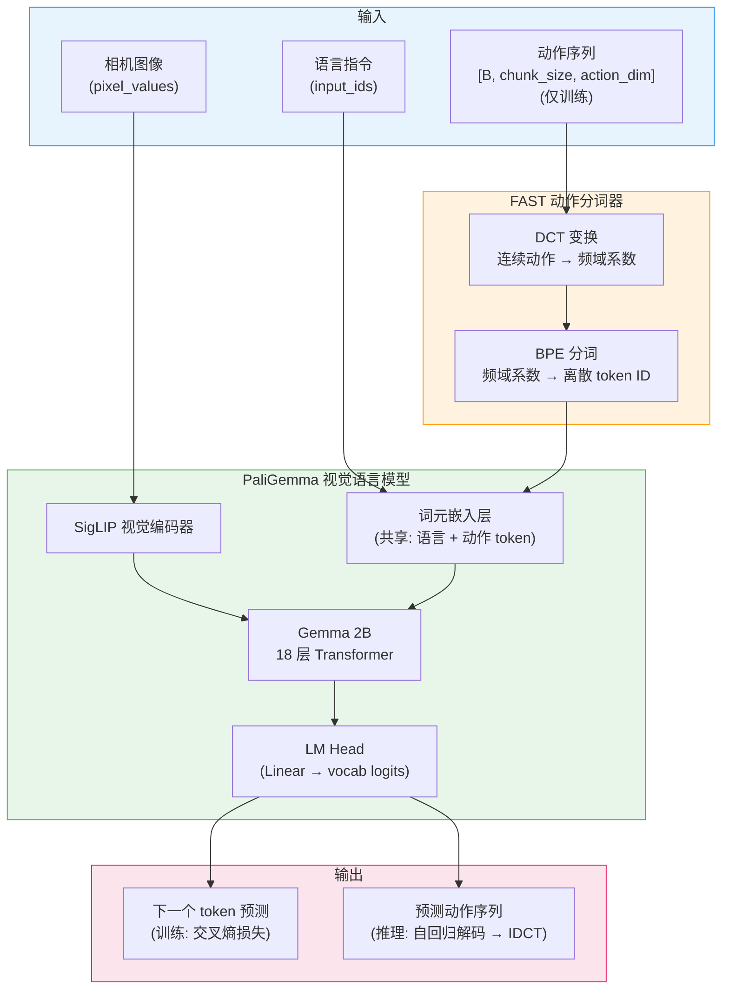
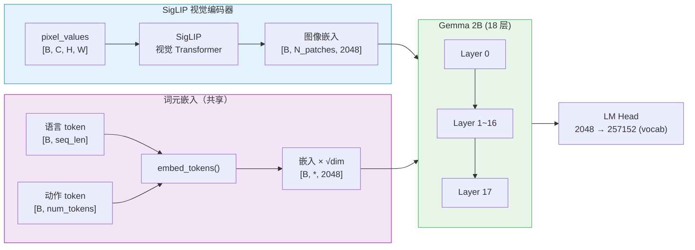
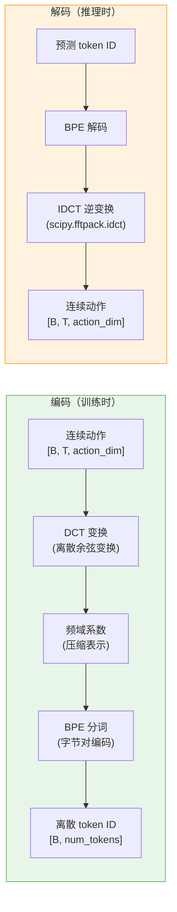
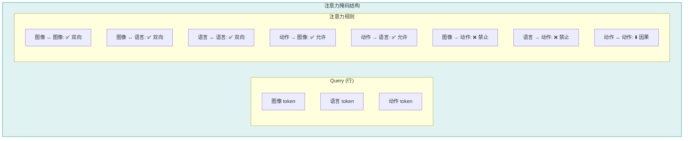
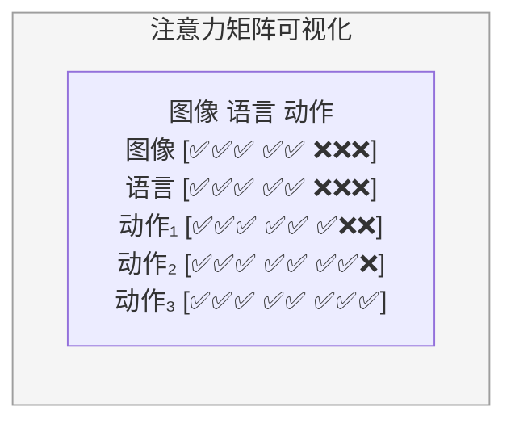
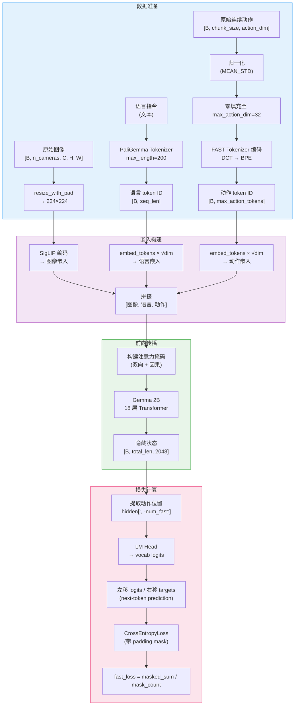
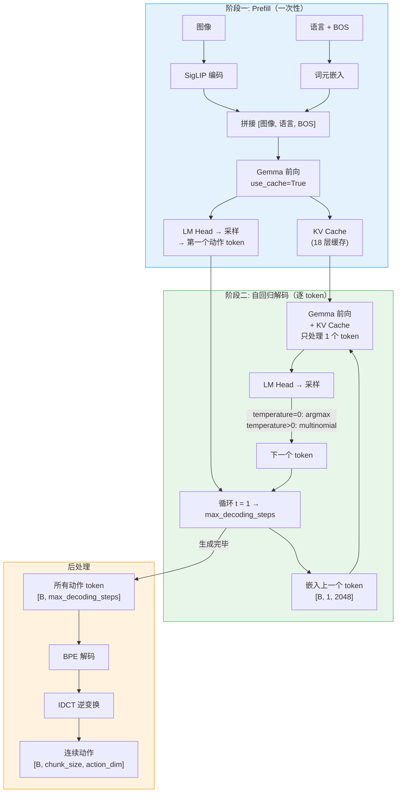
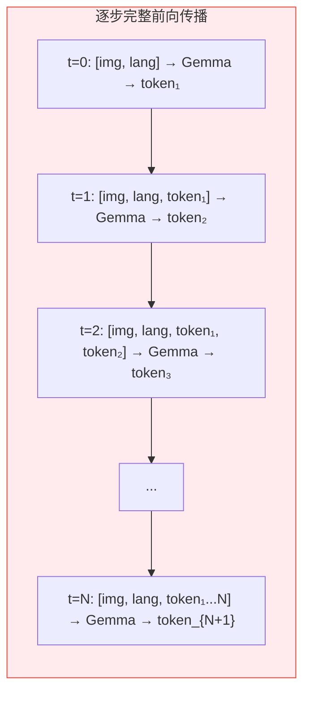
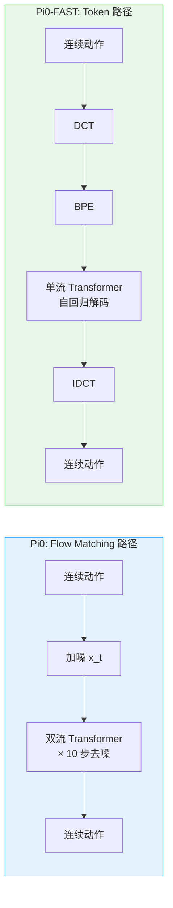

# Pi0-FAST 模型架构

## 1. 整体架构概览

Pi0-FAST (Fast Action Sequence Tokenizer) 是 Physical Intelligence 提出的一种高效视觉-语言-动作 (VLA) 模型。与 Pi0 使用 Flow Matching 扩散生成连续动作不同，Pi0-FAST **将连续动作离散化为 token**，然后通过 PaliGemma 视觉语言模型进行 **自回归 next-token 预测**。这种设计避免了多步去噪推理，实现了更快的动作生成。

核心思路：**连续动作 → DCT 变换 → BPE 分词 → 离散 token → 自回归预测**



---

## 2. 核心组件详解

### 2.1 PaliGemma 视觉语言模型

Pi0-FAST 使用 PaliGemma（SigLIP + Gemma）作为统一的视觉语言主干。**与 Pi0 不同，Pi0-FAST 没有独立的 Action Expert**——动作 token 直接复用语言模型的词元嵌入和 LM Head 进行预测。



**关键设计：**
- 动作 token 和语言 token **共享同一个嵌入层** (`embed_tokens`)
- 动作 token 和语言 token **共享同一个 LM Head** 进行预测
- 嵌入后乘以 `√hidden_dim` 进行缩放（与 Gemma 标准做法一致）
- 无需额外的状态投影或动作投影层

### 2.2 FAST 动作分词器 (Action Tokenizer)

FAST 分词器将连续动作序列转换为离散 token，是 Pi0-FAST 的核心创新。



**DCT 变换的优势：**
- 将时间域动作序列转换为频域系数，实现 **有损压缩**
- 低频成分（平滑运动）用少量系数即可表示
- 天然规避了连续值域的归一化和 padding 不稳定问题
- BPE 分词进一��将系数编码为可预测的离散 token

**Token 空间：**
- 总词表大小: 257,152（Gemma 原始词表）
- `fast_skip_tokens`: 128（跳过前 128 个 token）
- 最大动作 token 数: 256（`max_action_tokens`）

### 2.3 自定义注意力掩码

Pi0-FAST 使用精心设计的注意力掩码，确保图像/语言和动作 token 之间正确的信息流动。





**实现细节** (`_create_custom_attention_mask_fast`):
1. 初始化全零布尔掩码 `[B, total_len, total_len]`
2. 图像/语言段之间：设为 `True`（双向注意力）
3. 动作段 → 图像/语言段：设为 `True`（动作可看到观测）
4. 动作段内部：设下三角 `True`（因果注意力，自回归生成）
5. 最后与 padding mask 相交：`att_masks &= pad_2d_masks`

---

## 3. 训练流水线



**训练目标详解：**

```
输入 token:  [img_1, ..., img_N, lang_1, ..., lang_M, act_1, act_2, ..., act_{T-1}]
目标 token:  [                                         act_2, act_3, ..., act_T    ]
```

- logits 左移一位，targets 右移一位，实现 next-token prediction
- 只在动作 token 位置计算损失（图像和语言 token 不参与损失）
- 使用 `fast_action_masks` 屏蔽 padding token
- 损失函数：`CrossEntropyLoss(reduction="none")`，然后 mask 加权平均

---

## 4. 推理流水线

Pi0-FAST 支持两种推理模式：**无缓存** 和 **KV 缓存** 加速。

### 4.1 KV 缓存推理（默认，高效）



**KV 缓存优化要点：**
- Prefill 阶段：处理完整前缀序列，生成 KV Cache
- 解码阶段：每步只处理 **1 个新 token**，重用缓存的 K/V
- 注意力掩码：新 token 可注意到所有历���有效 token
- 复杂度从 O(T²) 降低到 O(T)（T = 总序列长度）

### 4.2 无缓存推理（简单但慢）



- 每步重新计算完整序列（无缓存复用）
- 序列逐步增长，注意力掩码动态扩展
- 仅作为参考实现，实际使用 KV 缓存版本

---

## 5. 与 Pi0 的关键区别

| 特性 | Pi0 | Pi0-FAST |
|---|---|---|
| **动作表示** | 连续值 (Flow Matching) | 离散 token (FAST Tokenizer) |
| **动作生成方式** | 迭代去噪 (10 步) | 自回归 next-token 预测 |
| **Action Expert** | 独立 Gemma 300M | 无（复用 PaliGemma） |
| **模型结构** | 双流 (PaliGemma + Expert) | 单流 (仅 PaliGemma) |
| **训练损失** | MSE (flow matching) | CrossEntropy (next-token) |
| **推理速度** | 10 次完整前向传播 | ~256 次轻量解码步 (KV cache) |
| **状态输入** | 投影到隐藏维 → suffix | 不直接使用（通过语言描述） |
| **归一化敏感性** | 高（MEAN_STD + padding 不稳定） | 低（token 化天然规避） |
| **Padding 问题** | 严重（30 维零值影响 flow matching） | 无（token 化后无连续 padding） |



---

## 6. 关键超参数

### 模型结构

| 参数 | 值 | 说明 |
|---|---|---|
| `paligemma_variant` | `gemma_2b` | PaliGemma 使用 Gemma 2B |
| Gemma 2B width | 2048 | 隐藏层维度 |
| Gemma 2B depth | 18 | Transformer 层数 |
| Gemma 2B mlp_dim | 16,384 | FFN 中间层维度 |
| Gemma 2B num_heads | 8 | 注意力头数 |
| Gemma 2B head_dim | 256 | 每头维度 |
| Gemma 2B num_kv_heads | 1 | GQA KV 头数 |
| 词表大小 | 257,152 | Gemma 原始词表 |

### 动作空间

| 参数 | 值 | 说明 |
|---|---|---|
| `chunk_size` | 50 | 预测动作步数 |
| `n_action_steps` | 50 | 执行动作步数 |
| `max_state_dim` | 32 | 状态向量填充维度 |
| `max_action_dim` | 32 | 动作向量填充维度 |
| `max_action_tokens` | 256 | 最大离散动作 token 数 |
| `fast_skip_tokens` | 128 | 跳过词表前 128 个 token |

### 推理参数

| 参数 | 值 | 说明 |
|---|---|---|
| `temperature` | 0.0 | 采样温度 (0=argmax) |
| `max_decoding_steps` | 256 | 最大自回归步数 |
| `use_kv_cache` | True | 启用 KV 缓存加速 |
| `validate_action_token_prefix` | True | 验证 "Action: " 前缀 |

### 训练参数

| 参数 | 值 | 说明 |
|---|---|---|
| `optimizer_lr` | 2.5e-5 | AdamW 学习率 |
| `optimizer_betas` | (0.9, 0.95) | Adam β 参数 |
| `optimizer_weight_decay` | 0.01 | 权重衰减 |
| `optimizer_grad_clip_norm` | 1.0 | 梯度裁剪阈值 |
| `scheduler_warmup_steps` | 1,000 | 预热步数 |
| `scheduler_decay_steps` | 30,000 | 余弦衰减总步数 |
| `scheduler_decay_lr` | 2.5e-6 | 最终学习率 |
| `tokenizer_max_length` | 200 | 语言 token 最大长度 |
| `image_resolution` | (224, 224) | 输入图像分辨率 |

---

## 7. 关键源文件

| 组件 | 类名 | 文件 |
|---|---|---|
| 策略封装 | `PI0FastPolicy` | `lerobot/policies/pi0_fast/modeling_pi0_fast.py:804` |
| 核心模型 | `PI0FastPytorch` | `lerobot/policies/pi0_fast/modeling_pi0_fast.py:278` |
| PaliGemma 封装 | `PI0FastPaliGemma` | `lerobot/policies/pi0_fast/modeling_pi0_fast.py:186` |
| Gemma 配置 | `GemmaConfig` / `get_gemma_config` | `lerobot/policies/pi0_fast/modeling_pi0_fast.py:150` |
| 配置类 | `PI0FastConfig` | `lerobot/policies/pi0_fast/configuration_pi0_fast.py:31` |
| 嵌入构建 | `embed_prefix_fast()` | `lerobot/policies/pi0_fast/modeling_pi0_fast.py:355` |
| 注意力掩码 | `_create_custom_attention_mask_fast()` | `lerobot/policies/pi0_fast/modeling_pi0_fast.py:443` |
| 训练前向 | `forward()` | `lerobot/policies/pi0_fast/modeling_pi0_fast.py:484` |
| 推理 (无缓存) | `sample_actions_fast()` | `lerobot/policies/pi0_fast/modeling_pi0_fast.py:583` |
| 推理 (KV 缓存) | `sample_actions_fast_kv_cache()` | `lerobot/policies/pi0_fast/modeling_pi0_fast.py:680` |
| 图像预处理 | `resize_with_pad_torch()` | `lerobot/policies/pi0_fast/modeling_pi0_fast.py:76` |
| FAST 分词器 | `physical-intelligence/fast` | HuggingFace Hub (外部) |
| 文本分词器 | `google/paligemma-3b-pt-224` | HuggingFace Hub (外部) |
