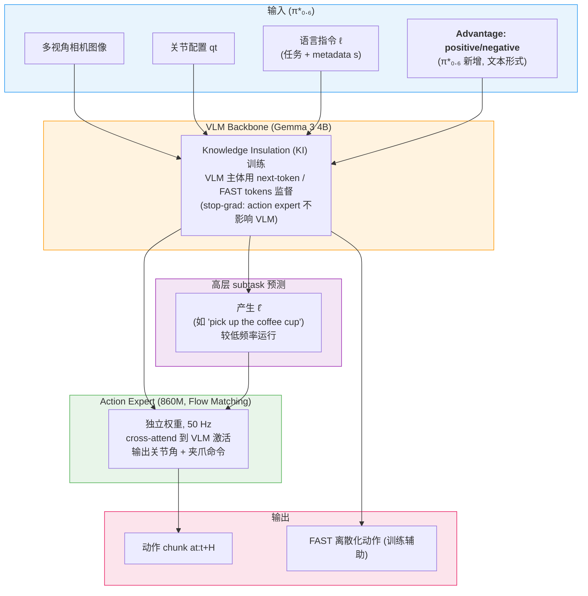
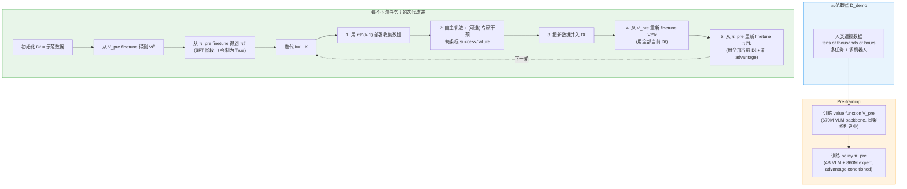

# π\*₀.₆ (Pi-Star-0.6) 训练范式与数据

π\*₀.₆ 是 Physical Intelligence 2025 年 11 月发布的 VLA（arXiv:2511.14759），核心不是新的网络主干，而是一种让 VLA 通过真实世界部署反复改进的训练方法 —— **RECAP**（**R**L with **E**xperience and **C**orrections via **A**dvantage-conditioned **P**olicies）。论文报告：在折叠衣物、纸箱装配、专业咖啡机操作这类长程灵巧任务上，RECAP 让吞吐量翻倍、失败率减半，在最难的任务上甚至能连续运行 13 小时不间断（咖啡机）或 2 小时（新住宅折衣）。

本文档因此把重心放在 **训练范式 + 数据组成**，架构部分只用一节带过（仍以 π₀.₆ 的 VLM + flow matching action expert 为底）。

---

## 1. 整体定位与论文出处

| 项目 | 内容 |
|---|---|
| 论文 | "π\*₀.₆: a VLA That Learns From Experience" |
| arXiv | [2511.14759](https://arxiv.org/abs/2511.14759)（2025-11-18） |
| 作者 | Physical Intelligence (~50 人) |
| 官方 blog | [pi.website/blog/pistar06](https://pi.website/blog/pistar06) |
| 模型 card | π₀.₆ Model Card（论文 ref [6]，未公开网址） |
| 代码 | **未公开**（OpenPI 中 π₀ / π₀.₅ / π₀-FAST 系列已开源，但 π₀.₆ 与 π\*₀.₆ 截至本文撰写时尚未发布） |
| 在 Pi 系列中的位置 | π₀ → π₀.₅ → **π₀.₆**（同期发布，下文称"base π₀.₆"）→ **π\*₀.₆**（RECAP 改造版） |

注意区分两个名字：

- **π₀.₆**：base 模型，是 π₀.₅ 的常规升级（数据扩量 + 更大 backbone + 更大 action expert），用监督学习训练。
- **π\*₀.₆**：在 π₀.₆ 基础上**增加了"advantage 条件化"输入**，使其能被 RECAP 用 offline RL 训练。星号代表"加了 advantage 输入的那一版"。

---

## 2. 网络架构（简短一节）

> ⚠️ **基于公开材料推测 + 论文有限披露**：底层架构沿用 π₀.₆ 的双流 Transformer + flow matching action expert，详见 [Pi0_Architecture.md](01.Pi0_Architecture.html) 与 [Pi0.5_Architecture.md](02.Pi0.5_Architecture.html)。π\*₀.₆ 相对 π₀.₆ 的唯一结构性改动是 **多一个 text 输入字段 "Advantage: positive/negative"**，不引入新的网络模块。



论文明确披露的架构数字：

- **VLM backbone**：Gemma 3 4B 模型（取代 π₀.₅ 中的更小 VLM）
- **Action expert**：860M 参数（π₀.₅ 中为 300M）
- **训练策略**：KI（Knowledge Insulation [73]）— action expert 通过 cross-attention 读取 VLM 激活，但梯度被 stop 阻断，VLM 仅靠离散 token 预测（含 FAST [77]）监督，避免 flow matching 噪声污染 VLM 表征
- **动作输出**：50 Hz 关节角 + 夹爪开合，chunk 长度 H
- **辅助输出**：每个 chunk 同时预测 (i) 下一个 subtask 文本 ℓ̂，(ii) FAST tokenized 动作（仅用于训练，推理不需要）

> ⚠️ **未在论文中明确**：action expert 的层数、hidden_dim、cross-attn 周期等细节。论文与 model card 用文字描述，未公布详细超参表。

advantage 输入位置（论文明确）：

> "Advantage" 字段以普通文本插入到 prompt 中，**位置在 subtask 文本 ℓ̂ 之后、动作之前**。这意味着只有动作 log-likelihood 受 advantage 影响。训练时随机 dropout 这个字段，使得同一模型既可在 "无 advantage" 模式下采样（β=1 等价），也可在 "advantage=positive" 模式下采样（推理时几乎总用 positive）。

---

## 3. 训练范式：RECAP（核心）

RECAP 的核心思想：**不用 PPO / REINFORCE 直接调 policy；改用 "advantage conditioning" — 训练时给 VLA 多一个文本输入告诉它"这条动作算好还是算坏"，部署时永远要它输出 positive 那种，policy 自然向高 advantage 倾斜**。

这避免了 flow matching 模型不可导 log-likelihood 的痛点，等价于 classifier-free guidance 的离散变体。

### 3.1 三个子过程



注意 **每轮都从 π_pre / V_pre finetune，而不是从上一轮模型**，论文说这样能避免多轮迭代的 drift。

### 3.2 Value function：distributional + time-to-success reward

reward 设计极简（论文 Eq. 5）：

```
r_t =  0         if t = T and success
       -C_fail   if t = T and failure
       -1        otherwise
```

也就是说 value 等于"到 success 还差几步"（成功），或一大负数（失败）。Value function 用 cross-entropy 在 **B=201 个离散 value bin** 上预测分布（distributional value function [72]）。

值函数本身是个独立的 VLM 模型：

- **VLM backbone**：Gemma 3 的更小版本，**670M 参数**（policy 用 4B）
- 与 policy 共享语言输入，但不带动作 expert
- 还用一小部分多模态 web 数据 co-train 防止 overfit
- 在 VLA 训练时 **on-the-fly** 推理 V，逐条 example 算 advantage，因此 6.7B 主模型训练时的额外开销可控

每个任务 ℓ 有自己的 **improvement threshold ϵℓ**：取 V 在该任务训练样本上的 30 百分位作为门槛。`It = 1[A(ot, at, ℓ) > ϵℓ]`，二值化的 advantage 就以 "Advantage: positive" / "Advantage: negative" 进入 prompt。

### 3.3 Policy 训练目标

end-to-end 训练同一个 policy 同时建模 πθ(a|o,ℓ) 和 πθ(a|I,o,ℓ)，靠在训练时随机 dropout 那个 advantage token：

```
min_θ E[ −log πθ(at | ot, ℓ) − α·log πθ(at | It, ot, ℓ) ]
```

这是 advantage-conditioned 版的 CFGRL [4]：

- 训练时一半样本带 advantage 标签、另一半不带 → 同一组权重既学到 unconditional 又学到 conditional
- 推理时把 advantage=positive 喂进去（β=1），policy 自然 sample 出高 advantage 动作
- 如果想更激进，可以做 CFG（β>1），用 conditional vs unconditional 的差值 guidance

实现上是离散 token 部分（subtask、FAST 动作）的 cross-entropy + 连续部分（flow matching）的 MSE 联合优化（论文 Eq. 4 给出一个 ELBO-style 下界）。

### 3.4 异构数据如何统一

RECAP 的另一个关键卖点：**示范、自主轨迹、专家干预这三类异构数据可以用同一目标函数训**，只是 advantage 标签来源不同：

- **示范**：所有动作强制 `It = True`（视作高 advantage）
- **自主轨迹**：每条动作的 `It` 由 value function 算出
- **专家干预**：所有动作强制 `It = True`（假设专家总是给出好的纠错动作）

整个 trajectory（不管是不是被干预过）都进入数据集 Dℓ，不区分对待。这相当于一个统一的 offline RL 框架，能同时吃 DAgger 风格的人类纠错和 BC 风格的示范。

---

## 4. 数据组成

### 4.1 预训练数据

继承 π₀.₅ 的 recipe（[Pi0.5_Architecture.md](02.Pi0.5_Architecture.html)）：

- **机器人示范数据**：来自数十种机器人平台 的"tens of thousands of hours"动作轨迹
- **视觉-语言 co-training 数据**：来自 web 的图文对，用于保持 VLM 的语言能力
- **subtask 标签**：每个动作 chunk 同时标注下一个高层 subtask 文本（如 "pick up the coffee cup"），供 KI recipe 训 VLM

π₀.₆ 相对 π₀.₅ 的数据增益：**多机器人平台数据更丰富**（论文未给具体小时数 / 平台清单）。

### 4.2 RECAP 阶段的异构数据

| 数据源 | 用途 | advantage 标签来源 |
|---|---|---|
| 示范 (demonstrations) | 提供初始策略 + SFT phase | 强制 `It = True` |
| 自主轨迹 (on-policy rollouts) | RL 改进信号 | value function 算 A，再二值化 |
| 专家干预 (human interventions) | 修复 catastrophic failure | 干预段强制 `It = True` |

具体数量级（论文 Sec. VI 报告）：

- **T-shirt/shorts 折衣任务**：每轮 4 个机器人收集 300 条自主轨迹，跑 2 轮
- **纸箱装配任务**：每轮 600 条自主 + 360 条带干预 = 960 条/轮，跑 2 轮
- **目标失败模式移除（strict T-shirt）**：2 轮，每轮 600 条

### 4.3 机器人平台

- 预训练：多种机器人（论文 Fig. 5 标注 "many different robots"，未列清单）
- 评估改进：**静态双臂系统**，两个 6-DoF 手臂 + 平行夹爪，50 Hz 关节控制，三相机（base 一个 + 两腕一个）

---

## 5. 任务与报告结果

### 5.1 评估任务

| 任务 | 时长上限 | 关键挑战 |
|---|---|---|
| Laundry (T-shirts/shorts) | 200 s | 从篮中取衣 → 抚平 → 折叠 → 摞到右上角 |
| Laundry (diverse, 11 类) | 500 s | 含毛巾、衬衫、毛衣、牛仔、polo、袜、内衣等；统计最难的 button-up 衬衫 |
| Laundry (strict target) | 200 s | 单件 T-shirt + 严格 success（领口必须朝上居中） |
| Cafe (double espresso) | 200 s | 拿粉碗 → 磨豆 → 压实 → 装机 → 取杯 → 出杯 → 上桌 |
| Box assembly | 600 s | 从平板纸 → 折成箱 → 贴标 → 放入指定 crate 位置 |

### 5.2 主要数字（论文 Fig. 7-8）

| 指标 | base π₀.₅ | base π₀.₆ | RL-pretrain π\*₀.₆ | offline RL + SFT | **π\*₀.₆ + RECAP (final)** |
|---|---|---|---|---|---|
| Diverse laundry throughput | 低 | 中 | 中 | 中 | **≈2× SFT baseline** |
| Espresso throughput | 低 | 中 | 中 | 中 | **≈2× SFT baseline** |
| Box assembly throughput | 低 | 中 | 中 | 中 | **≈2× SFT baseline (after 2 iters)** |
| Final success rate（多数任务） | < 90% | < 90% | < 90% | < 90% | **≥ 90%** |
| Strict T-shirt 严格 success | — | — | — | — | **97%**（2 轮迭代 + 600 条/轮，无人干预） |

实际部署强度：

- **咖啡机**：连续运行 13 小时不停机
- **新住宅折衣**：2 小时 + 无干预
- **纸箱装配**：用于真实工厂打包流程

### 5.3 方法对比（论文 Fig. 11）

在 T-shirts/shorts 任务上，用同样的 RECAP-collected 数据，对比三种 policy extraction：

- **PPO（small trust region η=0.01）**：训得稳但提升微弱，论文认为是 flow matching 模型 PPO 难以稳定
- **AWR**：能涨 success rate，但 policy 速度变慢、throughput 反而下降
- **RECAP（advantage conditioning）**：throughput 最高，明显优于另两者

---

## 6. 与 Pi 系列前作的差异

| 项目 | π₀ | π₀.₅ | π₀.₆ (base) | π\*₀.₆ (RECAP) |
|---|---|---|---|---|
| **VLM backbone** | PaliGemma (Gemma 2B) | PaliGemma-ish | **Gemma 3 4B** | Gemma 3 4B |
| **Action expert** | 300M | 300M | **860M** | 860M |
| **训练方式** | 监督 (BC) | 监督 + KI | 监督 (含 KI / FAST) | **+ offline RL via advantage conditioning** |
| **数据组成** | 示范 | 示范 + web VL | 示范 (扩量) + web VL | + on-policy + 干预 |
| **conditioning 输入** | 任务文本 | 任务 + subtask ℓ̂ | + metadata s | **+ "Advantage: positive/neg"** |
| **value function** | — | — | — | **distributional, 670M VLM, 201 bins, 多任务** |
| **改进机制** | 无 | 无 | 无 | iterated offline RL（外加 SFT 启动） |
| **复杂任务上限** | 短程灵巧 | 中长程 | 中长程 | **长程实战级**（13h espresso, 2h 折衣） |

---

## 7. 关键事实点的来源标注

> 这一节用于区分"代码或论文直接陈述的事实" vs "由论文文本推测、由架构延续性外推的事实"。π\*₀.₆ 与 π₀.₆ 均未公开代码，所有架构数字均来自论文 / blog 描述。

| 事实点 | 来源 | 备注 |
|---|---|---|
| RECAP 三步循环（数据收集 → V 训练 → π 训练 + advantage cond.） | ✅ 论文 Sec. IV / Algorithm 1 | 明确 |
| Advantage 二值化 + 文本 "positive/negative" 注入 prompt | ✅ 论文 Sec. V-B | 明确 |
| ϵℓ = 30 percentile of V on task ℓ | ✅ 论文 Sec. V-D | 明确 |
| Value function = distributional, 201 bins, 670M VLM | ✅ 论文 Sec. V-C | 明确 |
| Policy backbone = Gemma 3 4B, action expert = 860M | ✅ 论文 Sec. V-A + π₀.₆ model card | 明确 |
| KI 训练范式 + stop-grad + FAST tokens | ✅ 论文 Sec. V-A（refs [73, 77]） | 明确 |
| 50 Hz 关节控制 + 双 6-DoF 臂 + 三相机 | ✅ 论文 Fig. 5 | 明确（评估系统） |
| 13 小时 espresso、2 小时 folding 实测 | ✅ 论文 Sec. I | 明确 |
| Throughput ≈2×、failure rate ≈½ | ✅ 论文 Sec. VI-C / Fig. 7-8 | 明确 |
| Pre-train 数据规模 "tens of thousands of hours" | ✅ 论文 Sec. IV-C | 数值描述 |
| ⚠️ Action expert 的层数 / hidden_dim / cross-attn 周期 | ⚠️ **论文未公开** | 推测沿用 π₀.₅ 设计 |
| ⚠️ flow matching 步数 / Beta 采样分布 | ⚠️ **论文未公开** | 推测沿用 π₀ 系列（10 步 + Beta-shaped） |
| ⚠️ VLM 是否完全 frozen vs 顶层 finetune | ⚠️ **论文未明确**（"KI"只是说梯度从 action expert 不流回 VLM；VLM 自身用 token-pred loss 是否更新需看 model card） | model card 未公开 |
| ⚠️ value function 是否 share weights with policy VLM | ⚠️ 论文 Sec. V-C 说"same architecture design, smaller backbone, initialized from Gemma 3" | 独立模型而非共享 |
| ⚠️ pre-train 中"more robot platforms"具体清单 | ⚠️ 论文仅文字描述 | 未给清单 |

---

## 8. 参考资料

- 论文：[arXiv:2511.14759 — π\*₀.₆: a VLA That Learns From Experience](https://arxiv.org/abs/2511.14759)
- 官方 blog：[pi.website/blog/pistar06](https://pi.website/blog/pistar06)
- 前作 π₀ / π₀.₅ / π₀-FAST 的架构详解：[Pi0_Architecture](01.Pi0_Architecture.html) / [Pi0.5_Architecture](02.Pi0.5_Architecture.html) / [Pi0-FAST_Architecture](03.Pi0-FAST_Architecture.html)
- 后续 π₀.₇：[Pi0.7_Architecture](05.Pi0.7_Architecture.html)（同期 blog [pi.website/pi07](https://pi.website/pi07)）
- 相关方法 CFGRL：[Frans et al. 2025, arXiv:2505.23458](https://arxiv.org/abs/2505.23458)
- KI 训练范式：π₀.₅ 论文 / Knowledge Insulation [73]
- FAST 离散化：[Pertsch et al. 2025](https://arxiv.org/abs/2501.09747)
