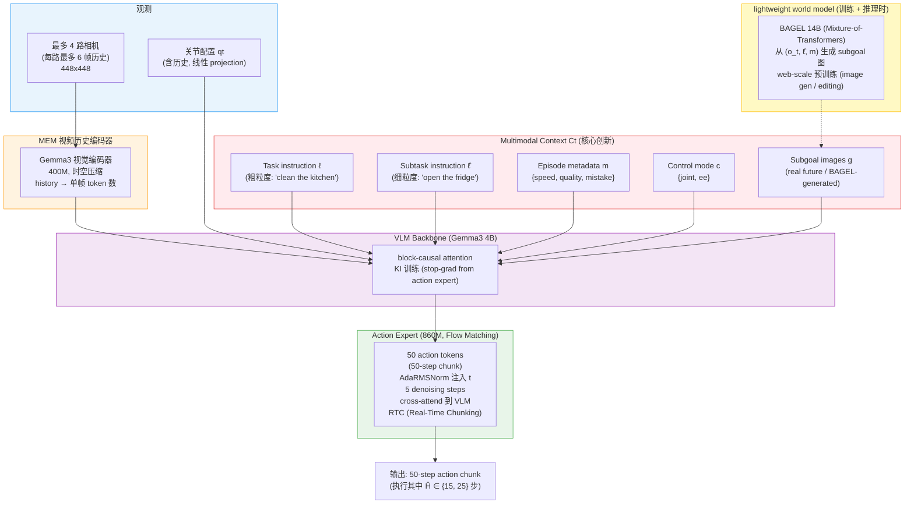

# π₀.₇ (Pi-0.7) 训练范式与数据

π₀.₇ 是 Physical Intelligence 2026 年 4 月发布的 VLA（arXiv:2604.15483），定位为 **"steerable generalist robotic foundation model"**。它最大的卖点不在新主干，而是在 **prompt 里塞进了多模态 context conditioning**：除了语言指令，还给模型喂 episode metadata（速度 / 质量 / 是否出错 / 控制模式）+ 一/多张 subgoal images（由 BAGEL 14B 世界模型生成）。这套 prompt 设计让模型可以同时吃下示范、(suboptimal) 自主轨迹、人类纠错、网络视频、非机器人数据等异构源，而不会被低质量数据拖垮。

模型本身（5B 总参，4B Gemma3 VLM + 860M flow matching action expert + MEM 历史编码器）在 π₀.₆ 之上加了 multi-modal context conditioning 与历史压缩，本文档因此把重心放在 **训练范式 + 数据**，架构部分仅在第 2 节作为一节带过。

---

## 1. 整体定位与论文出处

| 项目 | 内容 |
|---|---|
| 论文 | "π₀.₇: a Steerable Generalist Robotic Foundation Model with Emergent Capabilities" |
| arXiv | [2604.15483](https://arxiv.org/abs/2604.15483)（2026-04-16） |
| 作者 | Physical Intelligence (~80 人) |
| 官方 blog | [pi.website/blog/pi07](https://www.pi.website/blog/pi07) / [pi.website/pi07](https://pi.website/pi07) |
| 代码 | **未公开**（OpenPI 中目前到 π₀ / π₀.₅ / π₀-FAST，π₀.₆ / π\*₀.₆ / π₀.₇ 均无开源实现） |
| 在 Pi 系列中的位置 | π₀ → π₀.₅ → π₀.₆ → π\*₀.₆ → **π₀.₇** |

π₀.₇ 想解决的问题用一句话：**"naive 地把异构数据（含 failure、自主轨迹）扔进一个模型训出来的策略会向所有 mode 平均，结果一塌糊涂。"** 解法不是过滤数据，而是**给每条数据贴标签**，让模型在训练时学到"这条数据是用什么策略 / 多快 / 多准确做出来的"，在推理时用 prompt 显式要求"只走 quality=5、mistake=false 的那种"。

---

## 2. 网络架构（简短一节）

> ⚠️ **架构是 π₀.₆ + MEM + 多模态 context 的组合**，论文 Sec. VI-B 给出明确数字（5B 总参、4B Gemma3 backbone、860M action expert）。下游细节未公开（cross-attn 周期、layer 数等）见 [Pi0_Architecture.md](01.Pi0_Architecture.html) 与 π₀.₆ 论文 [42]；MEM 视频历史编码器见 [arXiv 引用 [37]](https://arxiv.org/abs/2503.04822)。



论文明确披露的架构数字：

| 模块 | 参数 | 来源 |
|---|---|---|
| 总参数 | ~5B | Sec. VI-B |
| VLM backbone | Gemma3 4B（含 400M 视觉编码器） | Sec. VI-B |
| Action expert | 860M | Sec. VI-B |
| MEM 历史编码器 | 与 vision encoder 共享，时空压缩 | Sec. VI-B + ref [37] |
| BAGEL 世界模型 | **14B, Mixture-of-Transformers** | Sec. V-B + ref [105] |
| 相机数 | 最多 4 路（front + 2 wrist + optional rear） | Sec. VI-B |
| 历史帧 | 最多 6 帧 / 路，stride 1 s，整体 dropout=0.3 | Sec. VI-B |
| 输入分辨率 | 448 × 448 | Sec. VI-B |
| 动作 chunk 长 | 50 步 | Sec. VI-B |
| Denoising steps | 5（推理） | Sec. VII |
| 执行步数 | 15 或 25（取决于任务） | Sec. VII |
| 控制频率 | 50 Hz（多数）/ 20 Hz（UR5e） | Sec. VIII |
| RTC 训练延迟模拟 | 0–12 timesteps（即 240 ms @50 Hz） | Sec. VI-B |

新增 vs π₀.₆：

- **MEM 视频历史编码器**（[ref 37]）— 把多帧历史压缩成单帧 token 数，使训练时帧数变化不影响 token 数
- **State 编码改用 linear projection**（π₀.₆ 用离散 token），每个历史帧的 state 是独立 token
- **block-causal attention mask**：观测 + subgoal 图 token 在内部双向 attend；后续文本 token 用 causal
- **AdaRMSNorm** 注入 flow matching timestep（替代 AdaLN）
- **Real-time action chunking (RTC)** — 训练时模拟 0-12 步推理延迟，使推理时即便延迟也能给出平滑动作

> ⚠️ **架构推测**：action expert 内部 layer 数、hidden_dim、与 VLM 的 cross-attn 周期等论文未公布。CFG（classifier-free guidance）权重 β ∈ {1.3, 1.7, 2.2} 在 episode metadata 上施加，是明确披露。

---

## 3. 训练范式：diverse context conditioning（核心）

### 3.1 prompt 结构

每条训练样本的 prompt 长这样（论文 Sec. V-E 原例）：

```
<Multi-view observation> <Multi-view subgoals>
Task: peel vegetables.
Subtask: pick up the peeler.
Speed: 8000.  Quality: 5.  Mistake: false.
Control Mode: joint.
<Proprioception>
```

5 个组件：

1. **Task instruction ℓ** — 粗粒度任务描述（e.g. "clean the kitchen"）
2. **Subtask instruction ℓ̂** — 细粒度当前 step（e.g. "open the fridge door"）
3. **Subgoal images g** — 1～n 张未来期望状态图（多视角），来自 (a) 训练集的未来真实帧，或 (b) BAGEL 世界模型生成
4. **Episode metadata m** — 3 维：speed / quality / mistake
5. **Control mode c** — `{joint, ee}` 二值

训练时 **每个组件独立随机 dropout**，使同一组权重既能在 "只给任务" 模式跑、也能在 "任务+metadata+subgoal" 模式跑：

| 组件 | dropout 率 | 备注 |
|---|---|---|
| Subgoal images（整体） | 训练时只 25% 样本含 subgoal | 否则太"作弊"（变成 inverse dynamics） |
| Subtask instruction ℓ̂（仅在含 subgoal 时） | 30% | subgoal 已经含 subtask 语义 |
| Episode metadata（整体） | 15% | 训练 unconditional 分支 |
| 单个 metadata 分量（speed / quality / mistake） | 各 5% | 训练 partial conditioning |
| Control mode | **不 dropout** | 必须始终给定 |
| 整段历史帧 | 30% | 让模型对帧数变化鲁棒 |
| Rear view（若有） | 30% | 不同机器人是否带 rear cam 不同 |

### 3.2 metadata 的具体定义

| 字段 | 取值 | 用途 |
|---|---|---|
| Overall speed | episode 步数（整数，以 500 步为 bin） | 长 = 慢；短 = 快 |
| Overall quality | 1–5 整数 | 人工评分，5 为最高 |
| Mistake | bool（per segment） | 该段内是否有错误（如抓空、做错 subtask） |

**推理时怎么设置**（论文 Sec. VII）：

- speed = 该任务训练集中 15 百分位的步数（要求"接近最快"）
- quality = 5（永远要最高）
- mistake = false（永远要无错）

这是把"出错的训练样本"留在数据集里、但只在 mistake=true 时学到那种行为；推理时永远不要它。

### 3.3 Subgoal image 训练方式

世界模型 gψ 用 BAGEL 14B 初始化（image editing / gen 大模型），目标函数是标准 flow matching loss：

```
max EDg [ L_CFM (g*, gψ(o, ℓ̂, m)) ]
```

其中 g* 是 episode 末尾的真实帧。 训练数据：高质量子集 + web 图像数据 + egocentric 人类视频（共享视觉概念）。

VLA 训练 subgoal 通道时混合两类输入：

- **0.25 概率**：取 episode 末尾的真实帧（与世界模型预测目标一致）
- **0.75 概率**：取未来 0–4 秒内的随机真实帧
- **额外**：在 batch 中加入由 gψ 生成的合成 subgoal，以减小 train/test 分布偏移

推理时：sub-goal 在 (i) subtask ℓ̂ 变化时，或 (ii) 距上次生成 ≥ 4 s 时刷新；用异步线程跑，不阻塞 50 Hz 动作循环。

### 3.4 CFG（classifier-free guidance）于 metadata

由于训练时 metadata 有 dropout，同一组权重既学到 conditional 也学到 unconditional 模式，因此能做 CFG：

```
∇log πθ(a|o, Ct) + β·(∇log πθ(a|o, Ct) − ∇log πθ(a|o, Ct_uncond))
```

β ∈ {1.3, 1.7, 2.2} — 在 metadata 上施加 guidance，用于强化 high-quality / high-speed 的动作风格。

### 3.5 知识隔离 (KI) 沿用

VLM backbone 用 next-token / FAST tokens 的 cross-entropy 监督；action expert 用 flow matching MSE。Action expert 通过 cross-attn 读取 VLM 激活，**但梯度不回传 VLM**（stop-grad）。这套从 π₀.₅ 延续到 π₀.₆ 再到 π₀.₇ 没变。

---

## 4. 数据组成

π₀.₇ 训练数据是 Pi 系列里最丰富的一次，按 "context 怎么给" 划分而非按"数据源"划分。

### 4.1 数据源清单（论文 Sec. VI-A）

| 数据源 | 用途 / 标注 |
|---|---|
| **示范数据** | 多机器人平台（静态/移动、单/双臂、in-house/in-the-wild 家庭环境）的标准 BC 数据 |
| **大量自主评估数据** | 来自历代 Pi 模型评估时收集的 rollouts（含 failure）— 用 metadata 标签区分质量 |
| **人类干预数据** | DAgger-style 实时纠错 |
| **开源机器人数据集** | 类似 OXE 风格的公开 cross-embodiment 数据 |
| **egocentric 人类视频** | 没有动作标签，做 vision representation co-training |
| **非机器人数据 (web)** | 物体定位、属性预测、VQA、纯文本预测 |
| **video-language** | 室内机器人视频 captioning + web 视频 |

最关键的策略：**把 π\*₀.₆ 的 RL 训练 rollouts 作为"高质量 autonomous data"喂进 π₀.₇**，等价于把 RL specialist 的能力 distill 进 generalist。这就是为什么 π₀.₇ 能在 espresso、box building、folding 等任务上**直接 out-of-the-box 匹敌 π\*₀.₆ specialist**（论文 Fig. 6）。

### 4.2 评估机器人平台（论文 Sec. VIII）

| 平台 | 控制频率 | 训练数据量 |
|---|---|---|
| Bimanual mobile manipulator (2×6 DoF + lift + holonomic base) | 50 Hz | 多 |
| Static bimanual ("BiPi", 2×6 DoF + 1 DoF lift) | 50 Hz | 多 |
| Bimanual UR5e (Robotiq) | 20 Hz | **零**（用于 cross-embodiment 测试） |
| Single-arm (BiPi-like single) | 50 Hz | 中 |

UR5e 是**故意留作 zero-shot cross-embodiment 测试**——没有任何 UR5e 上的折衣数据，但 π₀.₇ 仍能完成。

---

## 5. 任务与报告结果

### 5.1 Out-of-the-box dexterity（论文 Sec. IX-A, Fig. 6）

直接拿单个 π₀.₇ 模型测，对比 π\*₀.₆ 的任务专用 RL specialist：

| 任务 | π\*₀.₆ specialist | π₀.₇ (no finetune) | 备注 |
|---|---|---|---|
| Laundry (T-shirts/shorts) | 高 | **≈ specialist** | |
| Laundry (diverse, hardest item) | 高 | **超过 specialist throughput** | |
| Espresso | 高 | **≈ specialist** | 单杯成功率匹敌 |
| Box building | 高 | **超过 specialist throughput** | |
| PB sandwich, shirt inside-out, drive through door, slice zucchini, peel veg, take out trash | (SFT specialist) | **匹敌 SFT specialist** | bottom row Fig. 6 |

### 5.2 Instruction following（Sec. IX-B）

- **14 个 instruction-following 场景**，跨 4 个未见过的厨房 + 2 个未见过的卧室，每场景 3-6 步指令链 → π₀.₇ 显著超越 π₀.₅ / π₀.₆
- **Complex referential 指令**（"pick up the object I would use to eat soup"、"pick up the fruit on the largest plate"）→ π₀.₇ 比 π₀.₅/₀.₆ 强；加上 subgoal images (π₀.₇ (GC)) 再涨
- **Reverse bias tasks**（"Reverse Bussing"、"Reverse Fridge to Microwave"）— 反训练集偏置的指令；π₀.₇ 能跟，GC 版（带 subgoal）在 "Reverse Fridge to Microwave" 上是 critical

### 5.3 Cross-embodiment（Sec. IX-C）

| Source → Target | π₀.₅ | π₀.₆ | **π₀.₇** | π₀.₇ (GC) |
|---|---|---|---|---|
| Mixed → static bimanual (Table Setting) | 强 | 强 | 强 | — |
| UR5e → static bimanual (Bag in Backpack, Tupperware) | 弱 | 强 | 强 | — |
| Static bimanual → UR5e (Shirt Bagging) | 弱 | 中 | **强** | — |
| Static bimanual → UR5e (Laundry folding) | — | — | **强** | **匹敌人类首次遥操** |

最关键的实验：折衣数据完全没有 UR5e 上的，但 π₀.₇ 能完成，**task progress 匹敌经验丰富的人类操作员首次遥操 UR5e 的水平**。

### 5.4 Memory tasks（Sec. IX-A）

不需要 finetune，π₀.₇ 在 MEM 论文里的 4 个 memory 任务上匹敌或超过专门 finetune 过的 π₀.₆-MEM specialist（Swap 3 Mugs / Find Object / Scoop Coffee / Window Cleaning）。

### 5.5 Compositional generalization（emergent）

通过 language coaching + subgoal images，π₀.₇ 能完成训练集里**完全没有**的任务，例如：

- 加载红薯进 air fryer（训练集无 air fryer 任务）
- 操作完全未见过的 kitchen appliance

这是 blog 上着重强调的 "compositional generalization" emergent ability。

### 5.6 Ablation（Sec. IX-A, Fig. 7）

| Ablation | 影响 |
|---|---|
| π₀.₇ (no metadata) | 全任务下降，差距主要在 throughput |
| π₀.₇ (no eval data) | 全任务下降，无法 distill π\*₀.₆ RL specialist 的能力 |
| 完整 π₀.₇ | 最佳 |

结论：**multimodal context conditioning 是必要的**——它让模型能区分异构数据中的"好"与"坏"段，从而吃下 evaluation data（含 failure）而不被拖垮。

---

## 6. 与 Pi 系列前作的差异

| 项目 | π₀.₅ | π₀.₆ | π\*₀.₆ | **π₀.₇** |
|---|---|---|---|---|
| **VLM backbone** | PaliGemma 风 | Gemma3 4B | Gemma3 4B | Gemma3 4B (含 400M vision) |
| **Action expert** | 300M | 860M | 860M | 860M |
| **总参数** | <3B | ~5B | ~5B | **5B + 14B BAGEL world model**（推理时 14B 单独跑） |
| **训练方式** | BC + KI | BC + KI + FAST | + offline RL (advantage cond.) | BC + KI + **multimodal context** |
| **历史压缩** | — | — | — | **MEM 视频历史编码器** |
| **State 输入** | 离散 token | 离散 token | 离散 token | **linear projection** |
| **prompt 内容** | 任务 + subtask | + metadata s | + "Advantage: ±" | **+ metadata {speed, quality, mistake} + control mode + subgoal images** |
| **subgoal image** | — | — | — | **多视角 + BAGEL 生成** |
| **数据组成** | 示范 + web VL | + 多平台扩量 | + RECAP rollouts + 干预 | **+ 大量 eval rollouts + 非机器人 video + egocentric 人类** |
| **CFG** | 否 | 否 | 是（advantage） | **是（metadata, β=1.3/1.7/2.2）** |
| **flow matching steps** | (10) | (未公开) | (未公开) | **5** |
| **action chunk** | 50 | 50 | 50 | **50 (执行 15-25 步)** |
| **RTC（real-time chunking）** | 否 | 否 | 否 | **是（训练时模拟 0-12 步延迟）** |
| **跨形态泛化能力** | 弱 | 中 | 中 | **强（含 UR5e zero-shot 折衣）** |
| **指令鲁棒性** | 中 | 中 | 中 | **强（含 reverse-bias 任务）** |

---

## 7. 关键事实点的来源标注

> π₀.₇ 未公开代码，所有架构数字均来自论文文本 / 官方 blog。

| 事实点 | 来源 | 备注 |
|---|---|---|
| Prompt 5 组件结构（task / subtask / metadata / control / subgoal） | ✅ 论文 Sec. V | 明确 |
| Episode metadata 3 字段（speed / quality / mistake）+ 推理设值 | ✅ 论文 Sec. V-C + Sec. VII | 明确 |
| dropout 率（subgoal 25%、metadata 15%、各分量 5%、history 30%） | ✅ 论文 Sec. V-E + Sec. VI-B | 明确 |
| VLM = Gemma3 4B、action expert = 860M、总 5B | ✅ 论文 Sec. VI-B | 明确 |
| BAGEL 14B Mixture-of-Transformers 作世界模型 | ✅ 论文 Sec. V-B + ref [105] | 明确 |
| MEM 历史编码器（时空压缩，单帧 token 数） | ✅ 论文 Sec. VI-B + ref [37] | 明确（细节见 MEM 论文） |
| 4 路相机 / 6 帧 history / 448×448 / stride 1s | ✅ 论文 Sec. VI-B | 明确 |
| 50 action token / 5 denoising steps / 执行 15 或 25 步 | ✅ 论文 Sec. VI-B + VII | 明确 |
| AdaRMSNorm 注入 flow matching t | ✅ 论文 Sec. VI-B | 明确 |
| State 改用 linear projection（vs π₀.₆ 的离散 token） | ✅ 论文 Sec. VI-B | 明确 |
| Block-causal attention mask | ✅ 论文 Sec. VI-B + appendix | 明确 |
| RTC（Real-Time Chunking）模拟 0-12 步延迟 | ✅ 论文 Sec. VI-B + refs [107, 108] | 明确 |
| CFG on metadata, β ∈ {1.3, 1.7, 2.2} | ✅ 论文 Sec. VI-B | 明确 |
| Subgoal 训练混合（0.25 末尾真实帧 + 0.75 未来 0-4s 真实帧 + 合成） | ✅ 论文 Sec. VI-C | 明确 |
| Subgoal 推理刷新（ℓ̂ 变化或 ≥4s 间隔，异步线程） | ✅ 论文 Sec. VII Algorithm 1 | 明确 |
| 50 Hz（多数）vs 20 Hz (UR5e) | ✅ 论文 Sec. VIII | 明确 |
| 包含 π\*₀.₆ RL rollouts 作为训练数据 | ✅ 论文 Sec. VI-A | 明确（distillation） |
| Out-of-the-box 在 espresso / box / laundry 匹敌或超过 π\*₀.₆ specialist | ✅ 论文 Fig. 6 | 明确 |
| UR5e zero-shot 折衣匹敌人类首次遥操 | ✅ 论文 Sec. IX-C + Fig. 12 | 明确 |
| ⚠️ Action expert 内部 layer 数 / hidden_dim / cross-attn 周期 | ⚠️ **论文未公开** | 推测沿用 π₀.₆ |
| ⚠️ MEM 视觉编码器具体压缩比 / temporal pooling 方式 | ⚠️ **本论文未细化**，需查 MEM 论文 [37] | |
| ⚠️ BAGEL 是否 fine-tune 还是只调 adapter | ⚠️ **论文未明确**（说 "augmenting world model training with..." 暗示有训练，但是否 full FT 未说） | 推测：至少 LoRA / adapter |
| ⚠️ 训练数据总小时数 / 各数据源占比 | ⚠️ 论文仅文字描述 | 未给具体小时数 |
| ⚠️ 各 ablation 的 % 损失数字 | ⚠️ 论文 Fig. 7 仅给柱状图，未列绝对数字 | 见 paper PDF |

---

## 8. 参考资料

- 论文：[arXiv:2604.15483 — π₀.₇: a Steerable Generalist Robotic Foundation Model](https://arxiv.org/abs/2604.15483)
- 官方 blog：[pi.website/blog/pi07](https://www.pi.website/blog/pi07) ／ [pi.website/pi07](https://pi.website/pi07)
- 前作架构详解：[Pi0_Architecture](01.Pi0_Architecture.html) / [Pi0.5_Architecture](02.Pi0.5_Architecture.html) / [Pi0-FAST_Architecture](03.Pi0-FAST_Architecture.html) / [Pi-Star-0.6_Architecture](04.Pi-Star-0.6_Architecture.html)
- MEM 视频历史：论文 ref [37]（π₀.₆-MEM）
- BAGEL 世界模型：论文 ref [105]
- KI training recipe：论文 ref [103]，最早见于 π₀.₅
- FAST tokenizer：[Pertsch et al. 2025](https://arxiv.org/abs/2501.09747)
- RTC (Real-Time Chunking)：论文 refs [107, 108]
