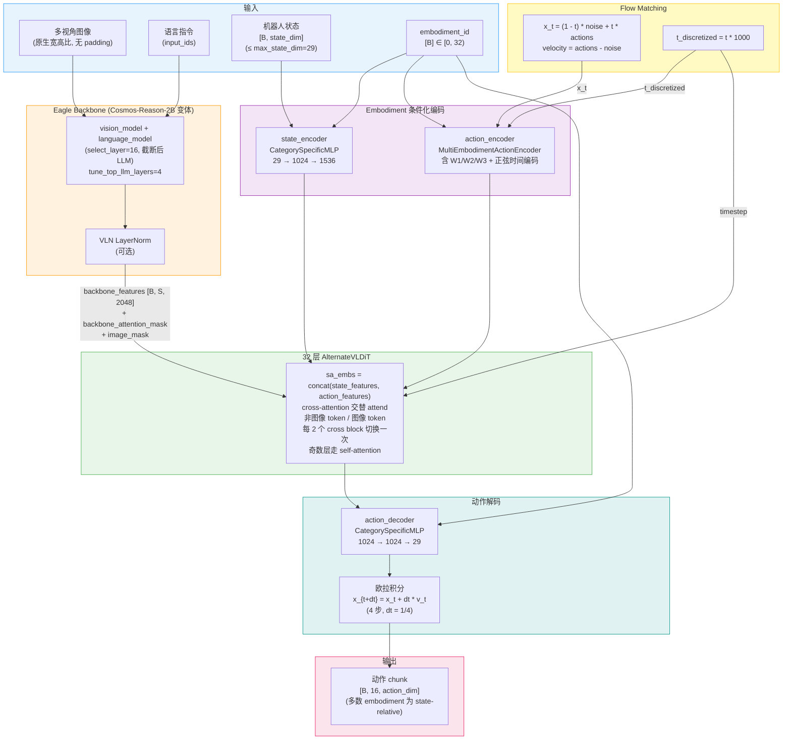
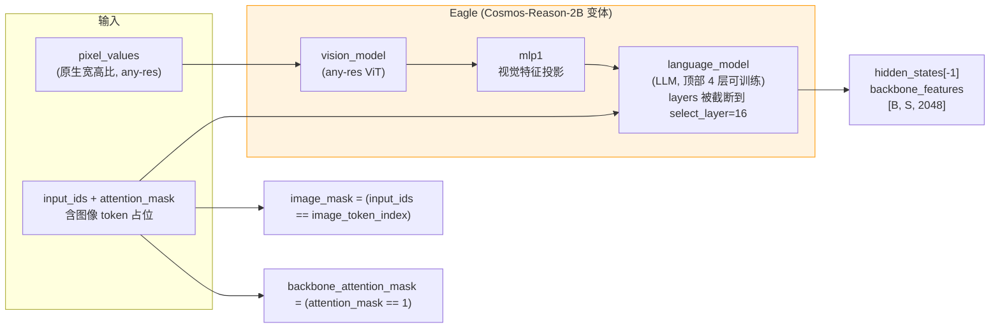
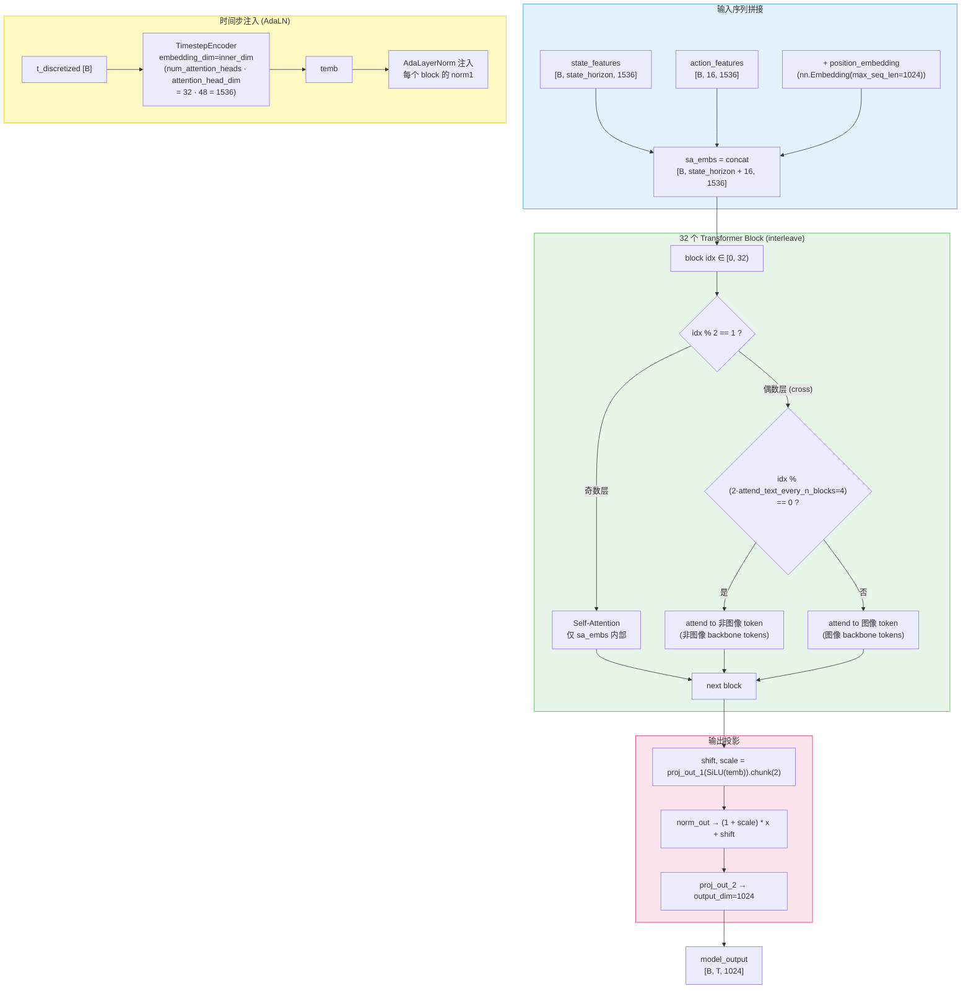
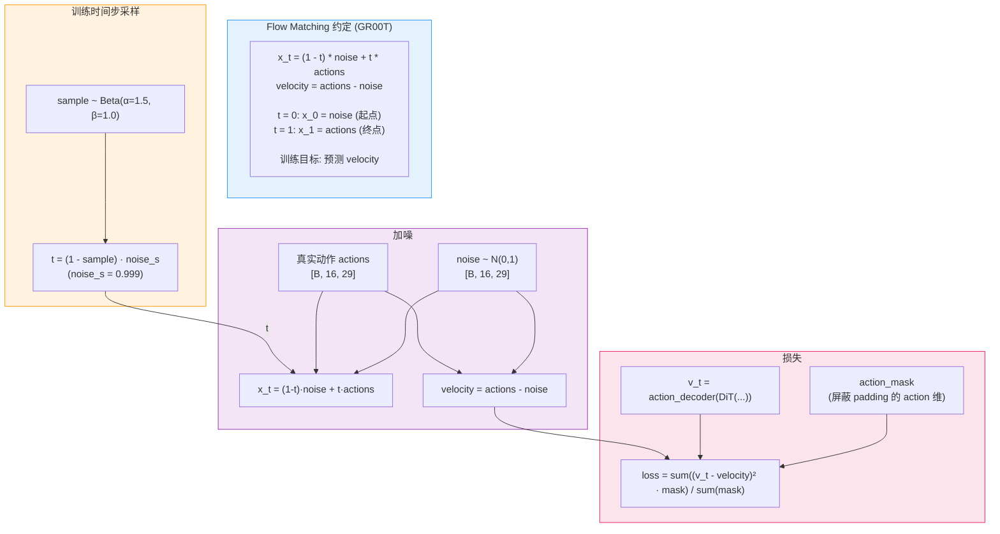
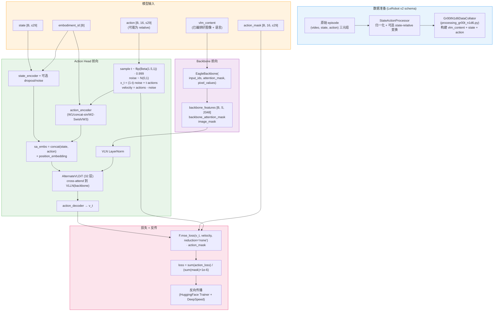
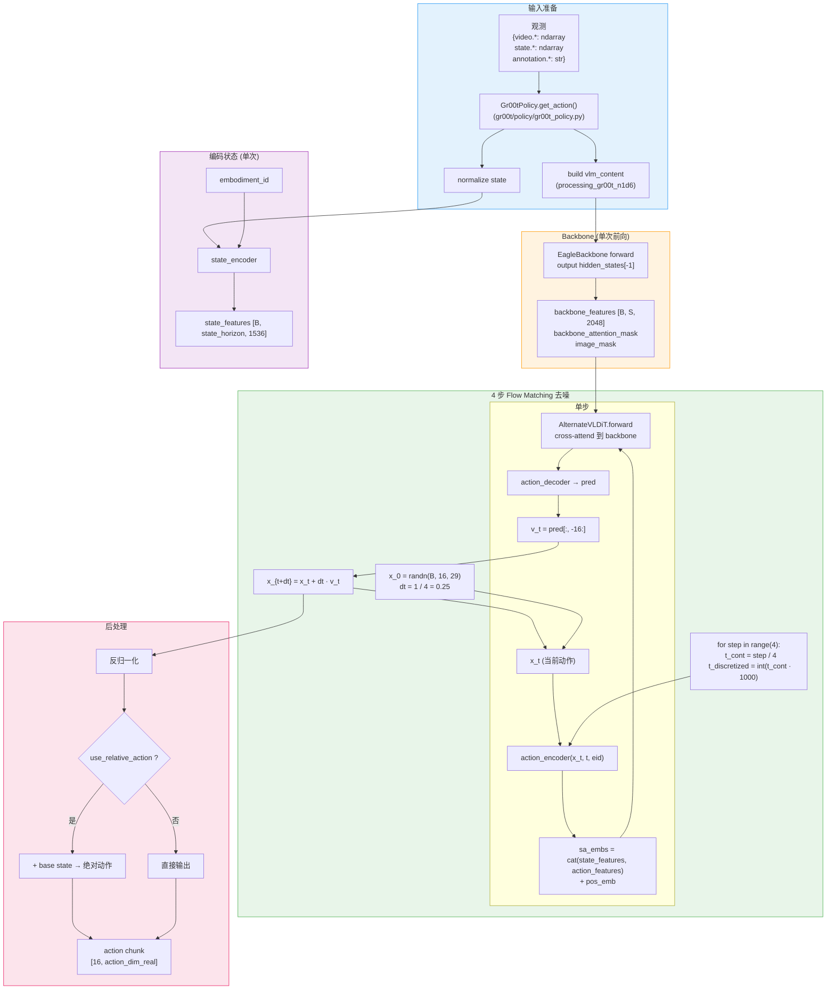

# Isaac GR00T N1.6 模型架构

## 1. 整体架构概览

Isaac GR00T N1.6 是 NVIDIA 提出的视觉-语言-动作 (VLA) 通用人形机器人基座模型，3B 参数级。其架构由两部分串联：上游 **Eagle Vision-Language Backbone**（基于 NVIDIA Cosmos-Reason-2B VLM 变体）将图像 + 语言编码成统一的多模态特征序列；下游 **Action Head** 使用 **32 层 AlternateVLDiT**（Diffusion Transformer）通过 **Flow Matching** 把高斯噪声逐步去噪成动作 chunk。为了支持跨形态（cross-embodiment）训练，状态编码器、动作编码器、动作解码器都使用 **CategorySpecificMLP**——同一组层但为每个 embodiment 维护独立权重，最多支持 32 种形态。N1.6 相比 N1.5 的核心改变包括：换用更大的 Cosmos VLM 并解冻顶部 4 层、DiT 层数从 16 翻倍到 32、移除 N1.5 的 post-VLM 4 层 transformer adapter、对大部分形态改为预测 **state-relative action chunks**。

---

## 2. 核心组件详解

### 2.1 Eagle Vision-Language Backbone

`EagleBackbone` (`gr00t/model/modules/eagle_backbone.py`) 是上游 VLM 包装。N1.6 默认 `model_name="nvidia/Eagle-Block2A-2B-v2"`——NVIDIA 内部的 **Cosmos-Reason-2B VLM 变体**，用 flash attention + bf16 加载。它由 `vision_model` + `mlp1` 视觉投影 + `language_model` 三段组成。

**关键细节：**

- 图像保持原生宽高比，无需 padding，由 Eagle 内部 any-res ViT 处理（参见 `gr00t/model/modules/nvidia/Eagle-Block2A-2B-v2/` 内 trust_remote_code 模型）
- `select_layer=16` 截断 LLM 顶部以外的层，仅保留前 16 层做特征提取
- `tune_top_llm_layers=4`：顶部 4 层 LLM 在 pretraining 中解冻，**这是 N1.6 相对 N1.5 的关键改动**（N1.5 是全冻 VLM + 外挂 4 层 transformer adapter）
- 输出三件：`backbone_features [B, S, 2048]`、`backbone_attention_mask`、`image_mask`（标识序列中哪些 token 是图像 token；AlternateVLDiT 后续用来分离图像/非图像注意力）
- backbone 输出后过一个可选的 `VLN LayerNorm` (`use_vlln=True`) 再送入 DiT

---

### 2.2 Embodiment 条件化的状态/动作编码

GR00T 要在一个模型里同时处理多种机器人（GR1、G1、YAM、Galaxea R1 Pro、Bridge、DROID...），关键设计是 **CategorySpecificLinear**——每个 embodiment id 选一组独立的 (W, b)，同一个网络结构服务 32 种形态。

```mermaid
graph TB
    subgraph CSL["CategorySpecificLinear"]
        IN["x: [B, T, input_dim]"] --> SELECT["W[cat_ids] / b[cat_ids]<br/>bmm(x, selected_W) + b"]
        EID["cat_ids: [B]"] --> SELECT
        SELECT --> OUT["[B, T, hidden_dim]"]
    end

    subgraph StateEnc["state_encoder = CategorySpecificMLP"]
        ST["state [B, state_dim≤29]"] --> SL1["CSL 29 → 1024<br/>+ ReLU"]
        SL1 --> SL2["CSL 1024 → 1536"]
        SL2 --> SF["state_features<br/>[B, state_horizon, 1536]"]
    end

    subgraph ActionEnc["action_encoder = MultiEmbodimentActionEncoder"]
        NA["noisy actions<br/>[B, 16, 29]"] --> W1["W1 (CSL): 29 → 1536"]
        TS["t_discretized: [B]<br/>expand to [B, 16]"] --> SIN["SinusoidalPositionalEncoding<br/>dim=1536"]
        W1 --> CAT2["concat → [B, 16, 3072]"]
        SIN --> CAT2
        CAT2 --> W2["W2 (CSL): 3072 → 1536<br/>+ Swish"]
        W2 --> W3["W3 (CSL): 1536 → 1536"]
        W3 --> AF["action_features<br/>[B, 16, 1536]"]
    end

    style CSL fill:#e3f2fd,stroke:#2196F3
    style StateEnc fill:#f3e5f5,stroke:#9C27B0
    style ActionEnc fill:#fff3e0,stroke:#FF9800
```

**关键细节：**

- `max_num_embodiments=32`，所有 CategorySpecific* 层都给 32 个 (W, b) 拷贝；新增形态后 `expand_action_dimension()` 可在 input/output 维度上复制原权重做安全扩展（参见 `embodiment_conditioned_mlp.py:66-114`）
- `state_dropout_prob` + 可学习 `mask_token`：训练时按概率把状态特征替换为 mask token，提高对状态缺失/噪声的鲁棒性
- `state_additive_noise_scale`：训练时给状态特征加高斯噪声做正则
- action encoder 用 **正弦位置编码（log 频率，base=10000）** 编码 discretized timestep，再与动作嵌入做 concat-fuse（不同于 Pi0 的 MLP fuse + 自定义 period）

---

### 2.3 AlternateVLDiT (Action Head 主干)

N1.6 的 Action Head 由 32 层 `AlternateVLDiT` 组成（`gr00t/model/modules/dit.py:289`），是 `DiT` 的子类。每个 block 由 **AdaLayerNorm + Attention + (Cross-Attention)** 构成，时间步 `temb` 通过 AdaLN 注入到每一层（不是 Pi0 那种把时间塞进序列）。

**关键细节：**

- DiT 内维 `inner_dim = num_attention_heads × attention_head_dim = 32 × 48 = 1536`，与 `input_embedding_dim` 对齐
- `interleave_self_attention=True`：奇数 idx 走自注意力（只看 `sa_embs` 内部），偶数 idx 走 cross-attention 到 Eagle 输出
- **AlternateVLDiT 的"交替"机制**：在偶数 cross 层中，按 `idx % (2 · attend_text_every_n_blocks)` 决定 cross 到"非图像 backbone token"还是"图像 backbone token"——`attend_text_every_n_blocks=2` 意味着每 4 个 cross block 中 2 个看图、2 个看文，让模型显式区分两种模态的注意力分配
- 末端 `model_output` 拿后 `action_horizon=16` 个 token 给 `action_decoder` 解码出预测速度场 `v_t`
- 可选 `position_embedding`（`nn.Embedding(1024, 1536)`）加在 `sa_embs` 上作为绝对位置先验

---

### 2.4 Flow Matching 扩散机制

GR00T 用 **Flow Matching** 而非 DDPM 风格扩散，与 Pi0 / Pi0.5 思路一致，但有两点 GR00T 特色：

1. **离散化时间步** ——`num_timestep_buckets=1000`，连续 `t` 乘以桶数取整后送入 `TimestepEncoder`，得到 `temb` 注入到 AdaLN
2. **方向取反约定** ——Pi0 用 `x_t = t·noise + (1-t)·actions`，**GR00T 反过来**：`x_t = (1-t)·noise + t·actions`，对应 `velocity = actions - noise`；推理时从 `t=0`（纯噪声）线性走到 `t=1`（干净动作），步进 `dt = +1/N`（参见 `gr00t_n1d6.py:316`）

**与 Pi0 / 标准扩散的对比：**

| 特性 | Pi0 (Flow Matching) | GR00T N1.6 (Flow Matching) |
|---|---|---|
| 线性路径方向 | `x_t = t·noise + (1-t)·actions` | `x_t = (1-t)·noise + t·actions` |
| 推理积分方向 | t: 1.0 → 0.0（dt=-0.1，10 步） | t: 0.0 → 1.0（dt=+0.25，**4 步**） |
| 时间步表示 | 正弦周期 [4e-3, 4.0] 注入序列 | 1000 个离散桶 + AdaLN 注入每层 |
| Beta 采样 | `Beta(1.5, 1.0)` 直接用 | `Beta(1.5, 1.0)` 取 `(1-sample)·0.999` |
| 时间注入位置 | 拼成序列里的一个 token | 通过 AdaLN 注入每个 DiT block |

---

### 2.5 State-Relative Action Chunks（N1.6 新约定）

对于大多数 embodiment，N1.6 让模型预测 **相对于当前状态的增量动作**（state-relative），而不是绝对关节角 / 末端位姿。开关在 `Gr00tN1d6Config.use_relative_action`，相关变换由 `gr00t/data/` 中的 `StateActionProcessor` 在数据侧完成：训练时把 GT 转成 relative，推理时把模型输出加回 base state 再下发。

这一改动的好处是：

- 数值范围更稳定（diff 的方差远小于绝对值）
- 改善跨 embodiment 泛化——相同任务下不同机器人的绝对状态范围差异很大，相对增量空间更接近

---

## 3. 训练流水线

**训练设置要点：**

- 框架：HuggingFace `Trainer` 包装为 `Gr00tTrainer`（加了轻量 profiling）
- 多卡：DeepSpeed（`gr00t/configs/deepspeed/` 内 ZeRO 配置）
- 入口：`gr00t/experiment/launch_train.py`（完整训练）/ `launch_finetune.py`（finetune）
- 三个可调粒度：`tune_projector`（state/action 编解码器）、`tune_diffusion_model`（DiT 主体）、`tune_vlln`（输出层归一化）—— finetune 时常只解冻 projector + DiT，VLM 完全冻结
- backbone 内 `tune_top_llm_layers=4`：仅解冻 LLM 顶部 4 层；`tune_llm/tune_visual` 默认 False
- bf16 训练 + flash attention（强制要求）
- 数据：**sharded iterable dataset** 支持分布式高速加载（N1.6 新增）
- `action_mask` 同时屏蔽 padding 的动作维度（不同 embodiment 实际 action_dim 不同，都 pad 到 29）和 padding 的 horizon 位置

---

## 4. 推理流水线

**推理优化要点：**

- **Backbone 只跑一次**：4 步去噪共享同一份 `backbone_features` / `backbone_attention_mask` / `image_mask`（在 `Gr00tN1d6ActionHead.get_action_with_features` 里实现）
- **状态编码也只跑一次**：`state_features` 在循环外算好
- 每步仅算 action 编码 + DiT 32 层 + 解码 → 16 步动作
- 仅 4 步去噪即可（vs Pi0 的 10 步），配合 `torch.compile` 在 RTX 5090 / H100 上可达 27 Hz 端到端
- 部署：`scripts/deployment/` 支持 TensorRT / ONNX 导出
- Server-Client 模式：`gr00t/eval/run_gr00t_server.py` + `PolicyClient` 通过 RESTful API 把策略与仿真环境解耦

---

## 5. 关键超参数表

### 模型结构参数

| 参数 | 值 | 说明 |
|---|---|---|
| `model_name` | `nvidia/Eagle-Block2A-2B-v2` | Eagle backbone (Cosmos-Reason-2B 变体) |
| `backbone_embedding_dim` | 2048 | Backbone 输出维度 |
| `select_layer` | 16 | LLM 截断保留层数 |
| `tune_top_llm_layers` | 4 | 训练时解冻的 LLM 顶部层数 |
| `tune_llm / tune_visual` | False / False | 默认全冻视觉与底部 LLM |
| `hidden_size` | 1024 | 解码后 hidden 维度 |
| `input_embedding_dim` | 1536 | state/action 编码后的维度，也是 DiT inner_dim |
| `max_seq_len` | 1024 | 位置嵌入最大长度 |
| `max_num_embodiments` | 32 | CategorySpecific 层的形态数 |

### Diffusion Transformer (AlternateVLDiT)

| 参数 | 值 | 说明 |
|---|---|---|
| `num_layers` | **32** | DiT 层数（N1.5 是 16） |
| `num_attention_heads` | 32 | 注意力头数 |
| `attention_head_dim` | 48 | 每头维度 |
| inner_dim | 1536 | = 32 × 48 |
| `norm_type` | `ada_norm` | AdaLayerNorm |
| `dropout` | 0.2 | DiT dropout |
| `interleave_self_attention` | True | 奇数层自注意力，偶数层 cross |
| `attend_text_every_n_blocks` | 2 | 文/图 cross 切换周期（每 4 个 cross block 中 2 文 2 图） |
| `output_dim` | 1024 | 投影回 hidden_size |
| `use_vlln` | True | backbone 输出后过 LayerNorm |
| `add_pos_embed` | True | 加 `nn.Embedding(1024, 1536)` 位置嵌入 |

### 动作生成

| 参数 | 值 | 说明 |
|---|---|---|
| `action_horizon` | 16 | 单次预测的动作步数 |
| `max_action_dim` | 29 | 动作维度上限（padding 用） |
| `max_state_dim` | 29 | 状态维度上限 |
| `use_relative_action` | False (config 默认) | 多数 embodiment 在数据侧设为 True，输出 state-relative |

### Flow Matching

| 参数 | 值 | 说明 |
|---|---|---|
| `num_inference_timesteps` | **4** | 推理去噪步数 |
| `noise_beta_alpha` | 1.5 | Beta 采样 α |
| `noise_beta_beta` | 1.0 | Beta 采样 β |
| `noise_s` | 0.999 | 时间步缩放（避免 t=1） |
| `num_timestep_buckets` | 1000 | timestep 离散化桶数 |

### 训练正则

| 参数 | 值 | 说明 |
|---|---|---|
| `state_dropout_prob` | 0.0 | 状态特征 dropout 概率（finetune 可能 >0） |
| `state_additive_noise_scale` | 0.0 | 状态特征加性噪声尺度 |
| `attn_dropout` | 0.2 | 注意力 dropout |
| `model_dtype` | `bfloat16` | 训练精度 |
| `use_flash_attention` | True | 强制 flash attention |
| `backbone_trainable_params_fp32` | True | 可训练参数 cast 回 fp32 |

### 推理性能（来自 README）

| 设备 | 模式 | Data | Backbone | Action Head | E2E | 频率 |
|---|---|---|---|---|---|---|
| RTX 5090 | torch.compile | 2 ms | 18 ms | 16 ms | 37 ms | 27.3 Hz |
| H100 | torch.compile | 4 ms | 23 ms | 11 ms | 38 ms | 26.3 Hz |
| RTX 4090 | torch.compile | 2 ms | 25 ms | 17 ms | 44 ms | 22.8 Hz |
| Jetson Thor | torch.compile | 5 ms | 39 ms | 61 ms | 105 ms | 9.5 Hz |

---

## 6. 关键源文件表

| 组件 | 类名 / 函数 | 文件路径 |
|---|---|---|
| 主模型 | `Gr00tN1d6` | `gr00t/model/gr00t_n1d6/gr00t_n1d6.py:411` |
| Action Head | `Gr00tN1d6ActionHead` | `gr00t/model/gr00t_n1d6/gr00t_n1d6.py:19` |
| 配置 | `Gr00tN1d6Config` | `gr00t/configs/model/gr00t_n1d6.py:13` |
| VL Backbone | `EagleBackbone` | `gr00t/model/modules/eagle_backbone.py:8` |
| Diffusion Transformer | `AlternateVLDiT` / `DiT` | `gr00t/model/modules/dit.py:289` / `:172` |
| Embodiment 线性层 | `CategorySpecificLinear` / `MLP` | `gr00t/model/modules/embodiment_conditioned_mlp.py:44` / `:128` |
| 动作编码器 | `MultiEmbodimentActionEncoder` | `gr00t/model/modules/embodiment_conditioned_mlp.py:162` |
| 时间步正弦编码 | `SinusoidalPositionalEncoding` | `gr00t/model/modules/embodiment_conditioned_mlp.py:11` |
| 数据 collator | `Gr00tN1d6DataCollator` | `gr00t/model/gr00t_n1d6/processing_gr00t_n1d6.py` |
| 推理策略 | `Gr00tPolicy` | `gr00t/policy/gr00t_policy.py:46` |
| Server | `run_gr00t_server.py` | `gr00t/eval/run_gr00t_server.py` |
| 训练入口 | `launch_train.py` / `launch_finetune.py` | `gr00t/experiment/` |
| Trainer 包装 | `Gr00tTrainer` | `gr00t/experiment/trainer.py` |
