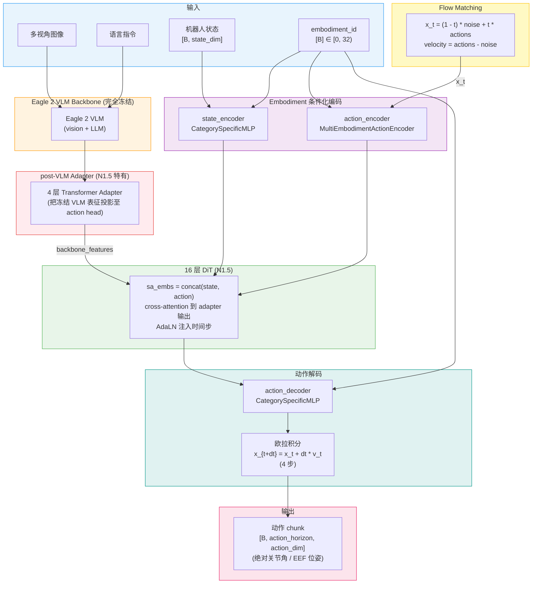
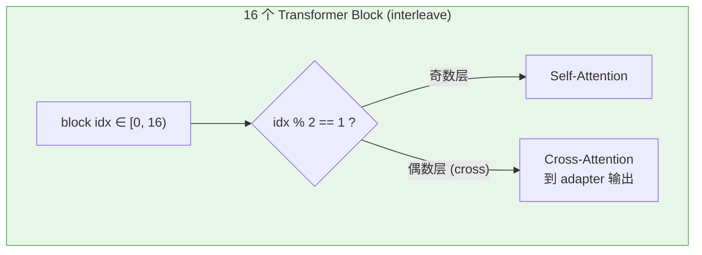

# Isaac GR00T N1.5 模型架构

## 1. 整体架构概览

Isaac GR00T N1.5 是 NVIDIA 发布的首个公开 VLA 基座模型（3B 参数）。架构由两段组成：**Eagle 2 VLM Backbone**（冻结）→ 4 层 transformer adapter → **16 层 DiT** + Flow Matching 出动作 chunk。多 embodiment 支持通过 `CategorySpecificMLP` 实现，最多 32 种形态。N1.5 训练时把 VLM 主体完全冻结，靠 4 层 adapter 把 VLM 表征"翻译"到 action head 需要的维度。

> **版本说明：** 本文档对应 NVIDIA Isaac-GR00T 仓库的 [`n1.5-release`](https://github.com/NVIDIA/Isaac-GR00T/tree/n1.5-release) 分支。当前 `main` 分支已升级为 N1.6（见 [Isaac-GR00T N1.6 架构](./06.Isaac-GR00T-N1.6_Architecture.html)）。两者整体架构思路相同——上游 VLM backbone 出特征、下游 DiT + Flow Matching 出动作 chunk、CategorySpecificMLP 做 embodiment 条件化——但在 backbone 选择、DiT 容量、训练策略和动作目标上有 4 处关键差异（见末尾对照表）。



---

## 2. 核心组件详解

### 2.1 Eagle 2 VLM Backbone (完全冻结)

N1.5 使用的 backbone 是 **Eagle 2 VLM**（[NVIDIA Eagle 2 论文](https://arxiv.org/abs/2501.14818)），与 N1.6 的 Cosmos-Reason-2B 变体不同：

- Eagle 2 是早期版本，**不支持** native 任意分辨率输入——图像需要 resize/pad 到固定尺寸
- N1.5 训练时 **完全冻结** VLM（`tune_llm=False`, `tune_visual=False`, `tune_top_llm_layers=0`），即整个 VLM 不参与梯度更新
- 由于 VLM 表征是为通用 VL 任务训练的，需要一个"翻译层"把它对齐到 action 任务——这就是 post-VLM adapter 的角色

---

### 2.2 Post-VLM 4 层 Transformer Adapter (N1.5 特有)

N1.5 在 backbone 和 action head 之间插入 **4 层独立的 transformer adapter**，作用是：

- 把冻结 Eagle 2 的高层表征做任务特化映射
- 弥补 VLM 主体不更新带来的表征损失
- 提供可学的 token-级信息聚合（注意力机制可以挑出对动作有用的视觉/语言 token）

在 N1.6 中这一层被 **完全移除**，改为直接解冻 Eagle (Cosmos) 顶部 4 层 LLM 层 (`tune_top_llm_layers=4`)。NVIDIA 的解释（见 README）是：直接让 VLM 顶层参与训练比外挂 adapter 更高效，参数利用更好。


---

### 2.3 Embodiment 条件化的状态/动作编码

与 N1.6 相同，采用 `CategorySpecificLinear` 和 `MultiEmbodimentActionEncoder` 在每个 embodiment id 处选独立 (W, b)，最多支持 32 种形态。这套机制贯穿 GR00T 整个系列，从 N1 → N1.5 → N1.6 没有结构性改动。

```mermaid
graph TB
    subgraph CSL["CategorySpecificLinear"]
        IN["x: [B, T, input_dim]"] --> SELECT["W[cat_ids] / b[cat_ids]<br/>bmm(x, W) + b"]
        EID["cat_ids: [B]"] --> SELECT
        SELECT --> OUT["[B, T, hidden_dim]"]
    end

    subgraph StateEnc["state_encoder = CategorySpecificMLP"]
        ST["state [B, state_dim]"] --> SL1["CSL → ReLU"]
        SL1 --> SL2["CSL"]
        SL2 --> SF["state_features"]
    end

    subgraph ActionEnc["action_encoder = MultiEmbodimentActionEncoder"]
        NA["noisy actions"] --> W1["W1 (CSL)"]
        TS["timestep"] --> SIN["正弦位置编码"]
        W1 --> CAT2["concat"]
        SIN --> CAT2
        CAT2 --> W2["W2 (CSL) + Swish"]
        W2 --> W3["W3 (CSL)"]
        W3 --> AF["action_features"]
    end

    style CSL fill:#e3f2fd,stroke:#2196F3
    style StateEnc fill:#f3e5f5,stroke:#9C27B0
    style ActionEnc fill:#fff3e0,stroke:#FF9800
```



详细细节参见 [N1.6 文档第 2.2 节](./06.Isaac-GR00T-N1.6_Architecture.html#22-embodiment-条件化的状态动作编码)，两者实现一致。

---

### 2.4 DiT (16 层, Action Head 主干)

N1.5 的 Action Head 由 **16 层 DiT 或 AlternateVLDiT** 组成，是 N1.6 (32 层) 的一半深度。同样使用：

- AdaLayerNorm 在每层注入时间步（不进入 token 序列）
- 奇数层 self-attention，偶数层 cross-attention 到 backbone（在 AlternateVLDiT 中进一步切分图像/非图像 token，同样以 `attend_text_every_n_blocks` 控制周期）
- inner_dim 由 `num_attention_heads × attention_head_dim` 决定，N1.5 默认与 N1.6 同款（32×48=1536），仅深度对半



容量差异的直观影响：

- **训练时**：16 层 DiT 参数量约为 N1.6 的一半，单步前向更快，但表达能力受限
- **推理时**：仍是 4 步 Flow Matching 去噪，单步成本更低
- **finetune 时**：N1.5 通常能用更小的 GPU 完成 finetune（A6000 / 40GB 显存即可），N1.6 则更倾向于 H100 / L40 节点

---

### 2.5 Flow Matching 扩散机制

与 N1.6 一致，方向约定相同：

```
x_t = (1 - t) * noise + t * actions
velocity = actions - noise
t: 0.0 → 1.0,  dt = 1/4 = 0.25 (4 步推理)
```

时间步采样、Beta 分布、离散化桶数 (`num_timestep_buckets=1000`) 等参数与 N1.6 基本一致。详细推导见 [N1.6 文档第 2.4 节](./06.Isaac-GR00T-N1.6_Architecture.html#24-flow-matching-扩散机制)。

---

### 2.6 动作目标：绝对值 (N1.5 默认)

N1.5 对大多数 embodiment **直接预测绝对关节角 / EEF 位姿**，而非 N1.6 的 state-relative 增量。意味着：

- 不同 embodiment 之间动作数值范围差异大（关节角 vs 末端位姿、不同自由度数）
- 跨形态泛化更难——同一任务在不同机器人上的"动作空间"看起来差别极大
- 数据预处理只做标准的 mean/std 归一化，无需 state 减法

N1.6 改预测 state-relative 后，这部分跨 embodiment 泛化变好，这是论文报告的关键改进之一。

---

## 3. 训练流水线

整体与 [N1.6 训练流水线](./06.Isaac-GR00T-N1.6_Architecture.html#3-训练流水线) 相同：

1. 数据走 LeRobot v2 schema，`StateActionProcessor` + Collator 构建输入
2. Backbone（**Eagle 2，完全冻结**）→ Adapter（4 层，**可训练**）→ DiT (16 层，可训练) → action_decoder
3. Flow Matching 噪声采样 + MSE 损失
4. HuggingFace `Trainer` + DeepSpeed 多卡

**与 N1.6 的训练设置差异：**

| 项目 | N1.5 | N1.6 |
|---|---|---|
| VLM 顶层是否解冻 | ❌（全冻） | ✅ 顶部 4 层（`tune_top_llm_layers=4`） |
| 是否有 post-VLM adapter | ✅ 4 层 transformer | ❌ |
| DiT 深度 | 16 | 32 |
| 数据加载 | 标准 LeRobot dataloader | **sharded iterable dataset**（更快） |
| 动作目标 | 绝对（多数 embodiment） | state-relative（多数 embodiment） |
| 数据 mixture | 基础组合 | **+ 数千小时新增遥操**（YAM、AGIBot Genie1、Galaxea R1 Pro on BEHAVIOR、Unitree G1 WB） |

---

## 4. 推理流水线

整体与 [N1.6 推理流水线](./06.Isaac-GR00T-N1.6_Architecture.html#4-推理流水线) 相同：

```
Eagle 2 (单次) → Adapter (单次) → state_encoder (单次) →
  loop 4 步:
    action_encoder(x_t, t, eid)
    DiT 16 层 cross-attend 到 adapter 输出
    action_decoder → v_t
    x_{t+dt} = x_t + dt * v_t
→ 反归一化 → 输出绝对动作 chunk
```

- Backbone + Adapter 计算 **一次** 缓存，4 步去噪复用
- 部署同样支持 TensorRT / ONNX 与 Server-Client 模式
- 由于 DiT 仅 16 层，单步去噪比 N1.6 快，但 backbone 部分两者相当

---

## 5. 关键超参数对照表（N1.5 vs N1.6）

| 类别 | 参数 | N1.5 | N1.6 |
|---|---|---|---|
| **Backbone** | 模型 | Eagle 2 VLM | Eagle-Block2A-2B-v2 (Cosmos-Reason-2B 变体) |
| | 可变分辨率 | ❌ | ✅ (native 宽高比) |
| | VLM 是否参与训练 | ❌ 全冻 | ✅ 顶 4 层解冻 |
| | post-VLM adapter | ✅ 4 层 transformer | ❌ |
| **DiT** | `num_layers` | 16 | **32** |
| | `interleave_self_attention` | True | True |
| | AlternateVLDiT (图/文交替) | 可选 | 默认开启 |
| **动作目标** | 默认目标 | 绝对关节角 / EEF 位姿 | **state-relative** (多数 embodiment) |
| **Flow Matching** | `num_inference_timesteps` | 4 | 4 |
| | Beta 采样 | `Beta(1.5, 1.0)` | `Beta(1.5, 1.0)` |
| | 时间方向 | t: 0→1 | t: 0→1 |
| **数据** | dataloader | 标准 | **sharded iterable** |
| | 预训练数据 | 基础组合 | **+ YAM / AGIBot / Galaxea / G1 WB** |
| **形态** | `max_num_embodiments` | 32 | 32 |
| **HF 模型** | checkpoint | [nvidia/GR00T-N1.5-3B](https://huggingface.co/nvidia/GR00T-N1.5-3B) | [nvidia/GR00T-N1.6-3B](https://huggingface.co/nvidia/GR00T-N1.6-3B) |
| | 分支 | [`n1.5-release`](https://github.com/NVIDIA/Isaac-GR00T/tree/n1.5-release) | [`main`](https://github.com/NVIDIA/Isaac-GR00T) |

---

## 6. 何时选 N1.5 vs N1.6

| 场景 | 推荐版本 | 原因 |
|---|---|---|
| 复现/参考 GR00T N1 论文设定 | N1.5 | N1.5 与原论文设定最接近 |
| 显存/算力有限（≤ 40GB） | N1.5 | 16 层 DiT 训练/finetune 更轻 |
| 追求最佳跨形态泛化 | N1.6 | state-relative + 更大 DiT + 顶层 VLM 解冻 |
| 部署到边缘端（Jetson）需高频 | N1.5 | DiT 更轻，单步去噪更快（但 backbone 部分相当） |
| 新项目，无历史包袱 | N1.6 | 直接用最新 main 分支即可 |

---

## 7. 参考文献与资源

- 论文：[GR00T N1: An Open Foundation Model for Generalist Humanoid Robots](https://arxiv.org/abs/2503.14734)
- N1.5 Research Blog：[research.nvidia.com/labs/gear/gr00t-n1_5](https://research.nvidia.com/labs/gear/gr00t-n1_5/)
- N1.5 代码：[github.com/NVIDIA/Isaac-GR00T/tree/n1.5-release](https://github.com/NVIDIA/Isaac-GR00T/tree/n1.5-release)
- N1.5 checkpoint：[huggingface.co/nvidia/GR00T-N1.5-3B](https://huggingface.co/nvidia/GR00T-N1.5-3B)
- Eagle 2 VLM：[arxiv.org/abs/2501.14818](https://arxiv.org/abs/2501.14818)
