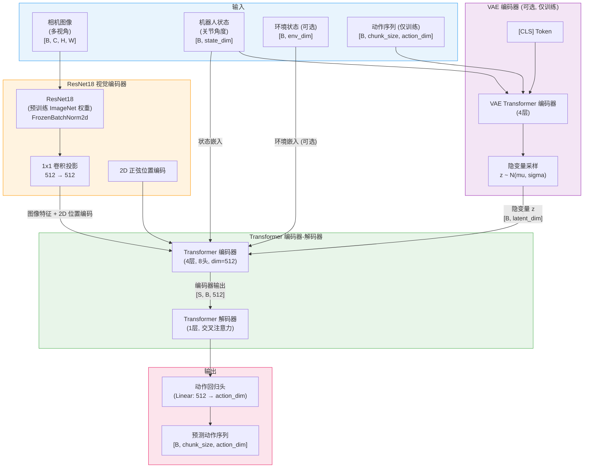
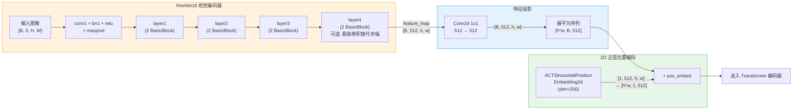
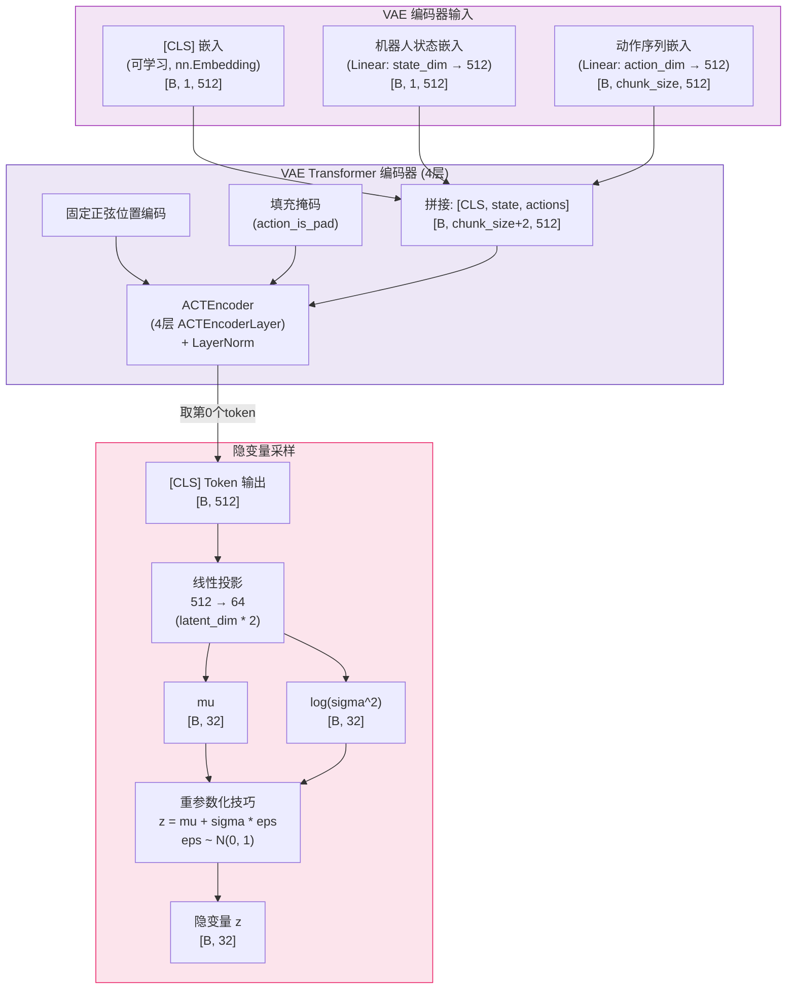
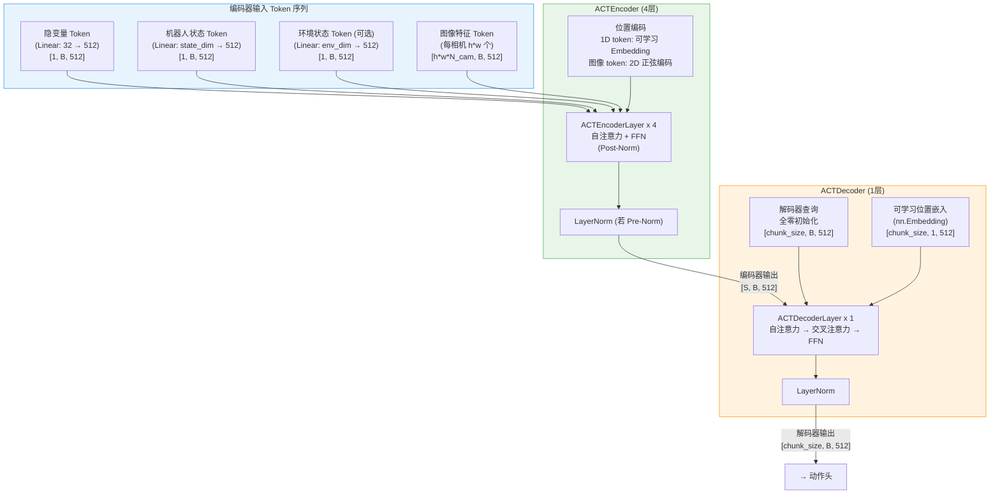
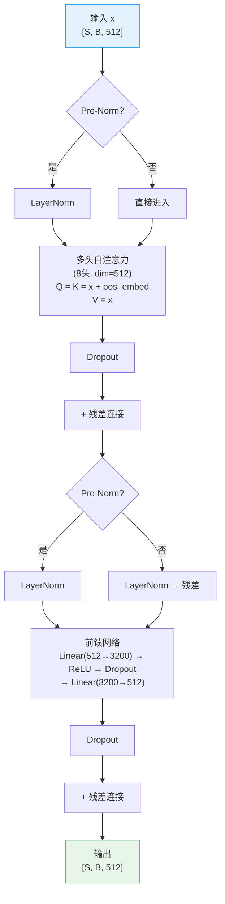
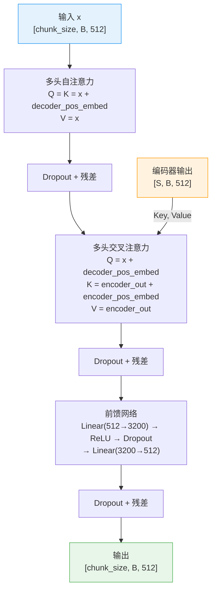
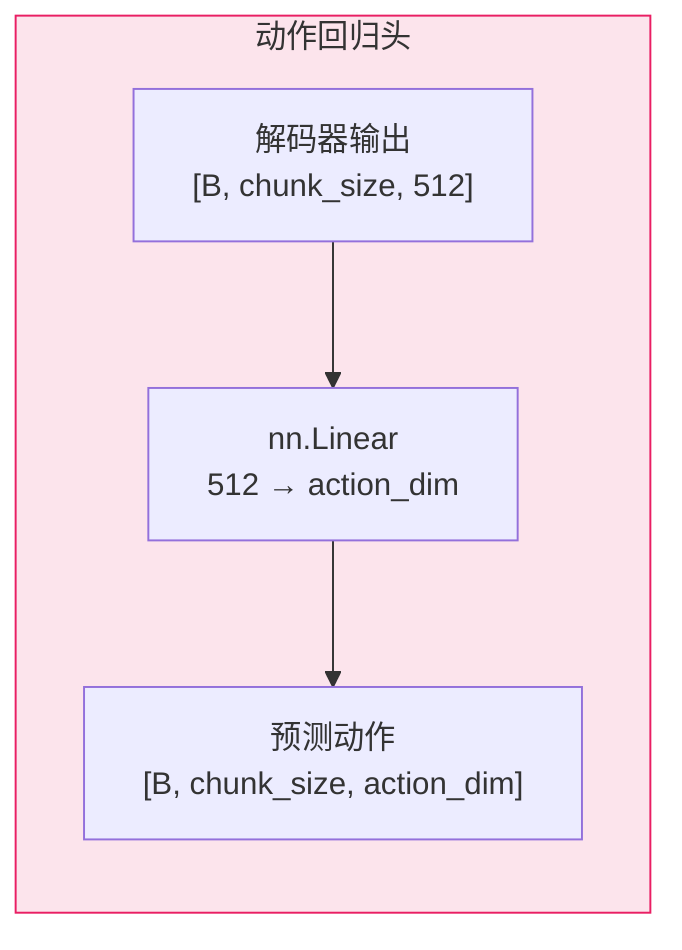
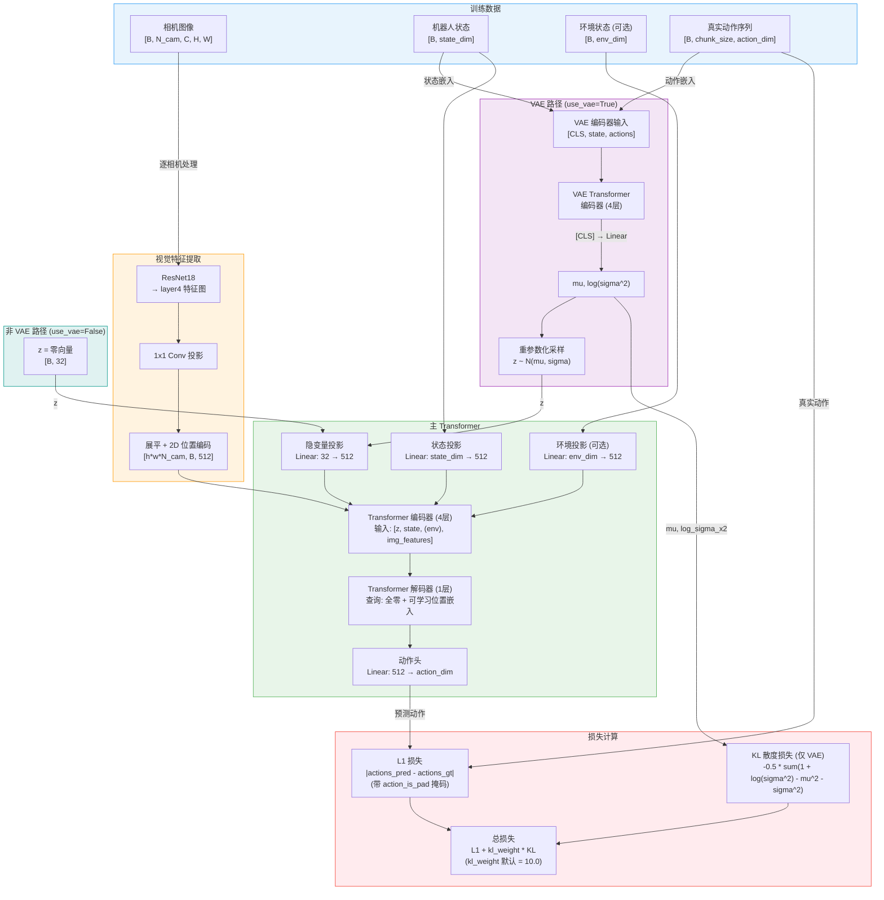
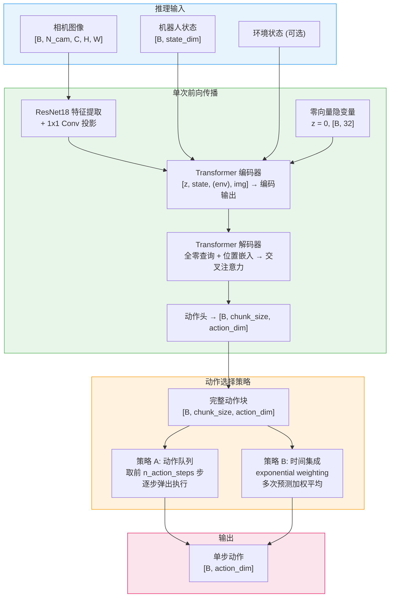
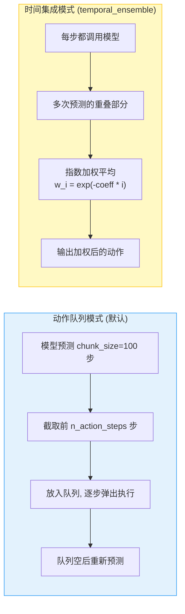

# ACT (Action Chunking Transformer) 模型架构

## 1. 整体架构概览

ACT (Action Chunking Transformer) 是一种基于 Transformer 编码器-解码器结构的机器人操作策略模型，出自论文 *Learning Fine-Grained Bimanual Manipulation with Low-Cost Hardware* (Zhao et al., 2023)。其核心思想是 **动作分块 (Action Chunking)**：模型一次性预测未来 `chunk_size` 步的动作序列，而非逐步预测，从而有效缓解复合误差问题。ACT 使用 ResNet18 作为视觉编码器提取图像特征，可选的 VAE 编码器学习动作分布的隐变量，以及 Transformer 编码器-解码器生成最终的动作序列。推理时仅需单次前向传播，无需迭代去噪。

---

## 2. 核心组件详解

### 2.1 ResNet18 视觉编码器

ACT 使用 torchvision 提供的 ResNet18 作为图像特征提取器，默认加载 ImageNet 预训练权重。特征图取自 `layer4` 的输出，经过 1x1 卷积投影到 Transformer 的隐藏维度 (512)，并附加 2D 正弦位置编码。

**关键设计细节:**

- 使用 `IntermediateLayerGetter` 提取 `layer4` 的特征图，而非 ResNet 的最终分类输出
- Batch Normalization 使用 `FrozenBatchNorm2d`，训练时不更新统计量
- `replace_final_stride_with_dilation` 选项可将 `layer4` 的 2x2 步幅替换为膨胀卷积，保留更高分辨率的特征图
- 多相机视角的图像逐一通过同一个 backbone，特征拼接到编码器的序列维度上

### 2.2 VAE 编码器 (可选)

VAE 编码器是 ACT 的核心创新之一。训练时，它将真实动作序列编码为隐变量 z，捕获动作分布中的多模态性；推理时跳过 VAE 编码器，直接使用零向量作为隐变量。

**VAE 的设计意图:**

- 人类演示数据中，同一状态可能对应多种合理的动作 (多模态性)。VAE 通过隐变量 z 对这种不确定性进行建模
- 训练时，VAE 编码器从真实动作序列中提取隐变量；推理时使用零向量 (先验均值)，对应最可能的动作模式
- KL 散度损失约束隐变量分布接近标准正态分布 N(0, I)，确保推理时零向量采样合理

### 2.3 Transformer 编码器-解码器

这是 ACT 的核心推理模块。Transformer 编码器融合隐变量、状态嵌入和图像特征；Transformer 解码器通过交叉注意力从编码器输出中生成动作序列。

#### ACTEncoderLayer 内部结构

#### ACTDecoderLayer 内部结构

> **注意:** 原始 ACT 代码中 `n_decoder_layers` 设为 7，但由于 [代码 bug](https://github.com/tonyzhaozh/act/issues/25)，实际只有第一层被使用。LeRobot 实现中默认设为 1 以匹配原始行为。

### 2.4 动作头

动作头是一个简单的线性层，将 Transformer 解码器的输出映射到动作空间。

- 没有额外的非线性激活或归一化层，直接线性投影
- 输出维度等于动作空间维度 (如双臂 ALOHA 为 14)
- 一次性输出 `chunk_size` 步动作 (默认 100 步)

---

## 3. 训练流水线

训练时存在两条路径：**使用 VAE** 和 **不使用 VAE**。核心区别在于隐变量 z 的来源。

**损失函数细节:**

| 损失项 | 公式 | 说明 |
|---|---|---|
| L1 重建损失 | `mean(\|actions_pred - actions_gt\| * ~action_is_pad)` | 主损失，填充位置被掩码排除 |
| KL 散度 (仅 VAE) | `-0.5 * mean(sum(1 + log(sigma^2) - mu^2 - sigma^2))` | 约束隐变量接近 N(0, I) |
| 总损失 | `L1 + kl_weight * KL` | `kl_weight` 默认为 10.0 |

---

## 4. 推理流水线

推理时 **不使用 VAE 编码器**，隐变量 z 设为零向量。模型通过单次前向传播输出整个动作块，无需迭代去噪。

### 动作选择策略对比

---

## 5. 关键超参数表

| 参数 | 默认值 | 说明 |
|---|---|---|
| `chunk_size` | 100 | 动作分块大小，一次预测的动作步数 |
| `n_action_steps` | 100 | 每次推理实际执行的动作步数 (<=chunk_size) |
| `n_obs_steps` | 1 | 观测帧数 (当前仅支持 1) |
| `dim_model` | 512 | Transformer 隐藏维度 |
| `n_heads` | 8 | 多头注意力头数 |
| `dim_feedforward` | 3200 | FFN 中间层维度 |
| `feedforward_activation` | `relu` | FFN 激活函数 |
| `n_encoder_layers` | 4 | Transformer 编码器层数 |
| `n_decoder_layers` | 1 | Transformer 解码器层数 (原代码 bug 导致实际为 1) |
| `use_vae` | True | 是否启用 VAE 路径 |
| `latent_dim` | 32 | VAE 隐变量维度 |
| `n_vae_encoder_layers` | 4 | VAE 编码器 Transformer 层数 |
| `kl_weight` | 10.0 | KL 散度损失权重 |
| `dropout` | 0.1 | Transformer 各层 Dropout 率 |
| `vision_backbone` | `resnet18` | 视觉编码器骨干网络 |
| `pretrained_backbone_weights` | `ResNet18_Weights.IMAGENET1K_V1` | 预训练权重 |
| `replace_final_stride_with_dilation` | False | 是否用膨胀卷积替代 layer4 步幅 |
| `pre_norm` | False | 是否使用 Pre-Norm (默认 Post-Norm) |
| `temporal_ensemble_coeff` | None | 时间集成系数 (None 表示不启用) |
| `optimizer_lr` | 1e-5 | 学习率 |
| `optimizer_lr_backbone` | 1e-5 | 视觉骨干网络学习率 |
| `optimizer_weight_decay` | 1e-4 | 权重衰减 |
| `optimizer_grad_clip_norm` | 1.0 | 梯度裁剪范数 |

---

## 6. 关键源文件表

| 组件 | 类名 | 文件 |
|---|---|---|
| 策略封装 | `ACTPolicy` | `lerobot/policies/act/modeling_act.py:41` |
| 核心模型 | `ACT` | `lerobot/policies/act/modeling_act.py:252` |
| Transformer 编码器 | `ACTEncoder` | `lerobot/policies/act/modeling_act.py:509` |
| 编码器层 | `ACTEncoderLayer` | `lerobot/policies/act/modeling_act.py:528` |
| Transformer 解码器 | `ACTDecoder` | `lerobot/policies/act/modeling_act.py:567` |
| 解码器层 | `ACTDecoderLayer` | `lerobot/policies/act/modeling_act.py:590` |
| 时间集成 | `ACTTemporalEnsembler` | `lerobot/policies/act/modeling_act.py:161` |
| 2D 位置编码 | `ACTSinusoidalPositionEmbedding2d` | `lerobot/policies/act/modeling_act.py:680` |
| 1D 位置编码 | `create_sinusoidal_pos_embedding` | `lerobot/policies/act/modeling_act.py:662` |
| 配置 | `ACTConfig` | `lerobot/policies/act/configuration_act.py:25` |
