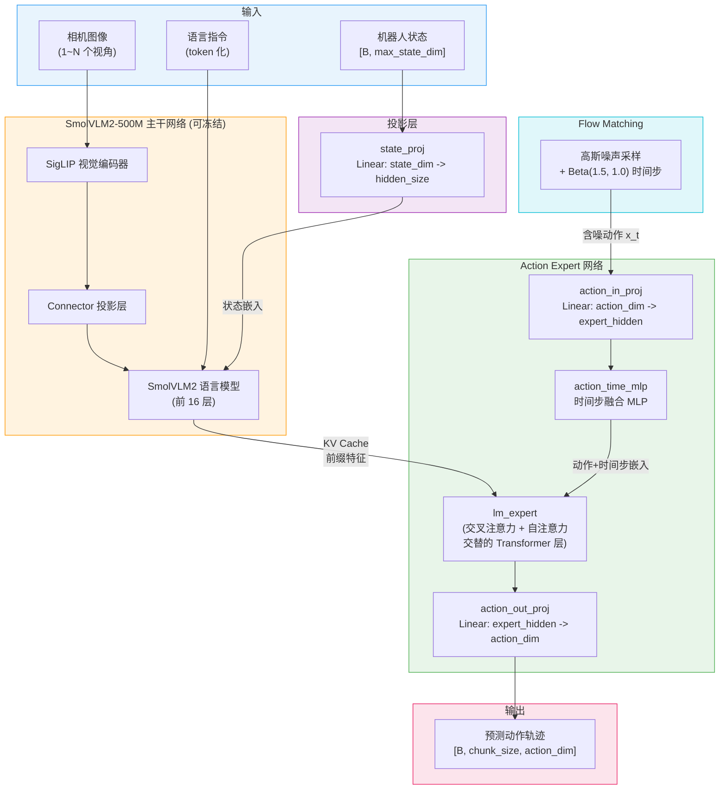
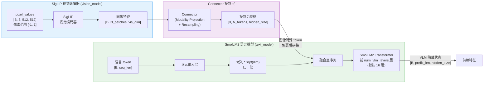
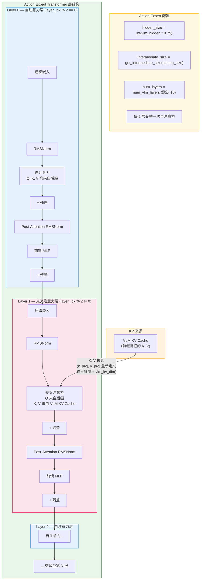
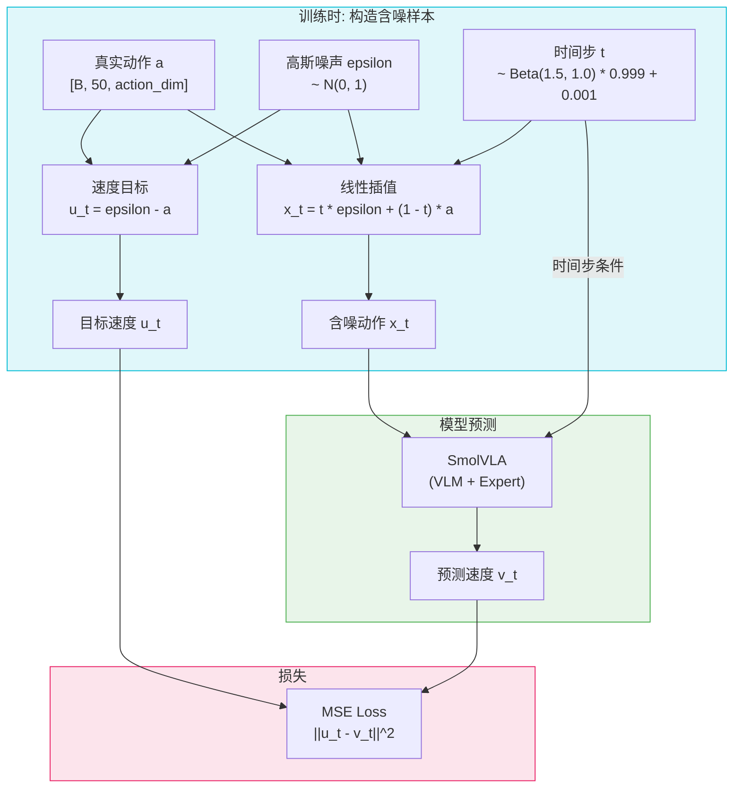
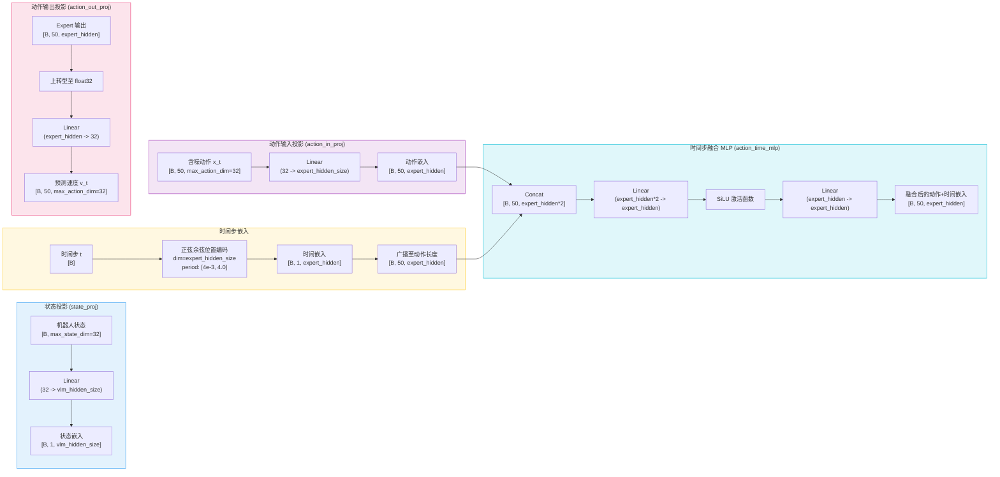
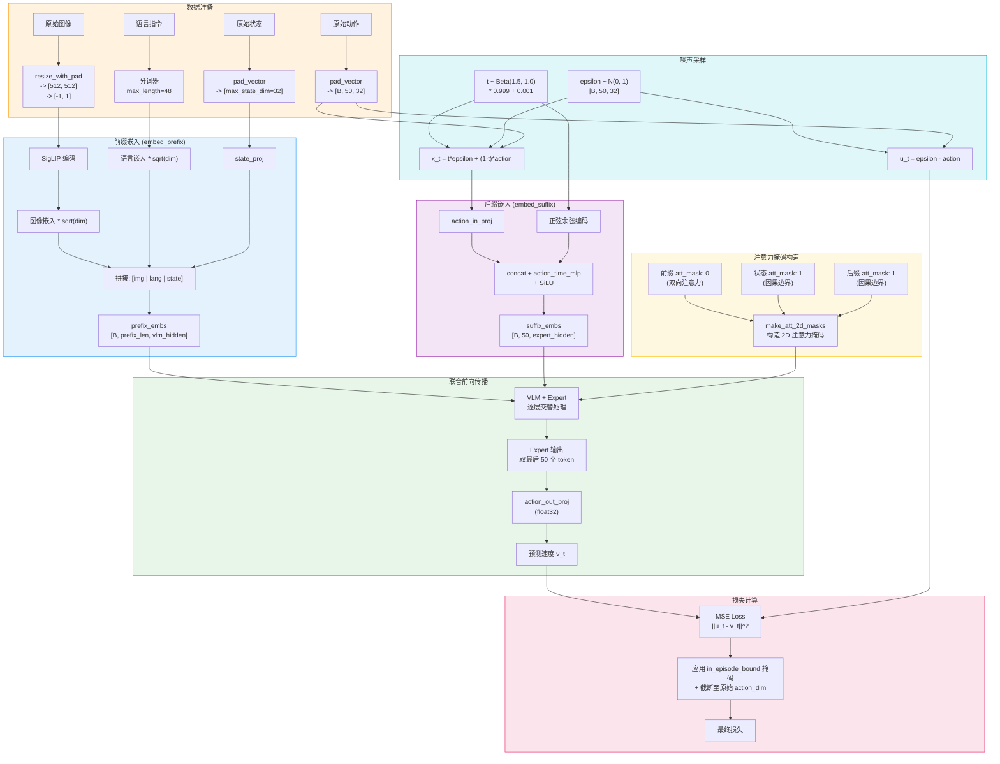
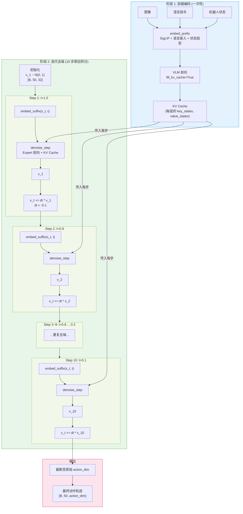

# SmolVLA 模型架构

## 1. 整体架构概览

SmolVLA (Small Vision-Language-Action) 是由 Hugging Face 设计的轻量级视觉-语言-动作 (VLA) 模型，采用 **SmolVLM2-500M-Video-Instruct** 作为视觉语言主干网络，并引入独立的 **Action Expert** 网络通过交叉注意力机制从 VLM 中提取特征来生成机器人动作。SmolVLA 使用 **Flow Matching**（与 Pi0 相同的范式）进行动作生成，通过迭代去噪将高斯噪声转化为动作轨迹。其核心设计理念是：VLM 处理前缀序列（图像 + 语言 + 状态），Action Expert 处理后缀序列（含噪动作 + 时间步），两者通过交叉注意力层交互，最终输出预测动作。



**SmolVLA 的核心设计特点：**

| 特性 | SmolVLA | GR00T N1.5 (对比) |
|---|---|---|
| VLM 主干 | SmolVLM2-500M (SigLIP + SmolLM2) | Eagle (SigLIP2 + Qwen3-1.7B) |
| 动作生成 | Action Expert (交叉注意力) | DiT (交替注意力) |
| 动作范式 | Flow Matching (连续) | Flow Matching (连续) |
| 注意力模式 | 前缀双向 + 后缀交叉注意力 | 交替交叉/自注意力 |
| 模型规模 | ~500M 参数 | ~2B+ 参数 |
| 推理步数 | 10 步 | 4 步 |

---

## 2. 核心组件详解

### 2.1 SmolVLM2-500M 视觉语言模型

SmolVLA 使用 `HuggingFaceTB/SmolVLM2-500M-Video-Instruct` 作为 VLM 主干，内部包含 SigLIP 视觉编码器、Connector 投影层和 SmolLM2 语言模型。VLM 的作用是处理前缀序列（图像 + 语言 + 状态），生成供 Action Expert 使用的 KV Cache。



**图像预处理流程：**

1. 图像缩放至 `512x512`，保持宽高比并用 0 填充（`resize_with_pad`）
2. 像素值从 `[0, 1]` 映射至 `[-1, 1]`（SigLIP 要求）
3. SigLIP 编码后经过 Connector 投影至语言模型维度
4. 图像嵌入乘以 `sqrt(dim)` 进行归一化
5. 可选：添加特殊图像 token（`fake_image_token` + `global_image_token`）包裹

**前缀序列拼接顺序：**

```
[图像1特殊token] [图像1 patch嵌入] [图像1结束token] ... [语言嵌入] [状态嵌入]
```

**VLM 层截断：** 与 GR00T 类似，SmolVLA 通过 `num_vlm_layers` 参数（默认 16）截断 VLM 的 Transformer 层数，仅使用前 16 层。

**冻结策略：**
- `freeze_vision_encoder=True`（默认）：SigLIP 视觉编码器完全冻结
- `train_expert_only=True`（默认）：整个 VLM 冻结，仅训练 Action Expert

---

### 2.2 Action Expert 网络（交叉注意力）

Action Expert 是 SmolVLA 的核心创新：一个独立的、更小的 Transformer 网络，通过交叉注意力从 VLM 的 KV Cache 中读取信息。其宽度通过 `expert_width_multiplier`（默认 0.75）控制，隐藏维度为 VLM 隐藏维度的 75%。



**交叉注意力层的 K, V 投影重塑：**

在交叉注意力层中，K 和 V 来自 VLM 的 KV Cache，其维度为 `num_kv_heads * head_dim`。由于 Expert 的隐藏维度不同于 VLM，SmolVLA 在初始化时重新创建了这些层的 `k_proj` 和 `v_proj`：

```python
# 交叉注意力层的 K, V 投影
k_proj = Linear(vlm_kv_heads * vlm_head_dim, expert_kv_heads * expert_head_dim)
v_proj = Linear(vlm_kv_heads * vlm_head_dim, expert_kv_heads * expert_head_dim)
```

**层对应关系：** 当 `num_expert_layers < num_vlm_layers` 时，Expert 层与 VLM 层按比例对应。例如 VLM 有 16 层、Expert 有 8 层时，每隔一层 VLM 层对应一个 Expert 层。未对应的层跳过 Expert 处理。

---

### 2.3 Flow Matching 扩散机制

SmolVLA 使用 **Flow Matching**（条件流匹配）范式生成动作，与 Pi0 相同。核心思想是学习从噪声分布到动作分布的"速度场"，训练时通过线性插值构造含噪样本，推理时通过欧拉积分迭代去噪。



**Flow Matching 关键公式：**

| 公式 | 说明 |
|---|---|
| `t ~ Beta(1.5, 1.0) * 0.999 + 0.001` | 时间步采样，偏向 t 接近 1（更接近噪声） |
| `x_t = t * noise + (1 - t) * action` | 线性插值构造含噪样本（t=0 为干净动作，t=1 为纯噪声） |
| `u_t = noise - action` | 速度目标（从动作到噪声的方向） |
| `loss = MSE(u_t, v_t)` | 训练损失 |
| `x_{t+dt} = x_t + dt * v_t` | 推理时欧拉积分（dt = -1/num_steps） |

> **注意：** SmolVLA 的插值方向与某些文献相反：`t=0` 对应干净动作，`t=1` 对应纯噪声。推理时从 `t=1` 开始，逐步向 `t=0` 去噪。

---

### 2.4 状态投影与动作投影

SmolVLA 通过一系列线性投影层实现不同维度空间之间的映射。



**维度填充机制：** SmolVLA 将所有状态和动作向量填充至固定维度（`max_state_dim=32`，`max_action_dim=32`），不足部分补零。推理后再截断回原始维度。这使得模型能够兼容不同自由度的机器人。

---

## 3. 训练流水线

训练时，模型接收完整的前缀和后缀序列，一次前向传播同时处理 VLM 和 Expert。注意力掩码确保前缀序列（图像、语言）采用双向注意力，而后缀序列（含噪动作）只能通过交叉注意力关注前缀。



**训练时注意力掩码详解：**

```
前缀 (图像+语言):  att_mask = [0, 0, 0, ..., 0]  -> 双向注意力（互相可见）
前缀 (状态):       att_mask = [1]                   -> 因果边界（图像/语言不关注状态）
后缀 (动作+时间):  att_mask = [1, 1, ..., 1]        -> 因果边界（前缀不关注后缀）
```

通过 `make_att_2d_masks` 函数，基于 `att_mask` 的累积和构造完整的 2D 注意力掩码矩阵。结果是：
- 图像和语言 token 之间**双向可见**
- 状态和动作 token 可以看到前面的所有 token
- 图像和语言 token **无法看到**状态和动作 token

---

## 4. 推理流水线

推理时采用两阶段：先计算前缀的 KV Cache（一次），然后通过 10 步欧拉积分迭代去噪后缀。KV Cache 使得前缀只需计算一次，大幅节省推理时间。



### 单步去噪详解 (denoise_step)

```mermaid
graph LR
    XT["x_t<br/>[B, 50, 32]"] --> AIP["action_in_proj"]
    TS["timestep t"] --> SIN_COS["正弦余弦编码<br/>[B, expert_hidden]"]
    AIP --> ACT_EMB["动作嵌入<br/>[B, 50, expert_hidden]"]
    SIN_COS --> EXPAND["广播<br/>[B, 50, expert_hidden]"]
    ACT_EMB --> CAT["Concat<br/>[B, 50, expert_hidden*2]"]
    EXPAND --> CAT
    CAT --> TML_IN["action_time_mlp_in"]
    TML_IN --> SILU["SiLU"]
    SILU --> TML_OUT["action_time_mlp_out"]
    TML_OUT --> SUFFIX["suffix_embs"]

    SUFFIX --> ATTN["构造注意力掩码<br/>(prefix KV + suffix 2D mask)"]
    KV["KV Cache"] --> ATTN
    ATTN --> EXPERT["Expert 前向<br/>(交叉注意力读取 KV Cache)"]
    EXPERT --> LAST50["取最后 50 token"]
    LAST50 --> FP32["转为 float32"]
    FP32 --> AOP["action_out_proj"]
    AOP --> VT["预测速度 v_t<br/>[B, 50, 32]"]

    style XT fill:#e0f7fa,stroke:#00BCD4
    style EXPERT fill:#e8f5e9,stroke:#4CAF50
    style VT fill:#fce4ec,stroke:#E91E63
```



**推理时的注意力掩码：** 后缀的每个 token 可以通过交叉注意力看到前缀 KV Cache 中的所有有效 token（基于 `prefix_pad_masks`），同时后缀 token 之间通过 `suffix_att_masks` 控制可见性。

---

## 5. 关键超参数表

| 参数 | 默认值 | 说明 |
|---|---|---|
| **模型结构** | | |
| `vlm_model_name` | `HuggingFaceTB/SmolVLM2-500M-Video-Instruct` | VLM 主干模型 |
| `num_vlm_layers` | 16 | VLM 使用的 Transformer 层数 |
| `num_expert_layers` | -1 (与 VLM 相同) | Action Expert 层数 |
| `expert_width_multiplier` | 0.75 | Expert 隐藏维度 = VLM 隐藏维度 * 0.75 |
| `self_attn_every_n_layers` | 2 | 每 2 层插入一个自注意力层 |
| `attention_mode` | `cross_attn` | 交叉注意力模式 |
| **输入/输出** | | |
| `chunk_size` | 50 | 动作块大小（预测未来 50 步） |
| `n_action_steps` | 50 | 每次执行的动作步数 |
| `n_obs_steps` | 1 | 观测步数 |
| `max_state_dim` | 32 | 状态向量最大维度（不足补零） |
| `max_action_dim` | 32 | 动作向量最大维度（不足补零） |
| **图像处理** | | |
| `resize_imgs_with_padding` | (512, 512) | 图像缩放至 512x512 |
| `empty_cameras` | 0 | 空相机数量（用零填充） |
| `add_image_special_tokens` | False | 是否添加图像特殊 token |
| **Flow Matching** | | |
| `num_steps` | 10 | 推理去噪步数 |
| 噪声分布 | N(0, 1) | 高斯噪声 |
| 时间步分布 | Beta(1.5, 1.0) * 0.999 + 0.001 | 偏向 t 接近 1 |
| `min_period` | 4e-3 | 时间步正弦编码最小周期 |
| `max_period` | 4.0 | 时间步正弦编码最大周期 |
| **训练设置** | | |
| `freeze_vision_encoder` | True | 冻结 SigLIP 视觉编码器 |
| `train_expert_only` | True | 仅训练 Action Expert |
| `train_state_proj` | True | 训练状态投影层 |
| `optimizer_lr` | 1e-4 | 学习率 |
| `optimizer_betas` | (0.9, 0.95) | Adam beta 参数 |
| `optimizer_weight_decay` | 1e-10 | 权重衰减 |
| `optimizer_grad_clip_norm` | 10 | 梯度裁剪 |
| `scheduler_warmup_steps` | 1,000 | 学习率预热步数 |
| `scheduler_decay_steps` | 30,000 | 余弦衰减步数 |
| `scheduler_decay_lr` | 2.5e-6 | 衰减后最低学习率 |
| **推理优化** | | |
| `use_cache` | True | 使用 KV Cache 加速推理 |
| `tokenizer_max_length` | 48 | 分词器最大长度 |
| `prefix_length` | -1 (不填充) | 前缀固定长度（-1 表示不填充） |

---

## 6. 关键源文件表

| 组件 | 类名 | 文件路径 |
|---|---|---|
| 策略封装 | `SmolVLAPolicy` | `lerobot/policies/smolvla/modeling_smolvla.py:225` |
| 核心模型 | `VLAFlowMatching` | `lerobot/policies/smolvla/modeling_smolvla.py:530` |
| VLM + Expert 封装 | `SmolVLMWithExpertModel` | `lerobot/policies/smolvla/smolvlm_with_expert.py:61` |
| 模型配置 | `SmolVLAConfig` | `lerobot/policies/smolvla/configuration_smolvla.py:29` |
| 注意力掩码工具 | `make_att_2d_masks` | `lerobot/policies/smolvla/modeling_smolvla.py:102` |
| 正弦位置编码 | `create_sinusoidal_pos_embedding` | `lerobot/policies/smolvla/modeling_smolvla.py:81` |
| RoPE 实现 | `apply_rope` | `lerobot/policies/smolvla/smolvlm_with_expert.py:28` |
| 图像缩放 | `resize_with_pad` | `lerobot/policies/smolvla/modeling_smolvla.py:135` |
| 向量填充 | `pad_vector` | `lerobot/policies/smolvla/modeling_smolvla.py:157` |
| RTC 处理器 | `RTCProcessor` | `lerobot/policies/rtc/modeling_rtc.py` |
