# WALL-OSS (WALL-X) 模型架构

## 1. 整体架构概览

WALL-OSS (WALL-X) 是一个跨具身的 **视觉-语言-动作 (VLA)** 模型，以 **Qwen2.5-VL + 混合专家 (MoE)** 作为视觉语言骨干网络，结合 **Flow Matching 动作头** 进行机器人连续动作预测。与 GR00T N1.5 等模型不同，WALL-X 采用当前最强的 VLM (Qwen2.5-VL) 作为骨干，通过 3D RoPE 位置编码对图像/视频的时空维度建模，并使用 MoE 路由机制将动作 token 和语言 token 分流至不同的专家网络。模型支持三种推理模式：纯文本自回归生成 (Text)、离散动作 token 快速生成 (Fast)、以及基于 ODE 积分的连续扩散动作预测 (Diffusion)。

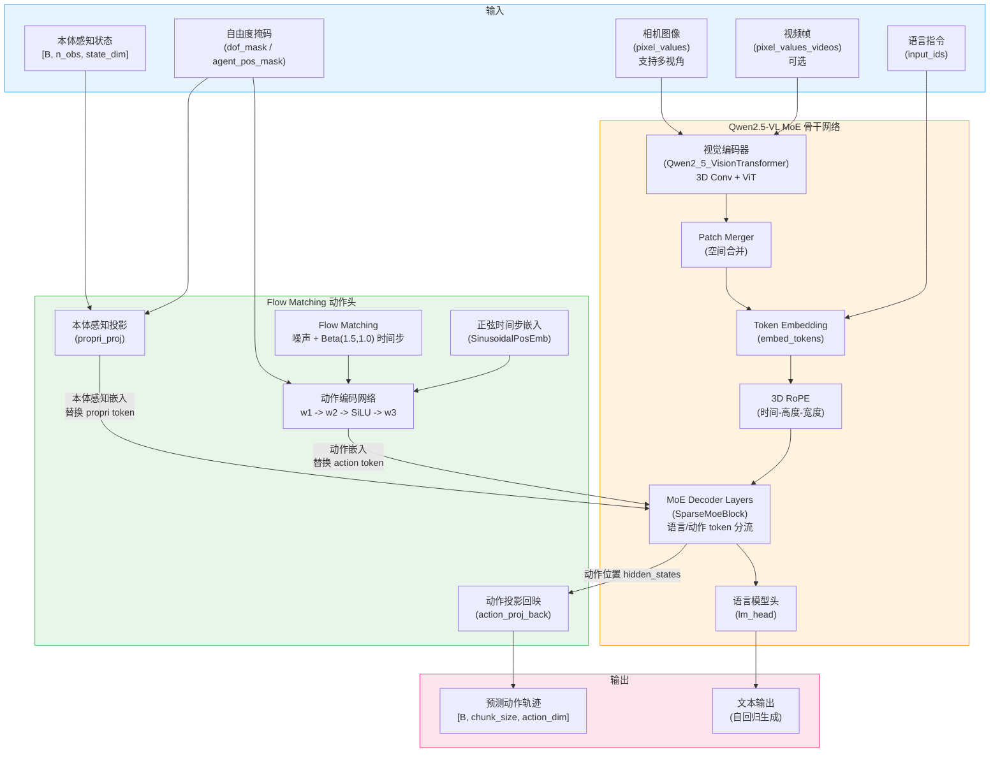

---

## 2. 核心组件详解

### 2.1 Qwen2.5-VL MoE 视觉语言骨干网络

WALL-X 采用 Qwen2.5-VL 作为视觉语言骨干网络，并在其基础上引入 MoE (混合专家) 机制。这是目前 VLA 领域使用的最强 VLM 骨干之一。整体模型由三部分组成：视觉编码器、Patch Merger 空间合并层、以及带 MoE 的 Decoder 层。

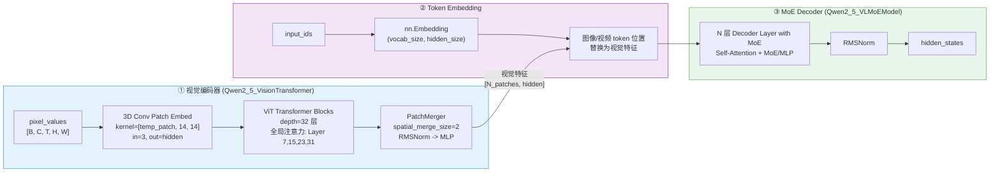

**关键设计：**
- 视觉编码器使用 **3D 卷积** 进行 Patch Embedding，`kernel_size = [temporal_patch_size, patch_size, patch_size]`，天然支持视频时序输入
- ViT 中的全局注意力层位于第 7、15、23、31 层，其余层使用窗口注意力 (`window_size=112`)
- Patch Merger 通过 `spatial_merge_size=2` 将空间分辨率降为原来的 1/4，减少送入 LLM 的 token 数
- Decoder 的每一层都是 `Qwen2_5_VLDecoderLayer_with_MoE`，根据配置选择使用标准 MLP 或 SparseMoeBlock

### 2.2 3D RoPE 位置编码 (时间-高度-宽度)

WALL-X 使用 **3D 旋转位置编码 (3D RoPE / mRoPE)**，为视觉 token 计算三维 (时间-高度-宽度) 位置 ID，为文本 token 使用标准 1D 位置编码。这使得模型能够感知图像/视频的空间和时序结构。

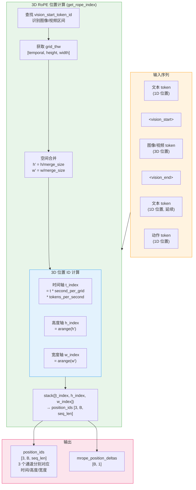

**核心逻辑 (源码 `get_rope_index`)：**
1. 遍历输入序列，找到每个 `vision_start_token_id` 标记的起始位置
2. 根据 `image_grid_thw` 或 `video_grid_thw` 获取该图像/视频的 `[T, H, W]` 网格尺寸
3. 经过 `spatial_merge_size` 合并后，计算 `[llm_grid_t, llm_grid_h, llm_grid_w]`
4. 对每个视觉 token 生成 3D 位置 ID：`t_index` 考虑了 `second_per_grid_t * tokens_per_second` 的时间缩放
5. 文本 token 使用标准 1D 递增位置（三个通道值相同），从视觉 token 最大位置 +1 延续

### 2.3 MoE (混合专家) 路由机制

WALL-X 的关键创新之一是在 Decoder 层中引入 MoE 路由，将 **语言 token** 和 **动作 token** 分流到不同的专家网络进行处理。路由信号由 `moe_token_types` 控制，该标记根据 `<|action|>` token 的位置自动生成。

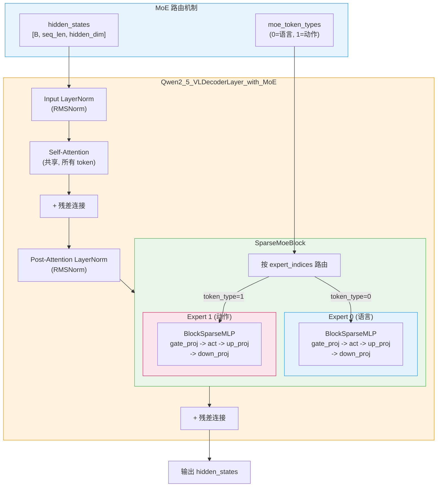

**路由细节：**
- `moe_token_types` 在数据预处理阶段根据 `input_ids == action_token_id` 自动生成
- `SparseMoeBlock` 包含多个 `BlockSparseMLP` 专家，每个专家有独立的 `gate_proj`、`up_proj`、`down_proj`
- 每个专家可以有不同的 `dim_inputs`（输入维度），由配置中的 `dim_inputs` 元组指定
- Self-Attention 在所有 token 间共享（不分流），仅 FFN 层通过 MoE 分流
- 当 `config.mlp_moe=False` 时，退化为标准 MLP（无 MoE），保持与原始 Qwen2.5-VL 兼容

### 2.4 Flow Matching 动作头

Flow Matching 动作头 (`ActionHead`) 是 WALL-X 的动作预测核心，使用 Beta 分布时间步采样和正弦时间步嵌入实现连续动作空间的流匹配预测。

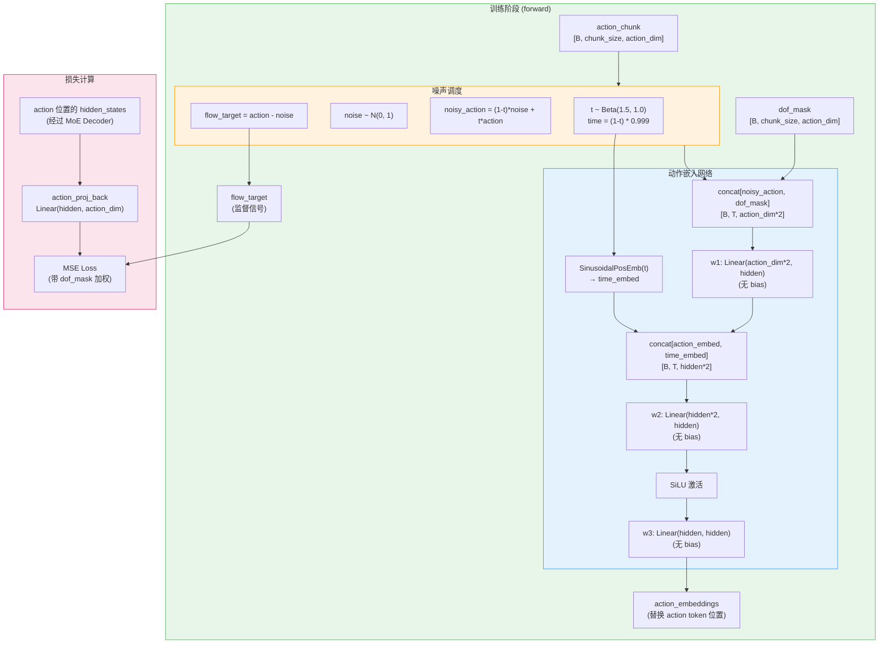

**动作嵌入网络的计算公式：**

```
action_embed = w3( SiLU( w2( concat[ w1(concat[noisy_action, dof_mask]), time_embed ] ) ) )
```

### 2.5 本体感知投影 (Proprioception + DOF Mask)

本体感知数据（关节位置、姿态等）通过 `propri_proj` 投影至隐藏空间，并替换序列中 `<|propri|>` token 的位置。DOF Mask 用于标记哪些自由度是有效的（跨具身统一维度）。

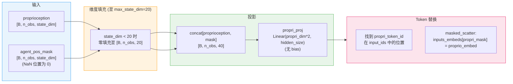

**关键点：**
- 本体感知状态和动作都统一填充到 `max_state_dim=20` / `max_action_dim=20`，使用 NaN 标记无效维度
- DOF Mask 自动从 NaN 位置推导：`(~torch.isnan(data)).float()`
- `propri_proj` 输入维度为 `propri_dim * 2`（状态 + 掩码拼接），输出维度为 `hidden_size`
- 动作的 DOF Mask 同理，在 `w1` 中与 noisy_action 拼接：`w1(concat[noisy_action, dof_mask])`

---

## 3. 三种推理模式

### 3.1 Text 模式 (纯自回归文本生成)

Text 模式下，模型作为标准 VLM 使用，通过自回归方式逐 token 生成文本回复。此模式不涉及动作预测，仅用于语言理解和生成任务。

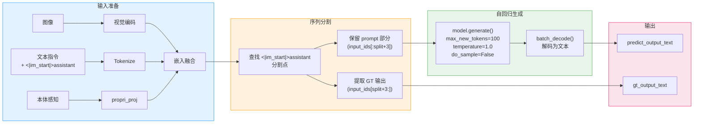

> **注意：** Text 模式仅支持 `batch_size=1`。

### 3.2 Fast 模式 (离散动作 token 生成)

Fast 模式将连续动作离散化为 token，通过自回归方式快速生成动作 token 序列，然后解码为连续动作。需要配合 `action_tokenizer`（如 physical-intelligence/fast）使用。

```mermaid
graph LR
    subgraph Input["输入准备"]
        IMG["图像"] --> VE["视觉编码"]
        TXT["文本指令"] --> TOK["Tokenize<br/>(含 action_token)"]
        VE --> EMB["嵌入融合"]
        TOK --> EMB
    end

    subgraph Generate["自回归生成"]
        EMB --> SPLIT["分割 prompt/gt"]
        SPLIT --> GEN["model.generate()<br/>max_new_tokens=100"]
        GEN --> IDS["predict_output_ids"]
    end

    subgraph Decode["动作解码"]
        IDS --> FILTER["提取 action_token<br/>(id >= action_token_start_index)"]
        FILTER --> OFFSET["减去 start_index 偏移"]
        OFFSET --> DEC["action_processor.decode()<br/>time_horizon, action_dim"]
        DEC --> UNMASK["应用 dof_mask<br/>取有效维度"]
    end

    subgraph Output["输出"]
        UNMASK --> ACT["predict_action<br/>[B, chunk_size, action_dim']"]
    end

    style Input fill:#e3f2fd,stroke:#2196F3
    style Generate fill:#fff3e0,stroke:#FF9800
    style Decode fill:#e8f5e9,stroke:#4CAF50
    style Output fill:#fce4ec,stroke:#E91E63
```

**Fast 模式要点：**
- 使用 `use_fast_tokenizer=True`，需预加载 action tokenizer（默认 `physical-intelligence/fast`）
- 生成的 token 中，ID >= `action_token_start_index` 的 token 为动作 token
- 通过 `action_processor.decode()` 将离散 token 序列解码回连续动作空间
- 仅支持 `batch_size=1`

### 3.3 Diffusion 模式 (ODE 积分连续动作预测)

Diffusion 模式是 WALL-X 最核心的推理模式。从随机高斯噪声出发，通过 ODE 欧拉积分迭代去噪，最终得到连续动作轨迹。此模式支持任意 batch size。

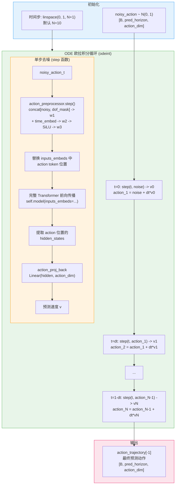

**ODE 积分细节 -- 单步展开：**

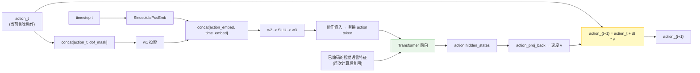

> **注意：** 每一步去噪都需要完整的 Transformer 前向传播（因为需要与视觉语言 token 进行注意力交互）。默认 `num_inference_timesteps=10`。

---

## 4. 训练流水线

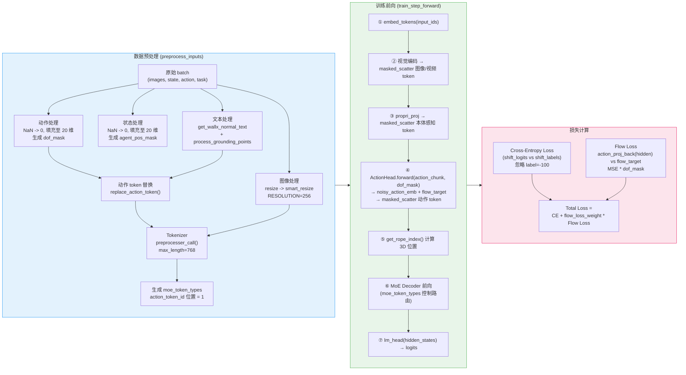

**训练损失公式：**

```
L_total = L_cross_entropy + flow_loss_weight * L_flow

L_cross_entropy = CE(shift_logits, shift_labels)   # 忽略 label=-100 的位置
L_flow = MSE(action_proj_back(h_action), flow_target) * dof_mask   # 仅在有效 DOF 上计算
```

其中 `flow_target = action_chunk - noise`，`h_action` 是 action token 位置的 Transformer 隐藏状态。

---

## 5. 关键超参数表

| 参数 | 值 | 说明 |
|---|---|---|
| `chunk_size` | 32 | 动作预测时域长度 (action horizon) |
| `n_action_steps` | 32 | 每次推理使用的动作步数 |
| `max_action_dim` | 20 | 跨具身统一动作维度 |
| `max_state_dim` | 20 | 跨具身统一状态维度 |
| `n_obs_steps` | 1 | 观测历史步数 |
| `prediction_mode` | `"diffusion"` / `"fast"` | 推理模式选择 |
| `num_inference_timesteps` | 10 | Diffusion 模式去噪步数 |
| `beta_alpha` | 1.5 | Flow Matching Beta 分布 alpha |
| `beta_beta` | 1.0 | Flow Matching Beta 分布 beta |
| `s` (时间上界) | 0.999 | 采样时间缩放因子 |
| `flow_loss_weight` | 1.0 | Flow Loss 权重系数 |
| `RESOLUTION` | 256 | 输入图像分辨率 |
| `IMAGE_FACTOR` | 28 | Patch 对齐因子 |
| `MIN_PIXELS` | 4 * 28 * 28 | 最小像素数 |
| `MAX_PIXELS` | 16384 * 28 * 28 | 最大像素数 |
| `TOKENIZER_MAX_LENGTH` | 768 | Tokenizer 最大长度 |
| `num_experts` | 4 (默认) | MoE 专家数量 |
| `spatial_merge_size` | 2 | 视觉 Patch 空间合并系数 |
| `patch_size` | 14 | 视觉 Patch 大小 |
| `temporal_patch_size` | 2 | 时间维度 Patch 大小 |
| `vision_depth` | 32 | 视觉 Transformer 层数 |
| `fullatt_block_indexes` | [7, 15, 23, 31] | 全局注意力层索引 |
| `optimizer_lr` | 2e-5 | 学习率 |
| `optimizer_betas` | (0.9, 0.95) | Adam beta 参数 |
| `optimizer_weight_decay` | 0.01 | 权重衰减 |
| `optimizer_grad_clip_norm` | 1.0 | 梯度裁剪 |
| `scheduler_warmup_steps` | 1000 | 预热步数 |
| `scheduler_decay_steps` | 100000 | 衰减步数 |
| LoRA `r` | 8 (默认) | LoRA 秩 |
| LoRA `target_modules` | `["q_proj", "v_proj"]` | LoRA 目标模块 |

---

## 6. 关键源文件表

| 组件 | 类名 | 文件路径 |
|---|---|---|
| 策略封装 | `WallXPolicy` | `lerobot/policies/wall_x/modeling_wall_x.py:1689` |
| 主模型 | `Qwen2_5_VLMoEForAction` | `lerobot/policies/wall_x/modeling_wall_x.py:256` |
| Flow Matching 动作头 | `ActionHead` | `lerobot/policies/wall_x/modeling_wall_x.py:109` |
| 正弦位置嵌入 | `SinusoidalPosEmb` | `lerobot/policies/wall_x/modeling_wall_x.py:92` |
| MoE Decoder 模型 | `Qwen2_5_VLMoEModel` | `lerobot/policies/wall_x/qwen_model/qwen2_5_vl_moe.py:2360` |
| MoE Decoder 层 | `Qwen2_5_VLDecoderLayer_with_MoE` | `lerobot/policies/wall_x/qwen_model/qwen2_5_vl_moe.py:2265` |
| 稀疏 MoE 模块 | `SparseMoeBlock` | `lerobot/policies/wall_x/qwen_model/qwen2_5_vl_moe.py:2217` |
| 专家 MLP | `BlockSparseMLP` | `lerobot/policies/wall_x/qwen_model/qwen2_5_vl_moe.py:2201` |
| 视觉 Transformer | `Qwen2_5_VisionTransformerPretrainedModel` | `lerobot/policies/wall_x/qwen_model/qwen2_5_vl_moe.py` |
| Patch Embedding | `Qwen2_5_VisionPatchEmbed` | `lerobot/policies/wall_x/qwen_model/qwen2_5_vl_moe.py:68` |
| Patch Merger | `Qwen2_5_VLPatchMerger` | `lerobot/policies/wall_x/qwen_model/qwen2_5_vl_moe.py:136` |
| 模型输出定义 | `Qwen2_5_VLACausalLMOutputWithPast` | `lerobot/policies/wall_x/qwen_model/qwen2_5_vl_moe.py:2187` |
| Qwen VL 配置 | `Qwen2_5_VLConfig` | `lerobot/policies/wall_x/qwen_model/configuration_qwen2_5_vl.py:43` |
| 视觉编码器配置 | `Qwen2_5_VLVisionConfig` | `lerobot/policies/wall_x/qwen_model/configuration_qwen2_5_vl.py:5` |
| 策略配置 | `WallXConfig` | `lerobot/policies/wall_x/configuration_wall_x.py:26` |
| 常量定义 | -- | `lerobot/policies/wall_x/constant.py` |
| 工具函数 | `get_wallx_normal_text`, `replace_action_token` 等 | `lerobot/policies/wall_x/utils.py` |
