# X-VLA 模型架构

## 1. 整体架构概览

X-VLA (Extended Vision-Language-Action) 是一个基于扩散的跨具身视觉-语言-动作模型，将 Florence2 视觉语言模型作为感知主干网络，配合软提示 Transformer (SoftPromptedTransformer) 动作头进行机器人动作预测。其核心设计思路为：Florence2 的 Vision Tower 和 BART 编码器提取多模态特征（**移除 BART 解码器以降低计算量**），再通过域感知线性层 (DomainAwareLinear) 实现多机器人具身支持，最终以扩散去噪方式生成动作序列。模型支持多视角图像输入、多种动作空间（ee6d / joint / auto 等），并通过可学习的软提示 token 实现域特定的知识注入。

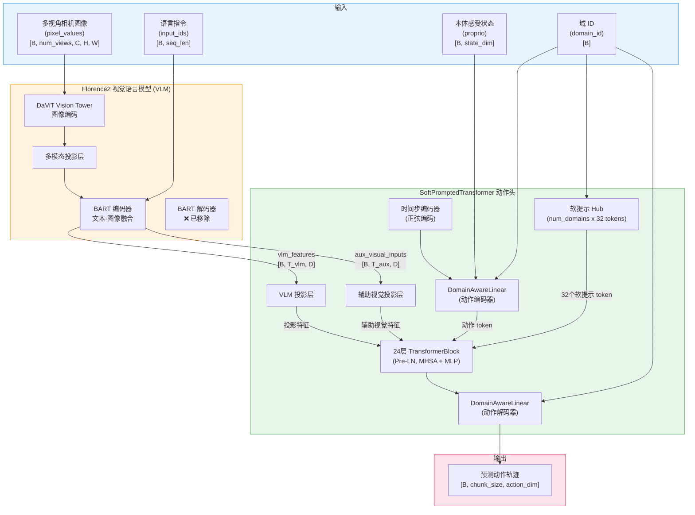

---

## 2. 核心组件详解

### 2.1 Florence2 视觉语言模型 (Vision Tower + BART 编码器)

Florence2 作为 X-VLA 的感知主干网络，负责将多视角图像和语言指令编码为统一的多模态特征。X-VLA **仅使用编码器部分**，在初始化时显式移除了 BART 的解码器 (`lm.model.decoder`) 和语言模型头 (`lm.lm_head`)，以节省显存和计算量。

**多视角处理流程：** 第一个视角图像与文本 token 在 BART 编码器中融合，产生 `vlm_features`；其余视角图像作为辅助视觉输入 (`aux_visual_inputs`) 直接传递给 Transformer 动作头。

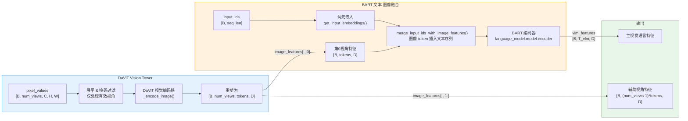

**关键设计：BART 解码器移除**

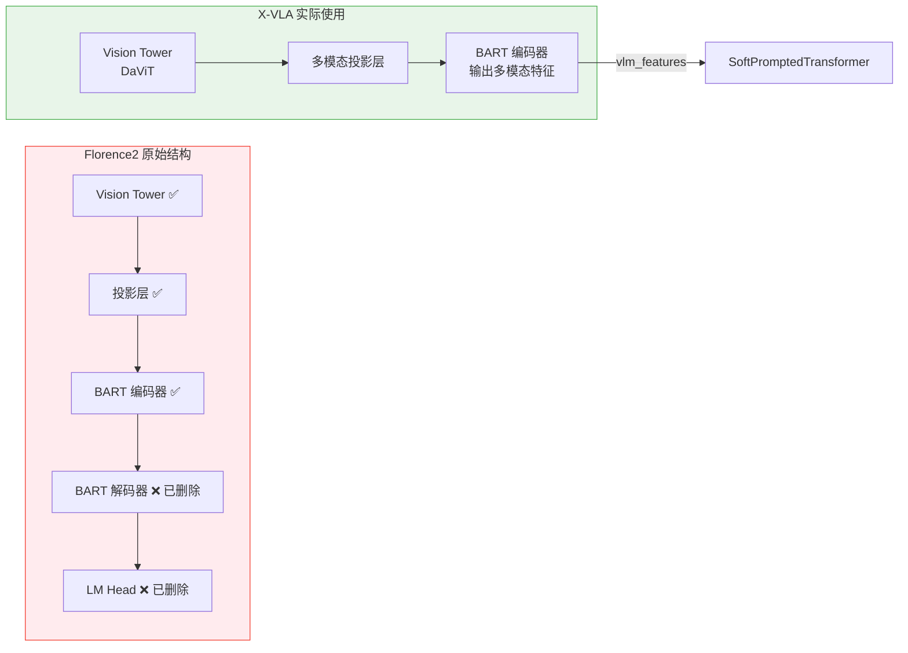

> **移除逻辑** (见 `modeling_xvla.py:79-84`):
> ```python
> if hasattr(self.vlm, "language_model"):
>     lm = self.vlm.language_model
>     if hasattr(lm, "model") and hasattr(lm.model, "decoder"):
>         del lm.model.decoder
>     if hasattr(lm, "lm_head"):
>         del lm.lm_head
> ```

**冻结策略：**

| 组件 | 默认状态 | 配置项 |
|---|---|---|
| Vision Tower | 可配置冻结 | `freeze_vision_encoder` (默认 False) |
| BART 编码器 | 可配置冻结 | `freeze_language_encoder` (默认 False) |
| BART 解码器 | 已删除 | N/A |
| LM Head | 已删除 | N/A |

---

### 2.2 SoftPromptedTransformer (软提示 Transformer)

SoftPromptedTransformer 是 X-VLA 的核心动作生成模块。它接收 VLM 特征、辅助视觉特征、含噪动作、本体感受状态和时间步信息，通过 24 层标准 Transformer 块进行处理，最终解码出预测动作。

**核心特色：** 每个域 (embodiment) 拥有独立的 32 个可学习软提示 token，通过 `nn.Embedding(num_domains, len_soft_prompts * hidden_size)` 存储，在前向传播时按 `domain_id` 索引并拼接到序列末尾。

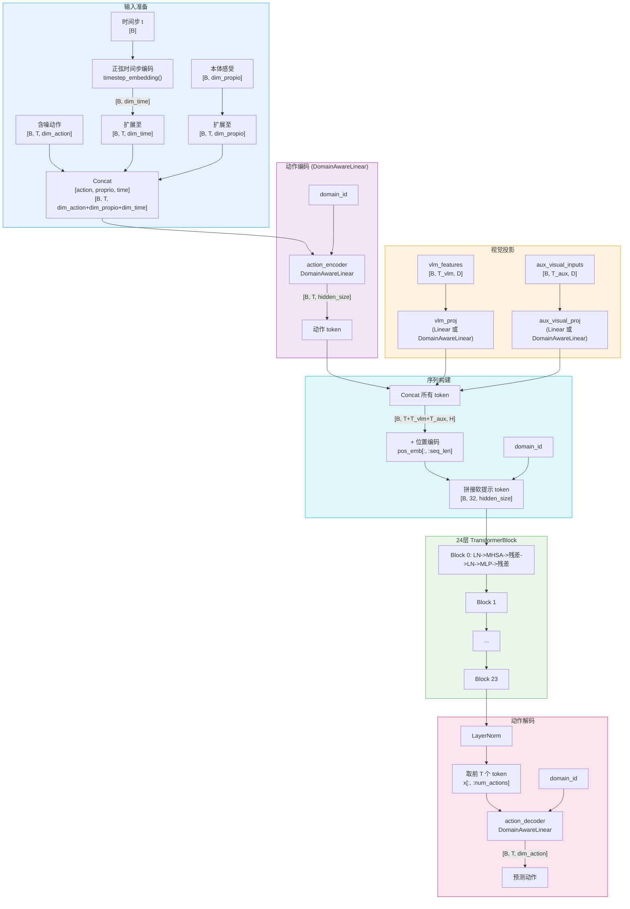

#### 序列拼接顺序

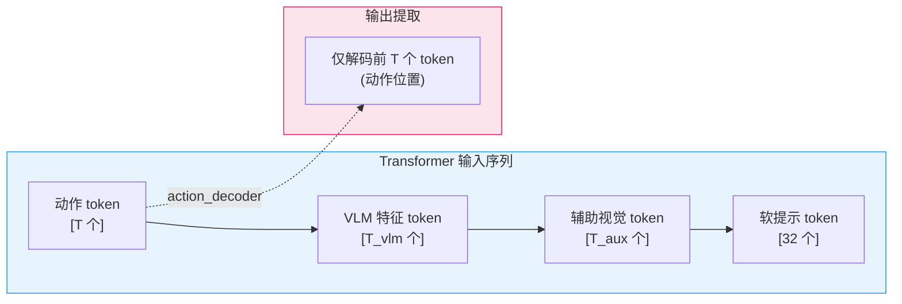

> **设计要点：** 软提示 token 拼接在序列**末尾**，但最终只解码序列**开头**的动作 token 位置。这使得软提示通过注意力机制间接影响动作预测，而非直接参与解码。

#### 单个 TransformerBlock (Pre-LN)

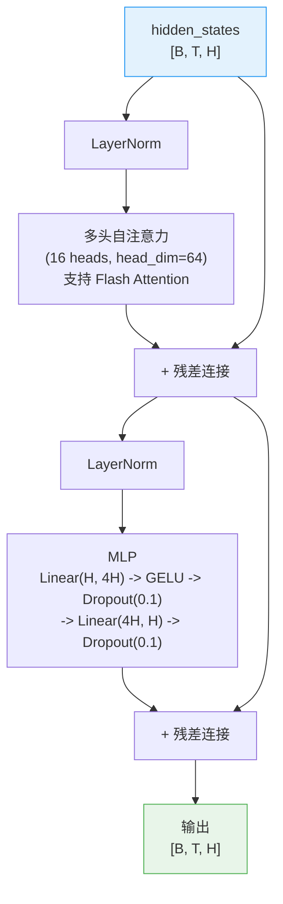

---

### 2.3 DomainAwareLinear (域感知线性层)

DomainAwareLinear 是 X-VLA 实现多具身支持的核心机制。每个域 (embodiment) 拥有独立的权重矩阵和偏置向量，通过 `nn.Embedding` 存储，在前向传播时按样本级别的 `domain_id` 索引选择对应的权重进行计算。

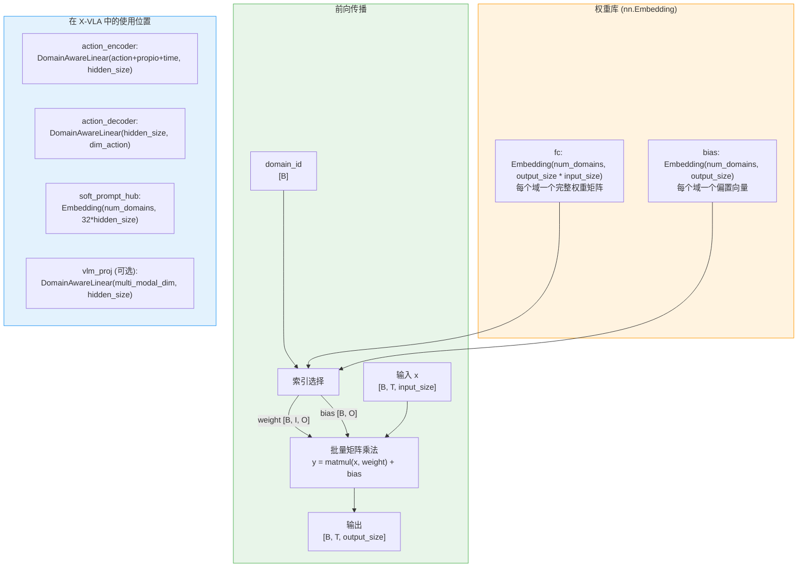

> **与 GR00T 的 CategorySpecificLinear 对比：** 两者设计思路一致——通过 Embedding 存储多组权重，按 embodiment ID 索引选择。X-VLA 的 DomainAwareLinear 支持 2D 和 3D 输入（自动 squeeze/unsqueeze），且使用 Xavier 均匀初始化权重、零初始化偏置。

---

### 2.4 动作空间管理器 (ActionSpace Registry)

X-VLA 通过注册表模式管理多种动作空间，每种动作空间定义了维度、损失计算、预处理和后处理逻辑。

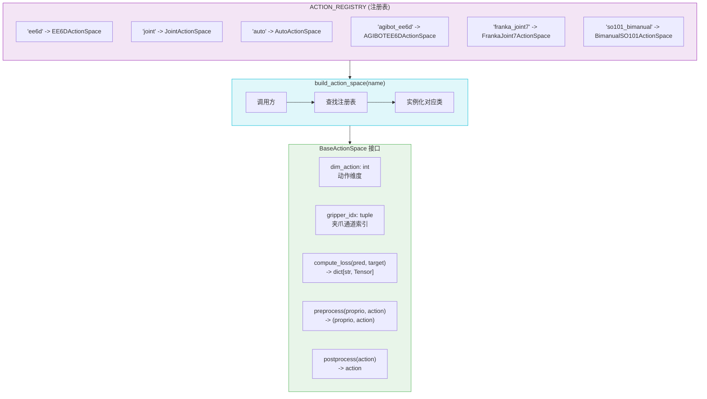

---

## 3. 训练流水线

训练时，模型使用扩散过程（Flow Matching）对动作进行加噪和去噪预测。时间步 `t` 在 `[0, 1)` 范围内均匀采样（带批次内偏移以增强多样性），含噪动作通过线性插值生成。

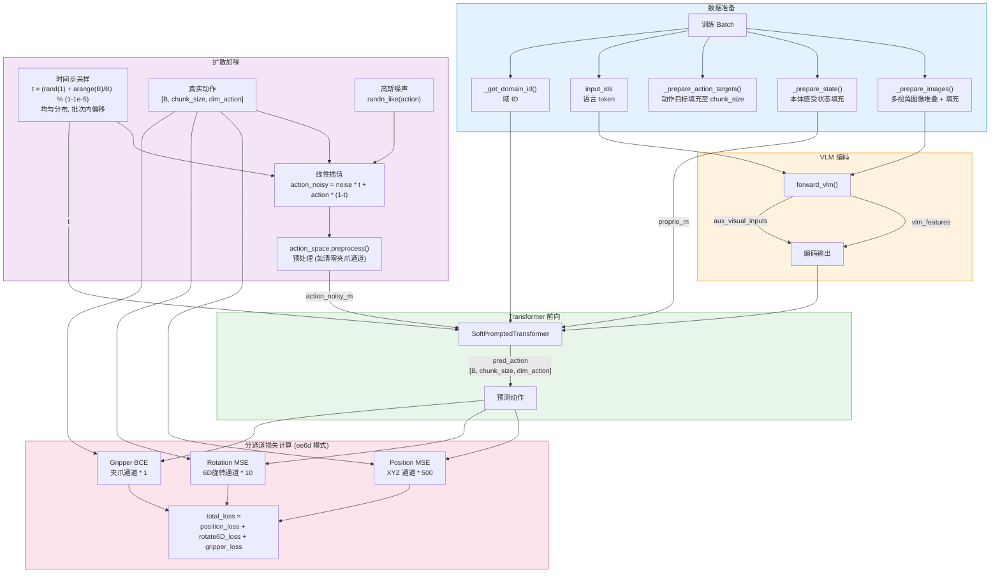

### 扩散加噪公式

```
t ~ Uniform[0, 1)  (带批次内偏移)
noise ~ N(0, I)
action_noisy = noise * t + action_gt * (1 - t)
```

模型预测的目标是**直接预测去噪后的动作**（而非预测噪声或速度），损失计算在原始动作空间中进行。

---

## 4. 推理流水线

推理时，模型从纯随机噪声出发，通过迭代去噪逐步恢复动作轨迹。默认使用 10 步去噪。

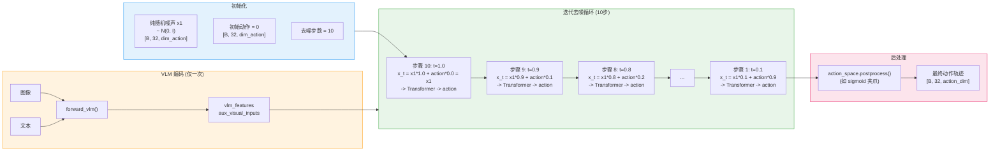

### 单步去噪展开

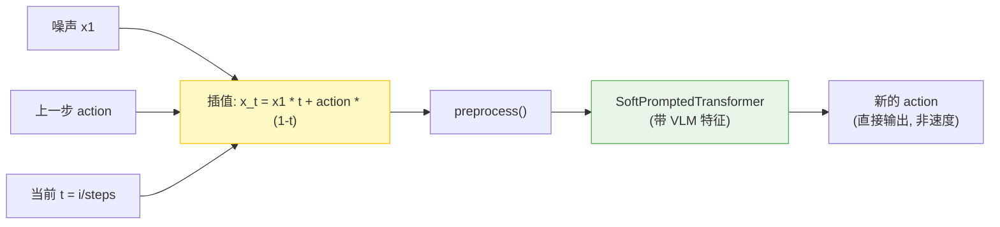

> **与 GR00T 的区别：** GR00T 使用欧拉积分 (`action += dt * v`) 逐步更新动作；X-VLA 则在每一步直接用模型输出替换 action，下一步再以新的 action 与噪声插值。两者都属于 Flow Matching 框架，但积分方式不同。

### 动作选择策略 (Action Chunking)

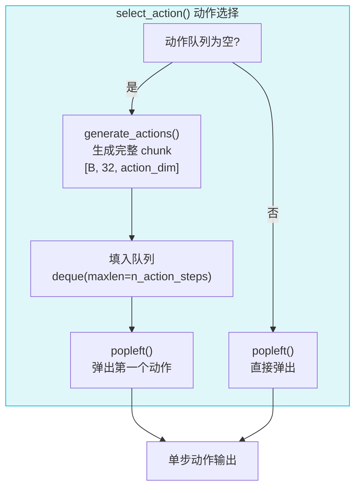

---

## 5. 动作空间详解

### 各模式对比

| 动作空间 | 维度 | 布局 | 夹爪索引 | 损失函数 | 适用场景 |
|---|---|---|---|---|---|
| **ee6d** | 20D | [XYZ(3)+Rot6D(6)+Gripper(1)] x2 臂 | (9, 19) | Pos MSE*500 + Rot MSE*10 + Grip BCE*1 | 末端执行器双臂 |
| **joint** | 14D | [Joints(6)+Gripper(1)] x2 臂 | (6, 13) | Joints MSE*1 + Grip BCE*0.1 | 关节空间双臂 |
| **auto** | 可配置 | 前 real_dim 维有效, 填充至 max_dim | 无 | MSE*1 (仅前 real_dim 维) | 任意维度自适应 |
| **agibot_ee6d** | 20D | 同 ee6d | (9, 19) | Pos MSE*500 + Rot MSE*10 + Grip MSE*10 | AGI-Bot (全 MSE) |
| **franka_joint7** | 20D (实际7D) | 7关节 + 13维填充 | 无 | MSE*1 (仅前7维) | Franka Panda |
| **so101_bimanual** | 20D (实际12D) | [5关节+Gripper] x2 + 8维填充 | (5, 11) | MSE*1 + Grip MSE*1 | SO-101 双臂 |

### ee6d 动作布局 (20D)

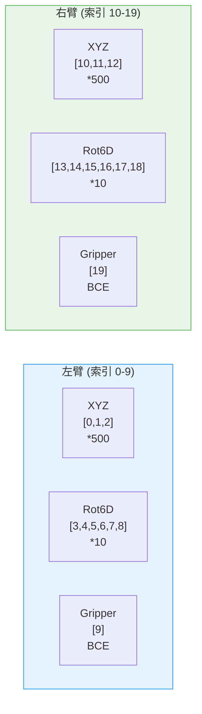

### 预处理与后处理

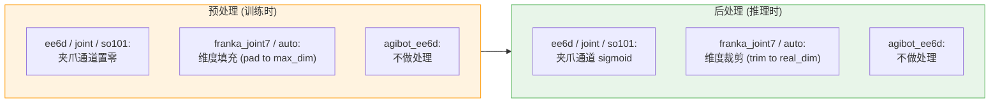

---

## 6. 关键超参数表

| 参数 | 默认值 | 说明 |
|---|---|---|
| `hidden_size` | 1024 | Transformer 隐藏层维度 |
| `depth` | 24 | Transformer 层数 |
| `num_heads` | 16 | 注意力头数 (head_dim = 64) |
| `mlp_ratio` | 4.0 | MLP 隐藏层倍数 (MLP dim = 4096) |
| `chunk_size` | 32 | 预测的未来动作步数 |
| `n_action_steps` | 32 | 每次推理使用的动作步数 |
| `num_denoising_steps` | 10 | 推理时去噪步数 |
| `num_domains` | 30 | 最大支持的机器人域数量 |
| `len_soft_prompts` | 32 | 每个域的可学习软提示 token 数 |
| `dim_time` | 32 | 时间步嵌入维度 |
| `max_len_seq` | 512 | 最大序列长度 (位置编码) |
| `max_state_dim` | 32 | 最大本体感受状态维度 |
| `max_action_dim` | 20 | 最大动作维度 (auto 模式填充目标) |
| `action_mode` | "ee6d" | 动作空间模式 |
| `dtype` | "float32" | 模型精度 ("bfloat16" / "float32") |
| `tokenizer_name` | "facebook/bart-large" | 语言分词器 |
| `tokenizer_max_length` | 64 | 最大文本 token 长度 |
| `use_proprio` | True | 是否使用本体感受状态 |
| `use_hetero_proj` | False | 是否使用域感知视觉投影 |
| `optimizer_lr` | 1e-4 | 基础学习率 |
| `optimizer_grad_clip_norm` | 10.0 | 梯度裁剪范数 |
| `scheduler_warmup_steps` | 1,000 | 学习率预热步数 |
| `scheduler_decay_steps` | 30,000 | 余弦衰减总步数 |
| `Attention dropout` | 0.1 | 注意力 Dropout 率 |
| `MLP dropout` | 0.1 | MLP Dropout 率 |

### 优化器配置

X-VLA 使用差分学习率策略：

| 参数组 | 学习率 | 说明 |
|---|---|---|
| VLM 参数 (vision + language) | `lr * 0.1` | 1/10 基础学习率, 稳定优化 |
| Transformer / 动作头 | `lr` | 完整学习率 |
| 软提示 | `lr * soft_prompt_lr_scale` | 可配置缩放, 支持独立 warmup |

---

## 7. 关键源文件表

| 组件 | 类名 | 文件路径 |
|---|---|---|
| 主模型 | `XVLAModel` | `lerobot/policies/xvla/modeling_xvla.py:43` |
| LeRobot 策略封装 | `XVLAPolicy` | `lerobot/policies/xvla/modeling_xvla.py:271` |
| 模型配置 | `XVLAConfig` | `lerobot/policies/xvla/configuration_xvla.py:41` |
| 软提示 Transformer | `SoftPromptedTransformer` | `lerobot/policies/xvla/soft_transformer.py:292` |
| Transformer 模块 | `TransformerBlock` | `lerobot/policies/xvla/soft_transformer.py:258` |
| 多头自注意力 | `Attention` | `lerobot/policies/xvla/soft_transformer.py:92` |
| 域感知线性层 | `DomainAwareLinear` | `lerobot/policies/xvla/soft_transformer.py:215` |
| 时间步嵌入 | `timestep_embedding()` | `lerobot/policies/xvla/soft_transformer.py:183` |
| MLP 模块 | `Mlp` | `lerobot/policies/xvla/soft_transformer.py:47` |
| 动作空间注册表 | `ACTION_REGISTRY` | `lerobot/policies/xvla/action_hub.py:27` |
| 动作空间基类 | `BaseActionSpace` | `lerobot/policies/xvla/action_hub.py:55` |
| ee6d 动作空间 | `EE6DActionSpace` | `lerobot/policies/xvla/action_hub.py:113` |
| joint 动作空间 | `JointActionSpace` | `lerobot/policies/xvla/action_hub.py:175` |
| auto 动作空间 | `AutoActionSpace` | `lerobot/policies/xvla/action_hub.py:345` |
| Florence2 配置 | `Florence2Config` | `lerobot/policies/xvla/configuration_florence2.py` |
| Florence2 模型 | `Florence2ForConditionalGeneration` | `lerobot/policies/xvla/modeling_florence2.py` |
