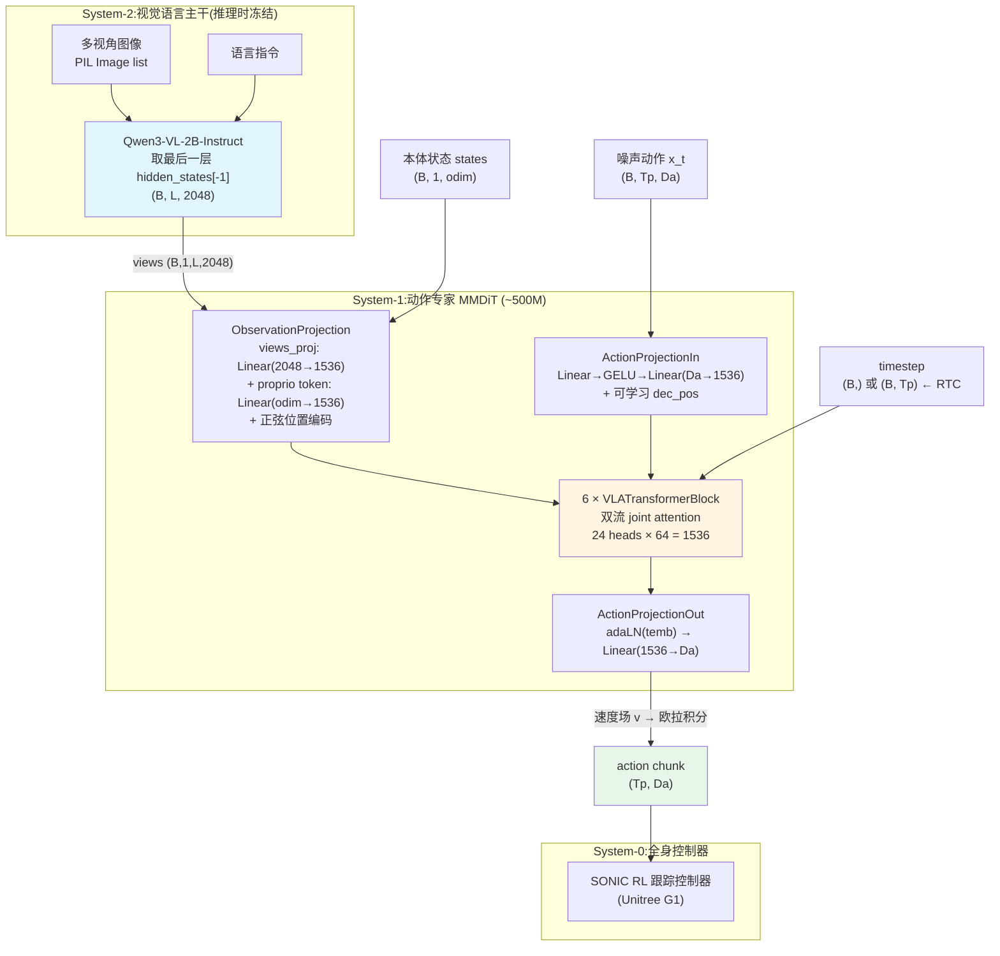
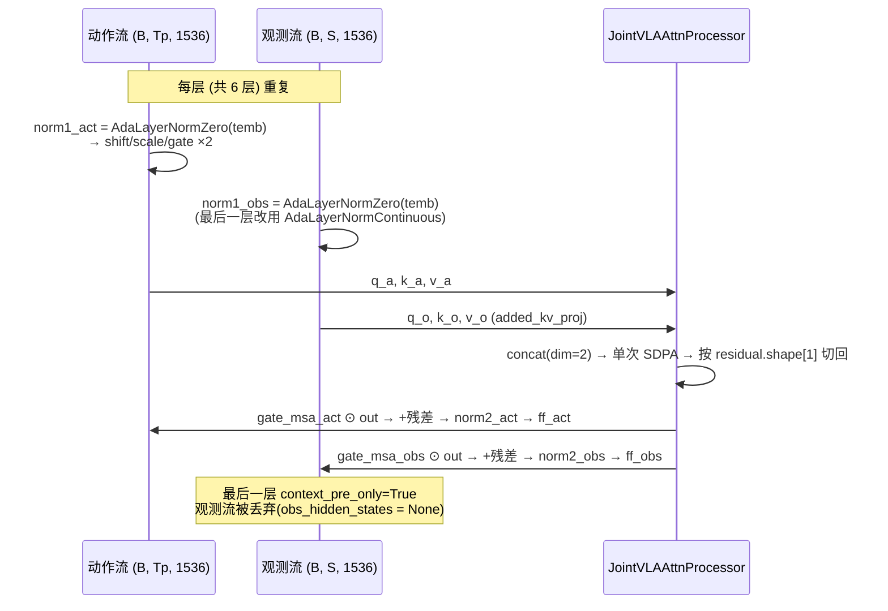
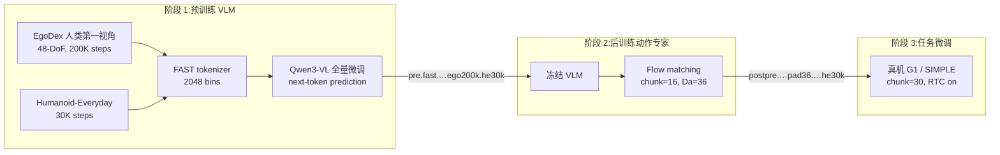

# Ψ₀ (Psi-0) 模型架构

## 1. 整体架构概览

Ψ₀ 是 USC PSI Lab 面向**人形机器人全身 loco-manipulation** 的开源基础模型(RSS 2026,arXiv:2603.12263,CVPR 2026 第二届 3D-LLM/VLA Workshop 最佳论文)。它的核心主张不是某个新模块,而是一条**数据配方**:*"scaling the right data in the right way"* —— 先用大规模**人类第一视角视频**(EgoDex)让 VLM 学会任务语义和视觉表征,再用少量**真机遥操作数据**让动作专家学会本体动力学。声称 80 条轨迹即可微调出新的长程灵巧技能。

架构上是一个明确的**三层系统**分工:

| 层 | 名称 | 组件 | 参数量 | 训练方式 |
|---|---|---|---|---|
| System-2 | 视觉语言主干 | Qwen3-VL-2B-Instruct | ~2B | FAST 离散 token 自回归预训练 |
| System-1 | 动作专家 | Flow-matching MMDiT(SD3 风格) | ~500M | Flow matching 后训练 / 微调 |
| System-0 | 底层控制器 | SONIC(GR00T-WholeBodyControl)RL 跟踪控制器 | — | 外部预训练,不参与 VLA 训练 |



关键点:VLM 与动作专家的接口**只有一根线** —— VLM 最后一层的 hidden states 被当成"视觉 token 序列"(代码里叫 `views`)喂给动作专家(`psi0.py:1625-1632`)。既不做 pooling,也不额外抽 vision tower 特征,更没有中间层 Q-Former(默认路径下)。这让 System-2 和 System-1 可以完全解耦地分阶段训练。

---

## 2. 核心组件详解

### 2.1 System-2:Qwen3-VL-2B-Instruct 主干

`Psi0Model.__init__`(`src/psi/models/psi0.py:1482`)直接持有一个 `Qwen3VLForConditionalGeneration`。推理时把图像和指令拼成标准 chat 消息,过 `AutoProcessor`:

```python
content = [{"type": "image", "image": img} for img in observation]
content.append({"type": "text", "text": instruction})
messages.append([{"role": "user", "content": content}])
texts = [self.vlm_processor.apply_chat_template(m, tokenize=False, add_generation_prompt=True) for m in messages]
image_inputs, video_inputs = process_vision_info(messages, image_patch_size=16)
```

然后**只取最后一层**隐状态:

```python
vlm_hidden_states = output.hidden_states[-1]        # (B, L, 2048)
vlm_hidden_states = vlm_hidden_states.unsqueeze(1)  # (B, 1, L, 2048) → 作为 "views"
```

注意 `view_feature_dim` 在所有 Ψ₀ 训练脚本里都写成 **2048**,正是 Qwen3-VL-2B 的 `text_config.hidden_size`。默认值 1920 是给外部 ResNet 特征用的历史遗留。

后训练与微调阶段 VLM **全程冻结**(`posttrain.py:126-128`):

```python
assert self.model_cfg.tune_vlm == False
for p in self.model.vlm_model.parameters():
    p.requires_grad = False
```

`from_pretrained`(`psi0.py:1518`)加载 checkpoint 时也很直接:按 `vlm_model.` / `action_header.` 前缀把 safetensors 劈成两半分别 load,并用 `embed_tokens.weight` 补上 tied 的 `lm_head.weight`。因为 FAST 预训练扩过词表,这里会按需 `resize_token_embeddings(..., pad_to_multiple_of=192)`。

### 2.2 System-1:VLATransformerBlock(SD3 风格 MMDiT)

`VLATransformerBlock`(`psi0.py:814`)是整个动作专家的骨架,结构与 Stable Diffusion 3 的 `JointTransformerBlock` 同构,但把 SD3 的"图像流 / 文本流"换成了 **动作流 A / 观测流 O**:



`JointVLAAttnProcessor`(`psi0.py:308`)的核心就三行:

```python
query = torch.cat([query, encoder_hidden_states_query_proj], dim=2)
key   = torch.cat([key,   encoder_hidden_states_key_proj],   dim=2)
value = torch.cat([value, encoder_hidden_states_value_proj], dim=2)
hidden_states = F.scaled_dot_product_attention(query, key, value, is_causal=False, attn_mask=attn_mask)
hidden_states, encoder_hidden_states = hidden_states[:, :residual.shape[1]], hidden_states[:, residual.shape[1]:]
```

即**两条流各有独立的 q/k/v 投影和独立的 FFN,但共享同一次 attention**。这与 π₀ 系列的"动作专家 cross-attend 到 VLM KV"不同 —— 这里观测流也会被动作流反过来更新,是真正的双向融合。`attn_mask` 由 VLM 的 `attention_mask` 扩展而来(padding token 被屏蔽),在 `tokenize_obs` 里追加 proprio token 时同步补 1(`psi0.py:683`)。

层数与维度:`action_num_blocks=6`,`action_hidden_dim=1536`,`action_nheads=24`,`attention_head_dim=64`(24 × 64 = 1536,严格整除)。

### 2.3 观测投影:ObservationProjection

`psi0.py:423`。默认配置(`n_conditions=0`、`token_fusion="concat"`、`use_film=False`)下路径其实很短:

| 步骤 | 操作 | 形状 |
|---|---|---|
| 1 | `views_proj = Linear(2048 → 1536)` | (B, 1, L, 2048) → (B, 1, L, 1536) |
| 2 | reshape 展平视角维 | → (B, L, 1536) |
| 3 | `_obs_proc = Dropout(0.2) → Linear(odim → 1536)`,拼成 1 个额外 token | → (B, L+1, 1536) |
| 4 | `enc_pos` 正弦位置编码相加 | (B, L+1, 1536) |

`_obs_strat = "add_token"` 是硬编码的(`psi0.py:589`)—— 本体状态永远作为**一个独立 token 拼在观测序列末尾**,而不是逐 token 广播拼接。

代码里还留着三条未启用的分支,值得知道它们存在但默认不走:`n_conditions > 0` 时会用 ResNet-18 编码 2D 轨迹条件图(`traj2ds`),`token_fusion` 可选 `cross`(轨迹 token cross-attend 视觉)或 `perceiver`(256 个 latent query 分别聚合视觉/轨迹),`use_film` 会插一层 FiLM 调制。所有 Ψ₀ 训练脚本都设 `--model.n_conditions=0 --model.no-use_film`。

### 2.4 动作投影与时间条件

**入口** `ActionProjectionIn`(`psi0.py:746`):

```python
self.ac_proj = nn.Sequential(nn.Linear(action_dim, action_dim), nn.GELU("tanh"), nn.Linear(action_dim, output_dim))
self.dec_pos = nn.Parameter(torch.empty(action_pred_horizon, output_dim))  # xavier_uniform 初始化
...
action_hidden_states = self.ac_proj(noise_acs) + self.dec_pos.unsqueeze(0)
```

动作位置编码是**可学习**的(不是正弦),而观测侧是固定正弦 —— 一个小但明确的不对称设计。

**出口** `ActionProjectionOut`(`psi0.py:784`)是 DiT 的 final layer,用 temb 做 adaLN 调制后线性投到 `action_dim`。注意实现里写的是 `x = x * scale + shift`(没有先过 `norm_final`,代码注释 `# TODO be careful!` 保留在原地)。

**时间嵌入** `_TimeNetwork(time_dim=256, out_dim=1536)`(`psi0.py:60`)是经典的对数频率正弦嵌入 + 两层 MLP。它有一处专门为 RTC 做的改造:

```python
def forward(self, x):
    # RTC: support 2D timesteps (B,Tp)
    x = x[..., None] * self.w
    x = torch.cat((torch.cos(x), torch.sin(x)), dim=-1)
    return self.out_net(x)
```

输入可以是 `(B,)` 也可以是 `(B, Tp)`。配套地,`AdaLayerNormZero.forward`(`psi0.py:217`)同时接受 `(B, D)` 和 `(B, T, D)` 的 emb;`VLATransformerBlock` 在给观测流做调制时用 `temb[:,-1] if len(temb.shape) > 2 else temb`(`psi0.py:940/947`)—— 因为观测流没有"每个动作步的噪声等级"这个概念,只能取最后一个。**这三处改动合起来,就是 RTC 的全部模型侧支持**。

### 2.5 备选动作头:DiTActionTransformerModel

`psi0.py:1211`,由 `--model.use-dit` 开启,默认关闭。它把观测 token 先过一个 **Q-Former**(256 个可学习 query + `CrossAttentionBlock`)压成定长,再送进一个标准 **DiT**(depth 24,16 heads,`learn_sigma=False`):

```python
query = self.query_tokens.unsqueeze(0).expand(B, -1, -1)   # (B, 256, D)
queried = self.cross_attention(query, condition_tokens)     # (B, 256, D)
action_output = self.DiT(noisy_action, timestep, queried)
```

代价是**丢掉了 per-token timestep 能力**(DiT 只接受标量 timestep),所以这条路径与 RTC 不兼容。

---

## 3. 三阶段训练流水线



### 3.1 阶段 1:FAST 离散动作预训练(`PretrainTrainer`)

`src/psi/trainers/pretrain.py`。这一阶段**没有扩散、没有动作专家** —— 动作被 `FastActionTokenizer`(DCT + BPE,`physical-intelligence/fast` 系)离散成 2048 个 bin,追加到 Qwen 的词表里,然后当作普通语言 token 做**自回归下一 token 预测**:

```python
self.vlm.resize_token_embeddings(len(self.tokenizer) + self.model_cfg.action_tokenizer.bins, ...)
...
loss = output.loss    # 标准 CE
```

监控指标 `action_l1_loss` 会把预测 token 解码回连续动作再算 L1(`pretrain.py:224-254`),只用于观察,不回传。

| 项 | EgoDex 预训练 | HE 预训练 |
|---|---|---|
| 脚本 | `pretrain-egodex-psi0-fast.sh` | `pretrain-he-psi0-fast.sh` |
| 并行 | DeepSpeed **ZeRO-3** | 同 |
| batch / GPU | 16 | 16 |
| lr | 1e-4,constant,warmup 0 | 同 |
| `tune_mm_llm/vision/mlp` | 全部 True | 同 |
| `mm_projector_lr` / `vision_tower_lr` | 1e-5 / 1e-5 | 同 |
| `chunk_size` | 1 | — |
| `upsample_rate` | 3 | — |
| 归一化 | `bounds_q99` + delta actions | 同 |
| 图像 resize | 270 × 480 | — |
| FAST checkpoint | `src/fast/egodex-rel-50w-1x48-v2048-s100` | 同 |

发布的主干 checkpoint 是二者串联的结果:`psi0/pre.fast.1by1.2601091803.ckpt.ego200k.he30k`。

### 3.2 阶段 2:Flow Matching 后训练动作专家(`PostTrainTrainer`)

`src/psi/trainers/posttrain.py:525`。VLM 冻结,只训 ~500M 的动作头。用的是标准 rectified flow:

```python
sigmas = torch.rand((bsz,), device=...)                       # σ ~ U(0,1)
timesteps = sigmas * 1000
noisy_actions = (1 - σ) * actions + σ * noise
target_action = noise - actions                                # 速度场
loss_action = F.mse_loss(pred, target, reduction="none")
loss_action = (loss_action * actions_mask).sum(1)              # 沿 horizon 求和(不是平均)
loss_action = (loss_action.mean(0) * self.loss_w).sum()        # 按维度加权
```

两个细节值得注意:

**沿 horizon `sum(1)` 而非 `mean(1)`。** 代码注释写明理由:*"to keep gradient consistent when training with different action chunks"* —— 这样从 chunk=16 换到 chunk=30 时,单步梯度尺度不会因分母变化而漂移。

**逐维度损失权重 `loss_w`。** 默认 `[0.1, 0.2, 0.1]` 对应 xyz / rpy / gripper,展开后强制校验 `sum == 1.0`(`posttrain.py:64`)。当 `action_dim != 7` 时退化为均匀的 `1/Da`。

| 项 | 值(`posttrain-he-psi0.sh`) |
|---|---|
| 数据 | Humanoid-Everyday(`HE_RAW`) |
| `action_chunk_size` / `action_dim` / `odim` | 16 / 36 / 36 |
| pad | `pad-action-dim=36`, `pad-state-dim=36` |
| 归一化 | `bounds_q99`,delta actions,**状态不归一化** |
| batch / GPU × 累积 | 64 × 1 |
| lr / 调度 | 1e-4 / constant + 1000 warmup |
| 并行 | DDP + bf16 |
| 图像 | resize 240×320 → center crop 240×320,无增广 |
| `noise_scheduler` | `FlowMatchEulerDiscreteScheduler`(1000 步) |

优化器按前缀分组(`posttrain.py:134`):`action_header.*` 用 `train.learning_rate`,`vlm_model.*` 用 `lang_backbone_lr=1e-5`(冻结时该组为空)。

### 3.3 阶段 3:任务微调 + RTC 训练(`FinetuneTrainer` / `SonicTrainer`)

`src/psi/trainers/finetune.py:539`。这一阶段打开 `--model.rtc --model.max-delay=8`,损失函数多出一段:

```python
delay = torch.randint(low=0, high=self.model_cfg.max_delay, size=(bsz,))
prefix_mask = torch.arange(Tp)[None, :] < delay[:, None]        # (B, Tp)
sigmas = torch.where(prefix_mask, 0.0, sigmas[:, None])         # 前 delay 个动作步噪声等级归零
timesteps = sigmas * 1000                                        # → (B, Tp) 逐 token timestep
...
mask = mask * (~prefix_mask)[:, :, None].float()                # prefix 不计入 loss
```

含义:每个训练样本随机抽一个延迟 `d ∈ [0, max_delay)`,把 chunk 的**前 d 步当作已知的干净动作**(σ=0),其余步正常加噪,并且**只在后半段算 loss**。模型因此学会"给定任意长度的干净前缀,补全剩下的动作"。这正是推理时 RTC 需要的能力 —— 上一块动作还在执行,新一块必须与之无缝衔接。

| 项 | 真机 G1(`finetune-real-psi0.sh`) | SONIC(`finetune-real-sonic-psi0.sh`) |
|---|---|---|
| `action_chunk_size` | 30 | 30 |
| `action_dim` | 36 | **78** |
| `odim` | 36 | **43** |
| `action_exec_horizon` | 30 | 30 |
| `rtc` / `max_delay` | on / 8 | on / 8 |
| batch / GPU | — | 16 × 8 GPU |
| lr / 调度 | 1e-4 | 1e-4 / cosine,warmup 1000 |
| `max_training_steps` | — | 40000 |
| 归一化 | `bounds`,状态归一化 | 同 |
| 图像增广 | 开启 | 开启 |
| 起点 | VLM `pre.fast.…ego200k.he30k` + 动作头 `postpre.…he30k` | 同 |

全局 batch size 在所有真机与仿真实验里统一为 **128**(device bs × GPU 数 × 梯度累积)。

---

## 4. 推理流水线

### 4.1 基础路径:`predict_action`

`psi0.py:1650`。一次 VLM 前向 + N 步动作去噪(`eval_diffusion_steps` 默认 10):

```python
action_samples = torch.randn(bsz, self.action_horizon, self.action_dim)
self.noise_scheduler.set_timesteps(num_inference_steps)
for timestep in self.noise_scheduler.timesteps:
    model_pred = self.action_header(timestep=timestep.expand(bsz), joint_attention_kwargs=dict(
        action_hidden_embeds=action_samples, views=vlm_hidden_states, obs=states, traj2ds=traj2ds))
    action_samples = self.noise_scheduler.step(model_pred, timestep, action_samples).prev_sample
```

VLM 只跑一次,循环里只有动作头 —— 6 层 × 1536 维,推理开销可以忽略。

### 4.2 RTC:四个变体

Real-Time Chunking 要解决的是**推理延迟导致的动作断裂**:上一 chunk 已经执行了 d 步,新 chunk 必须在前 d 步与旧的对齐。仓库里实现了四条路线:

| 方法 | 行号 | 机制 | 需要 RTC 训练? |
|---|---|---|---|
| `predict_action` | 1650 | 无 RTC,直接换 chunk | 否 |
| `predict_action_with_training_rtc_flow` | 1744 | **逐 token timestep + 硬替换前缀**,与训练完全一致 | **是** |
| `predict_action_with_rtc_flow` | 1870 | 伪逆引导(RTC 论文 Eq.5 软掩码) | 否 |
| `predict_action_with_rtc_flow_naive_inpaint` | 2052 | 朴素 inpainting 基线 | 否 |
| `predict_action_with_rtc_flow_based_gradient` | 2197 | 梯度引导变体 | 否 |

**训练一致的 RTC**(部署实际使用的路径,`psi0.py:1770-1846`):

```python
prefix_mask = torch.arange(H)[None, :] < d
for timestep in self.noise_scheduler.timesteps:
    batched_timestep_masked = torch.where(prefix_mask, 0, timestep)          # 前缀 timestep 恒为 0
    action_samples = torch.where(prefix_mask[:, :, None], prev_actions, action_samples)  # 前缀替换为真实旧动作
    model_pred = self.action_header(timestep=batched_timestep_masked, ...)
    action_samples = self.noise_scheduler.step(model_pred, timestep, action_samples).prev_sample
```

因为训练时见过完全相同的分布,这里不需要任何引导项 —— 直接钉住前缀即可。

**伪逆引导 RTC**(`psi0.py:1978-2043`)则是训练无关的方案,把"前缀要贴近 `prev_actions`"写成一个引导项加到速度场上:

```python
pred_x0 = x_t - τ * v                                   # 外推干净动作
error = (prev_actions - pred_x0.detach()) * W           # W 为软掩码
pinv_correction = torch.autograd.grad(pred_x0, x_t, grad_outputs=error)[0]   # VJP
inv_r2 = (τ**2 + (1 - τ)**2) / τ**2
c = torch.nan_to_num(τ / (1 - τ), posinf=guidance_weight)
g = torch.clamp(c * inv_r2, max=guidance_weight)        # guidance_weight 默认 5.0
v = v - g * pinv_correction
```

软掩码 `W` 由 `_create_soft_mask`(`psi0.py:2377`)按 RTC 论文 Eq.5 生成,三段式:

$$
W_i = \begin{cases}
1 & i < d \quad\text{(冻结区,已执行)}\\[2pt]
c_i \cdot \dfrac{e^{c_i}-1}{e-1},\ \ c_i = \dfrac{H-s-i}{H-s-d+1} & d \le i < H-s \quad\text{(过渡区)}\\[2pt]
0 & i \ge H-s \quad\text{(自由区)}
\end{cases}
$$

可选 `exponential`(默认)/ `linear` / `hard` / `simple` 四种调度。约束 `d ≤ s ≤ H - d` 在入口处强校验(`psi0.py:1897`)。

### 4.3 部署约束

`src/psi/deploy/psi0_serve_real_sonic.py:72-81`:

```python
self.Ta = action_exec_horizon or launch_config.model.action_exec_horizon
assert self.Ta <= self.Tp, "action_exec_horizon is too big"
if enable_rtc:
    assert launch_config.model.rtc, "rtc is not supported for this model"
    self.rtc_max_delay = launch_config.model.max_delay
    assert self.Tp - self.Ta <= self.rtc_max_delay
```

即推理延迟被定义为 `d = Tp - Ta`(预测长度减执行长度),必须落在训练时见过的 `[0, max_delay)` 区间内。服务端把上一次预测的剩余部分拼成 `prev_actions` 传给模型,形成滚动衔接。

服务与客户端脚本:

| 场景 | 服务端 | 机器人端 |
|---|---|---|
| 真机 G1(RTC) | `scripts/deploy/serve_psi0-rtc.sh` | `real/scripts/deploy_psi0-rtc.sh` |
| G1 + SONIC(RTC) | `scripts/deploy/serve_psi0-rtc-sonic.sh` | `real/scripts/deploy_psi0-sonic-rtc-robot.sh` + `..-client.sh` |
| SIMPLE 仿真 | `serve_psi0 --rtc --action-exec-horizon=24` | `src/simple/cli/eval_decoupled_wbc.py` 或 `eval.py` |

### 4.4 System-0:SONIC 全身控制器

Ψ₀ 输出的是**全身动作指令**,下肢部分由 [SONIC](https://github.com/NVlabs/GR00T-WholeBodyControl)(NVlabs GR00T-WholeBodyControl)的 RL 跟踪控制器执行。接入 SONIC 后动作维度从 36 涨到 **78**、状态维度从 36 到 **43**,数据经 `scripts/data/raw_sonic_to_psi_lerobot.py` 转成 Ψ₀ 的 LeRobot 格式,训练走 `SonicTrainer`(`src/psi/trainers/sonic.py`)。SONIC 侧细节见 [GR00T-WholeBodyControl 总览](./15.GR00T-WBC_Overview.html)。

SIMPLE 仿真评测按数据来源分两个入口:遥操作采的任务(`*Teleop`)用 `eval_decoupled_wbc.py` + `psi0_decoupled_wbc` agent,CuRobo 运动规划生成的任务(`*MP`)用 `eval.py` + `psi0` agent。

---

## 5. 关键超参数表

### 模型结构(`Psi0ModelConfig`,`src/psi/config/model_psi0.py`)

| 项 | 默认值 | 训练脚本实际值 |
|---|---|---|
| `model_name_or_path` | `Qwen/Qwen3-VL-2B-Instruct` | 预训练产出的 checkpoint 目录 |
| `hidden_dim`(动作专家) | 1536 | 1536 |
| `num_blocks` | 6 | 6 |
| `nhead` | 24 | 24(head_dim = 64) |
| `dim_feedforward` | 2048 | — |
| `time_dim` | 256 | 256 |
| `view_feature_dim` | 1920 | **2048**(Qwen3-VL-2B 隐维) |
| `action_dim` | 7 | 36(G1)/ 78(SONIC)/ 48(EgoDex) |
| `action_chunk_size` | 6 | 16(后训练)/ 30(微调) |
| `action_exec_horizon` | 6 | 16 / 30 / 24(SIMPLE 服务) |
| `observation_horizon` | 1 | 1 |
| `odim` | 15 | 36(G1)/ 43(SONIC) |
| `n_conditions` | 1 | **0** |
| `token_fusion` | `concat` | `concat` |
| `use_film` / `combined_temb` / `use_dit` | False | False |
| `tune_vlm` | False | False(强制) |
| `loss_w` | `[0.1, 0.2, 0.1]` | 同(Da≠7 时退化为均匀) |
| `dropout` | 0.1 | — |
| `model_max_length` | 4096 | — |
| `max_pixels` / `min_pixels` | 576·28² / 16·28² | — |

### Flow Matching

| 项 | 值 |
|---|---|
| 调度器 | `FlowMatchEulerDiscreteScheduler`(diffusers) |
| `train_diffusion_steps` | 1000(与 SD3 预训练对齐,注释标注 MUST) |
| `eval_diffusion_steps` | 10 |
| σ 采样 | `U(0, 1)` |
| 加噪 | `x_t = (1-σ)·a + σ·ε` |
| 目标 | `v = ε - a` |
| 损失 | 逐维加权 MSE,horizon 维求和、batch 维平均 |
| 备选调度器 | `DDIMScheduler`(`noise_scheduler=ddpm`,ε-prediction,`squaredcos_cap_v2`) |

### RTC

| 项 | 值 |
|---|---|
| `rtc` | 微调阶段 True |
| `max_delay` | 8 |
| 训练时延迟采样 | `d ~ Uniform{0, …, max_delay-1}` |
| 推理延迟 | `d = Tp - Ta` |
| 约束 | `d ≤ s ≤ H - d`(伪逆引导路径) |
| `guidance_weight` | 5.0 |
| `mask_schedule` | `exponential` |

### 学习率与优化

| 项 | 预训练 | 后训练 | 微调(SONIC) |
|---|---|---|---|
| 优化器 | AdamW | AdamW | AdamW |
| 并行 | DeepSpeed ZeRO-3 | DDP | DDP |
| 精度 | bf16 | bf16 | bf16 |
| lr | 1e-4 | 1e-4 | 1e-4 |
| 调度 | constant | constant | cosine |
| warmup | 0 | 1000 | 1000 |
| betas | (0.9, 0.999) | (0.9, 0.999) | (0.95, 0.999) |
| weight_decay | 0.0 | 0.0 | 1e-6 |
| `max_grad_norm` | 1.0 | 1.0 | 1.0 |
| batch / GPU | 16 | 64 | 16 |

---

## 6. 关键源文件表

| 文件 | 作用 |
|---|---|
| `src/psi/models/psi0.py` | 全部模型定义:`Psi0Model`、`ActionTransformerModel`、`VLATransformerBlock`、`JointVLAAttnProcessor`、5 个 `predict_action*` 推理路径、`_create_soft_mask` |
| `src/psi/config/model_psi0.py` | `Psi0ModelConfig` 全部超参 |
| `src/psi/config/config.py` | `LaunchConfig` / `TrainConfig` 顶层配置 |
| `src/psi/config/train/*.py` | 9 个训练入口配置(pretrain / posttrain / finetune × egodex / he / mix / real / simple) |
| `src/psi/trainers/pretrain.py` | 阶段 1:FAST 离散 token 自回归预训练 |
| `src/psi/trainers/posttrain.py` | 阶段 2:动作专家 flow matching 后训练 |
| `src/psi/trainers/finetune.py` | 阶段 3:任务微调 + RTC 训练损失 |
| `src/psi/trainers/sonic.py` | SONIC 全身控制器版本的微调 trainer |
| `src/psi/trainers/qwen3vl_mixin.py` | Qwen3-VL 数据整理与 collate |
| `src/psi/tokenizer/fast_action_tokenizer.py` | FAST 动作 tokenizer 封装 |
| `src/psi/deploy/psi0_serve_real_sonic.py` | SONIC 真机策略服务(RTC 约束校验在此) |
| `src/psi/deploy/psi0_serve_simple.py` | SIMPLE 仿真策略服务 |
| `src/psi/data/egodex/egodex_dataset.py` | EgoDex 人类视频数据集 |
| `src/psi/data/humanoid/he_raw_dataset.py` | Humanoid-Everyday 数据集 |
| `src/psi/data/lerobot/lerobot_ext.py` | LeRobot 数据集扩展 |
| `scripts/train/psi0/*.sh` | 9 个训练启动脚本(超参的真实来源) |
| `scripts/data/raw_to_lerobot.py` / `raw_sonic_to_psi_lerobot.py` | 原始遥操作数据 → LeRobot 格式 |
| `scripts/save_pretrain_qwen3vl_backbone.py` / `save_posttrain_action_expert.py` | 阶段间 checkpoint 导出 |

---

## 7. 数据与评测

### 数据集

| 数据集 | 用途 | 规模 / 配置 |
|---|---|---|
| [EgoDex](https://github.com/apple/ml-egodex) | 阶段 1 预训练 | 人类第一视角,48-DoF 动作,200K steps,`upsample_rate=3` |
| [Humanoid-Everyday](https://huggingface.co/datasets/USC-GVL/humanoid-everyday) | 阶段 1 + 阶段 2 | 30K steps 预训练 + 全量后训练 |
| 真机 G1 遥操作 | 阶段 3 | **9 个任务全部开源**(`USC-PSI-Lab/psi-data`) |
| SIMPLE 仿真 | 阶段 3 + 评测 | 6 个全身 loco-manipulation 任务 |

EgoDex 的动作预处理复用了 H-RDT 的流程(`src/h_rdt/datasets/pretrain/`)。

### 评测环境:SIMPLE

[SIMPLE](https://github.com/physical-superintelligence-lab/SIMPLE) 是本项目配套的人形基准仿真器,**MuJoCo 负责物理、Isaac Sim 负责渲染**。提供 `level-0/1/2` 三档域随机化。因为 IsaacSim 用同步渲染 API,单个 episode 评测需要 6~10 分钟。

### 仓库内基线

Ψ₀ 仓库把 8 个对比方法都收进来共享同一套 `src/`(通过 `uv` 分组管理独立虚拟环境):

| 基线 | 位置 |
|---|---|
| GR00T N1.6 | `baselines/gr00t-n1.6/`,详见 [Isaac GR00T N1.6 架构](./06.Isaac-GR00T-N1.6_Architecture.html) |
| OpenPI π₀.₅ | `baselines/pi05/`,详见 [π₀.₅ 架构](./02.Pi0.5_Architecture.html) |
| DreamZero | `baselines/dreamzero/`,详见 [DreamZero 架构](./13.DreamZero_Architecture.html) |
| InternVLA-M1 | `src/InternVLA-M1/` |
| H-RDT | `src/h_rdt/` |
| EgoVLA | `real/deploy/egovla_inference.py` |
| Diffusion Policy | `baselines/dp/` |
| ACT | `baselines/act/`,详见 [ACT 架构](./08.ACT_Architecture.html) |

### 发布的 Checkpoint

| Checkpoint | 说明 | 远程目录 |
|---|---|---|
| Ψ₀ VLM(主) | EgoDex 200K + HE 30K | `psi0/pre.fast.1by1.2601091803.ckpt.ego200k.he30k` |
| Ψ₀ 动作专家(主) | 在 HE 上后训练 | `psi0/postpre.1by1.pad36.2601131206.ckpt.he30k` |
| Ψ₀ VLM(消融) | 仅 EgoDex 200K | `psi0/pre.fast.egodex.2512241941.ckpt200k` |
| Ψ₀ VLM(消融) | 仅 HE 48K | `psi0/pre.abl.only.he.2512311516.48k` |
| Ψ₀ VLM(消融) | 仅 10% EgoDex | `psi0/pre.abl.ego.10per.2602021632.46k` |

消融组的命名本身就说明了论文的核心实验:**拆开验证"人类视频预训练"这一步到底贡献了多少**。

---

## 8. 与其他 VLA 的对照

| 维度 | Ψ₀ | π₀.₅ | GR00T N1.6 |
|---|---|---|---|
| VLM 主干 | Qwen3-VL-2B-Instruct | PaliGemma-3B | Eagle 2.5 / Cosmos-Reason |
| 动作专家结构 | SD3 风格 MMDiT,**动作/观测双流共享 attention** | 混合专家,动作专家 cross-attend VLM KV | DiT + Flow matching |
| VLM 与专家的接口 | 最后一层 hidden states 当视觉 token | 逐层 KV | 逐层特征 |
| 预训练动作表示 | **FAST 离散 token**(自回归) | FAST(π₀-FAST)/ 连续 | 连续 |
| 后训练动作表示 | Flow matching 连续 | Flow matching 连续 | Flow matching 连续 |
| 跨形态 | 单一形态(G1),靠维度 padding 对齐 | 多形态 | 多形态 projector |
| 实时衔接 | **RTC 内建到训练**(逐 token timestep) | RTC 后处理 | — |
| 下肢控制 | 外接 SONIC RL 控制器(System-0) | — | 内建 WBC |
| 目标场景 | 人形全身 loco-manipulation | 通用桌面操作 | 通用人形 |

Ψ₀ 最有辨识度的两点:一是把 **FAST 离散预训练 + flow matching 后训练**拆成两个完全独立的阶段(而不是像 π₀-FAST 那样二选一),二是把 **RTC 从推理技巧变成训练目标** —— 逐 token timestep 这个改动只有三处几行代码,但让实时衔接从"引导近似"变成了"分布内推理"。
