# DreamZero (WAM) 模型架构

## 1. 整体架构概览

DreamZero 是一个**世界动作模型 (World Action Model, WAM)**，通过联合预测未来视频帧与机器人动作序列，实现对未见任务的零样本泛化。其核心创新在于：基于 Wan2.1 视频扩散模型构建 Causal WAN DiT，以 Flow Matching 框架在视频 latent 空间和动作空间上**同步去噪**，配合 Category-specific MLP 构成的本体接口（state 编码 / action 编码 / action 解码三处）适配不同机器人平台，在 MolmoSpaces 和 RoboArena 双榜均位列第一（截至 2026 年 2 月）。

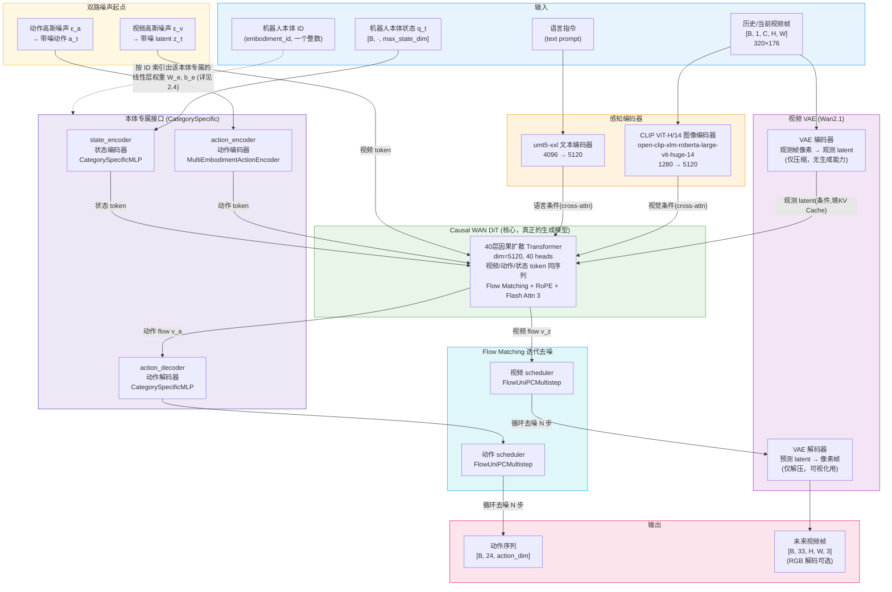

> **关于视频分支与控制的关系**：只有「把最终 video latent 用 VAE 解码成 RGB 像素」这一步在部署时可以省略。视频分支本身**是动作预测的核心组成部分**——带噪视频 latent 与动作 token 处于同一 Transformer 序列、共享 self-attention，DiT 在同一次前向中同时输出视频 flow 和动作 flow。未来视频相当于隐式的视觉规划，视频预测出错时动作往往跟随错误的视觉计划。此外，省略 RGB 解码并不能显著降低推理耗时，主要计算量在 DiT blocks 与 diffusion steps。

---

## 2. 核心组件详解

### 2.1 感知编码器

DreamZero 使用两个独立的预训练编码器提取视觉和语言条件。**两者的原生输出维度并不相同**，各自经过独立投影层后才对齐到 DiT 的 5120 维隐空间：

- **图像编码器**：`open-clip-xlm-roberta-large-vit-huge-14`（CLIP ViT-H/14），输出 **1280 维** 视觉 token，经 `MLPProj(1280, 5120)` 投影
- **文本编码器**：`umt5-xxl`（Google 多语言 T5），输出 **4096 维** 序列特征，经 `text_embedding`（`Linear(4096, 5120) → GELU → Linear(5120, 5120)`）投影

> ⚠️ 配置文件 `wan_flow_matching_action_tf.yaml` 中的 `input_embedding_dim: 1536` **不是这两个编码器的实际维度**。该字段在代码中仅被赋值给 `self.input_embedding_dim`（`wan_flow_matching_action_tf.py:228`）后再未被引用，是从上层框架沿用下来的失效字段。

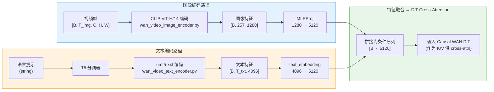

---

### 2.2 视频 VAE

沿用 Wan2.1 的视频 VAE，作为**压缩/解压工具**（无生成能力），让 DiT 在低维 latent 空间工作以降低计算量。VAE 编码器和解码器服务于两个完全不同的目的，输入输出的 latent 含义不同。

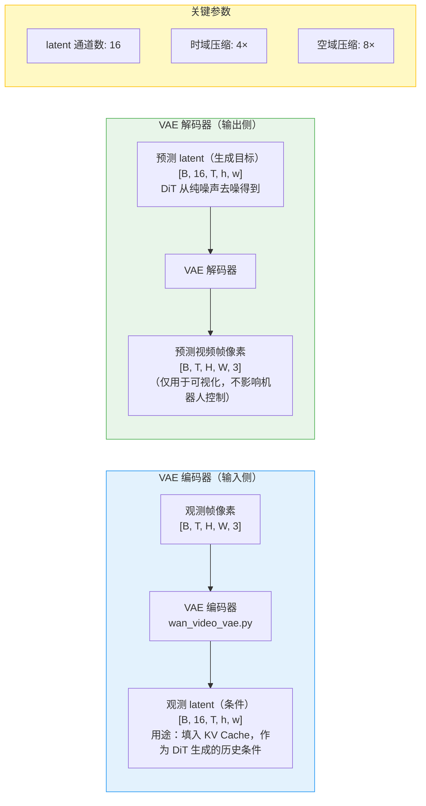

---

### 2.3 Causal WAN DiT（核心扩散模型）

Causal WAN DiT 是 DreamZero 的核心，基于 Wan2.1 的 DiT 架构改造而来：**40 层因果 Transformer**，通过 Causal Masking 保证时序因果性，同时在 latent 序列中嵌入动作 token 与状态 token，实现视频与动作的联合生成。

**序列排布**：视频 token 在前，动作与状态 token 拼成 `action_register` 追加在后，构成 `[video tokens | action tokens | state tokens]` 一条序列。因此视频 token 与动作 token 在自注意力中可以相互访问——这是「视频分支影响控制」的机制来源，而非先生成视频、再用独立 IDM 从视频反推动作。

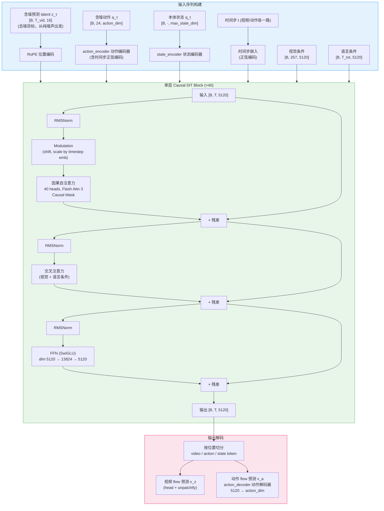

**因果注意力掩码设计：** 视频帧 token 只能 attend 到过去帧和当前帧，动作 token attend 到所有视频 token（全局条件），保证生成的时序一致性。

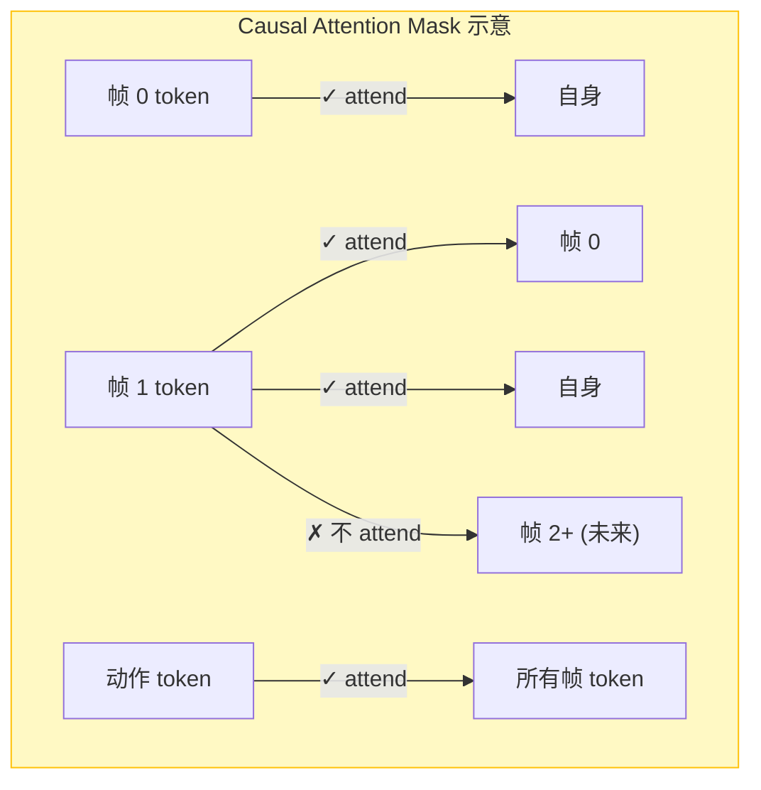

---

### 2.4 本体适配机制（Embodiment Interface）

DreamZero 的本体适配可以概括为：

> **共享 Causal DiT + 本体专属 state/action 接口**（embodiment-specific state/action interface）

而**不是**「共享 DiT + 一个 robot-ID prompt token」。

#### 三个本体专属模块，而非一个

`embodiment_id` 不会被编码成向量再作为 token 喂给 Transformer。它的作用是**从权重张量中索引出该本体专属的一组权重**：

```python
class CategorySpecificLinear(nn.Module):
    def __init__(self, num_categories, input_dim, hidden_dim):
        self.W = nn.Parameter(0.02 * torch.randn(num_categories, input_dim, hidden_dim))
        self.b = nn.Parameter(torch.zeros(num_categories, hidden_dim))

    def forward(self, x, cat_ids):
        selected_W = self.W[cat_ids]      # 按本体 ID 选权重
        selected_b = self.b[cat_ids]
        return torch.bmm(x, selected_W) + selected_b.unsqueeze(1)
```

即对本体 $e$ 执行 $y = x W_e + b_e$。

##### `W_e` / `b_e` 到底是什么、从哪来

一句话：**它们就是普通 `nn.Linear` 的权重和偏置，只不过被"每个本体存一份"地堆成了一个多出一维的大张量，`W_e` 是从中切出的第 e 片。**

对比一下就很清楚——普通线性层与这里的差别只在最前面多了一个「本体」维：

| | 普通 `nn.Linear` | `CategorySpecificLinear` |
|---|---|---|
| 权重形状 | `(input_dim, hidden_dim)` | `(num_categories, input_dim, hidden_dim)` |
| 偏置形状 | `(hidden_dim,)` | `(num_categories, hidden_dim)` |
| 前向 | `x @ W + b` | `x @ W[e] + b[e]`，即 `W_e = W[e]` |

所以：

- **是什么**：`W` 和 `b` 是 `nn.Parameter`，即**模型的可训练参数本身**，和 DiT 里任何一个权重矩阵地位相同。`W_e` 不是运行时算出来的中间变量，只是对 `W` 沿第 0 维做一次索引 `W[e]`，切出来的 `(input_dim, hidden_dim)` 就是一个再普通不过的权重矩阵。
- **从哪来（初始化）**：随机初始化，**从零训起** —— `W = 0.02 * torch.randn(...)`，`b = torch.zeros(...)`。这三个模块在 Wan2.1 预训练权重里**根本不存在**（Wan2.1 是纯视频生成模型，没有机器人状态/动作的概念），是 DreamZero 新增的部件，因此没有预训练权重可继承。
- **怎么训出来**：靠正常的反向传播。注意 `W[cat_ids]` 是一次索引操作，梯度是**稀疏**的——某个 batch 里只出现了本体 3，那么只有 `W[3]` 这一片拿到梯度，其他本体的切片原封不动。这正是"各本体互不干扰"的来源。
- **LoRA 模式下也全量训练**：`train_architecture=lora` 时先把所有参数冻结，注入 LoRA 后又显式把这三个模块解冻（`wan_flow_matching_action_tf.py:341-343`），它们走的是**完整梯度更新，不是低秩分解**。原因很直接：新本体的接口层没有预训练权重可微调，低秩增量无从谈起。
- **`torch.bmm` 的意义**：用 batch matmul 而非普通 matmul，是为了让**同一个 batch 内不同样本可以用不同本体的权重**，从而支持多本体数据混合训练。

> 一个直观的类比：把 `W` 想成一本按机器人型号编号的「适配器手册」，`embodiment_id = e` 就是翻到第 e 页。手册本身（`W` 整体）是训练出来的，翻页（索引）不消耗任何计算，也不产生 token。

这套机制分布在**三个位置**，而不只是动作输入端：

| 位置 | 模块 | 类型 | 作用 |
|---|---|---|---|
| 状态输入 | `state_encoder` | `CategorySpecificMLP` | $q_t \rightarrow$ 状态 token（`max_state_dim → 5120`） |
| 动作输入 | `action_encoder` | `MultiEmbodimentActionEncoder` | 带噪动作 $a_\tau$ + 扩散时间步 $\tau \rightarrow$ 动作 token |
| 动作输出 | `action_decoder` | `CategorySpecificMLP` | DiT 输出 $\rightarrow$ 本体动作空间的 flow（`5120 → action_dim`） |

`MultiEmbodimentActionEncoder` 内部由 3 个 `CategorySpecificLinear`（W1/W2/W3）加正弦位置编码构成：动作先经 W1 升维，与时间步编码拼接后经 W2 + swish，再经 W3 输出。

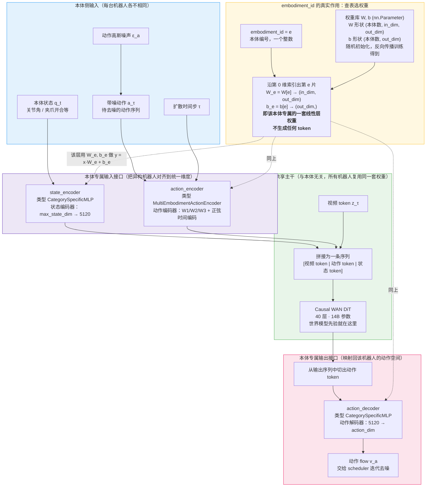

#### ⚠️ 当前公开实现并非「单 checkpoint 多本体自由切换」

尽管类名（`MultiEmbodimentActionEncoder`）和字段（`max_num_embodiments`）都暗示多本体，**当前公开主分支实际只有一个 category**：

```python
# wan_video_dit_action_casual_chunk.py:1325，紧接在赋值 self.max_num_embodiments 之后
max_num_embodiments = 1          # 局部变量被硬覆盖为 1

self.state_encoder  = CategorySpecificMLP(num_categories=max_num_embodiments, ...)
self.action_encoder = MultiEmbodimentActionEncoder(num_embodiments=max_num_embodiments, ...)
self.action_decoder = CategorySpecificMLP(num_categories=max_num_embodiments, ...)
```

并且**两条前向路径**都会把传入的 `embodiment_id` 覆盖为 0：

```python
# :1715（常规前向）与 :2011（TensorRT 前向）
embodiment_id = torch.tensor([0], device=x.device).repeat(x.shape[0])
```

所以代码结构预留了多本体权重选择机制，但**当前发布的权重并没有真正用一个 checkpoint 同时学习多个本体**。论文的说法与之一致：

- AgiBot G1 与 Franka **分别预训练**；
- multi-embodiment joint training 列为未来工作；
- AgiBot → YAM 是拿 AgiBot checkpoint 在 YAM 约 30 分钟数据上继续 post-training，**不是**推理时把 `embodiment_id` 从 AgiBot 改成 YAM 就能直接部署。

> 需要注意的是，数据侧的 `dreamzero_cotrain.py` 里确实存在完整的 embodiment 白名单（AGIBOT / OXE_DROID / GR1_UNIFIED / MECKA_HANDS / XDOF / YAM 等，见 `transform/base.yaml` 的 `embodiment_tag_to_projector_index`），但这些 ID 用于数据变换阶段的分发，模型侧最终仍被压到单一 category。

#### 适配新本体实际需要做什么

不能简化为「换个 ID 加个 MLP」。实际流程包含：

1. 训练新的 state / action interface（上表三个模块）；
2. 调整动作归一化与维度（`max_state_dim` / `max_action_dim`，如 AgiBot 配置为 64 / 32）；
3. 对共享 DiT 做 post-training——公开脚本提供**两套**：`droid_training_lora.sh`（`train_architecture=lora`）与 `droid_training_full_finetune.sh`（`train_architecture=full`）；AgiBot / YAM 脚本默认走 LoRA；
4. LoRA 模式下三个 state/action adapter 仍保持可训练：

```python
# wan_flow_matching_action_tf.py:343-345
self.model.state_encoder.requires_grad_(True)
self.model.action_encoder.requires_grad_(True)
self.model.action_decoder.requires_grad_(True)
```

5. 依赖视频世界模型已有的视觉动力学先验完成迁移。

**相对动作计算：** 各机器人体在数据加载时将绝对动作转为相对值（`action - reference_state`），使模型学到的动作表示更加泛化。

---

## 3. 训练流水线

DreamZero 基于 **Flow Matching** 框架进行训练，同时对视频 latent 和动作 token 施加扩散损失。训练使用 DeepSpeed ZeRO-2 分布式优化，并通过 LoRA 高效微调 14B 参数基础模型。

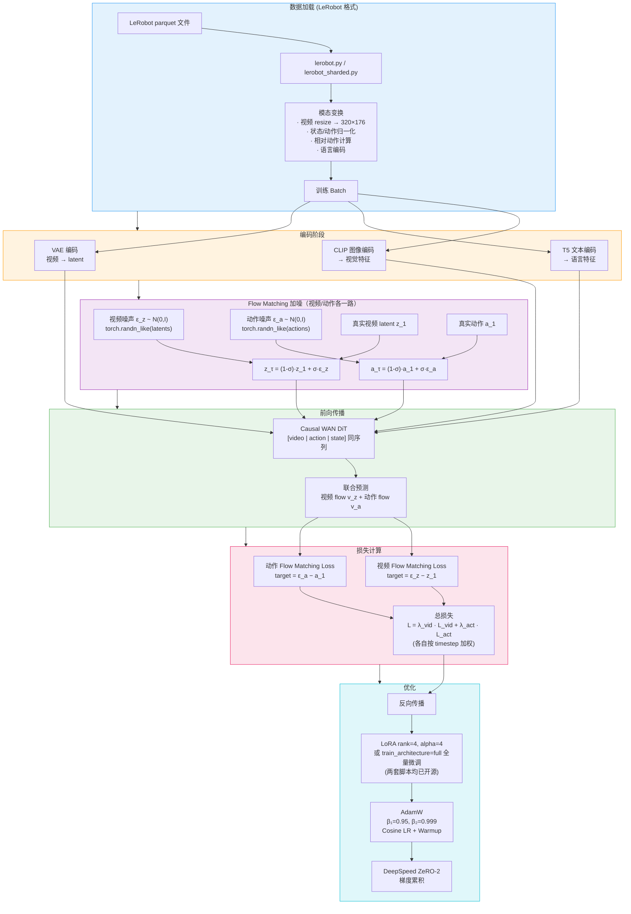

**训练模式：** 公开仓库提供两套脚本。

- **LoRA**（`droid_training_lora.sh` / `agibot_training.sh` / `yam_training.sh`，`train_architecture=lora`）：基础模型（Wan2.1，约 14B 参数）冻结，在 DiT 的 `q,k,v,o,ffn.0,ffn.2` 上插入 LoRA 适配器（rank=4, alpha=4），**同时保持 `state_encoder` / `action_encoder` / `action_decoder` 三个本体接口全量可训练**。
- **全量微调**（`droid_training_full_finetune.sh`，`train_architecture=full`，`save_lora_only=false`）：更新全部 DiT blocks，对应论文中的主预训练设置。

---

## 4. 推理流水线

推理时视频 latent 与动作**都**从各自的高斯噪声出发，在同一次 DiT 前向中得到两路 flow，再由**两个独立的 scheduler** 分别积分更新。动作不是 DiT 一次前向直接回归出来的干净值，而是多步去噪的结果。DreamZero 支持通过 WebSocket 的分布式多 GPU 推理服务。

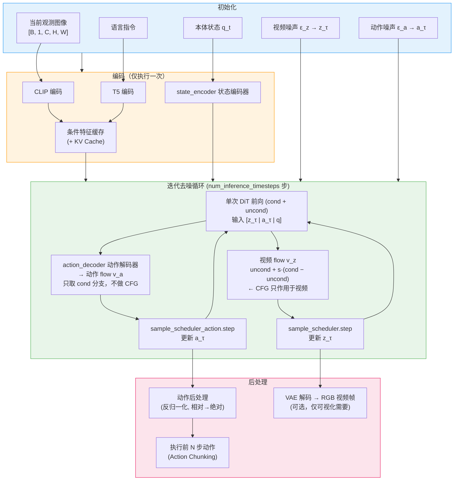

> 两个 scheduler 均为 `FlowUniPCMultistepScheduler`，用同样的步数、同样的 `sigma_shift`，但各自持有独立的 timestep 序列。开启 `decouple_inference_noise` 时，视频 sigma 序列会被重映射到 `[σ_max, video_inference_final_noise]`（默认 0.8，即视频**故意不完全去噪**），而**动作始终按标准 1000→0 完整去噪**——再次说明视频分支的价值在于它在 DiT 内部提供的世界模型先验，而不是最终那张图好不好看。
>
> 另外循环里还有一个 `should_run_model()` 的跳步缓存：某些步会直接复用上一次的 `flow_pred`，不重跑 DiT，所以「去噪步数」不等于「DiT 前向次数」。

### 分布式推理服务

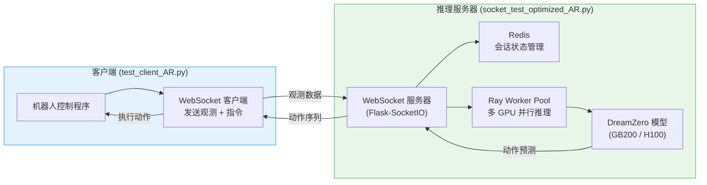

---

## 5. 关键超参数表

### 5.1 架构常量（由预训练权重固定，不可改）

| 参数 | 值 | 说明 |
|---|---|---|
| 模型总参数 | ~14B | 基于 Wan2.1-I2V-14B |
| DiT 层数 | 40 | Causal WAN DiT |
| DiT hidden dim | 5120 | `dim`，全部 token 统一到该维度 |
| 注意力头数 | 40 | head_dim = 128 |
| 文本编码维度 | 4096 → 5120 | UMT5 输出 `text_dim=4096`，经 `text_embedding` 两层 MLP 升维 |
| 图像编码维度 | 1280 → 5120 | CLIP ViT-H 输出 1280，经 `MLPProj(1280, dim)` 升维 |
| VAE latent 通道 | 16 | 视频压缩维度 |
| 训练 timestep 桶数 | 1000 | `num_timestep_buckets` |

> ⚠️ 配置里的 `input_embedding_dim: 1536` 是失效字段，**不是**任何编码器的真实维度，详见 [2.1 节](#21-感知编码器)。

### 5.2 配置项（随脚本/数据集变化）

下表左列是官方 `scripts/train/*.sh`（droid / agibot / yam / aloha_lekiwi / pen_right_arm 全部一致）里实际传入的值；右列是仓库内另一套数据配置 `base_48_wan_fine_aug_relative.yaml` 的取值。**这些是配置而非架构常量**——换数据集时会变。

| 参数 | 训练脚本 | `base_48_..._relative.yaml` |
|---|---|---|
| 视频帧数 `num_frames` | 33 | 49 |
| `action_horizon` | 24 | 48 |
| 图像分辨率 | 320×176 | 480×256 |

### 5.3 训练配置

| 参数 | 值 | 说明 |
|---|---|---|
| 训练模式 | `lora` / `full` | `droid_training_lora.sh` vs `droid_training_full_finetune.sh` |
| LoRA rank / alpha | 4 / 4 | 默认值，作用于 `q,k,v,o,ffn.0,ffn.2` |
| LoRA 额外可训练模块 | 三个本体接口 | state / action 编码器与 action 解码器始终 `requires_grad_(True)` |
| 分布式策略 | DeepSpeed ZeRO-2 | 分布式训练 |
| 优化器 | AdamW | β₁=0.95, β₂=0.999 |
| 学习率调度 | Cosine + Warmup | 分布式多卡训练 |
| 精度 | bfloat16 | 混合精度训练 |

---

## 6. 关键源文件表

| 组件 | 文件路径（相对 `/home/zhuyilong/dreamzero/`） |
|---|---|
| 核心 VLA 模型 | `groot/vla/model/dreamzero/base_vla.py` |
| Action Head (Flow Matching) | `groot/vla/model/dreamzero/action_head/wan_flow_matching_action_tf.py` |
| Causal WAN DiT | `groot/vla/model/dreamzero/modules/wan_video_dit_action_casual_chunk.py` |
| 视频 VAE | `groot/vla/model/dreamzero/modules/wan_video_vae.py` |
| 文本编码器 | `groot/vla/model/dreamzero/modules/wan_video_text_encoder.py` |
| 图像编码器 | `groot/vla/model/dreamzero/modules/wan_video_image_encoder.py` |
| 数据变换 | `groot/vla/model/dreamzero/transform/` |
| 数据集加载 | `groot/vla/data/dataset/lerobot.py` |
| 分片数据集 | `groot/vla/data/dataset/lerobot_sharded.py` |
| 训练器 | `groot/vla/experiment/experiment.py` |
| 训练基类 | `groot/vla/experiment/base.py` |
| 分布式推理服务 | `socket_test_optimized_AR.py` |
| 推理客户端 | `test_client_AR.py` |
| Hydra 模型配置 | `groot/vla/configs/model/` |
| 训练脚本 | `scripts/train/` |

---

## 7. Attention 机制深入解析

### 7.1 Q / K / V 的本质分工

Attention 的计算分四步：

```
1. q = W_q(x)              # x 投影成 Q
2. k = W_k(context)        # context 投影成 K
3. v = W_v(context)        # context 投影成 V（同一原材料，不同矩阵）
4. 权重 = softmax(q · kᵀ / √d)
5. 输出 = 权重 · v
```

K 和 V 的原材料相同（都来自 context），但投影矩阵不同，作用完全不同：

| 矩阵 | 参与哪一步 | 对输出的影响 | 学到的是 |
|---|---|---|---|
| W_q | 步骤 4（点积） | 间接（通过权重） | 我该去找什么样的 K |
| W_k | 步骤 4（点积） | 间接（通过权重） | 什么样的 Q 应该找到我 |
| W_v | 步骤 5（加权求和） | **直接**（构成输出） | 被选中后我该提供什么内容 |

**K 是抽象意义上的索引**——它不直接出现在输出里，只决定权重分布，告诉模型"哪些位置比较重要"。V 才是真正被读取的内容。

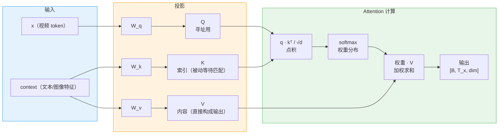

---

### 7.2 Self-Attention vs Cross-Attention

区别只有一个：Q、K、V 的原材料从哪来。

| | Q 来自 | K、V 来自 | 用途 |
|---|---|---|---|
| **Self-Attention** | 序列自身 x | 序列自身 x | 序列内部 token 互相交流 |
| **Cross-Attention** | 序列自身 x | 另一个序列 context | 从外部条件（文本/图像）读取信息 |

DreamZero 的每个 DiT Block 里两者都有：先 Self-Attention 让视频 token 内部交流，再 Cross-Attention 读取文本和图像条件。

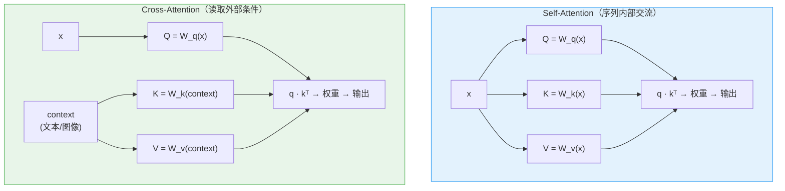

---

### 7.3 为什么 K 不能等于 Q

K=Q 意味着 W_k = W_q，K 和 Q 是同一个向量。此时：

```
权重 = softmax(q · qᵀ / √d)   # x 和自身的相似度
```

权重退化成"找和自己像的"，模型只能检索与自身相似的 token，无法找到"内容上互补但方向不同"的信息。

**类比**：图书馆里每本书的索引标签直接写的是"我想找机器人抓取的书"——所有书都在大喊需求，没有一本书在说"我能提供什么"，检索系统完全失效。

K 和 Q 必须用不同的投影矩阵，让"被检索"和"去检索"解耦。

---

### 7.4 多头注意力（Multi-Head Attention）

多头就是把 dim 切成 h 份，并行跑 h 套独立的 Q/K/V：

```
head_i 输出 = softmax(Q_i · K_iᵀ / √d) · V_i
最终输出 = Concat(head_0, ..., head_h-1) · W_o
```

**多头的价值来源于 Q 的多样性**——每个头问不同的问题，从 context 里提取不同侧面的信息。

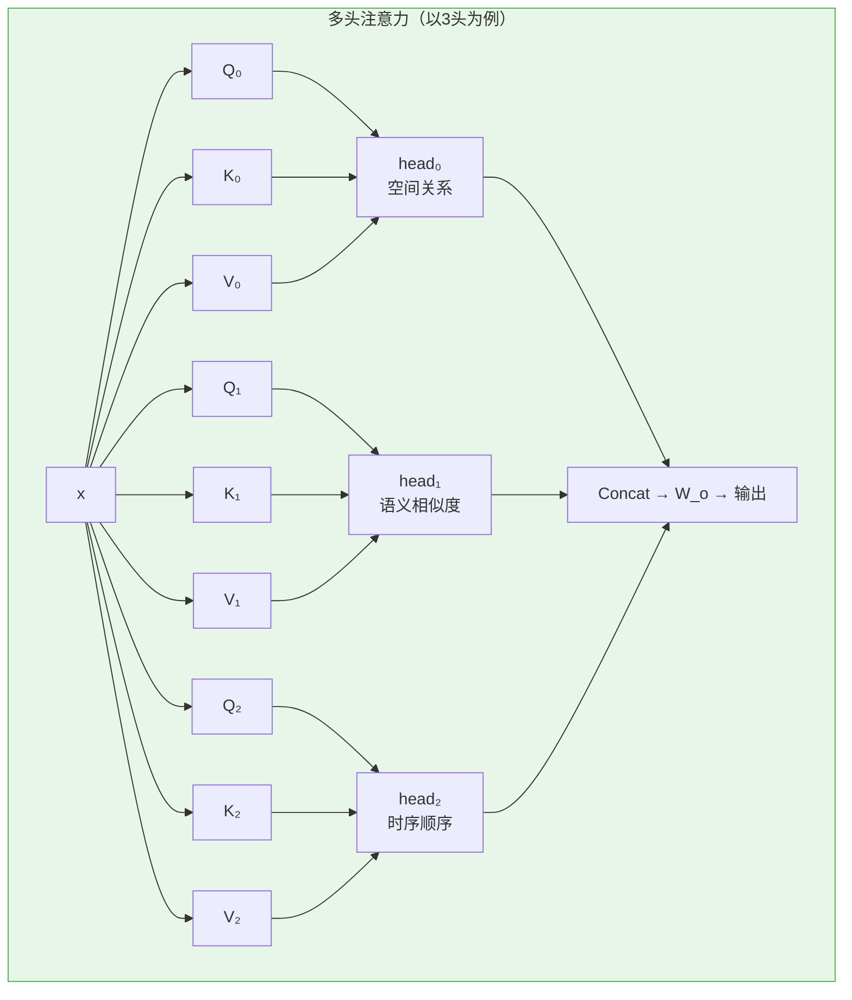

**Q 不能共享，K/V 可以共享（MQA）：**

| | 多K多V | 单K单V |
|---|---|---|
| **多Q（问题不同）** | 标准多头 MHA | MQA（现代大模型常用） |
| **单Q（问题相同）** | 无意义（退化） | 普通单头 |

MQA（Multi-Query Attention）中所有 Q 头共享同一组 K/V，节省 KV Cache 显存，但不影响 Q 的多样性——40 个人用不同问题检索同一个书架，仍然能找出不同的重点。

---

### 7.5 W_q、W_k、W_v 各自如何被训练

三个矩阵的梯度路径不同，学到的东西也不同。

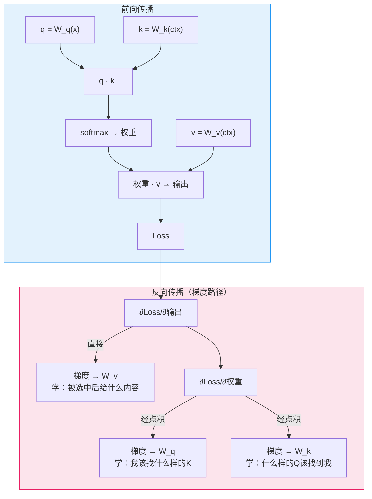

W_q 和 W_k 通过同一条路径（点积）互相塑造，W_v 的梯度路径完全独立，只由输出质量驱动。

---

### 7.6 QK Norm：为什么归一化能稳定训练

原始点积：

```
q · k = |q| × |k| × cos(θ)
```

模长和方向混在一起，W_q 和 W_k 需要同时控制两件事，容易震荡。

QK Norm 之后：

```
q_norm = q / |q|,  k_norm = k / |k|
q_norm · k_norm = cos(θ)     # 值域固定在 [-1, 1]
```

点积退化为纯余弦相似度，**只剩方向这一个自由度**，模长的干扰被彻底消除。W_q 和 W_k 只需要各自学"朝哪个方向"，优化目标从三个因素（|q|、|k|、θ）变成一个（θ），训练更稳定。

DreamZero 代码中对应实现（`wan2_1_submodule.py`）：

```python
q = self.norm_q(self.q(x))        # QK Norm
k = self.norm_k(self.k(context))  # QK Norm
```
