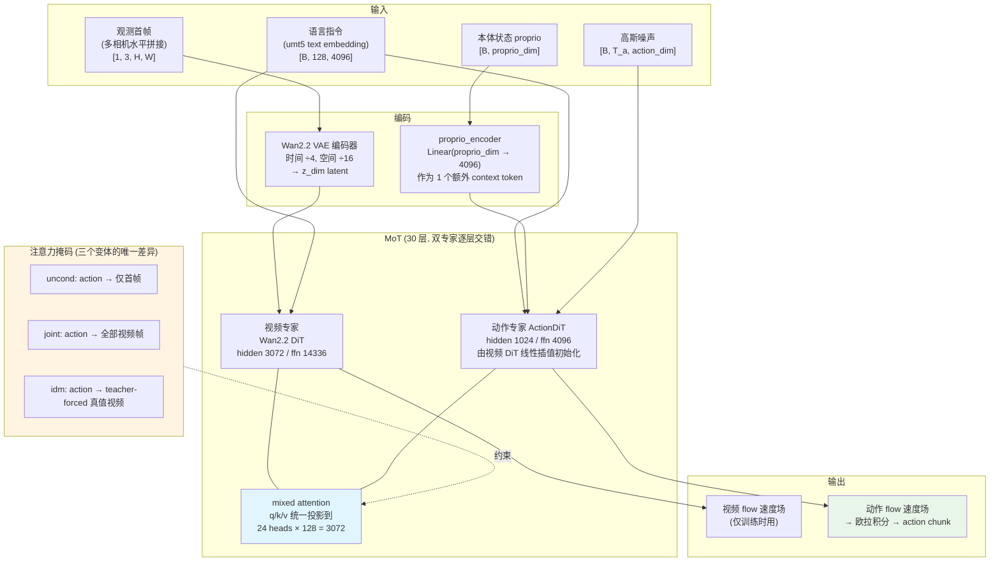
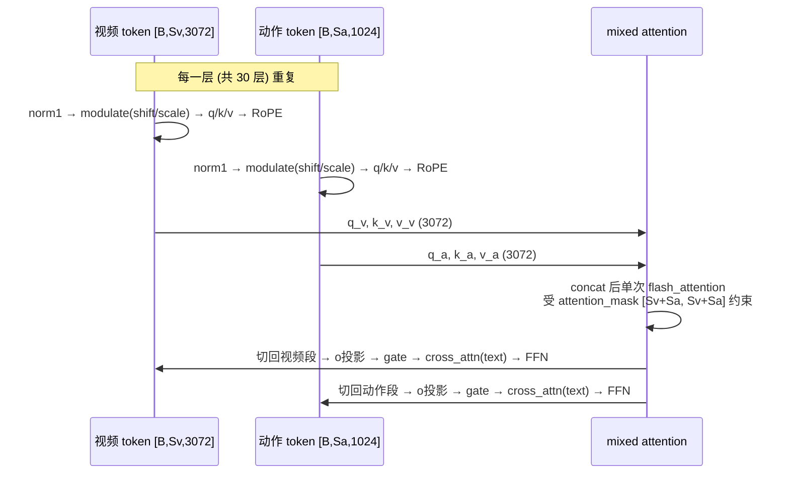
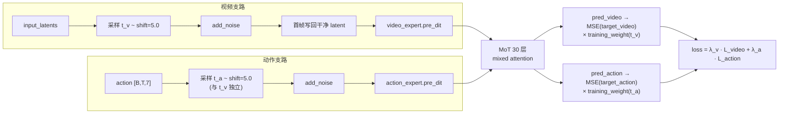
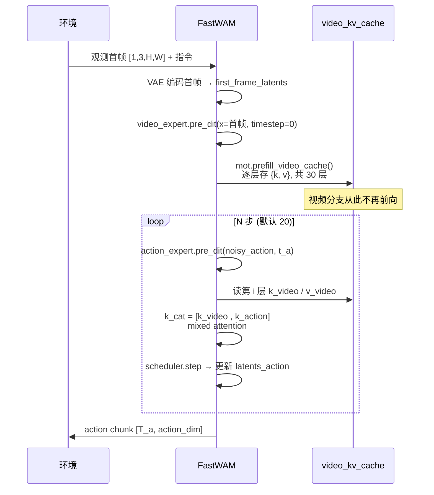

# Fast-WAM 模型架构

## 1. 整体架构概览

Fast-WAM 是一个**世界动作模型 (World Action Model, WAM)**,论文标题本身就是它要回答的问题:*"Do World Action Models Need Test-time Future Imagination?"*(arXiv:2603.16666)。结论是**不需要** —— 现有 WAM(如 DreamZero、IDM 类方法)在推理时要先把未来视频去噪生成出来,再从中读出动作,代价是每步决策都要跑一遍完整的视频扩散;Fast-WAM 证明这份"未来想象"只在**训练时**有价值,推理时可以彻底砍掉。

实现手段是一个**双专家 MoT (Mixture-of-Transformers)**:视频专家来自 Wan2.2-TI2V-5B 的 DiT,动作专家 `ActionDiT` 是同层数、同头数的窄版 DiT,两者逐层共享同一次 mixed attention。关键设计在**注意力掩码**:动作 token 只被允许看**首帧**视频 token,而首帧在 `first_frame_causal` 掩码下又不允许看后续帧 —— 于是首帧的 K/V 与"视频有没有被生成"无关。推理时因此可以把视频专家跑**一次**(输入只有观测首帧,timestep=0)缓存下每层 K/V,后续 N 步动作去噪全部走缓存,视频分支一次都不用再跑。



三个变体共用**完全相同的配置文件**(`configs/model/fastwam.yaml` / `fastwam_idm.yaml` / `fastwam_joint.yaml` 逐字段一致,只有 `_target_` 不同),差异全部落在 Python 类的两个方法上:`_build_mot_attention_mask()` 和 `infer_action()`。这让"未来想象是否必要"成为一个干净的受控对比。

---

## 2. 核心组件详解

### 2.1 视频专家:Wan2.2-TI2V-5B DiT

视频分支直接复用 Wan2.2 的文生视频 DiT,权重从 `Wan-AI/Wan2.2-TI2V-5B` 加载(`src/fastwam/models/wan22/helpers/loader.py`)。

| 参数 | 值 |
|---|---|
| `num_layers` | 30 |
| `hidden_dim` | 3072 |
| `ffn_dim` | 14336 |
| `num_heads` × `attn_head_dim` | 24 × 128 = 3072 |
| `in_dim` / `out_dim` | 48 / 48 |
| `patch_size` | `[1, 2, 2]`(时间不下采样,空间 2×2 patch) |
| `text_dim` | 4096(umt5) |
| `freq_dim` | 256 |
| `fuse_vae_embedding_in_latents` | `true` |

配套 VAE 是 Wan2.2 VAE:时间下采样 4 倍、空间 16 倍。因此视频帧数必须满足 `T % 4 == 1`(`build_inputs` 中强校验,`src/fastwam/models/wan22/fastwam.py:296`),LIBERO 用 33 帧 → 9 个 latent 时间步。

`fuse_vae_embedding_in_latents=true` 时,首帧 latent 会在加噪后被**原样写回**(`fastwam.py:468`):

```python
latents = self.train_video_scheduler.add_noise(input_latents, noise_video, timestep_video)
...
if inputs["first_frame_latents"] is not None:
    latents[:, :, 0:1] = inputs["first_frame_latents"]   # 首帧永远是干净观测
```

首帧因此是**条件**而非生成目标,视频 loss 也相应跳过第 0 步(`fastwam.py:536`)。

### 2.2 视频自注意力掩码:`first_frame_causal`

`build_video_to_video_mask()`(`src/fastwam/models/wan22/wan_video_dit.py:473`)支持三种模式,Fast-WAM 全系配置用 `first_frame_causal`:

```python
if self.video_attention_mask_mode == "first_frame_causal":
    video_mask = torch.ones((video_seq_len, video_seq_len), dtype=torch.bool, device=device)
    first_frame_tokens = min(video_tokens_per_frame, video_seq_len)
    video_mask[:first_frame_tokens, first_frame_tokens:] = False
    return video_mask
```

含义:**首帧的 query 不允许看任何后续帧**,其余帧之间双向可见。这条约束是整套加速的数学前提 —— 首帧 token 的表征只依赖首帧自己,所以"只喂首帧跑一次 DiT"得到的 K/V,与"喂完整视频跑一次 DiT"里首帧那段 K/V **逐位相等**。缓存因此是精确的,不是近似。

三种模式对比:

| 模式 | 语义 | 是否可缓存首帧 |
|---|---|---|
| `bidirectional` | 全帧双向可见 | ❌ 首帧表征依赖未来帧 |
| `per_frame_causal` | 逐帧下三角因果 | ✅ 但每帧都要按序算 |
| `first_frame_causal` | 首帧单向隔离,其余双向 | ✅ **Fast-WAM 采用** |

### 2.3 动作专家 ActionDiT

`src/fastwam/models/wan22/action_dit.py` 定义,结构上是一个"窄身宽头"的 DiT:

| 参数 | 值 | 说明 |
|---|---|---|
| `num_layers` | 30 | **必须**与视频专家一致 |
| `hidden_dim` | 1024 | 只有视频专家的 1/3 |
| `ffn_dim` | 4096 | |
| `num_heads` × `attn_head_dim` | 24 × 128 | **必须**与视频专家一致 |
| `action_dim` | 7(LIBERO) | eef delta pose 6 + gripper 1 |

注意 `hidden_dim=1024` 但 `num_heads × attn_head_dim = 3072`。`SelfAttention` 里 q/k/v 投影写的是 `nn.Linear(hidden_dim, num_heads * attn_head_dim)`(`wan_video_dit.py:179`),即 `Linear(1024 → 3072)`。这不是笔误 —— **两个专家的 K/V 必须落在同一个 3072 维空间里,才能在 mixed attention 中直接 concat**:

```python
k_cat = torch.cat([k_video, k_action], dim=1)   # mot.py:426
v_cat = torch.cat([v_video, v_action], dim=1)
```

`from_wan22_pretrained()` 会对三项硬校验,不一致直接抛错(`fastwam.py:140-145`)。

**ActionDiT 的初始化**不是随机的,而是从 Wan2.2 视频 DiT **线性插值降维**得到。`scripts/preprocess_action_dit_backbone.py` 把 3072 维权重沿最后一维 `F.interpolate(mode="linear", align_corners=True)` 压到 1024,并施加 `alpha = sqrt(d_video / d_action)` 的缩放以保持激活方差:

```python
if apply_alpha_scaling and src.ndim >= 2 and src.shape[-1] != target.shape[-1]:
    alpha = (float(src.shape[-1]) / float(target.shape[-1])) ** 0.5
    value = value.to(torch.float32) * alpha
```

产物存为 `checkpoints/ActionDiT_linear_interp_Wan22_alphascale_1024hdim.pt`,内含 `meta`(8 个结构字段,加载时逐项校验)+ `backbone_state_dict`。`action_encoder.` 和 `head.` 两个前缀被排除在外(`ACTION_BACKBONE_SKIP_PREFIXES`),保持随机初始化 —— 因为动作维度与视频 latent 维度无对应关系,插值没有意义。

### 2.4 MoT 混合注意力

`src/fastwam/models/wan22/mot.py` 的 `MoT` 不是常见的 sparse-MoE 路由,而是**两套完整参数、逐层做一次联合 attention**:



两个专家各自保留独立的 `modulation`、`cross_attn`(对文本)、`ffn`、`o` 投影 —— 只有 self-attention 那一次矩阵乘是共享的。这正是 MoT 与"共享主干 + 两个 head"的区别:参数完全不共享,只共享**注意力这一次信息交换**。

`mot_checkpoint_mixed_attn=true` 时,mixed attention 走 `torch.utils.checkpoint`,以重算换显存(`mot.py:89`)。

### 2.5 三个变体的注意力掩码

这是整篇论文的实验骨架。三个类的 `_build_mot_attention_mask()` 只在"action → video"这一个子块上不同:

**FastWAM (uncond)** — `fastwam.py:386`

```python
mask[video_seq_len:, video_seq_len:] = True                 # action → action 全可见
first_frame_tokens = min(video_tokens_per_frame, video_seq_len)
mask[video_seq_len:, :first_frame_tokens] = True            # action → 仅首帧
```

**FastWAMJoint** — `fastwam_joint.py:29`

```python
mask[video_seq_len:, video_seq_len:] = True
mask[video_seq_len:, :video_seq_len] = True                 # action → 全部视频帧
```

**FastWAMIDM** — `fastwam_idm.py:20`,训练时构造**三段序列**(noisy video / cond video / action),动作只看 cond 那一段:

```python
mask[cond_end:, cond_end:] = True                           # action → action
mask[cond_end:, noisy_end:cond_end] = True                  # action → cond_video only
```

cond 分支以 `video_cond_noise_prob = 0.5` 的概率被加噪(`fastwam_idm.py:17`),否则直接用真值 latent。这是 IDM(逆动力学)的标准 teacher forcing:训练时给模型看真实的未来,让它学"从 s_t 到 s_{t+k} 需要什么动作"。

三者的推理代价:

| 变体 | action 可见范围 | 推理时视频分支 | 每次决策的 DiT 前向 |
|---|---|---|---|
| **uncond** | 首帧 | prefill **1 次**,之后走 KV cache | 1 × 视频 + N × 动作(窄) |
| **joint** | 全部帧 | 与动作**联合去噪 N 步** | N × (视频 + 动作) |
| **idm** | teacher-forced 真值 | 测试时无真值 → 必须先完整生成视频 | N × (视频 + 动作) |

---

## 3. 训练流水线

`training_loss()`(`fastwam.py:448`)对视频和动作**各自独立采样 timestep**,两条 flow matching 支路并行:



几个实现细节:

**两个独立 timestep。** `timestep_video` 和 `timestep_action` 分别采样(`fastwam.py:459` / `471`),不共享。这意味着模型见过"视频很干净但动作很噪"和反过来的所有组合 —— 对 uncond 变体尤其关键,因为推理时视频侧固定是 `timestep_video = 0`(全干净),必须在训练中覆盖到这个区域。

**padding 掩码逐样本归一。** 动作和图像都可能有 padding(数据集尾部对齐),loss 按有效步数归一而不是简单 `.mean()`:

```python
valid = (~action_is_pad).to(...)
valid_sum = valid.sum(dim=1).clamp(min=1.0)
action_loss_per_sample = (action_loss_token * valid).sum(dim=1) / valid_sum
```

图像侧还要把帧级 mask 折叠到 latent 步(除以 `temporal_downsample_factor=4`,一个 latent 步内全 pad 才算 pad,`fastwam.py:431`)。

**proprio 作为 context token。** 本体状态不进动作序列,而是过一个 `Linear(proprio_dim → text_dim)` 变成**一个 token 拼在文本 context 末尾**(`_append_proprio_to_context`,`fastwam.py:219`),两个专家的 cross-attention 都能看到。训练时只取序列首帧的 proprio(`proprio[:, 0, :]`)。

**文本编码器可以不加载。** 配置里 `load_text_encoder: false` —— 训练前用 `scripts/precompute_text_embeds.py` 把 umt5 embedding 全部预计算缓存到 `text_embedding_cache_dir`,训练时直接读 `context` / `context_mask`,省下 umt5-xxl 的显存。

**训练入口**:`scripts/train.py` + `scripts/train_zero1.sh`(DeepSpeed ZeRO-1)。优化器和冻结逻辑通过 `self.dit = self.mot` 这个别名接到 trainer 上(`fastwam.py:47`)。

---

## 4. 推理流水线

### 4.1 快路径:`infer_action`(uncond 变体)

这是 Fast-WAM 的核心卖点,`fastwam.py:906`:



代码上的关键三步:

```python
# 1. 视频专家只在首帧上跑一次,timestep 恒为 0
timestep_video = torch.zeros((first_frame_latents.shape[0],), ...)
video_pre = self.video_expert.pre_dit(x=first_frame_latents, timestep=timestep_video, ...)

# 2. 逐层缓存 K/V
video_kv_cache = self.mot.prefill_video_cache(...)          # fastwam.py:1013

# 3. N 步动作去噪全部走缓存
for step_t_action, step_delta_action in zip(...):
    pred_action = self._predict_action_noise_with_cache(..., video_kv_cache=video_kv_cache, ...)
    latents_action = self.infer_action_scheduler.step(pred_action, step_delta_action, latents_action)
```

`infer_action` 开头有一条硬断言 —— 没有 `first_frame_causal` 掩码,缓存就不成立:

```python
if str(getattr(self.video_expert, "video_attention_mask_mode", "")) != "first_frame_causal":
    raise ValueError("`infer_action` requires `video_attention_mask_mode='first_frame_causal'`.")
```

注意 VAE 解码器**完全没被调用** —— 不生成像素,连 latent 都不生成。返回值只有 `{"action": ...}`。

### 4.2 慢路径:`infer_joint`

joint 和 idm 变体走这条。两个 scheduler 步调对齐,每步都要跑完整的 `_predict_joint_noise`(视频 + 动作双分支),且每步结束后把首帧 latent 重新写回:

```python
latents_video = self.infer_video_scheduler.step(pred_video_posi, step_delta_video, latents_video)
latents_action = self.infer_action_scheduler.step(pred_action_posi, step_delta_action, latents_action)
latents_video[:, :, 0:1] = first_frame_latents.clone()      # fastwam_joint.py:232
```

IDM 变体更进一步 —— `infer_joint` 里视频是**独立的第一阶段**先去噪完,再算动作(`fastwam_idm.py:288` 起,注释写明 "video is denoised in a standalone first stage")。

### 4.3 仿真评测

`experiments/libero/run_libero_manager.py` 和 `experiments/robotwin/run_robotwin_manager.py`,配置见 `configs/sim_libero.yaml`:

| 参数 | 值 |
|---|---|
| `num_trials` | 50 |
| `num_steps_wait` | 30 |
| `replan_steps` | 10(每 10 步重新推理一次 action chunk) |
| `binarize_gripper` | true |
| `text_cfg_scale` | 1.0(不开 CFG) |
| `visualize_future_video` | false |
| task suites | libero_10 / goal / spatial / object,8 GPU × 2 task |

---

## 5. 关键超参数表

### 模型结构

| 项 | 视频专家 | 动作专家 |
|---|---|---|
| 层数 | 30 | 30(强制一致) |
| hidden_dim | 3072 | 1024 |
| ffn_dim | 14336 | 4096 |
| num_heads | 24 | 24(强制一致) |
| attn_head_dim | 128 | 128(强制一致) |
| q/k/v 投影输出 | 3072 | 3072(`Linear(1024→3072)`) |
| text_dim | 4096 | 4096 |
| freq_dim | 256 | 256 |
| eps | 1e-6 | 1e-6 |

### Flow Matching

| 项 | 值 |
|---|---|
| 调度器 | `WanContinuousFlowMatchScheduler` |
| `num_train_timesteps` | 1000 |
| `train_shift` / `infer_shift` | 5.0 / 5.0(视频与动作相同) |
| 推理步数 | 20(`eval_num_inference_steps`) |
| 损失 | `λ_video · MSE_video + λ_action · MSE_action`,均带 `training_weight(t)` |
| `λ_action` | 1.0 |

### 数据(LIBERO 2-cam)

| 项 | 值 |
|---|---|
| `num_frames` | 33(→ 9 个 latent 时间步) |
| `action_video_freq_ratio` | 4(→ 32 步动作) |
| 单相机分辨率 | 224 × 224 |
| 拼接后视频尺寸 | 224 × 448(`concat_multi_camera: horizontal`) |
| `action_output_dim` | 7 = eef delta pose(6) + gripper(1) |
| `proprio_output_dim` | 8 = eef pose(6) + gripper(2) |
| `delta_action_dim_mask` | 前 6 维为 delta,gripper 为绝对值 |
| 归一化 | `min/max` |
| `context_len` | 128 |

RoboTwin 配置为 3 相机 384 分辨率(`configs/task/robotwin_*_3cam_384_1e-4.yaml`)。

---

## 6. 关键源文件表

| 文件 | 作用 |
|---|---|
| `src/fastwam/models/wan22/fastwam.py` | 主模型(uncond 变体)、训练 loss、`infer_action` 快路径、`infer_joint` |
| `src/fastwam/models/wan22/fastwam_joint.py` | Joint 变体:action 看全部视频帧 |
| `src/fastwam/models/wan22/fastwam_idm.py` | IDM 变体:teacher-forcing 三段序列 |
| `src/fastwam/models/wan22/mot.py` | MoT 混合注意力、`prefill_video_cache`、`forward_action_with_video_cache` |
| `src/fastwam/models/wan22/action_dit.py` | ActionDiT 定义与插值权重加载 |
| `src/fastwam/models/wan22/wan_video_dit.py` | Wan2.2 DiT、`build_video_to_video_mask`、SelfAttention/DiTBlock |
| `src/fastwam/models/wan22/wan_video_vae.py` | Wan2.2 视频 VAE |
| `src/fastwam/models/wan22/schedulers/scheduler_continuous.py` | 连续 flow matching 调度器 |
| `src/fastwam/models/wan22/wan22.py` | `Wan22Core` 基线(纯视频,无动作分支) |
| `scripts/preprocess_action_dit_backbone.py` | 由视频 DiT 线性插值生成 ActionDiT 初始权重 |
| `scripts/precompute_text_embeds.py` | 预计算 umt5 文本 embedding 缓存 |
| `scripts/train.py` / `scripts/train_zero1.sh` | 训练入口 / DeepSpeed ZeRO-1 |
| `experiments/libero/run_libero_manager.py` | LIBERO 评测 |
| `experiments/robotwin/run_robotwin_manager.py` | RoboTwin 评测 |
| `src/fastwam/datasets/lerobot/processors/fastwam_processor.py` | 动作/状态归一化与 delta 变换 |

---

## 7. 与 DreamZero 的对照

两者都是 Wan 系视频扩散改造的 WAM,放在一起看差异很清楚(DreamZero 细节见 [DreamZero 架构](./13.DreamZero_Architecture.html)):

| 维度 | DreamZero | Fast-WAM |
|---|---|---|
| 视频基座 | Wan2.1 | Wan2.2-TI2V-5B |
| 动作分支 | action head 挂在 DiT 上,与视频 latent 同序列 | 独立 ActionDiT 专家,MoT 逐层混合注意力 |
| 跨形态支持 | Category-specific MLP(embodiment id 白名单) | 无 —— 单形态,proprio 走 context token |
| 推理时是否生成视频 | **是**,先出未来帧再出动作 | **否**(uncond 变体),视频分支只 prefill 一次 |
| 定位 | 追求泛化(RoboArena / MolmoSpaces 榜首) | 追求"证明未来想象在推理时冗余" |
| 评测环境 | 真机 + 多平台 | LIBERO / RoboTwin 仿真 |

Fast-WAM 的 `joint` 与 `idm` 两个变体,本质上就是把 DreamZero 那类"推理时也要想象未来"的做法做成受控基线,再用 `uncond` 变体证明砍掉它不掉点。
