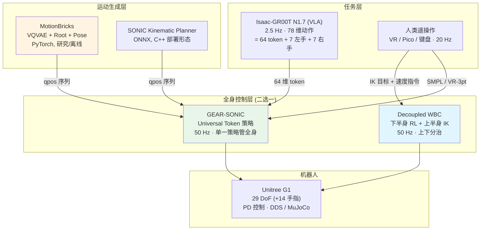
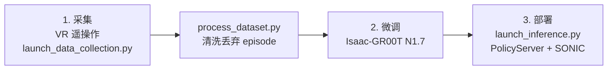

# GR00T-WholeBodyControl 总览

## 1. 这个仓库是什么

`GR00T-WholeBodyControl` 是 NVIDIA GEAR 团队的人形机器人**全身控制**代码库,目标平台是 Unitree G1(29 DoF,带灵巧手时 43 DoF)。它不是一个单一模型,而是**三条并列的技术路线**外加一套共享的部署/遥操作基础设施:

| 子项目 | 定位 | 状态 | 详细文档 |
|---|---|---|---|
| **Decoupled WBC** | 下半身 RL + 上半身 IK 的解耦控制器,GR00T N1.5 / N1.6 实际使用的方案 | 2025-11 首发 | [Decoupled WBC 架构](./16.Decoupled-WBC_Architecture.html) |
| **GEAR-SONIC** | 通用 token 全身控制器,单一策略统管全身,兼作 VLA 的动作空间 | 2026-02 发布,训练码 2026-04 开源 | [GEAR-SONIC 架构](./17.GEAR-SONIC_Architecture.html) |
| **MotionBricks** | 实时隐式生成模型,15,000 FPS 零样本运动合成 | 2026-04-27 预览 | [MotionBricks 架构](./18.MotionBricks_Architecture.html) |

理解这个仓库的关键是抓住**分层**:MotionBricks 生成"要做什么运动",SONIC 或 Decoupled WBC 负责"把这个运动执行出来",最上层还可以挂一个 VLA(GR00T N1.7)来决定"该做什么任务"。



---

## 2. 两条控制路线的分野

Decoupled WBC 和 GEAR-SONIC 解决的是同一个问题,但假设完全不同。

### 2.1 核心差异

| 维度 | Decoupled WBC | GEAR-SONIC |
|---|---|---|
| **控制结构** | 腰部劈开:下半身 RL(ONNX)+ 上半身 QP-IK | 单一 RL 策略输出全部 29 DoF |
| **上半身反馈** | **无** —— 开环插值 IK 目标 | 有 —— 全身状态进策略观测 |
| **上下耦合** | 4 个显式通道:`q_arms`、`base_height_command`、躯干相对腰部 RPY、`navigate_cmd` | 隐式,统一潜空间 |
| **指令接口** | 关节角目标 + (vx, vy, ωz) 速度指令 | **64 维运动 token** |
| **观测维度** | 86 × 6 = 516 | 因配置而异,token 版策略约 154 维 |
| **策略数量** | 2 个(`‖cmd‖ < 0.05` 时切站立,否则切行走) | 1 个 |
| **训练码** | 不在仓库内(仅发布 ONNX) | **开源**,Isaac Lab + PPO,4096 环境 |
| **运动能力** | 稳态操作、行走 + 手臂作业 | 走、爬、大幅度全身动态动作 |
| **末端精度** | 高 —— 由 QP 求解器直接保证 | 较低 —— 受策略跟踪误差影响 |
| **可解释性** | 高 —— 每层都能单独观察 | 低 —— token 不可直接解读 |
| **用于 GR00T** | N1.5 / N1.6 | N1.7 及之后的 VLA 动作空间 |

### 2.2 该选哪个

- **要把手准确送到某个位姿**(装配、抓取、精细遥操作数据采集)→ **Decoupled WBC**。QP-IK 的末端误差不受 RL 探索噪声污染,腰部权重(`waist_pitch/roll` posture 权重 10)还会主动抑制身体晃动。
- **要机器人做出某种整体运动**(行走、爬行、模仿人类动捕、跟随生成的运动)→ **GEAR-SONIC**。它天然吃三种运动来源,且能跟踪训练分布之外的运动。
- **要接 VLA** → **GEAR-SONIC**。64 维 token 已经是标准化的动作空间,VLA 只需要以 2.5 Hz 输出 40 步 token chunk,平衡与协调由预训练策略免费提供。

两者不是迭代替换关系,在仓库里是并列维护的。

---

## 3. 三个子项目的关键数字速查

### 3.1 Decoupled WBC

| 项 | 值 |
|---|---|
| 控制频率 / 仿真频率 / 遥操作频率 | 50 / 200 / 20 Hz |
| 单帧观测 | 86 维(3 cmd + 1 height + 3 躯干 RPY + 3 ω + 3 gravity + 29 q + 29 dq + 15 last action) |
| 观测历史 | 6 帧 → 516 维 |
| 动作 | 15 维(12 腿 + 3 腰)× `action_scale 0.25` + `default_angles` |
| ONNX 策略 | `GR00T-WholeBodyControl-Balance.onnx` / `-Walk.onnx`(配置里为 `ft92.onnx` / `ft109.onnx`) |
| 策略切换阈值 | `‖cmd‖ < 0.05` |
| 默认基座高度 | 0.74 m |
| IK 求解 | pink + pinocchio + qpsolvers(quadprog),`dt 0.05`,3 步/帧 |
| IK 代价 | 手部 `position 8.0` / `orientation 2.0` / `lm_damping 3.0`,`posture_cost 0.01` |
| 数据导出 | 43 维(29 身体 + 14 手指),LeRobot 格式 |

### 3.2 GEAR-SONIC

| 项 | 值 |
|---|---|
| Token | 2 个 × 32 维 = **64**,每维 FSQ 量化 32 级 |
| 编码器 | 3 个(`g1_mf_mlp` / `teleop_mlp` / `smpl_mlp`),均 MLP `[2048,1024,512,512]` + SiLU |
| 解码器 | `g1_dyn_mlp`(上真机,6 层最宽 2048)、`g1_kin_mf_mlp`(仅辅助损失) |
| 辅助损失 | `g1_recon` 0.01;4 项潜空间对齐各 1.0 |
| 训练 | Isaac Lab `ManagerBasedRLEnv`,4096 环境,PPO,100k iter |
| 学习率 | actor 2e-5 / critic 1e-3,adaptive `desired_kl 0.01` |
| 前瞻 | 默认 10 帧 × 20 ms ≈ 200 ms;低延迟版 4 帧 ≈ 80 ms |
| 跟踪奖励参考点 | `torso_link`(+0.5 m)、双 `wrist_yaw_link` |
| 部署 | C++ / TensorRT,`model_encoder.onnx` + `model_decoder.onnx` + `observation_config.yaml` |
| 输入接口 | keyboard / gamepad / zmq / ros2 / manager |

### 3.3 MotionBricks

| 项 | 值 |
|---|---|
| 合成吞吐 | **15,000 FPS** 零样本 |
| 运动表征 | `DualRootGlobalJoints` 418 维 = 409 body + 5 global root + 4 local root |
| 骨架 | `G1Skeleton34`(32 G1 关节 + 2 虚拟脚趾) |
| VQVAE 码本 | `nb_code = 1e8` = 每头 10 码 × 8 头,`code_dim 256` → 每头 32 维 |
| Token 数范围 | 6 – 16 |
| Root 模型 | `n_embd 512`,3 层共享 + 3 层 root-token,**不看文本** |
| Pose 模型 | `n_embd 1024`,16 层,`masked_token_ratio 0.8`,文本概率 0.2 |
| Checkpoint | 合计 ~2.2 GB(pose 1.6 GB 占大头) |
| 论文 | arXiv:2604.24833 |

---

## 4. 共享基础设施

三条路线共用同一套外围,理解它们能省很多调试时间。

### 4.1 坐标系与关节序

这是跨子项目最容易踩的坑:

| 空间 | Up | Forward | 四元数 |
|---|---|---|---|
| Isaac Lab / MuJoCo | Z | X | **wxyz** |
| SMPL / BVH | Y | — | — |
| scipy `Rotation` | — | — | **xyzw** |
| MotionBricks 运动空间 | **Y** | **Z** | — |

- 代码里 `w_last=False` 即 wxyz。
- `pose_aa` 是轴角,按 **MuJoCo body 顺序**。
- Isaac Lab 与 MuJoCo 的关节序不同,由 `G1_ISAACLAB_TO_MUJOCO_DOF` / `G1_MUJOCO_TO_ISAACLAB_DOF` 映射;运动 PKL 存 MuJoCo 序,`order_converter.py` 负责转换。
- MotionBricks ↔ MuJoCo:`Motion X = MuJoCo Y`,`Motion Y = MuJoCo Z`,`Motion Z = MuJoCo X`。

详见 `docs/source/references/conventions.md`。

### 4.2 MuJoCo `qpos` 36 维

贯穿 MotionBricks 输出、SONIC 规划器输入输出的通用格式:

| 索引 | 内容 |
|---|---|
| 0–2 | 根平移 (x, y, z),Z-up 世界系 |
| 3–6 | 根四元数 (w, x, y, z) |
| 7–35 | 29 个关节角(弧度,MuJoCo body 树序) |

### 4.3 遥操作栈

VR(Apple Vision Pro / Pico / CloudXR)→ 头 + 双手 6D 位姿 + 手指 `(25, 4, 4)`。两条路线的用法不同:

- **Decoupled WBC**:位姿 → QP-IK → 关节目标 → 插值 → 机器人。
- **GEAR-SONIC**:位姿 → `teleop_mlp` 编码器 → token → 策略。

激活流程一致:按 `l` 或 `toggle_activation` → 倒计时 → `calibrate()` 记录基准姿态;按 `k` 重置。

### 4.4 数据采集与 VLA 工作流



产出标准 **LeRobot v2.1** 数据集:

```
outputs/<timestamp>-G1-robot01/
├── data/train-00000.parquet
├── videos/observation.images.ego_view/episode_000000.mp4
└── meta/{info,modality,episodes,tasks}.json(l)
```

官方建议单任务 **50–100 条**演示。采集时按 `x` 标记丢弃,采集后必须跑 `process_dataset.py` 清掉这些 episode 和残留的 SMPL 帧。

VLA 的动作空间是 **78 维 = 64 维 SONIC token + 7 维左手 + 7 维右手**,推理 2.5 Hz、每次出 40 步,由 SONIC 以 50 Hz 解码 —— 正好填满 20 倍频率差。

### 4.5 真机部署要点

| 项 | 值 |
|---|---|
| Docker 镜像 | `docker.io/nvgear` |
| 机器人静态 IP | `192.168.123.222 / 255.255.255.0` |
| 相机服务器 | `192.168.123.164` |
| tmux 会话 | `g1_deployment`(`scripts/deploy_g1.py` 分窗格拉起) |
| SONIC 构建 | `just build`,`just run g1_deploy_onnx_ref <iface> <model> <motion_dir>` |
| 日志 | CSV @50 Hz:`base_quat` / `base_ang_vel` / `torso_quat` / `torso_ang_vel` / `q` / `dq` / `action` |
| 可视化 | `visualize_motion.py --realtime_debug_url tcp://localhost:5557`(4 个机器人:目标彩色 / 零平移绿 / 实测红 / 温度热力图) |

---

## 5. 仓库结构

```
GR00T-WholeBodyControl/
├── decoupled_wbc/          # 路线一:RL 下半身 + IK 上半身
│   ├── control/
│   │   ├── policy/         # 解耦策略、ONNX RL、插值、遥操作
│   │   ├── teleop/         # IK 求解器栈 (pink/pinocchio)
│   │   ├── envs/g1/        # G1Env
│   │   └── main/teleop/    # ROS 控制循环 + 配置
│   └── sim2mujoco/         # MuJoCo 资产与**实际加载的** RL 配置
├── gear_sonic/             # 路线二:训练侧 (Python / Isaac Lab)
│   ├── config/             # Hydra 配置树 (exp / actor_critic / encoder / decoder / algo)
│   ├── trl/modules/        # UniversalTokenModule 等
│   └── scripts/            # 数据采集、评估、推理启动
├── gear_sonic_deploy/      # 路线二:部署侧 (C++ / TensorRT / ONNX)
├── motionbricks/           # 路线三:运动生成
│   ├── motionbricks/       # 模型代码 (vqvae / motion_backbone)
│   ├── out/                # 三个 checkpoint 及其 config.yaml
│   ├── docs/               # 运动表征文档
│   └── scripts/            # 交互式 demo
├── docs/source/            # Sphinx 文档 (references / tutorials / user_guide)
├── external_dependencies/  # 外部依赖
├── install_scripts/        # 环境安装
└── download_from_hf.py     # 从 HuggingFace 拉模型
```

---

## 6. 阅读顺序建议

如果是第一次看这个仓库:

1. **先读 [Decoupled WBC](./16.Decoupled-WBC_Architecture.html)** —— 结构最简单、每一层都能对应到具体的物理量,读完就理解了 G1 的观测/动作接口、PD 控制、遥操作 IK 这些共性概念。
2. **再读 [GEAR-SONIC](./17.GEAR-SONIC_Architecture.html)** —— 带着上一步建立的接口直觉,去看"如果不分治、全部交给一个策略,该怎么设计潜空间"。重点是 §2.4 的辅助损失表(对齐 1.0 vs 重建 0.01)。
3. **最后读 [MotionBricks](./18.MotionBricks_Architecture.html)** —— 它与控制无关,是纯生成模型;但它的 `qpos` 输出格式和 SONIC 规划器完全一致,读完能把整条"生成 → 跟踪"链路串起来。

如果目标是**接 VLA**,可以跳过 Decoupled WBC,直接读 GEAR-SONIC 的 §2.1(token 从哪来)和 §5(与 VLA 的连接)。

---

## 7. 与其他 VLA 工作的关系

| 项目 | 与 GR00T-WBC 的关系 |
|---|---|
| **Isaac-GR00T N1.5 / N1.6** | 用 Decoupled WBC 作为全身控制器 |
| **Isaac-GR00T N1.7** | 用 SONIC token 作动作空间,见 [GR00T N1.5 架构](./07.Isaac-GR00T-N1.5_Architecture.html) / [N1.6 架构](./06.Isaac-GR00T-N1.6_Architecture.html) |
| **BONES-SEED** | 训练语料。`motionbricks/README.md` 称 35 万条产品级动捕片段;主 README 的开源公告为 14.2 万+ 条(约 288 小时)并附 G1 MuJoCo 轨迹 |
| **SOMA Retargeter** | 人体动捕 → G1 骨架重定向 |
| **Kimodo** | 同系列文生运动模型,SONIC 的网页 demo 用它做文本入口 |

许可:代码 Apache 2.0,模型权重 NVIDIA Open Model License。
