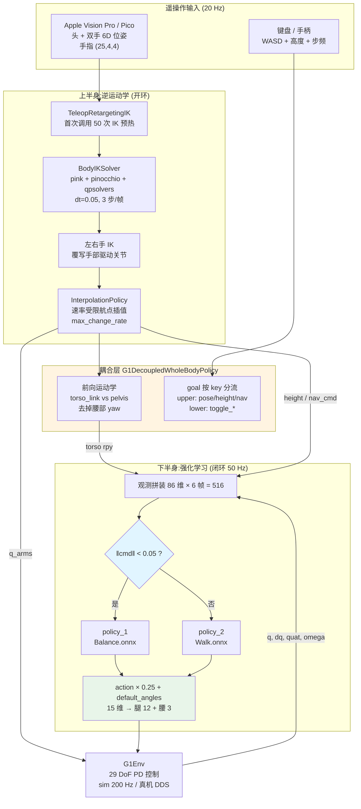
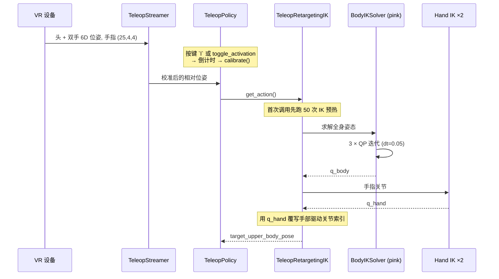
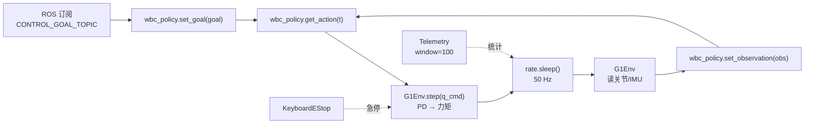

# Decoupled WBC 架构

## 1. 整体架构概览

Decoupled WBC 是 GR00T-WholeBodyControl 里**最保守也最好调试**的一条全身控制路线:它不训练一个端到端的全身策略,而是把机器人从腰部劈成两半 —— **下半身交给强化学习**(ONNX 策略,50 Hz 闭环),**上半身交给逆运动学**(QP-IK + 插值,开环跟随遥操作目标)。

这个"解耦"不是工程上的偷懒,而是一个明确的契约:上半身**不看任何观测**,只是把遥操作算出来的关节目标做速率受限插值;下半身则把上半身的姿态当作**扰动的先验信息**读进观测里,自己去维持平衡。二者之间只有四个标量/向量在流动:手臂关节角 `q_arms`、基座高度指令 `base_height_command`、躯干相对腰部的 RPY `torso_orientation_rpy`、插值后的导航速度 `navigate_cmd`。



与 [GEAR-SONIC](./17.GEAR-SONIC_Architecture.html) 那种"一个 RL 策略管全身"的做法相比,Decoupled WBC 的优势是**上半身可以精确跟踪任意 IK 目标**(做操作任务时手的位置误差只由 QP 求解器决定,不受 RL 策略的探索噪声影响),代价是上下半身的动力学耦合只能靠观测里那几维隐式补偿,做不了大幅度的全身动态动作。

---

## 2. 核心组件详解

### 2.1 解耦契约:`G1DecoupledWholeBodyPolicy`

`decoupled_wbc/control/policy/g1_decoupled_whole_body_policy.py` 只有 157 行,却把整套契约写得很干净。

**第一条:上半身不接收观测。**

```python
def set_observation(self, observation):
    # Upper body policy is open loop (just interpolation), so we don't need to set the observation
    self.lower_body_policy.set_observation(observation)
```

(`g1_decoupled_whole_body_policy.py:30`)。这一行就是"解耦"的定义 —— 上半身策略在整个控制回路里**没有反馈通路**。

**第二条:goal 按 key 分流。**

| 目标 key | 去向 | 含义 |
|---|---|---|
| `target_upper_body_pose` | 上半身 | IK 解出的上半身关节目标 |
| `base_height_command` | 上半身(再转下半身) | 期望基座高度,先经插值再喂给 RL |
| `target_time` | 上半身 | 该航点的到达时刻 |
| `interpolation_garbage_collection_time` | 上半身 | 早于此时刻的航点被丢弃 |
| `navigate_cmd` | 上半身(再转下半身) | 期望速度 (vx, vy, ωz),先插值再喂 RL |
| `toggle_stand_command` | 下半身 | 站立/行走切换 |
| `toggle_policy_action` | 下半身 | RL 输出是否生效(否则原地保持当前关节角) |

注意 `base_height_command` 和 `navigate_cmd` 明明是给下半身用的,却先走上半身的插值器 —— 这是刻意的:**遥操作发来的指令是 20 Hz 的稀疏航点,而控制环是 50 Hz**,统一用同一个 `InterpolationPolicy` 做时间对齐,可以保证速度指令不会阶跃跳变。

**第三条:遥操作缺省即安全。**

```python
if "navigate_cmd" not in goal:
    # Safety: Inject safe default navigate_cmd to ensure interpolation goes to stop
    ... upper_body_goal["navigate_cmd"] = np.array(DEFAULT_NAV_CMD)   # [0, 0, 0]
```

(`:65`)。以及 `get_action` 里的**1 秒超时**(`:91` 起):如果 1 秒内没收到新的遥操作 goal,主动注入一个 `target_time = now + 0.1`、`interpolation_garbage_collection_time = now - 1.0` 的安全 goal,让插值器把速度收敛到 0、并触发下半身的重置逻辑。

**第四条:是否处于遥操作模式由指令本身决定。**

```python
has_teleop_commands = ("navigate_cmd" in goal) or ("base_height_command" in goal)
self.is_in_teleop_mode = has_teleop_commands
self.lower_body_policy.set_use_teleop_policy_cmd(has_teleop_commands)
```

(`:75`)。这个开关直接决定下半身要不要采纳外部的高度/速度/躯干姿态 —— 键盘模式下它是 `False`,RL 策略用自己的键盘状态量。

### 2.2 上下半身的唯一物理耦合:躯干相对腰部姿态

这是整个文档里最值得细看的十行代码(`g1_decoupled_whole_body_policy.py:124-134`):

```python
self.robot_model.cache_forward_kinematics(q, auto_clip=False)
torso_orientation = self.robot_model.frame_placement("torso_link").rotation
waist_orientation = self.robot_model.frame_placement("pelvis").rotation
waist_yaw = np.arctan2(waist_orientation[1, 0], waist_orientation[0, 0])
waist_yaw_only_rotation = rpy.rpyToMatrix(0, 0, waist_yaw)
yaw_only_waist_from_torso = waist_yaw_only_rotation.T @ torso_orientation
torso_orientation_rpy = rpy.matrixToRpy(yaw_only_waist_from_torso)
```

逻辑是:先取骨盆的世界姿态,**只保留它的 yaw**,构造一个纯 yaw 旋转矩阵,再用它的转置去左乘躯干的世界姿态。结果 `torso_orientation_rpy` 表达的是"躯干相对于一个与骨盆同朝向、但保持水平的参考系"的 roll/pitch/yaw。

为什么要去掉 roll/pitch 只留 yaw?因为骨盆的 roll/pitch 是**平衡状态的一部分**,RL 策略已经从 `gravity_orientation` 里知道了;如果不剥离,躯干姿态指令就会和平衡状态纠缠在一起,策略无法区分"我倾斜了"和"操作员让我弯腰了"。剥离之后这三个数变成纯粹的**上半身意图**,直接写进观测的 `[4:7]` 槽位。

**关节写回的顺序也定义了优先级**:

```python
q[upper_body_indices] = upper_body_action["target_upper_body_pose"]
...
q[lower_body_indices] = lower_body_action["body_action"][0][: len(lower_body_indices)]
```

(`:119` 与 `:141`)。上半身先写,下半身后写 —— 在腰部关节(`waist_yaw/roll/pitch`)重叠的情况下,**下半身的 RL 输出覆盖上半身的 IK 输出**。这与 `configs.py` 里 `enable_waist: False` 的默认值是一致的:默认腰部归下半身管。

### 2.3 下半身 RL 策略:`G1GearWbcPolicy`

`decoupled_wbc/control/policy/g1_gear_wbc_policy.py`,295 行,核心是**两个 ONNX 模型 + 一个观测历史缓冲**。

**双策略加载。** `model_path` 是一个逗号分隔的字符串,split 后分别加载(`:30` / `:33`):

```python
self.policy_1 = self.load_onnx_policy(model_path.split(",")[0])   # Balance
self.policy_2 = self.load_onnx_policy(model_path.split(",")[1])   # Walk
```

默认值在 `configs.py`:

```python
wbc_model_path: str = (
    "policy/GR00T-WholeBodyControl-Balance.onnx,"
    "policy/GR00T-WholeBodyControl-Walk.onnx"
)
```

而 `sim2mujoco/resources/robots/g1/g1_gear_wbc.yaml` 里对应的是 `policy/ft92.onnx`(站立)和 `policy/ft109.onnx`(行走)。

**观测布局:86 维单帧。** `compute_observation`(`:68`)显式声明维度构成:

```python
single_obs_dim = 86  # 3 + 1 + 3 + 3 + 3 + n_joints + n_joints + 15, n_joints = 29
```

| 槽位 | 维度 | 内容 | 缩放 |
|---|---|---|---|
| `[0:3]` | 3 | 速度指令 `cmd[:3]` | `× cmd_scale = [2.0, 2.0, 0.5]` |
| `[3:4]` | 1 | 基座高度指令 `height_cmd` | 无(默认 0.74 m) |
| `[4:7]` | 3 | 躯干 RPY 指令(见 2.2) | 无 |
| `[7:10]` | 3 | 基座角速度 `omega` | `× ang_vel_scale = 0.5` |
| `[10:13]` | 3 | 重力方向 `gravity_orientation` | 无 |
| `[13:42]` | 29 | `(q - default_angles)` | `× dof_pos_scale` |
| `[42:71]` | 29 | `dq` | `× dof_vel_scale = 0.05` |
| `[71:86]` | 15 | 上一步动作 `self.action` | 无 |

注意 `[13:42]` 和 `[42:71]` 都是 **29 维全身关节** —— 下半身策略能看到手臂的全部关节角和角速度,这是它感知上半身负载的第二条通道(第一条是 2.2 的躯干姿态)。而输出只有 15 维(12 腿 + 3 腰),所以它"看全身、控下半身"。

**堆叠历史。** `num_obs: 516 = 86 × 6`,`obs_history_len: 6`,即 6 帧 × 86 维滑窗(`set_observation`,`:135` 起)。

> ⚠️ **配置陷阱**:`control/main/teleop/configs/g1_gear_wbc.yaml` 里写的是 `num_obs: 570 # 76*6`,与代码里的 86 矛盾。追踪 `GEAR_WBC_CONFIG` 可知实际加载的是 `decoupled_wbc/sim2mujoco/resources/robots/g1/g1_gear_wbc.yaml`(`num_obs: 516 # 86 × 6`)。前者是残留的旧文件,不要参照。

**步态时钟:算了但没用。** `compute_observation` 开头老老实实算了一套双足步态相位(`:71-87`):

```python
self.gait_indices = torch.remainder(self.gait_indices + 0.02 * self.freq_cmd, 1.0)
durations = torch.full_like(self.gait_indices, 0.5)          # duty = 0.5
foot_indices = [self.gait_indices + phases, self.gait_indices, ...]
self.clock_inputs = torch.stack([torch.sin(2 * np.pi * fi) for fi in foot_indices], dim=1)
```

但写进 `single_obs` 的那两行被注释掉了(`:129-131`)。也就是说**当前发布的策略是无相位时钟的**,步态节奏完全由网络自己涌现;`freq_cmd`(默认 0.75,键盘 `n`/`m` 可在 [1.0, 2.0] 内调)目前只影响这个未被使用的时钟。这是一个明显的"训练时用过、部署时关掉"的痕迹。

**策略切换:一个阈值。**

```python
if np.linalg.norm(self.cmd) < 0.05:
    policy = self.policy_1      # 站立/平衡
else:
    policy = self.policy_2      # 行走
self.action = policy(self.obs_tensor).detach().numpy().squeeze()
```

(`:223-230`)。切换是**硬切换**,没有混合、没有渐变。之所以能这样做,是因为两个策略共享完全相同的观测空间和动作空间,且都在 `cmd ≈ 0` 附近训练过,输出连续性由 `default_angles` 这个共同锚点保证。

**动作反缩放与安全阀。**

```python
if self.use_policy_action:
    cmd_q = self.action * self.config["action_scale"] + self.config["default_angles"]
else:
    cmd_q = self.observation["q"][self.robot_model.get_joint_group_indices("lower_body")]
return {"body_action": (cmd_q, cmd_dq, cmd_tau)}
```

(`:233-241`)。`use_policy_action = False` 时(默认值,`:44`),下半身**原地冻结在当前关节角** —— 这是上电后的安全状态,必须按键盘 `]` 才会把 RL 输出接进去,按 `o` 断开。`cmd_dq` 和 `cmd_tau` 恒为零向量,即**纯位置 PD 控制**,不做前馈力矩。

### 2.4 上半身插值:`InterpolationPolicy`

`decoupled_wbc/control/policy/interpolation_policy.py`。它维护一个 `PoseTrajectoryInterpolator`(`:152`),把 `target_upper_body_pose` / `base_height_command` / `navigate_cmd` 三者拼成一个长向量统一插值(`_concat_vecs` / `_unconcat_vecs`),取值时再拆开。

关键机制是 `schedule_waypoint`(`:197`):

- **速率钳制**:`max_change_rate` 逐关节生效(`upper_body_max_joint_speed`,配置里给的是 1000 —— 实际上等同于不限速,限速交给下游的关节安全监控),新航点若要求的变化率超限则被推后。
- **垃圾回收**:早于 `interpolation_garbage_collection_time` 的历史航点被 `trim` 掉(`:218`),防止轨迹缓冲无限增长,也保证遥操作断连后旧航点不会被重新插值出来。
- **单调时间**:全程用 `time.monotonic()`,不受系统时钟调整影响。

工厂函数 `wbc_policy_factory.py:31` 给它的初值是:

```python
InterpolationPolicy(
    init_values={
        "target_upper_body_pose": robot_model.get_initial_upper_body_pose(),
        "base_height_command": np.array([DEFAULT_BASE_HEIGHT]),   # 0.74
        "navigate_cmd": np.array([DEFAULT_NAV_CMD]),              # [0, 0, 0]
    },
    max_change_rate=wbc_config["upper_body_max_joint_speed"],
)
```

若配置 `upper_body_policy_type: "identity"`,则换成 `IdentityPolicy` —— 目标原样透传,不插值。这条路径用于策略回放/数据重演场景。

### 2.5 遥操作 IK 栈



**`TeleopRetargetingIK`**(`control/teleop/teleop_retargeting_ik.py`,148 行):首次调用时连跑 **50 次 IK 迭代**做预热 —— 因为 QP-IK 是增量式的,冷启动第一帧误差可能很大,预热让它先收敛到当前 VR 姿态附近。之后每帧先解身体,再用左右手 IK 求解器的结果覆写手部驱动关节的对应索引。

**`BodyIKSolver`**(`control/teleop/solver/body/body_ik_solver.py`,179 行)基于 `pink` + `pinocchio` + `qpsolvers`(优先 `quadprog`)。它的特色是自定义了一个 `WeightedPostureTask(PostureTask)`,重写 `compute_error` 和 `compute_jacobian`,让不同关节的"回归默认姿态"代价可以差几个数量级:

| 关节 | posture 权重 | 解读 |
|---|---|---|
| `waist_pitch` / `waist_roll` | 10 | 强烈不希望动腰 |
| `shoulder_pitch` | 4 | 较硬 |
| `elbow_pitch` / `shoulder_roll` | 3 | 中等 |
| `waist_yaw` | 2 | 允许转身 |
| `wrist_pitch` | 1 | 较软 |
| `shoulder_yaw` / `wrist_yaw` | 0.1 | 几乎自由 |

**任务代价**(`body_ik_solver_settings.py`)则给手部末端:`position_cost: 8.0`、`orientation_cost: 2.0`、`lm_damping: 3.0` —— 位置权重是姿态的 4 倍,说明"手到哪儿"比"手朝哪儿"重要;`posture_cost: 0.01` 是全局正则系数,与上表的逐关节权重相乘。

求解参数:`dt = 0.05`(20 Hz 遥操作周期),`num_step_per_frame = 3`(每帧解 3 次 QP)。

**关节限位覆写**:IK 用的限位比机器人物理限位更紧,`waist_pitch: [-0.52, 0.9]`、`elbow_pitch: [-1.0472, 1.4]` —— 前者防止弯腰过度破坏平衡,后者避开肘部自碰撞区。`q_default` 里 `shoulder_roll` 设为 ±0.2,让手臂略微外展,远离躯干奇异位形。

---

## 3. 控制循环与频率

`control/main/teleop/run_g1_control_loop.py`(236 行)是 ROS 节点 `ControlPolicy` 的主循环:



| 频率 | 值 | 说明 |
|---|---|---|
| `control_frequency` | **50 Hz** | 主循环 / RL 策略推理频率 |
| `sim_frequency` | **200 Hz** | MuJoCo 物理步进(`SIMULATE_DT: 0.005`) |
| `teleop_frequency` | **20 Hz** | VR 数据与 IK 求解 |
| `VIEWER_DT` | 0.02 | 可视化刷新 50 Hz |
| `control_decimation` | 4 | 200 Hz ÷ 4 = 50 Hz,与上面一致 |

几个循环里的细节:

- `waist_location = "lower_and_upper_body" if config.enable_waist else "lower_body"`(`:55`)—— 决定腰部三关节归属哪一组,直接影响 2.2 里 `q[lower_body_indices]` 覆盖的范围。
- `Telemetry(window_size=100)`(`:53`)滑窗统计单步耗时,超过 `1/control_frequency` 且非 `sim_sync_mode` 时告警(`:220`)。
- `KeyboardEStop`(`:72`)独立于策略之外,任何时刻可切断输出。
- 键盘输入有两条通路:直接读终端(raw)或订阅 `/keyboard_input` ROS 话题 —— 后者让远端机器也能发按键。

**键盘绑定**(`g1_gear_wbc_policy.py:243` 起):

| 按键 | 作用 |
|---|---|
| `]` / `o` | RL 动作接入 / 断开(`use_policy_action`) |
| `W` / `S` | `cmd[0]` ±0.2(前后) |
| `A` / `D` | `cmd[1]` ±0.2(左右) |
| `Q` / `E` | `cmd[2]` ±0.2(转向) |
| `z` | 三个速度分量全部清零 |
| `1` / `2` | `height_cmd` ±0.1 |
| `n` / `m` | `freq_cmd` ±,钳制在 [1.0, 2.0] |
| `3`–`8` | 躯干 roll / pitch / yaw ±10° |
| `l` | 遥操作激活(倒计时后 `calibrate()`) |
| `k` | 遥操作重置 |

---

## 4. 部署

### 4.1 仿真

`ROBOT_SCENE: scene_43dof.xml`,`SIMULATE_DT: 0.005`,`ENABLE_ELASTIC_BAND: True` —— 弹性绳吊住机器人,方便调试时不摔。`GAIT_PERIOD: 0.9`。

配置里 `MOTOR2JOINT` / `JOINT2MOTOR` 都是 29 元的恒等映射,说明仿真侧不需要电机重排;真机侧则通过 `UNITREE_LEGGED_CONST`(`LOWLEVEL = 0xFF`,`MODE_MACHINE = 5`)走低层 DDS 接口。

### 4.2 真机

- Docker 镜像 `docker.io/nvgear`。
- 机器人静态 IP `192.168.123.222/255.255.255.0`,`robot_ip: "192.168.123.164"`(相机服务器)。
- `scripts/deploy_g1.py` 起一个名为 `g1_deployment` 的 tmux 会话,分窗格拉起各组件。
- **PD 增益分两套**:`JOINT_KP/KD`(策略侧)与 `MOTOR_KP/KD`(电机侧)各一个 29 维向量。真机上有一处针对性微调:

  ```python
  wbc_config["MOTOR_KD"][14] = wbc_config["MOTOR_KD"][14] - 10   # 腰部 pitch 阻尼下调
  ```

  索引 14 是腰部 pitch,降阻尼是为了让上半身 IK 的目标更容易跟上。

- `DataExporterConfig.state_dim / action_dim = 43` —— 29 身体关节 + 14 手指关节(`with_hands: True`),导出为 LeRobot 格式用于后续 VLA 训练。

### 4.3 关键 RL 配置(`sim2mujoco/resources/robots/g1/g1_gear_wbc.yaml`)

| 项 | 值 |
|---|---|
| `policy_path` | `policy/ft92.onnx`(站立) |
| `walk_policy_path` | `policy/ft109.onnx`(行走) |
| `simulation_dt` | 0.005 |
| `control_decimation` | 4 |
| `kps` | `[150,150,150,200,40,40] × 2 + [250,250,250]` |
| `kds` | `[2,2,2,4,2,2] × 2 + [5,5,5]` |
| `default_angles` | `[-0.1,0,0,0.3,-0.2,0] × 2 + [0,0,0]` |
| `ang_vel_scale` | 0.5 |
| `dof_vel_scale` | 0.05 |
| `action_scale` | 0.25 |
| `cmd_scale` | `[2.0, 2.0, 0.5]` |
| `num_actions` | 15 |
| `num_obs` | 516(= 86 × 6) |
| `obs_history_len` | 6 |
| `height_cmd` | 0.74 |
| `freq_cmd` | 0.75 |

`kps` 的结构读法:每条腿 6 关节 `[hip_pitch, hip_roll, hip_yaw, knee, ankle_pitch, ankle_roll]`,膝盖最硬(200),踝最软(40);腰部三关节最硬(250)——因为它要顶住整个上半身。`default_angles` 是一个微蹲姿态:髋 pitch -0.1、膝 +0.3、踝 pitch -0.2,三者相加保证小腿垂直、重心略低。

---

## 5. 关键源文件表

| 文件 | 作用 |
|---|---|
| `decoupled_wbc/control/policy/g1_decoupled_whole_body_policy.py` | 解耦契约:goal 分流、躯干姿态计算、上下半身关节合并、遥操作超时 |
| `decoupled_wbc/control/policy/g1_gear_wbc_policy.py` | 下半身 RL:双 ONNX 加载、86 维观测拼装、策略切换、键盘 |
| `decoupled_wbc/control/policy/wbc_policy_factory.py` | 组装上下半身策略,`WBC_VERSIONS = ["gear_wbc"]` |
| `decoupled_wbc/control/policy/interpolation_policy.py` | 速率受限航点插值 + 垃圾回收 |
| `decoupled_wbc/control/policy/identity_policy.py` | 目标透传(无插值)分支 |
| `decoupled_wbc/control/policy/teleop_policy.py` | `TeleopStreamer` 封装、激活/校准状态机 |
| `decoupled_wbc/control/teleop/teleop_retargeting_ik.py` | IK 预热、身体 + 双手求解结果拼接 |
| `decoupled_wbc/control/teleop/solver/body/body_ik_solver.py` | pink/pinocchio QP-IK,`WeightedPostureTask` |
| `decoupled_wbc/control/teleop/solver/body/body_ik_solver_settings.py` | IK 权重、限位覆写、`q_default` |
| `decoupled_wbc/control/main/teleop/run_g1_control_loop.py` | ROS 主循环、频率控制、遥测、急停 |
| `decoupled_wbc/control/main/teleop/configs/configs.py` | `ControlLoopConfig` / `DataExporterConfig` 等数据类 |
| `decoupled_wbc/control/main/teleop/configs/g1_29dof_gear_wbc.yaml` | 顶层部署配置,指向真正的 RL 配置 |
| `decoupled_wbc/sim2mujoco/resources/robots/g1/g1_gear_wbc.yaml` | **实际加载**的 RL 超参与 ONNX 路径 |
| `decoupled_wbc/control/main/constants.py` | ROS 话题名、`DEFAULT_BASE_HEIGHT = 0.74`、`DEFAULT_NAV_CMD` |
| `docs/source/references/decoupled_wbc.md` | 官方部署说明、键盘/Pico 绑定 |

---

## 6. 与 GEAR-SONIC 的对照

| 维度 | Decoupled WBC | [GEAR-SONIC](./17.GEAR-SONIC_Architecture.html) |
|---|---|---|
| 全身控制方式 | 上下分治(IK + RL) | 单一 RL 策略统管 29 DoF |
| 上半身反馈 | **无**(开环插值) | 有(策略观测包含全身状态) |
| 上下耦合 | 4 个显式通道(`q_arms` / 高度 / 躯干 RPY / 速度) | 隐式,统一潜空间 |
| 指令接口 | 关节角目标 + 速度指令 | 64 维运动 token |
| 训练 | ONNX 策略离线训练,仓库不含训练码 | Isaac Lab PPO,4096 并行环境,训练码开源 |
| 动作能力 | 稳态操作、行走 + 手臂作业 | 大幅度全身动态动作、多来源运动重定向 |
| 调试难度 | 低 —— 每一层都可单独观察 | 高 —— 潜空间不可直接解释 |
| 适用场景 | 精确遥操作、数据采集 | 通用运动跟踪、VLA 下游动作空间 |

两条路线在这个仓库里是**并列的**,不是迭代替换关系。Decoupled WBC 更适合"要把手准确送到某个位姿"的操作类任务;GEAR-SONIC 更适合"要机器人做出某种整体运动"的场景,并且它的 64 维 token 已经被当作 VLA 的动作空间使用(见 [GR00T-WBC 总览](./15.GR00T-WBC_Overview.html))。
