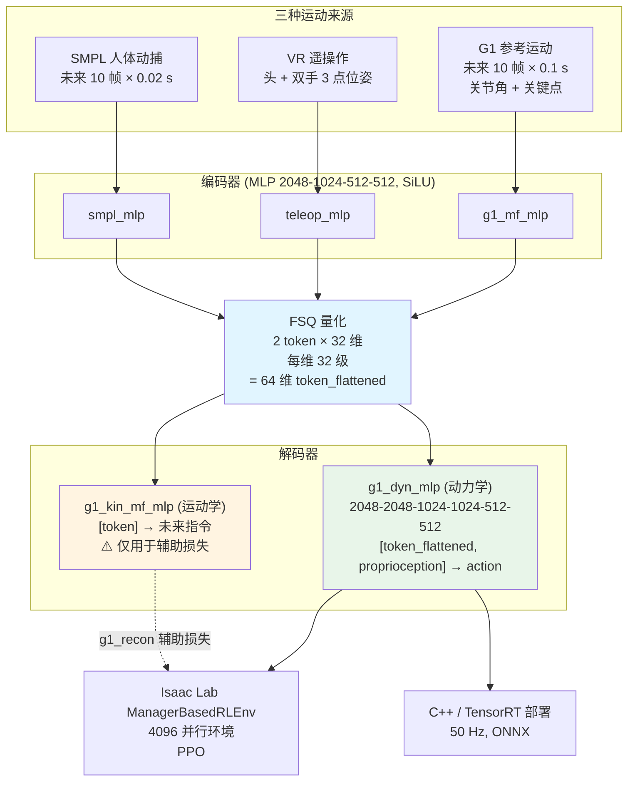
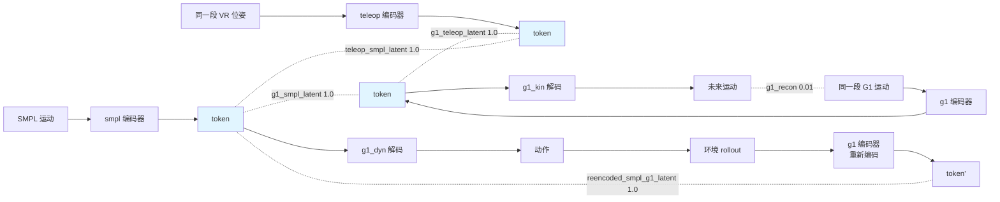
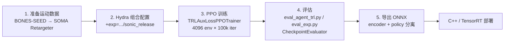

# GEAR-SONIC 架构

> 论文 arXiv:2511.07820 · 模型 `nvidia/GEAR-SONIC` · Isaac Lab 2.3.2

## 1. 整体架构概览

GEAR-SONIC 要解决的是一个很具体的接口问题:**人类动捕、VR 遥操作、机器人参考轨迹这三种运动来源,格式完全不同,能不能压进同一个空间,让同一个控制器都能跟踪?**

答案是 **Universal Token(通用运动 token)**。三个独立编码器分别吃 G1 参考运动、VR 三点遥操作、SMPL 人体动捕,各自输出到同一个 **64 维 FSQ 量化潜空间**;下游只有**一个**动力学解码器,把 token + 本体感知解成 29 维关节动作,50 Hz 跑在真机上。

这个设计带来两个直接后果:

1. **部署侧只需要一个策略。** 换输入模态 = 换编码器,策略权重不变。C++ 部署栈里编码器和解码器是两个独立的 ONNX 文件(`model_encoder.onnx` / `model_decoder.onnx`),配一份 `observation_config.yaml`。
2. **token 成了一个通用动作空间。** VLA 模型可以直接预测 64 维 token 而不是关节角 —— 这就是 GR00T N1.7 在这套系统上做全身操作的方式(2.5 Hz 出 token,SONIC 以 50 Hz 解码)。



---

## 2. 核心组件详解

### 2.1 Universal Token:64 维从哪来

模型卡里写"64 维潜运动 token",训练配置里却找不到 `64` 这个数。它是算出来的:

```python
self.token_dim = self.num_fsq_levels          # 32
self.token_total_dim = self.token_dim * self.max_num_tokens   # 32 × 2 = 64
```

(`gear_sonic/trl/modules/universal_token_modules.py`)。对应配置:

| 配置项 | 文件 | 值 |
|---|---|---|
| `num_fsq_levels` | `config/actor_critic/universal_token/all_mlp_v1.yaml` | 32 |
| `fsq_level_list` | 同上 | 32 |
| `max_num_tokens` | 同上 | 2 |
| `encoder.dimension` | 部署侧 `observation_config.yaml` | **64** |

即:**2 个 token,每个 32 维,每一维被 FSQ 量化到 32 个离散级别**。FSQ(Finite Scalar Quantization)来自 `vector_quantize_pytorch`,相比 VQ-VAE 的码本查表,它直接对每个标量维度做有界四舍五入,没有码本坍塌问题,也不需要 commitment loss 和 EMA 更新 —— 对 RL 训练特别友好,因为不会出现"码本没更新导致梯度断流"。

模块暴露的特征名有两个:

| 特征名 | 维度 | 用途 |
|---|---|---|
| `token` | 32 | 带时间维,给 `g1_kin` 解码器 |
| `token_flattened` | 64 | 展平,给 `g1_dyn` 解码器和部署 |

`UniversalTokenModule` 的方法链:`_create_frame_and_token_masks` → `parse_tokenizer_obs` → `_encode_single`(逐编码器)→ `assemble_all_tokens` → `encode` / `decode` / `forward(..., latent_residual, latent_residual_mode)` / `get_token_info`。

**多热编码器掩码。** `create_encoder_masks` 支持一个环境同时激活多个编码器 —— SMPL 原生的环境会同时打开 SMPL=1 和 G1=1 两个标志。这是"同一段运动、两种表示"的训练信号,也是后面 `reencoded_smpl_g1_latent` 损失的前提。

### 2.2 三个编码器

三者结构完全相同,只有输入维度不同:

| 编码器 | 配置文件 | 输入 |
|---|---|---|
| `g1_mf_mlp` | `config/encoder/g1_mf_mlp.yaml` | G1 未来参考帧(多帧) |
| `teleop_mlp` | `config/encoder/teleop_mlp.yaml` | VR 三点位姿 |
| `smpl_mlp` | `config/encoder/smpl_mlp.yaml` | SMPL 未来帧 |

共同超参:

```yaml
hidden_dims: [2048, 1024, 512, 512]
activation: SiLU
num_output_temporal_dims: ${max_num_tokens}     # 2
```

`num_output_temporal_dims = max_num_tokens` 是关键 —— 编码器直接输出 2 个时间槽位的特征,而不是先出一个大向量再切分。

**训练时随机采样编码器**:

```yaml
encoder_sample_probs: {g1: 1.0, teleop: 1.0, smpl: 1.0}
```

三者等权。加上 `teleop_sample_prob_when_smpl: 0.5`(SMPL 环境有一半概率同时以遥操作形式呈现),保证任何一个编码器都不会训练不足。

### 2.3 两个解码器,只有一个上真机

这是 SONIC 设计里最容易被忽略的一点。

**`g1_dyn_mlp`(动力学解码器)—— 唯一上真机的那个:**

```yaml
inputs: ["token_flattened", "proprioception"]
outputs: ["action"]
has_temporal_dim: False
hidden_dims: [2048, 2048, 1024, 1024, 512, 512]
```

6 层、最宽 2048 —— 比编码器深得多,因为它要做的事更难:从"想做什么动作"(token)+ "现在什么状态"(本体感知)推出"下一步 29 个关节各转多少"。`proprioception_features: ["actor_obs"]` 表示本体感知就是 actor 的常规观测。

**`g1_kin_mf_mlp`(运动学解码器)—— 只为损失存在:**

```yaml
inputs: ["token"]
outputs: 未来运动指令
has_temporal_dim: True
```

它不参与控制。它的唯一职责是把 token 解回"未来运动应该长什么样",与真值比对产生 `g1_recon` 辅助损失。有它在,token 就不能退化成"只对当前策略有用的黑盒特征",必须真的编码了运动的运动学内容 —— 这才让 token 具备跨模态、跨下游任务的通用性。

### 2.4 辅助损失:把三个编码器焊在同一个空间

`config/aux_losses/universal_token/g1_recon_and_all_latent.yaml`:

| 损失项 | 系数 | 作用 |
|---|---|---|
| `g1_recon` | **0.01** | `g1_kin` 重建未来运动 → token 保留运动学语义 |
| `g1_smpl_latent` | **1.0** | G1 编码 ≈ SMPL 编码 |
| `g1_teleop_latent` | **1.0** | G1 编码 ≈ 遥操作编码 |
| `teleop_smpl_latent` | **1.0** | 遥操作编码 ≈ SMPL 编码 |
| `reencoded_smpl_g1_latent` | **1.0** | SMPL→动作→重新编码 后仍 ≈ 原 token |

系数对比很说明问题:**重建损失 0.01,对齐损失全是 1.0**。也就是说训练目标的重心不在"token 能不能还原运动",而在"三个编码器必须收敛到同一个空间"。重建损失只是一个弱正则,防止空间退化。

第四项 `reencoded_smpl_g1_latent` 需要 `reencode_smpl_g1_recon: true`(在 `sonic_release.yaml` 的算法覆写里)。它构成一个闭环一致性约束:SMPL 运动 → SMPL 编码器 → token → 解码出动作 → 用 G1 编码器重新编码 → 应当回到原 token。这直接惩罚了"编码器学会作弊、把模态身份编进 token"的行为。



---

## 3. 训练流水线

### 3.1 环境与算法

训练跑在 **Isaac Lab 的 `ManagerBasedRLEnv`** 上,配置组合由 Hydra 完成:

```bash
+exp=manager/universal_token/all_modes/sonic_release
```

`config/base.yaml` 基础项:`seed: 0`,`headless: True`,`num_envs: 4096`,`base_dir: logs_rl`,`sim_type: isaacsim`,`env_spacing: 20`。

**PPO 超参**(`config/algo/ppo_im_phc.yaml`):

| 项 | 值 |
|---|---|
| epochs | 5 |
| mini-batches | 4 |
| clip | 0.2 |
| γ / λ | 0.99 / 0.95 |
| `value_loss_coef` | 1.0 |
| `entropy_coef` | 0.01 |
| actor lr | 2e-5 |
| critic lr | 1e-3 |
| 学习率调度 | adaptive,`desired_kl: 0.01`,范围 [1e-5, 2e-4] |
| `num_steps_per_env` | 32(实验里覆写为 **24**) |
| `init_noise_std` | 0.05 |
| `num_learning_iterations` | 100000 |
| `save_interval` | 500 |

注意 **actor lr 2e-5 比 critic lr 1e-3 小了 50 倍**。这在运动跟踪类 RL 里是常见做法:策略网络此时同时承担着"维持潜空间结构"的职责(辅助损失也从这里反传),学得太快会破坏编码器对齐;而 critic 只需要拟合价值函数,可以放开。

`sonic_release.yaml` 的算法覆写还包括:

```yaml
use_clampped_std: true
std_clamp_min: 0.001
std_clamp_max: 0.5
max_grad_norm: 0.1
```

`max_grad_norm: 0.1` 相当激进(常见值是 0.5~1.0),配合 2e-5 的学习率,整体是一个"小步慢走"的策略 —— 符合"在已经对齐好的潜空间上做精细跟踪"这个目标。

### 3.2 实验配置要点(`sonic_release.yaml`)

| 项 | 值 | 说明 |
|---|---|---|
| `num_envs` | 4096 | |
| `project_name` | `TRL_G1_Track` | |
| 本体/动作历史 | 10 / 10 | |
| `robot` | `g1_model_12_dex` | 带灵巧手的 G1 |
| `terrain_type` | `trimesh` | 非平地 |
| `num_future_frames` | 10 | G1 参考未来 10 帧 |
| `dt_future_ref_frames` | 0.1 | → 1.0 s 前瞻 |
| `smpl_num_future_frames` | 10 | |
| `smpl_dt_future_ref_frames` | 0.02 | → 0.2 s 前瞻 |
| `reward_point_body` | `["torso_link", "left_wrist_yaw_link", "right_wrist_yaw_link"]` | 跟踪奖励的参考点 |
| 对应偏移 | `[[0,0,0.5], [0,0,0], [0,0,0]]` | 躯干点上移 0.5 m,近似头部 |
| `feet_acc` 权重 | -2.5e-6 | 抑制脚部加速度,减少抖动 |
| `cat_upper_body_poses` | true(prob 0.5) | 一半样本拼接上半身姿态指令 |
| `freeze_frame_aug` | true | 冻结帧数据增强 |
| `teleop_sample_prob_when_smpl` | 0.5 | |
| `adp_samp_failure_rate_max_over_mean` | 200 | 自适应采样:难样本上限倍率 |
| `motion_file` | `data/motion_lib_bones_seed/robot_filtered` | |
| `smpl_motion_file` | `data/bones_seed_smpl` | |
| `smpl_y_up` | true | SMPL 数据是 Y-up |

`reward_point_body` 的三点选择值得说一下:躯干 + 双腕。跟踪奖励不是逐关节角度误差,而是**这三个点在世界系的位置误差** —— 这让策略有自由度用不同的关节组合达到同一个末端姿态,比逐关节跟踪宽松得多,也更符合"看起来像"的直觉。躯干点加 0.5 m 偏移把参考点抬到接近头部的位置,相当于额外约束了躯干的倾斜。

`adp_samp_failure_rate_max_over_mean: 200` 是自适应采样:失败率高的运动片段被更频繁地采样,但倍率上限 200 倍,防止某几条极难的片段吃光整个 batch。

### 3.3 训练五步

`docs/source/references/training_code.md` 给出的流程:



关键类:

| 类 | 职责 |
|---|---|
| `Actor` / `Critic` | 策略与价值网络 |
| `UniversalTokenModule` | 编码器/解码器/FSQ 全家桶 |
| `PolicyAndValueWrapper` | 训练时把二者打包 |
| `TRLPPOTrainer` | 标准 PPO |
| `TRLAuxLossPPOTrainer` | PPO **+ 辅助损失**,SONIC 实际用的 |
| `ManagerEnvWrapper` | Isaac Lab `ManagerBasedRLEnv` 适配 |
| `CheckpointEvaluator` | 批量评估 checkpoint |

---

## 4. 部署

### 4.1 两个发布模型

`docs/source/model_card.md`:

| | 默认 SONIC | 低延迟 SONIC |
|---|---|---|
| 未来帧数 | 10 | 4 |
| 帧间隔 | 20 ms | 20 ms |
| 前瞻时长 | ≈ **200 ms** | ≈ **80 ms** |
| observation step | `step5` | `step1` |
| checkpoint | `sonic_release/last.pt` | `low_latency/last.pt` |
| 部署文件 | 顶层 `model_encoder.onnx` / `model_decoder.onnx` / `observation_config.yaml` | `low_latency/` 下同名三件套 |
| token 维度 | 64 | 64 |
| 控制频率 | 50 Hz | 50 Hz |
| 输入模态 | SMPL / G1-ref / VR-3pt | 同 |

HuggingFace: `nvidia/GEAR-SONIC`。下载与启动:

```bash
python download_from_hf.py                # 默认模型 + 规划器
python download_from_hf.py --low-latency  # 低延迟版本

cd gear_sonic_deploy && ./deploy.sh --input-type zmq_manager real
# 低延迟版需显式指定 checkpoint 前缀与观测配置
./deploy.sh --cp policy/low_latency/model \
            --obs-config policy/low_latency/observation_config.yaml \
            --input-type zmq_manager real
```

官方特别强调:**200 ms / 80 ms 是"参考前瞻窗口",不是端到端遥操作延迟** —— 后者还要加上感知、网络、预处理和推理。

前瞻时长是一个真实的权衡:200 ms 前瞻让动作更平滑、更能提前规划落脚点;80 ms 版本对遥操作的响应更跟手,但动作质量下降。

### 4.2 观测配置系统

部署侧用 YAML 声明观测由哪些块拼成,命名规范是 `{base}_{N}frame_step{S}`,其中 **S 以 50 Hz 的 tick 计** —— `step5` = 5 × 20 ms = 0.1 s。

三个典型配置的规模(`docs/source/references/observation_config.md`):

| 配置 | 策略输入 | 编码器输入 |
|---|---|---|
| 最小 | 154 维 | — |
| token-based | 64 + 3 + 29 + 29 + 29 | 290 + 290 + 60 + 10 = **650** |
| VR 遥操作 | — | — |

token-based 策略输入的读法:64 维 token + 3 维(基座相关)+ 三个 29 维块(关节角、关节速度、上一动作)。这与 [Decoupled WBC](./16.Decoupled-WBC_Architecture.html) 的 86 维观测结构其实很像 —— 差别在于前 4 维的显式速度/高度指令被换成了 64 维 token。

C++ 侧每个观测块是一个注册函数:

```cpp
bool MyObservation(std::vector<double>& target_buffer, size_t offset);
```

(`gear_sonic_deploy/src/g1/g1_deploy_onnx_ref/src/g1_deploy_onnx_ref.cpp`)。注册表模式让加新观测不用改主循环。

### 4.3 运行

```bash
just build
just run g1_deploy_onnx_ref <iface> <model> <motion_dir>
```

| 参数 | 取值 |
|---|---|
| 输入接口 | `keyboard` / `gamepad` / `gamepad_manager` / `zmq` / `zmq_manager` / `ros2` / `manager` |
| 输出 | `zmq` / `ros2` / `all` |
| `--encoder-file` | 编码器 ONNX |
| `--planner-file` | 运动学规划器 ONNX(可选) |
| `--policy-precision` | 推理精度 |
| `--disable-crc-check` | 调试用 |
| `--set-compliance` | 默认 `0.5,0.5,0.0` |
| `--max-close-ratio` | 手部闭合上限 |

CSV 日志以 50 Hz 记录 `base_quat` / `base_ang_vel` / `torso_quat` / `torso_ang_vel` / `q` / `dq` / `action`。

可视化:

```bash
python visualize_motion.py --realtime_debug_url tcp://localhost:5557
```

同屏显示 4 个机器人 —— 目标(彩色)、零平移目标(绿)、实测(红)、温度热力图。

### 4.4 运动学规划器(Planner ONNX)

一个可选的上层模块:给定当前状态 + 高层导航指令,输出未来一串 MuJoCo `qpos`,再交给 SONIC 跟踪。它的接口(`docs/source/references/planner_onnx.md`)与 [MotionBricks](./18.MotionBricks_Architecture.html) 高度同构:

| 输入 | 形状 | 说明 |
|---|---|---|
| `context_mujoco_qpos` | `[1, 4, 36]` | 最近 4 帧 qpos(3 位置 + 4 四元数 wxyz + 29 关节) |
| `target_vel` | `[1]` | ≤ 0 用模式默认速度,> 0 覆写(m/s) |
| `mode` | `[1]` int64 | 运动风格索引(idle / slowWalk / ...) |
| `movement_direction` | `[1, 3]` | 世界系移动方向 |
| `facing_direction` | `[1, 3]` | 世界系朝向 |
| `height` | `[1]` | ≤ 0 关闭高度控制 |

| 输出 | 形状 |
|---|---|
| `mujoco_qpos` | `[1, N, 36]`(padding,只有前 `num_pred_frames` 帧有效) |
| `num_pred_frames` | scalar int64 |

另有 5 个"高级输入"由 C++ 栈管理,不建议手动改。坐标系是 MuJoCo Z-up(X 前、Y 左、Z 上),所有输入都在**世界系**,规范化由模型内部完成。

规划器的训练代码和技术报告尚未发布,当前只开放 ONNX 接口。

### 4.5 坐标系约定

`docs/source/references/conventions.md` 是踩坑高发区:

| 空间 | Up 轴 | 四元数序 |
|---|---|---|
| Isaac Lab / MuJoCo | **Z** | **wxyz** |
| SMPL / BVH | **Y** | — |
| scipy `Rotation` | — | **xyzw** |

代码里 `w_last=False` 表示 wxyz。`pose_aa` 是轴角表示,按 **MuJoCo body 顺序**排列。两套关节序之间由 `G1_ISAACLAB_TO_MUJOCO_DOF` / `G1_MUJOCO_TO_ISAACLAB_DOF` 映射,运动 PKL 文件存的是 MuJoCo 序,由 `order_converter.py` 转换。

---

## 5. 与 VLA 的连接

`docs/source/tutorials/vla_workflow.md` 描述的三段式工作流:


**动作空间就是 SONIC 的 token**:

```
VLA (2.5 Hz) --64 维 × 40--> SONIC 解码器 (C++) --50 Hz--> 机器人
```

每次推理的完整动作是 **78 维 = 64 维运动 token + 7 维左手 + 7 维右手**。VLA 只需要决定"做什么",平衡、行走、全身协调这些"怎么做"全部由预训练的 SONIC 承担。2.5 Hz → 50 Hz 的 20 倍频率差,正是靠 40 步的 token chunk 填满的。

数据采集:

```bash
python gear_sonic/scripts/launch_data_collection.py \
    --camera-host 192.168.123.164 \
    --task-prompt "pick up the soda can and place it in the bin"
```

产出标准 LeRobot v2.1 目录(`data/*.parquet` + `videos/observation.images.ego_view/*.mp4` + `meta/{info,modality,episodes,tasks}`)。官方建议单任务 **50–100 条**演示。采集后必须跑 `process_dataset.py` 清掉录制时按 `x` 标记丢弃的 episode 和残留的 SMPL 帧。

---

## 6. 关键源文件表

| 文件 | 作用 |
|---|---|
| `gear_sonic/trl/modules/universal_token_modules.py` | `UniversalTokenModule`:编码/量化/解码、编码器掩码、token 维度推导 |
| `gear_sonic/config/exp/manager/universal_token/all_modes/sonic_release.yaml` | 发布版实验配置(环境/奖励/数据/算法覆写) |
| `gear_sonic/config/actor_critic/universal_token/all_mlp_v1.yaml` | FSQ 级数、token 数、编码器采样概率、辅助损失开关 |
| `gear_sonic/config/encoder/{g1_mf_mlp,teleop_mlp,smpl_mlp}.yaml` | 三个编码器 |
| `gear_sonic/config/decoder/g1_dyn_mlp.yaml` | 动力学解码器(唯一上真机) |
| `gear_sonic/config/decoder/g1_kin_mf_mlp.yaml` | 运动学解码器(仅辅助损失) |
| `gear_sonic/config/aux_losses/universal_token/g1_recon_and_all_latent.yaml` | 5 项辅助损失系数 |
| `gear_sonic/config/algo/ppo_im_phc.yaml` | PPO 超参 |
| `gear_sonic/config/base.yaml` | 全局默认(seed / num_envs / sim_type) |
| `gear_sonic/scripts/launch_data_collection.py` | VR 遥操作数据采集 |
| `gear_sonic/scripts/process_dataset.py` | 数据集清洗 |
| `gear_sonic_deploy/src/g1/g1_deploy_onnx_ref/src/g1_deploy_onnx_ref.cpp` | C++ 部署主程序、观测注册表 |
| `docs/source/model_card.md` | 两个发布模型的规格 |
| `docs/source/references/training_code.md` | 目录结构、MDP 组件、关键类 |
| `docs/source/references/observation_config.md` | 观测块命名与维度表 |
| `docs/source/references/deployment_code.md` | `just` 命令、CLI 参数、日志与可视化 |
| `docs/source/references/planner_onnx.md` | 规划器 ONNX 输入输出规格 |
| `docs/source/references/conventions.md` | 坐标系与关节序约定 |
| `docs/source/tutorials/vla_workflow.md` | 采集 → 微调 → 部署 |

---

## 7. 设计取舍小结

| 决策 | 收益 | 代价 |
|---|---|---|
| FSQ 而非 VQ-VAE | 无码本坍塌、无 commitment loss、RL 友好 | 表达力受离散级数限制(32 级) |
| 2 × 32 而非 1 × 64 | 保留时间结构,`g1_kin` 可按 token 展开 | 部署侧要展平,多一层约定 |
| 对齐损失 1.0 / 重建 0.01 | 强制跨模态共享空间 | token 的可解释性弱 |
| `g1_kin` 只训不部署 | 保证 token 有运动学语义 | 训练开销增加 |
| actor lr 比 critic 小 50 倍 | 保护已对齐的潜空间 | 收敛慢,需 100k iter |
| 三点位置奖励而非逐关节 | 允许多样的关节解 | 关节层面可能出现奇怪姿态 |

与 [Decoupled WBC](./16.Decoupled-WBC_Architecture.html) 的路线对比、以及在整个 GR00T-WholeBodyControl 仓库中的定位,见 [GR00T-WBC 总览](./15.GR00T-WBC_Overview.html)。
