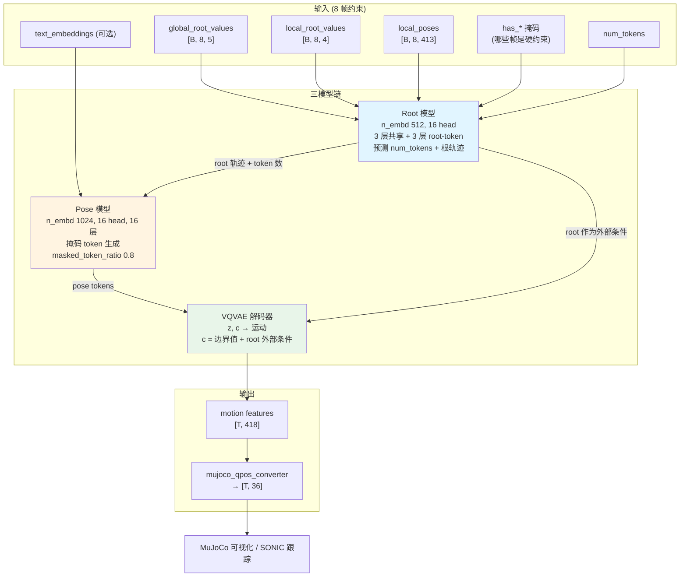
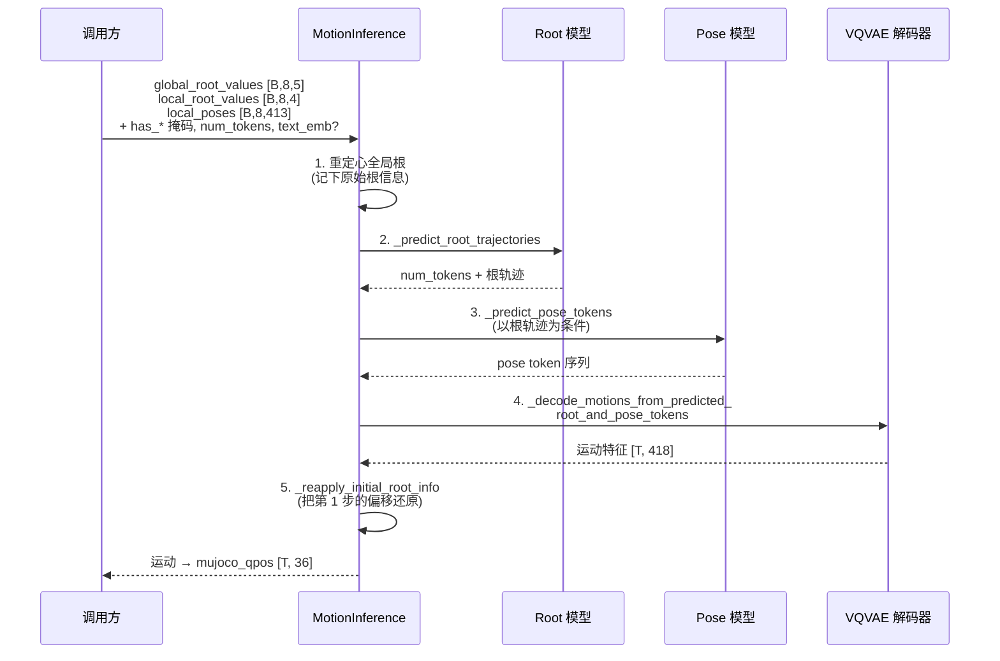

# MotionBricks 架构

## 1. 整体架构概览

MotionBricks(arXiv:2604.24833,Tingwu Wang 等,2026)是 GR00T-WholeBodyControl 里的**运动生成**层 —— 它不控制机器人,它**生产机器人要跟踪的运动**。给定几帧上下文和一个方向/风格指令,它在毫秒级内合成一段物理合理的 G1 全身运动,吞吐达到 **15,000 FPS** 的零样本合成速度。

架构上是**三个模型串成一条链**:

1. **VQVAE** —— 运动分词器。把一段运动压成若干离散 token,再解回来。先单独训练,之后冻结。
2. **Root 模型** —— 先决定"走到哪、朝哪、用几个 token",输出全局根轨迹。**不依赖 VQVAE**。
3. **Pose 模型** —— 以 root 轨迹为条件,用掩码 token 生成的方式补出姿态 token 序列,再送进 VQVAE 解码器还原成运动。



"先根后姿"的分解是整个设计的核心:根轨迹是**低维、强物理约束、可被用户直接指定**的(走到哪儿是用户说了算),姿态是**高维、多解、需要生成模型**的。把它们拆开之后,交互式控制只需要改 root 的输入,pose 模型自动适配。

---

## 2. 运动表征

### 2.1 `DualRootGlobalJoints` on `G1Skeleton34`

骨架 `G1Skeleton34` = Unitree G1 的 32 个关节 + 2 个虚拟脚趾关节(仅用于足部接触检测,真机不驱动)。

每帧特征 **418 维**,由三块组成:

| 块 | 维度 | 内容 |
|---|---|---|
| **Body** | **409** | 见下表,全局/局部两种表示共享 |
| Global root | 5 | `global_root_pos`(3)+ `global_root_heading` cos/sin(2) |
| Local root | 4 | `local_root_rot_vel`(1)+ `local_root_vel` XZ(2)+ `global_root_y` 高度(1) |

Body 409 的细分:

| 特征 | 维度 | 说明 |
|---|---|---|
| `ric_data` | 99 | 33 个非根关节的全局位置,**逐帧减去根的 XZ 投影** |
| `global_rot_data` | 204 | 34 个关节的**世界系** 6D 连续旋转(34 × 6) |
| `local_vel` | 102 | 34 关节的世界系速度(位置有限差分)。名字里的 `local_` 是历史遗留 —— `removing_heading=False`,**没有**做朝向旋转 |
| `foot_contacts` | 4 | 左踝、左趾、右踝、右趾的二值接触 |

三种组合:

| 表示 | 公式 | 总维 | 使用者 |
|---|---|---|---|
| `GlobalRootGlobalJoints` | 5 + 409 | **414** | **Root 模型**、数据加载器 |
| `LocalRootGlobalJoints` | 4 + 409 | **413** | **Pose / 分词器模块** |
| `DualRootGlobalJoints` | 5 + 4 + 409 | **418** | 完整表示 |

两个子集通过 `dual_rep.global_to_local` / `local_to_global` **无损互转**。数据加载器返回的永远是 global(414),训练步里按需转成 local。

为什么 root 模型用 global、pose 模型用 local?因为 root 模型的职责就是**精确的全局位置控制**(用户要机器人走到某个坐标),必须直接看世界系;pose 模型只关心"相对于当前根,身体怎么动",用局部速度表示对平移/旋转不变,泛化更好。

### 2.2 没有固定朝向规范化

这是 MotionBricks 与大多数运动生成工作的一个明显区别。它**不**把每段运动旋转到统一朝向,而是:

```
change_first_heading(..., first_heading_angle)
  训练: first_heading_angle ~ Uniform(0, 2π)      → 随机朝向
  推理: first_heading_angle = 0                    → 确定性
```

效果是把首帧根 XZ 放到原点(高度 Y 保留),并整体旋转到目标朝向。既然训练时模型见过所有朝向,预先规范化就没有额外收益,反而引入一次多余的坐标变换。

### 2.3 归一化与坐标系

z-score,`eps = 1e-5`:

```
normalized = (feature - mean) / sqrt(std² + eps)
```

`mean.npy` / `std.npy` 存在每个 checkpoint 的 `stats/motion/` 目录下。

**坐标系是最容易出错的地方**:

| 空间 | Up | Forward | 手性 |
|---|---|---|---|
| Motion(MotionBricks 内部) | **Y** | **Z** | 右手 |
| MuJoCo | **Z** | **X** | 右手 |

转换关系:`Motion X = MuJoCo Y`,`Motion Y = MuJoCo Z`,`Motion Z = MuJoCo X`。

输出的 MuJoCo `qpos` 是 **36 维**:

| 索引 | 内容 |
|---|---|
| 0–2 | 根平移 (x, y, z) |
| 3–6 | 根四元数 (w, x, y, z) |
| 7–35 | 29 个铰链关节角 |

34 关节的运动表示 ↔ 29 DoF 的 MuJoCo 模型由 `mujoco_qpos_converter` 负责映射(差的 5 个:2 个虚拟脚趾 + 3 个骨架里有但 MuJoCo 模型未建的自由度)。

---

## 3. 三个模型详解

### 3.1 VQVAE:运动分词器

`motionbricks/vqvae/neural_modules/vqvae.py` 的接口约定很直白:

- **编码器**:无条件,`x → z`。
- **解码器**:有条件,`(z, c) → x`,其中 `c` = **目标条件**(边界值,即片段首尾的锚点)+ **外部条件**(pose VQVAE 用的是 root 值)。

配置(`out/motionbricks_vqvae/version_1/config.yaml`):

| 项 | 值 |
|---|---|
| `encoder_state_dim` | 241 |
| `decoder_state_dim` | 329 |
| `decoder_target_cond_dim` | 241 |
| `decoder_external_cond_dim` | 2 |
| `quantizer_strategy` | `multihead_ema_reset` |
| `quantizer_mu` | 0.99 |
| `nb_code` | **100,000,000** |
| `code_dim` | 256 |
| `num_heads` | 8 |
| `down_t` / `stride_t` | 2 / 2 |
| `width` / `depth` | 512 / 4 |
| `min_tokens` / `max_tokens` | 6 / 16 |

**一亿码本是怎么来的?** `quantize_cnn_multihead.py` 的 `QuantizeEMAResetMultiHead`:

```python
nb_code_per_head = round(2 ** (math.log2(nb_code) / num_heads))
assert nb_code_per_head ** num_heads == nb_code
codebook_dim = code_dim // num_heads
```

代入:`log2(1e8) / 8 = 3.3219`,`2^3.3219 ≈ 10`,`10^8 = 100,000,000` ✓。也就是说**每个头只有 10 个码字,码字维度 32**,8 个头组合出 10⁸ 的有效词表。索引通过 `from_mh_indices_to_overall_indices` 做 10 进制打包。

这是绕过码本坍塌的经典手法:真去维护一亿个 256 维码字既不可训练也不可存储,而 8 × 10 个 32 维码字总共只有 80 个向量,EMA 更新充分、每个码字都被高频访问。表达力则来自组合爆炸。

`ema_reset` 是配套的:长期未被使用的码字被重置到当前 batch 的某个编码上,`mu = 0.99` 是 EMA 动量。

**损失项**:

| 项 | 系数 |
|---|---|
| `commit_loss_coeff` | 0.02 |
| `skate_contact_loss_coeff` | 0.01 |
| `joint_vel_loss_coeff` | **2.0** |

`joint_vel_loss` 系数是重建之外最大的一项 —— 运动质量的主观感受高度依赖速度连续性,位置对了但速度抖动的运动看起来是"卡顿的"。`skate_contact_loss` 惩罚脚在接触状态下的水平滑移(滑步是运动生成的典型 artifact)。另有关键帧预热 200,000 步,以及 1.0 s 窗口内的 `min_joint_height_within_windows` 地板约束。

**训练**:`AdamAtan2`,lr 2e-4 + WarmupCosine(warmup 10,000,`max_steps` 2,000,001,final lr 4e-6),8 GPU × 4 节点 DDP,fp32,梯度裁剪 0.5,batch 128。数据 `motionbricks-G1` @30 fps,`MaxDurationRandomCrop max_seconds: 30`,`randomize_first_heading: true`。

### 3.2 Root 模型:先定轨迹

`out/motionbricks_root/version_1/config.yaml`:

| 项 | 值 |
|---|---|
| `n_embd` | 512 |
| `n_head` | 16 |
| `n_layers_shared` | 3 |
| `n_layers_root_token` | 3 |
| `pose_feat_dim` | 256 |
| `local_root_feat_dim` / `global_root_feat_dim` | 64 / 64 |
| `use_hard_num_token_emb_for_root_prediction` | true |
| `num_token_loss_coeff` | 1.0 |
| `global_root_loss_coeff` | **2.0** |
| `local_root_loss_coeff` | 1.0 |
| `prob_provide_text_emb` | **0.0** |
| 训练规模 | 8 GPU × 2 节点 |

三个输出头:

1. **`num_tokens`** —— 这段运动该用几个 token(范围 [6, 16])。等价于预测运动时长,因为 token 数 × 下采样率 = 帧数。
2. **全局根轨迹**(损失权重 2.0)—— 世界系位置 + 朝向。
3. **局部根轨迹**(损失权重 1.0)—— 速度形式。

`use_hard_num_token_emb_for_root_prediction: true`:预测出的 `num_tokens` 以**硬 embedding**(而非软权重)反馈进根轨迹预测。因为根轨迹的形状强依赖于时长 —— 同样的起点终点,给 6 个 token 和给 16 个 token 应当是完全不同的速度曲线。

`prob_provide_text_emb: 0.0` —— **root 模型完全不看文本**。风格/语义只影响姿态,不影响"走到哪儿"。这个分工很干净。

推理时有一条断言:**root 模型不是 tokenized 的**(`motion_inference.py`),它直接回归连续值,不经过 VQVAE。

### 3.3 Pose 模型:掩码 token 生成

`out/motionbricks_pose/version_1/config.yaml`:

| 项 | 值 |
|---|---|
| `n_embd` | 1024 |
| `n_head` | 16 |
| `n_layers` | 16 |
| `root_feat_width` | 256 |
| `pose_feat_width` | 640 |
| `token_length_feat_width` | 128 |
| `text_emb_dim` | **4096** |
| `masked_token_ratio` | **0.8** |
| `max_num_start/end_keyframes` | 4 / 4 |
| `max_num_middle_keyframes` | 8 |
| `no_middle_keyframe_prob` | 0.5 |
| `prob_provide_text_emb` | **0.2** |
| lr | 1e-4 |

它加载冻结的 VQVAE:

```yaml
vqvae_model_ckpt_path: out/motionbricks_vqvae/version_1/checkpoints/model-step=2000000.ckpt
```

**掩码比例 0.8** 意味着训练时平均 80% 的 token 被遮住 —— 这是 MaskGIT 风格的生成范式,推理时可以从全掩码开始迭代式地填充,也可以只掩住中间段做 in-betweening。

**关键帧调度**是这个模型的可控性来源:训练时随机采样起始关键帧(≤4)、结束关键帧(≤4)、中间关键帧(≤8),并且有 50% 概率完全没有中间关键帧。这让同一个模型同时支持:

- 只给起点 → 自由续写
- 给起点 + 终点 → in-betweening
- 给起点 + 若干中间点 + 终点 → 精确路径跟随

**文本条件只有 20% 概率提供**(`prob_provide_text_emb: 0.2`),`text_emb_dim: 4096`。低概率是刻意的 —— 保证模型在无文本时仍能正常工作(交互式 demo 就不用文本),文本只是一个可选的风格调节器。

---

## 4. 推理流水线

`motionbricks/motion_backbone/inference/motion_inference.py`。全局常量:

```python
BATCH_SIZE = 1
EXTERNAL_POSE_FEATURE_MODE = "joint_positions_and_rotations"
INTERNAL_POSE_FEATURE_MODE = "joint_positions_and_rotations_and_hip_height"
EPS = 1e-5
```

外部/内部特征模式的差异只在 `hip_height` —— 对外暴露的接口不需要用户提供髋高,内部会补上。

`predict()` 五步:



第 1 步和第 5 步是一对:先把上下文运动搬到原点、旋到标准朝向,生成完后再搬回去。这保证模型永远工作在它训练时见过的分布内,而调用方可以在任意世界坐标下使用它。

上下文是固定的 **8 帧**约束窗口,配 `has_global_root` / `has_local_root` / `has_local_poses` 掩码 —— 哪几帧是硬约束由调用方决定,不需要 8 帧全给。`allowed_pred_num_tokens` 可以限制 root 模型只在指定的 token 数里选(比如强制生成固定时长)。

### 4.1 交互式导航 agent

`motionbricks/motion_backbone/demo/full_agent.py`(596 行)把上面的一次性推理包装成**流式**的:

| 方法 | 职责 |
|---|---|
| `generate_new_frames(input, controller_dt=0.25, force_generation)` | 主入口,按需触发新一段生成 |
| `_should_regenerate` | 判断当前缓冲是否快用完 / 指令是否变了 |
| `_generate_spring_model_position_and_heading` | 临界阻尼弹簧模型平滑用户输入(`fast_neg_exp_func`) |
| `_generate_target_joint_transforms` | 由目标根位姿推出目标关节变换 |
| `_generate_inbetween_frames` | 新旧片段之间的过渡帧 |
| `get_next_frame` | 每个渲染 tick 取一帧 qpos |
| `get_context_motion_features` / `get_context_mujoco_qpos` | 取最近 8 帧上下文,喂回下一轮 |
| `_canonicalize_mujoco_qpos` / `_uncanonicalize_mujoco_qpos` | 世界系 ↔ 规范系 |

**临界阻尼弹簧**是让交互手感自然的关键:用户按下 W 时目标速度阶跃变化,直接喂给模型会产生突兀的加速;弹簧模型把阶跃滤成平滑的一阶响应,再交给 root 模型。这也是 `planner_onnx.md` 里那句"实际速度可能与目标速度有偏差 —— 因为临界阻尼弹簧模型"的来源。

### 4.2 Demo

```bash
DISPLAY=:1 python scripts/interactive_demo_g1.py
```

`mujoco.viewer.launch_passive` + X11 被动键抓取(`_disable_mujoco_keyboard_shortcuts`,`interactive_demo_g1.py:12`)—— MuJoCo viewer 自己占用了 WASD 等快捷键,所以在 Linux 上用 Xlib 的 `grab_key` 在 X server 层面把 `wasdrtfgeqzxcvb` 这 15 个键截下来。macOS/Windows 暂不支持,快捷键会冲突。

主循环(`:71-103`):取下一帧 qpos → 取上下文 → 生成控制信号 → `generate_new_frames` → `mj_forward` → `viewer.sync()` → 按 `mj_model.opt.timestep` 睡眠。

**按键**:

| 键 | 风格 |
|---|---|
| W / A / S / D | 移动方向 |
| V | 慢走 |
| Z | 手爬 |
| X | 边走边出拳 |
| B | 肘爬 |
| R | 潜行 |
| T | 受伤 |
| C | 蹲伏潜行 |
| E | 开心跳舞 |
| F | 僵尸 |
| G | 持枪行走 |
| Q | 惊吓 |

关键 CLI 参数:`--use_qpos 1`(用 qpos 而非 motion features 作上下文)、`--generate_dt 2.0`、`--controller wasd|random`、`--force_canonicalization 1`、`--source/target_root_realignment 1`。

---

## 5. 模型与数据

### 5.1 Checkpoint

Git LFS,合计约 **2.2 GB**:

| 文件 | 大小 |
|---|---|
| `out/G1-clip.ckpt` | ~7.5 MB |
| VQVAE | ~273 MB |
| Pose 模型 | ~1.6 GB |
| Root 模型 | ~391 MB |

Pose 模型占了大头(1024 × 16 层),Root 模型小得多(512 × 6 层),符合"根简单、姿态难"的设计判断。

### 5.2 相关项目

| 项目 | 关系 |
|---|---|
| **BONES-SEED** | MotionBricks 的训练语料,也是 [GEAR-SONIC](./17.GEAR-SONIC_Architecture.html) 的数据底座。`motionbricks/README.md` 称 35 万条产品级真人动捕片段;仓库主 README 的开源公告写的是 14.2 万+ 条人体运动(约 288 小时)并附带 G1 MuJoCo 轨迹 —— 前者应指原始素材规模,后者指公开发布的子集 |
| **SOMA Retargeter** | 人体动捕 → G1 骨架的重定向工具 |
| **GEAR-SONIC** | 下游全身控制器,跟踪 MotionBricks 生成的运动 |
| **Kimodo** | 同系列运动模型 |

### 5.3 许可

代码 Apache 2.0,权重 NVIDIA Open Model License(双许可)。发布日期 2026-04-27。

---

## 6. 关键源文件表

| 文件 | 作用 |
|---|---|
| `motionbricks/motion_backbone/inference/motion_inference.py` | `predict()` 五步流水线、输入契约、常量定义 |
| `motionbricks/motion_backbone/demo/full_agent.py` | 流式导航 agent、弹簧模型、过渡帧、上下文管理 |
| `motionbricks/motion_backbone/demo/controllers.py` | WASD / 随机控制器,风格键映射 |
| `motionbricks/motion_backbone/demo/utils.py` | `navigation_demo` 装配入口 |
| `motionbricks/vqvae/neural_modules/vqvae.py` | VQVAE 编解码器接口与条件约定 |
| `motionbricks/vqvae/neural_modules/quantize_cnn_multihead.py` | `QuantizeEMAResetMultiHead`、多头索引打包 |
| `motionlib/core/motion_reps/tools/motion_features.py` | `compute_motion_features` 特征计算管线 |
| `out/motionbricks_vqvae/version_1/config.yaml` | 分词器超参与损失系数 |
| `out/motionbricks_root/version_1/config.yaml` | Root 模型结构与损失权重 |
| `out/motionbricks_pose/version_1/config.yaml` | Pose 模型结构、掩码与关键帧调度 |
| `scripts/interactive_demo_g1.py` | 交互式 MuJoCo demo、X11 键抓取 |
| `docs/motion_representation.md` | 418 维表征、骨架、坐标系、归一化 |
| `README.md` | 论文信息、checkpoint、按键、许可 |

---

## 7. 与 SONIC Planner 的关系

`gear_sonic` 里的运动学规划器(见 [GEAR-SONIC 架构 §4.4](./17.GEAR-SONIC_Architecture.html))与 MotionBricks 在接口上高度同构:

| | MotionBricks | SONIC Planner ONNX |
|---|---|---|
| 上下文 | 8 帧(motion features 或 qpos) | 4 帧 `context_mujoco_qpos [1,4,36]` |
| 指令 | 方向 + 风格键 + 可选文本 | `movement_direction` / `facing_direction` / `mode` / `target_vel` / `height` |
| 输出 | 运动特征 → qpos | `mujoco_qpos [1,N,36]` + `num_pred_frames` |
| 变长输出 | `num_tokens ∈ [6,16]` | `num_pred_frames`,其余 padding |
| 平滑机制 | 临界阻尼弹簧 | 同(文档明确提及) |
| 形态 | PyTorch,研究/离线 | ONNX,C++ 部署 |
| 训练码 | **已开源** | 未发布 |

可以理解为:MotionBricks 是这一类"运动学规划器"的开源研究版本,SONIC 部署栈里那个 ONNX 是它的工程化形态。二者的分工都是**上层出运动、下层跟踪运动** —— 生成的 qpos 序列交给 SONIC 的 token 编码器 → 策略,最终落到 50 Hz 的关节指令。

整体链路与另一条 [Decoupled WBC](./16.Decoupled-WBC_Architecture.html) 路线的对比,见 [GR00T-WBC 总览](./15.GR00T-WBC_Overview.html)。
