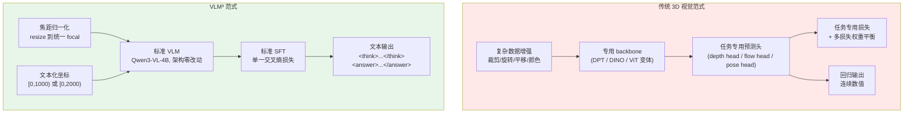

# VLM³ 方法架构

> *Vision Language Models Are Native 3D Learners* · arXiv:2605.30561 · Meta FAIR · CC-BY-NC

## 1. 核心主张

VLM³ 的论点非常直接,也非常反直觉:

> **标准 VLM 本身就是原生的 3D 学习器。不需要改架构、不需要改损失、不需要复杂数据增强。**

它做的事情是把一系列 3D 视觉任务 —— 度量深度估计、像素对应、相机位姿估计、物体级 3D 理解 —— **全部重写成纯文本问答**,然后用标准 SFT 微调一个 Qwen3-VL-4B。结果是在四条赛道上同时打平或超过各自领域的专用模型:

| 任务 | 对比基线 | VLM³ 结果 |
|---|---|---|
| 物体级 3D 理解 | SpatialRGPT | **超过**(SpatialRGPT-bench 定性与定量),且**不用额外编码器** |
| 度量深度估计 | UniDepthV2 / MoGe-2 | **打平**;把 DepthLM 的精度从 0.84 提到 **0.90** |
| 像素对应 | DKM / RoMa | **超过** |
| 相机位姿估计 | DepthAnything3 / VGGT | 打平 DA3,**超过** VGGT |

作者由此给出的结论列表几乎是对当前 3D 视觉工程范式的逐条否定:

- 大模型 —— 不必要(4B 就够)
- 任务专用架构 —— 不必要
- 任务专用损失与权重平衡 —— 不必要
- 复杂数据增强(裁剪、旋转、平移、外观扰动)—— 不必要
- **甚至连回归形式本身**(几乎所有 SOTA 3D 模型的基础)—— 也不必要

留下的充分条件只有两条:**统一输出域为文本的通用基础模型 + 数据规模**。



---

## 2. 方法:只有两个技巧

VLM³ 的"方法"部分短到可以一段话讲完,但两个技巧都直击要害。

### 2.1 焦距归一化:解决相机歧义

**问题**:同一张图,如果不知道相机内参,深度是不可解的 —— 一个近处的小物体和一个远处的大物体在图像上完全一样。传统做法是给模型加一个内参编码器/嵌入模块。

**VLM³ 的做法**:直接把所有输入图像 **resize 到同一个焦距**。

```
resize 后 fx = fy = 常数 (如 1000 px)
```

这样一来,焦距变成了一个模型可以硬编码的先验,不再是一个需要显式输入的变量。**不需要任何额外的 VLM 编码器或模块。**

不同任务用的归一化焦距不同:

| 任务 | 归一化目标 | 来源 |
|---|---|---|
| 度量深度 | **fx = fy = 1000 px** | `depth_labels.json` |
| 物体级 3D(SpatialRGPT) | **fx ≈ 1000 px** | `spatialrgpt_labels.json` |
| 相机位姿 | **fx = fy = 750 px** | `pose_labels.json`,匹配 WAI 评测流程 |
| 像素对应 | **不做焦距归一化**,只 resize 到 `max(W,H) = 1024` | `pixel_corr_labels.json` |

像素对应是例外,理由写在数据里:后续的最大边 resize 本身就产生了固定分辨率,再做焦距归一化是多余的,而且推理更轻。这也侧面说明焦距归一化只在**需要绝对尺度**的任务里必要 —— 像素对应是纯 2D 匹配问题,不涉及尺度。

深度任务的图像还会先做**去畸变**(当 fx ≠ fy 时)。

### 2.2 文本化坐标:解决指代问题

**问题**:怎么让模型知道"我问的是图上哪个点/哪个物体"?常见做法是渲染视觉标记(画圈、上色、贴数字),或者引入 region encoder。

**VLM³ 的做法**:直接在文本里写归一化坐标。

```
点:  (norm_x, norm_y)      ← [0, 2000) 或 [0, 1000)
框:  (x1, y1, x2, y2)      ← [0, 1000)
```

归一化是相对 **resize 后**图像的宽高,横纵轴各自独立归一化。

好处清单:

- **不改架构** —— 坐标就是普通 token。
- **不渲染标记** —— 不污染图像,不引入渲染 artifact,同一张图可以问 100 个不同的点而只编码一次(实际实现里每个点仍是一次前向,但图像可复用)。
- **更灵活** —— 点、框、任意多个实体,统一用文本表达。
- **更可扩展** —— 加新任务只需要设计 prompt 模板,不需要写新的 head。

坐标范围在不同任务里不同(深度用 2000,其余用 1000),说明这个尺度是可调超参而非固定设计 —— 更大的范围给更细的空间分辨率,代价是数字 token 更长。

---

## 3. 四个任务的接口

VLM³ 发布了 **4 个独立 checkpoint**,每个任务一个,均基于同一个 Qwen3-VL-4B 基座。

| Checkpoint | 任务 | 输入 |
|---|---|---|
| `facebook/VLM3-depth` | 度量深度估计 | 1 图 + 1 点 |
| `facebook/VLM3-object` | 物体级 3D 理解 | 1 图 + N 个框 |
| `facebook/VLM3-corr` | 像素对应 | 2 图 + 1 点 |
| `facebook/VLM3-pose` | 相机位姿估计 | 2 图 |

> ⚠️ **每个任务是一个单独的模型**,不是一个多任务模型。`inference.ipynb` 里在切换任务前显式 `del model` + `gc.collect()` + `torch.cuda.empty_cache()`。README 顶部的模型表格写的是 "Coming Soon!",实际权重通过 HuggingFace `facebook/VLM3-*` 提供。

### 3.1 度量深度(`VLM3-depth`)

**Prompt:**

```
Given this image, how far is the point at coordinates ({nx}, {ny}) from the camera?
The coordinates are in normalised [0, 2000] format relative to image width and height.
Output the thinking process in <think> </think> and final answer
(the meter number only, without the unit) in <answer> </answer> tags.
```

**输出**:`<think> ... </think> <answer> 14.01 </answer>`,单位米,纯数字。

**解析**:一条正则 `<answer>\s*([-+]?\d*\.?\d+...)\s*</answer>`。

**评测**:DepthLM 风格的 δ₁ 精度 ——

$$\max\left(\frac{\hat d}{d_{gt}},\ \frac{d_{gt}}{\hat d}\right) < 1.25$$

样例数据:1215 × 920 图像,归一化后 `fx = fy = 1000`,`cx = 609.06`,`cy = 458.13`,100 个标注点,深度范围约 8–18 m。

### 3.2 物体级 3D 理解(`VLM3-object`)

用 SpatialRGPT-Bench 的问答格式,物体通过 **[0, 1000] 归一化边界框**指代:

```
Can you confirm if bounding box region (0, 39, 652, 999) is smaller than
bounding box region (6, 380, 228, 562)?
```

GT 回答:

```
Incorrect, bounding box region (0, 39, 652, 999) is not smaller in size than
bounding box region (6, 380, 228, 562).
```

问答元信息里带 `category`(如 `small_predicate`)、`class`(如 `["lamp", "television"]`)、`type`(`qualitative` / 定量)。定性题的评测就是抽取极性(positive / negative)后比对 —— notebook 里用两条正则匹配 `yes|correct|affirmative|true|right|indeed` 与 `no|incorrect|wrong|false|not`,同时命中时取**出现位置更靠前**的那个。

这是 VLM³ 最能说明问题的一条赛道:SpatialRGPT 为了做物体级空间推理,专门引入了深度编码器和 region 表示;VLM³ 只用文本框坐标就超过了它。

### 3.3 像素对应(`VLM3-corr`)

**Prompt 模板**:

```
Given these two images, what pixel in the second image corresponds to pixel
({x1}, {y1}) in the first image? Report the answer as (x, y).
```

可选追加思考格式指令:

```
Please think step by step and follow the format: "<think> [think process] </think>\n\n[answer]".
```

**预处理**:两图各自 resize 到 `max(W, H) == 1024`,坐标归一化到 [0, 1000]。

**评测**:EPE(End-Point Error),在 norm-1000 像素单位下的欧氏距离,越低越好。

样例数据:ETH3D `courtyard` 场景,600 × 400 → 1024 × 683,**covisibility 仅 0.135**(共视区只有 13.5%),56 对对应点。共视率这么低意味着这是一个相当困难的宽基线匹配样例。

开思考(`USE_THINK = True`)时 `max_new_tokens` 从 256 提到 **2048** —— 说明推理链可以很长。

### 3.4 相机位姿(`VLM3-pose`)

这是四个任务里输出结构最丰富的,一对图问 **4 个独立问题**:

| 问题 id | 问题 | GT 回答格式 |
|---|---|---|
| `rotation_angle` | 两个相机位姿之间的相对旋转角(度) | `Rotation angle: 89.7 degrees` |
| `euler_natural` | 以第一相机局部轴、内旋 yaw→pitch→roll 描述重定向 | `Yaw=+89.6°, Pitch=+2.6°, Roll=+6.1°` |
| `translation_direction` | 第一相机局部系下的平移方向 | `The camera moves left, forward, unit vector (-0.69, +0.02, +0.72).` |
| `translation_distance` | 平移距离 | `Translation distance: 1.98 meters` |

**约定**(非常重要,是模型能学会的前提):

- **旋转**:关于 cam-1 体轴的**内旋** Yaw → Pitch → Roll
  - yaw > 0 → 右转(绕竖直/down 轴)
  - pitch > 0 → 抬头(绕 yaw 之后的横向/right 轴)
  - roll > 0 → 右倾(绕 yaw、pitch 之后的光轴/forward 轴,画面顺时针转)
- **平移**:cam-1 体系下的单位向量,`x > 0` 右、`y > 0` 下、`z > 0` 前
- **距离**:米,**只在 `metric` / `estimated metric` 数据集上输出**

注意 `translation_direction` 的回答**同时给定性描述和精确向量** —— "moves left, forward" 加 "(-0.69, +0.02, +0.72)"。这种"先说人话再给数"的格式很可能不是偶然:定性词充当了一个粗粒度的自我一致性检查,让后续的数字生成有个锚。

样例数据:ScanNet++v2,1752 × 1168 → 2830 × 1884(为了把焦距压到 750 px 反而**放大**了图像),`scale_type: metric`。

---

## 4. 与 DepthLM 的关系

VLM³ 明确说自己 "largely motivated by" 同组的前作 **DepthLM**(arXiv:2509.25413,*Metric Depth from Vision Language Models*)。

| | DepthLM | VLM³ |
|---|---|---|
| 任务 | 只做度量深度 | 深度 + 对应 + 位姿 + 物体级理解 |
| 坐标指代 | 文本坐标 | 文本坐标(继承) |
| 焦距处理 | 焦距归一化 | 焦距归一化(继承) |
| δ₁ 精度 | 0.84 | **0.90** |
| 论点 | VLM 能做度量深度 | VLM 是**原生 3D 学习器**,通用范式 |

也就是说 VLM³ 的两个技巧都是从 DepthLM 继承的,它的贡献在于**把这套配方推广到整个 3D 视觉任务谱系**,并证明它在每一条赛道上都能打专用模型。评测协议(δ₁ < 1.25、`DepthLM_eval_from_metadata_coord2k` 坐标系)也直接沿用。

---

## 5. 工程细节

### 5.1 依赖与推理

基座是 **Qwen3-VL-4B**,架构**零改动**,所以调用方式与原始 VLM 完全一致:

```python
from transformers import AutoModelForImageTextToText, AutoProcessor

model = AutoModelForImageTextToText.from_pretrained(
    "facebook/VLM3-depth", dtype="auto", device_map="auto"
)
processor = AutoProcessor.from_pretrained("facebook/VLM3-depth")
```

关键依赖版本(`requirements.txt` 里为可复现性钉死):

| 包 | 版本 |
|---|---|
| `transformers` | **≥ 5.4.0**(硬性要求) |
| `torch` / `torchvision` | 2.8.0 / 0.23.0 |
| `trl` | 1.0.0 |
| `liger_kernel` | 0.7.0 |
| `flash_attn` | 2.8.3 |
| `qwen-vl-utils` | 0.0.14 |
| `timm` | 1.0.22 |
| `datasets` / `accelerate` | 4.8.4 / 1.12.0 |

`trl` + `liger_kernel` 的组合说明训练侧就是**标准 TRL SFT**,`liger_kernel` 用于降显存 —— 进一步印证"没有自定义损失"的说法:如果有自定义损失,就用不了 liger 的融合算子。

推理一律 `do_sample=False`(贪心解码),`max_new_tokens` 按任务取 128 / 256 / 512 / 2048。

### 5.2 仓库里有什么

```
VLM3/
├── inference.ipynb      # 唯一的代码:四个任务的完整推理 + 评测 cookbook
├── requirements.txt     # 钉死版本的依赖清单
├── sample_data/         # 每个任务一组样例图 + 标注 JSON
│   ├── depth.jpeg / depth_labels.json                    (100 点)
│   ├── spatialrgpt.jpeg / spatialrgpt_labels.json        (5 框 + 1 QA)
│   ├── pixel_corr_img{1,2}.jpeg / pixel_corr_labels.json (56 对)
│   └── pose_img{1,2}.jpeg / pose_labels.json             (4 QA)
├── media/               # teaser / pipeline / visualizations / table1 / table2
└── LICENSE              # FAIR CC-BY-NC
```

**注意:仓库里没有模型代码,也没有训练代码。** 这与 [π\*₀.₆](./04.Pi-Star-0.6_Architecture.html) / [π₀.₇](./05.Pi0.7_Architecture.html) 这类以论文为主的条目一样 —— 本文档基于 README、`inference.ipynb` 和样例标注的元数据整理,不是从模型实现反推的。

样例标注 JSON 的价值不低:它们完整记录了**评测流水线的预处理约定**(归一化焦距、resize 目标、坐标范围、内参),这些是复现结果的必要信息,而这些信息在论文正文里通常只有一句话。

---

## 6. 关键文件表

| 文件 | 内容 |
|---|---|
| `README.md` | 论文主张、四条赛道的对比结论、方法概述、Quickstart |
| `inference.ipynb` | 四个任务的 prompt 模板、输出解析正则、评测指标实现 |
| `requirements.txt` | 钉死版本依赖(`transformers ≥ 5.4.0` 为硬性要求) |
| `sample_data/depth_labels.json` | 归一化内参、`[0,2000)` 坐标约定、100 个 GT 深度点 |
| `sample_data/spatialrgpt_labels.json` | 原始/归一化内参、5 个 `[0,1000)` 框、QA 类别与 GT |
| `sample_data/pixel_corr_labels.json` | prompt 模板、思考格式指令、共视率、56 对对应点 |
| `sample_data/pose_labels.json` | 旋转/平移约定、f750 预处理说明、4 个 QA 及 GT |
| `media/pipeline.svg` | 方法流程图 |
| `media/table1.png` / `table2.png` | 定量结果表 |

---

## 7. 对 VLA 的意义

VLM³ 本身不是 VLA,但它给具身智能提供了一个直接可用的结论:**VLM 的文本输出空间足以承载精确的几何量**。

这与 VLA 领域的两条主流做法形成对照:

| 路线 | 动作/几何量表示 | 代表 |
|---|---|---|
| 连续回归头 | flow matching / 扩散 action expert | [π₀](./01.Pi0_Architecture.html)、[GR00T N1.5](./07.Isaac-GR00T-N1.5_Architecture.html) |
| 离散 token | FAST 等动作分词器 | [π₀-FAST](./03.Pi0-FAST_Architecture.html) |
| **纯文本数值** | 直接生成数字字符串 | **VLM³**(几何量);RT-2 类早期工作(动作) |

VLM³ 的证据说明第三条路被低估了 —— 至少在几何量上,只要把**输入歧义消掉**(焦距归一化)、把**指代方式统一**(文本坐标),标准 VLM 的文本头就能达到专用回归头的精度。这对 VLA 的启示是:动作离散化/回归头未必是必需品,数据规模和输入表示的规范化可能是更关键的变量。

另一个可直接迁移的点是**深度与位姿能力本身**:机器人操作需要度量深度和相对位姿,而 `VLM3-depth` / `VLM3-pose` 提供的正是这两项能力,且已经是 VLM 的形态,理论上可以与 VLA 的语言主干共享或直接作为预训练初始化。
