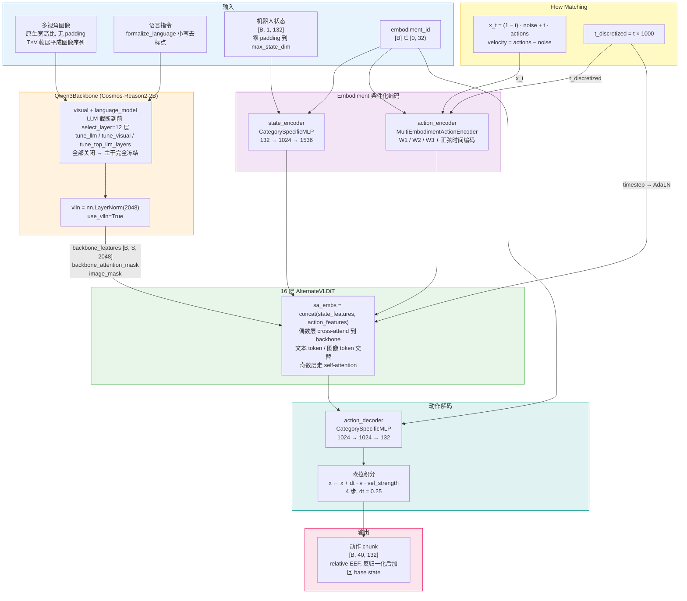
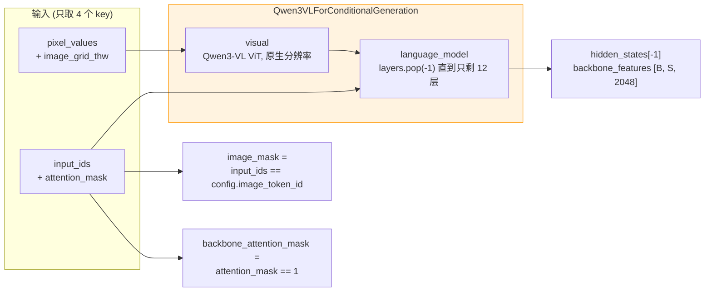
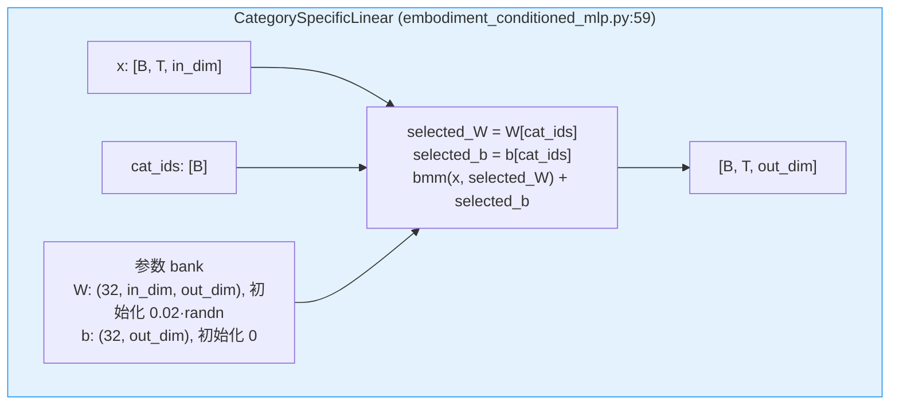
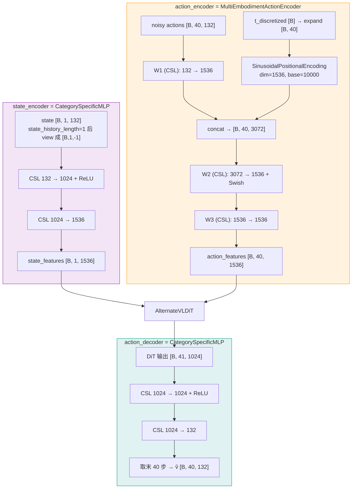
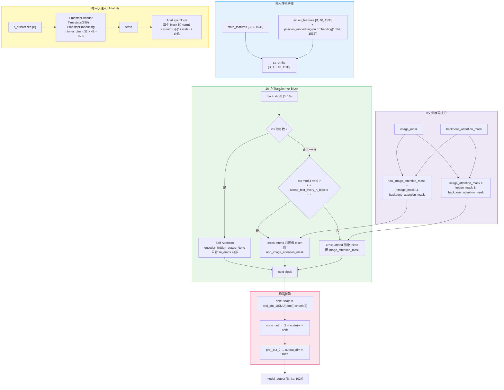
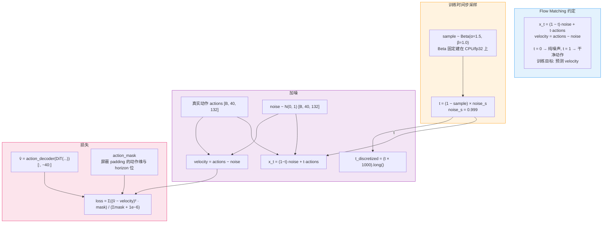
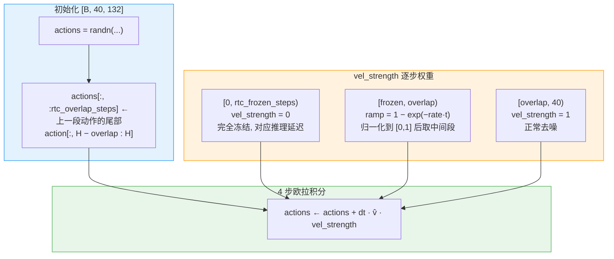
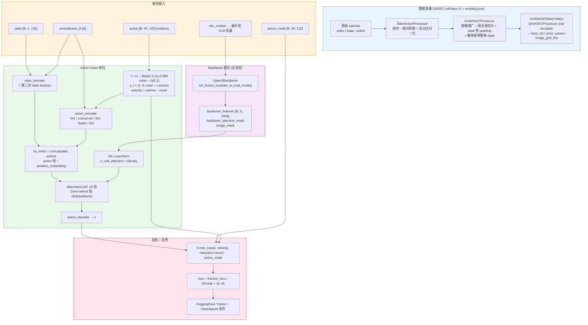
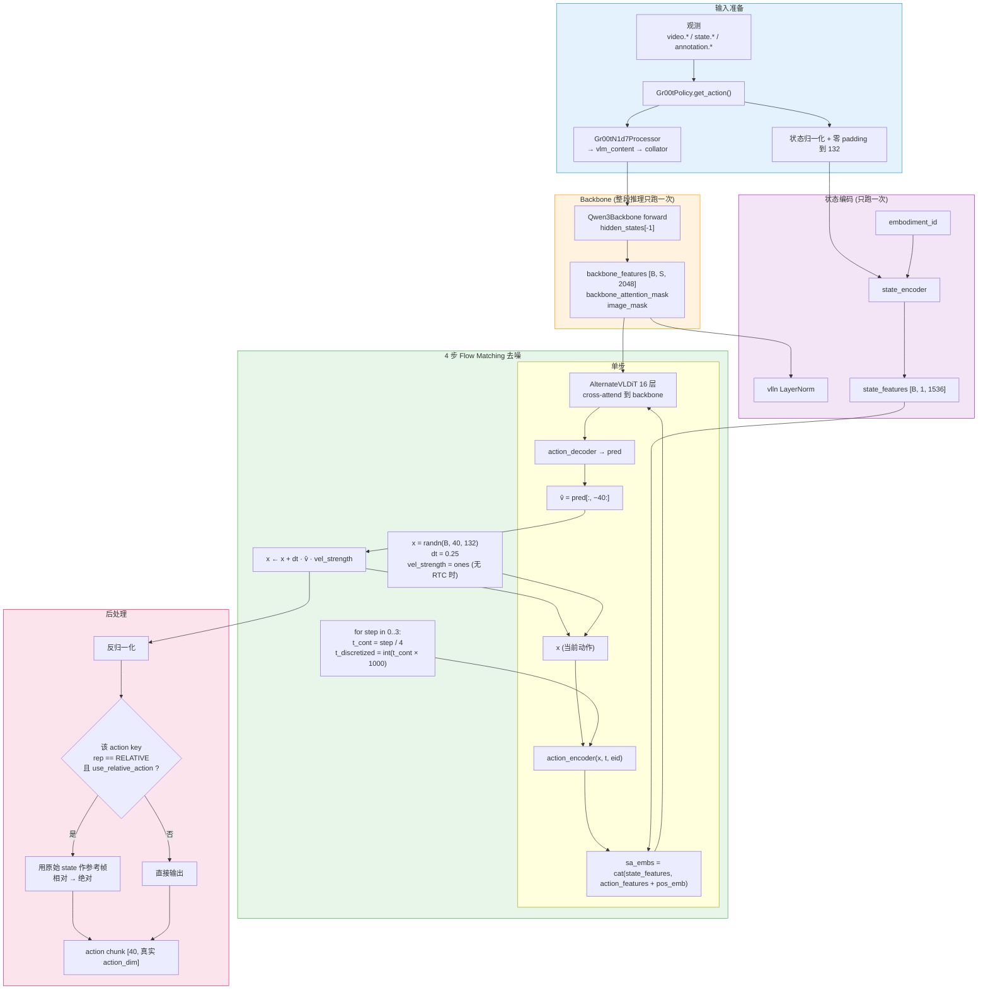

# Isaac GR00T N1.7 模型架构

Isaac GR00T N1.7 是 NVIDIA 2026 年发布的通用人形机器人 VLA 基座模型（3B 级，Apache 2.0）。相对 N1.6，它把 VLM 主干从自研 Eagle 换成 **Cosmos-Reason2-2B（Qwen3-VL 架构）**，把 DiT 从 32 层减半到 **16 层**，把状态/动作维度上限从 29 扩到 **132**、动作 horizon 从 16 扩到 **40**，并统一改用 **relative EEF 动作空间**，从而可以直接吃 20K 小时 EgoScale 人类第一视角视频做预训练。

> 本文基于 `Gr00t_17/Isaac-GR00T` 仓库源码逐行核对撰写，所有超参数、维度、公式均标注了对应源文件；README 层面的说法（数据规模、性能表）单独标注来源。
> 前作参考：[Isaac-GR00T N1.6](06.Isaac-GR00T-N1.6_Architecture.html) / [Isaac-GR00T N1.5](07.Isaac-GR00T-N1.5_Architecture.html)

---

## 1. 整体架构概览

整体仍是"**冻结 VLM 编码 + flow matching DiT 去噪动作**"的两段式结构，但 N1.7 的三处结构性变化让它和 N1.6 不再是同一个模型：

1. **主干换血**：`Qwen3VLForConditionalGeneration` 加载 `nvidia/Cosmos-Reason2-2B`，只保留前 12 层 LLM，且 **默认完全冻结**（`tune_top_llm_layers=0`，N1.6 是解冻顶部 4 层）
2. **动作头缩小、动作变长**：DiT 32 → 16 层，但 `action_horizon` 16 → 40，`max_action_dim` 29 → 132
3. **动作空间改为相对末端位姿**：`launch_finetune.py` 强制 `use_relative_action=True`，动作是相对当前状态的位姿增量，人类视频和机器人数据因此可以共用同一套动作表示

---

## 2. 核心组件详解

### 2.1 Qwen3Backbone（Cosmos-Reason2-2B）

`Qwen3Backbone`（`gr00t/model/modules/qwen3_backbone.py:135`）是对 HuggingFace `Qwen3VLForConditionalGeneration` 的薄封装，加载 `nvidia/Cosmos-Reason2-2B`。它替代了 N1.6 的 `EagleBackbone`，因此 N1.7 要求 `transformers>=4.57`。

**关键细节：**

- **层截断而非选层**：`while len(self.model.language_model.layers) > select_layer: layers.pop(-1)`，`select_layer=12` 意味着物理删掉第 12 层以上的所有 LLM 层，再取 `hidden_states[-1]`（即第 12 层输出）。删层同时省显存和算力
- **默认全冻**：`tune_llm=False`、`tune_visual=False`、`tune_top_llm_layers=0`。N1.6 会解冻 LLM 顶部 4 层，N1.7 不再解冻任何一层，主干退化为纯特征提取器。`set_trainable_parameters()` 在没有任何可训练参数时会打 warning，这是预期行为
- **门控仓库**：`nvidia/Cosmos-Reason2-2B` 是 HF gated repo，`_is_gated_repo_error()` 会沿 `__cause__` / `__context__` 链最多回溯 10 层来识别 401/gated 错误，并换成一条可读的提示。所有 GR00T checkpoint（包括 base 模型）都要加载它，因此不申请权限就没法推理
- **RoPE 修复**：Qwen3-VL 的 `inv_freq` 是 `persistent=False` buffer，不会从 checkpoint 恢复，在嵌套 `no_init_weights` 加载下可能未初始化。`_reset_rotary_inv_freq()` 在加载后用模块自己的类重新解析出 fp32 频率并写回；找不到对应结构时**直接抛异常而不是静默跳过**（fail closed）
- **Conv3d 性能补丁**：torch≥2.9 + cuDNN 9.10 上，bf16 contiguous 的 patch-embed `Conv3d` 会 dispatch 到 sm_80 上极慢的 kernel；`_apply_vision_patch_embed_channels_last()` 把它切到 `channels_last_3d`，数值等价
- `reproject_vision` / `projector_dim` 两个参数在 `Qwen3Backbone.__init__` 签名里保留，但**函数体内并未使用**（config 默认 `reproject_vision=False`，finetune 入口也强制置 False）
- forward 只喂 `input_ids / attention_mask / pixel_values / image_grid_thw` 四个 key，其余输入被丢弃

---

### 2.2 Embodiment 条件化的状态/动作编码

跨形态的核心机制与 N1.6、DreamZero 完全一致：**`CategorySpecificLinear` 为每个 embodiment id 维护一份独立的 (W, b)**，同一套网络结构服务最多 32 种形态。

**底座机制 —— `CategorySpecificLinear`：**

**三个 embodiment 专属模块（CSL 记为 `CategorySpecificLinear`）：**

**关键细节：**

- 三个 embodiment 专属模块分别是 `state_encoder`（`CategorySpecificMLP`）、`action_encoder`（`MultiEmbodimentActionEncoder`）、`action_decoder`（`CategorySpecificMLP`），由 `tune_projector` 一个开关统一控制训练与否，默认 True
- `max_num_embodiments=32`，但**实际用到的 projector 槽位是稀疏的**——`_PROJECTOR_INDEX_GROUPS` 里只登记了 9 个索引（见 §2.6 的表），新形态要么占用未使用的索引，要么并入某个已有分组
- 新增形态导致动作维度变大时，`expand_action_dimension()` 会按整数倍 + 余数把旧权重沿相应维度复制过去，做安全扩展而不是随机初始化
- 状态 dropout 在**两个地方各做一次**（都只在 `training` 时生效）：
  - `Gr00tN1d7Processor.__call__` 里按 `state_dropout_prob` 概率把**原始状态**整条置零，再走归一化和 padding
  - `Gr00tN1d7ActionHead.forward` 里按同一概率把 **state_features** 逐样本乘 0
  - N1.6 用的可学习 `mask_token` 与 `state_additive_noise_scale` 在 N1.7 中已被移除，只剩纯置零
- 状态无论实际维度多少，都在 collator 里零 padding 到 `max_state_dim=132`

---

### 2.3 AlternateVLDiT（16 层动作头主干）

`AlternateVLDiT`（`gr00t/model/modules/dit.py:339`）继承自 `DiT`，把 cross-attention 的 KV 按"图像 token / 非图像 token"拆开轮流 attend。N1.7 把层数从 N1.6 的 32 减半到 **16**。

**16 层的实际调度表**（`attend_text_every_n_blocks=2`）：

| block idx | 0 | 1 | 2 | 3 | 4 | 5 | 6 | 7 | 8 | 9 | 10 | 11 | 12 | 13 | 14 | 15 |
|---|---|---|---|---|---|---|---|---|---|---|---|---|---|---|---|---|
| 类型 | cross | self | cross | self | cross | self | cross | self | cross | self | cross | self | cross | self | cross | self |
| KV 来源 | 文本 | — | 图像 | — | 文本 | — | 图像 | — | 文本 | — | 图像 | — | 文本 | — | 图像 | — |

也就是 **8 个 self-attention 块 + 4 个"看文本"cross 块 + 4 个"看图像"cross 块**，cross 块严格文/图交替。

**关键细节：**

- `inner_dim = num_attention_heads × attention_head_dim = 32 × 48 = 1536`，恰好等于 `input_embedding_dim`，因此 state/action 编码结果可以直接进 DiT
- `cross_attention_dim = backbone_embedding_dim = 2048`，KV 侧维度对齐 Qwen3-VL 输出
- `AlternateVLDiT.forward` 里有两处硬断言：`image_mask is not None` 和 `config.interleave_self_attention` 必须为 True——这个类不支持退化成普通 DiT
- `diffusion_model_cfg` 里显式设了 `"positional_embeddings": None`，所以 block 内部的 `SinusoidalPositionalEmbedding` 被禁用；序列位置信息只由 action head 侧的 `add_pos_embed`（`nn.Embedding(1024, 1536)`）提供，且**只加在 action_features 上**，state token 不加
- 每个 block 是 `AdaLayerNorm → Attention → (+residual) → LayerNorm → GEGLU FeedForward → (+residual)`，`final_dropout=True` 时注意力输出后再过一层 `Dropout(0.2)`
- 末端取 `model_output[:, -action_horizon:]` 即最后 40 个 token 送 `action_decoder`
- 在 DGX Spark（sm121）上 PyTorch 的 mem-efficient SDPA kernel 有问题，`_sdpa_context()` 会自动强制走 math backend；其他平台是 no-op，也可用 `GR00T_DIT_SDPA_MODE` 环境变量手动覆盖

---

### 2.4 Flow Matching 机制

N1.7 沿用 GR00T 系列的 flow matching 约定，与 N1.6 逐字一致（`gr00t_n1d7.py:230-238`）：

**关键细节：**

- `Beta(1.5, 1.0)` 的两个 concentration 张量被**显式 pin 在 CPU/fp32**。action head 可能在 meta device / bf16 默认上下文里被构造（嵌套 `from_pretrained`），如果用裸 Python float 建 Beta，采样器会落到 meta device 上，轻则 `__init__` 里 `.item()` 校验就崩，重则静默返回垃圾。显式指定后噪声调度只依赖 config，不依赖构造时的 device/dtype
- `t = (1 − Beta样本) × 0.999`：Beta(1.5, 1.0) 偏向大值，翻转后 `t` 偏向小值，即训练更多落在"噪声多"的一端；乘 0.999 是为了避开 `t = 1`
- 推理是 4 步欧拉积分，`t_cont = step / 4` → `t_discretized = int(t_cont × 1000)`，实际只用到 **0 / 250 / 500 / 750** 四个桶
- 注意训练时 `t_discretized` 由连续 `t` 直接乘 1000 得到（取值连续覆盖 0~999），推理时只取 4 个固定桶——**训练/推理的时间桶分布并不一致**，这是 flow matching few-step 推理的常见做法

---

### 2.5 Relative EEF 动作空间

这是 N1.7 在 README 里被列为头号改动的部分：动作不再是绝对目标位姿，而是**相对当前状态的位姿增量**。

- 开关：`Gr00tN1d7Config.use_relative_action` 默认 False，但 `gr00t/experiment/launch_finetune.py:102` **无条件强制置 True**，所以走官方 finetune 入口时一定是相对动作
- 生效条件是"双闸门"：某个 action key 只有在 modality config 里标了 `ActionRepresentation.RELATIVE` **且** `use_relative_action=True` 时才做转换（`state_action_processor.py:369`）
- 转换本身在 `ActionChunk.relative_chunking(reference_frame)` 里：以当前状态位姿为参考帧，对 chunk 内每个 pose 做多态减法 `pose − ref_pose`；`EndEffectorActionChunk` / `JointActionChunk` 各自定义减法语义
- 归一化统计量也要跟着换：`_compute_normalization_parameters()` 会用 `statistics[tag]["relative_action"]` 覆盖绝对动作的 min/max，缺这份统计量直接报错
- 推理时 `unapply_action()` 先反归一化，再用**原始（未归一化）状态**把相对动作转回绝对动作下发

为什么重要：相同任务下不同机器人的绝对状态范围差别极大，而"相对当前位姿移动多少"这件事在人手和机械臂之间是可比的。README 称 N1.7 因此得以在预训练中混入 **20K 小时 EgoScale 人类第一视角视频**，把人类操作先验直接迁移到机器人控制。

> ⚠️ 20K 小时、以及"comparable performance to N1.6, with improved generalization"这类说法来自仓库 README，代码中无法验证。

---

### 2.6 Embodiment tag 与 projector 槽位映射

和 DreamZero 的 embodiment 白名单类似，N1.7 的 embodiment tag 不是自由字符串——它必须能映射到一个 projector 索引，否则 `CategorySpecific*` 层无从选权重。映射的**唯一真源**是 `_PROJECTOR_INDEX_GROUPS`（`processing_gr00t_n1d7.py:69`），写成 `{索引: {tag 集合}}` 的形式，只有确实是同一台物理机器人的 tag 才允许共享索引。

| projector 索引 | embodiment tag | 说明 |
|---|---|---|
| 0 | `simpler_env_google` | SimplerEnv Fractal（Google Robot） |
| 1 | `simpler_env_widowx` | SimplerEnv Bridge（WidowX） |
| 2 | `libero_sim` | LIBERO Panda |
| 10 | `new_embodiment`, `robocasa_panda_omron`, `robocasa_gr1_tabletop` | finetune 占位槽，RoboCasa 系列搭车复用 |
| 11 | `unitree_g1_sonic` | G1 + SONIC 全身控制，动作空间是 SONIC latent |
| 24 | `oxe_droid_relative_eef_relative_joint` | DROID |
| 25 | `real_g1_relative_eef_relative_joints`, `unitree_g1_full_body_with_waist_height_nav_cmd` | 同一台 G1，跨 pretrain / posttrain 边界 |
| 26 | `real_r1_pro_sharpa_relative_eef` 及 `_human` / `_maxinsights` / `_mecka` 三个变体 | 同一台 R1 Pro Sharpa，四个数据来源 |
| 27 | `xdof_relative_eef_relative_joint`, `..._subtask` | xdof 基础版 + subtask 版 |

`_build_tag_to_projector_index()` 会检查同一个 tag 是否被写进两个分组，是则直接抛 `ValueError`——防止插入顺序静默决定归属。

另有一道保护 `validate_action_horizons()`：任何 embodiment 的 `action.delta_indices` 长度超过模型 `action_horizon=40` 时，在 **processor 构造阶段**就报错，而不是等到第一次 forward 深处才崩。

---

### 2.7 RTC 实时分块推理（实验性）

`get_action_with_features()` 里内置了 real-time chunking：当 `action_input` 里带了上一段动作时，把新 chunk 的开头用旧动作"钉住"，做 inpainting 式续接，避免两段 chunk 拼接处抖动。

- `rtc_frozen_steps` 对应策略推理的延迟步数：这几步的动作机器人已经在执行了，不能再改，所以速度场权重直接为 0
- 中间段用指数斜坡 `1 − exp(−rate·t)` 从"完全冻结"平滑过渡到"完全自由"，代码里生成 `intermediate_steps + 2` 个点再掐头去尾，保证边界不会正好是 0 或 1
- 三个参数 `rtc_overlap_steps` / `rtc_frozen_steps` / `rtc_ramp_rate` 通过 `options` 字典传入，四个 assert 全部必填

> ⚠️ **RTC 目前只是模型层原语**：`getting_started/real_world_deployment.md:413` 明确说明它**没有接进 `Gr00tPolicy` 或 server-client 路径**（那里的 `options` 参数当前未被使用），也没有测试和现成示例，要用得自己接线。异步推理本身是支持的。

---

## 3. 训练流水线

**训练设置要点：**

- 入口：`gr00t/experiment/launch_finetune.py`（简化 CLI）/ `launch_train.py`（完整配置），trainer 是 `Gr00tTrainer`，多卡走 DeepSpeed（`gr00t/configs/deepspeed/`）
- 三个训练粒度开关全部默认 True：`tune_projector`（三个 embodiment 模块 + position_embedding）、`tune_diffusion_model`（DiT）、`tune_vlln`（vlln + vl_self_attention）；主干侧的 `tune_llm` / `tune_visual` / `tune_top_llm_layers` 全部关闭 —— **实际可训练的就是 action head**
- `launch_finetune.py` 会硬编码覆盖若干 config：`load_bf16=False`、`reproject_vision=False`、`model_name="nvidia/Cosmos-Reason2-2B"`、`backbone_trainable_params_fp32=True`、`use_relative_action=True`
- 图像增广（torchvision 路径）：训练 `Resize(256) → RandomCrop(230) → Resize(256)`，评估把 `RandomCrop` 换成 `CenterCrop`；默认走 albumentations 路径（`use_albumentations_transforms=True`），支持 `crop_fraction` 按比例裁剪、旋转、ColorJitter，以及 mask 引导的背景抑制增广
- 语言侧 `formalize_language=True`：`text.lower()` 后再 `re.sub(r"[^\w\s]", "", text)` 去掉所有标点
- 多数据集混合：`--dataset-path` 可给多个路径，`ds_weights_alpha` 控制混合权重；配合 sharded iterable dataset（`shard_size=1024`、`episode_sampling_rate=0.1`）
- `action_mask` 同时屏蔽 padding 的动作维（各 embodiment 真实 action_dim 都 pad 到 132）与 padding 的 horizon 位
- README 训练提示：图像增广不确定性会带来 **5–6% 的 run 间方差**；`state_dropout_prob` 在 model config 里默认 0.8、finetune CLI 默认 0.2，官方脚本按 benchmark 覆盖（LIBERO 10-Long 用 0.2、SimplerEnv Bridge 用 0.8、SimplerEnv Fractal 用 0.5）

**finetune CLI 默认超参**（`gr00t/configs/finetune_config.py`）：

| 参数 | 默认值 |
|---|---|
| `learning_rate` | 1e-4 |
| `weight_decay` | 1e-5 |
| `warmup_ratio` | 0.05 |
| `global_batch_size` | 64 |
| `max_steps` | 10000 |
| `optim` | `adamw_torch` |
| `state_dropout_prob` | 0.2 |
| `save_steps` / `save_total_limit` | 1000 / 5 |

---

## 4. 推理流水线

**推理要点：**

- **Backbone 与 state 编码都只跑一次**：`_encode_features()` 在去噪循环外把 `backbone_features` / `state_features` 算好，4 步循环里只重跑 action 编码 + 16 层 DiT + 解码。这也是为什么 backbone 的时间在下表里是固定开销
- `--execution-horizon` 控制每次策略调用实际下发多少步动作（N1.6 时期叫 `--action-horizon`），与模型的 `action_horizon=40` 是两个概念
- 部署路径：`export_onnx_n1d7.py` 把 LLM / VL self-attention / state encoder / action encoder / DiT / action decoder 逐个导出 ONNX，`build_trt_pipeline.py` 编译成 TensorRT engine，`verify` 步骤要求 PyTorch vs TRT 余弦相似度 0.999+
- Server-Client：`gr00t/eval/run_gr00t_server.py` + `PolicyClient`（ZMQ），策略跑在 GPU 服务器上，仿真/真机端只做轻量客户端

**推理性能**（4 步去噪、1 路相机，来自 `scripts/deployment/README.md`）：

| 设备 | 模式 | Data | Backbone | Action Head | E2E | 频率 | 加速比 |
|---|---|---|---|---|---|---|---|
| H100 80GB | PyTorch Eager | 6.2 ms | 31.3 ms | 48.2 ms | 85.8 ms | 11.7 Hz | 1.00× |
| H100 80GB | torch.compile | 6.2 ms | 30.4 ms | 12.0 ms | 48.6 ms | 20.6 Hz | 1.77× |
| H100 80GB | **TensorRT 全流水** | 6.2 ms | 8.8 ms | 12.3 ms | **27.9 ms** | **35.9 Hz** | 3.08× |
| RTX Pro 6000 Blackwell | TensorRT 全流水 | 4.8 ms | 9.9 ms | 13.2 ms | 27.9 ms | 35.9 Hz | 2.81× |
| H20 96GB | TensorRT 全流水 | 5.33 ms | 14.2 ms | 14.5 ms | 34.0 ms | 29.4 Hz | 2.45× |
| L40 | TensorRT 全流水 | 6.6 ms | 13.1 ms | 18.8 ms | 38.4 ms | 26.0 Hz | 3.34× |
| RTX Pro 5000 72GB | TensorRT 全流水 | 8.85 ms | 14.37 ms | 17.33 ms | 40.5 ms | 24.7 Hz | 3.13× |
| L20 | TensorRT 全流水 | 5.7 ms | 17.27 ms | 19.79 ms | 42.8 ms | 23.3 Hz | 3.28× |
| AGX Thor | TensorRT 全流水 | 8.21 ms | 28.89 ms | 56.64 ms | 93.8 ms | 10.7 Hz | 1.54× |
| DGX Spark | TensorRT 全流水 | 13.14 ms | 33.43 ms | 52.37 ms | 98.6 ms | 10.1 Hz | 1.28× |
| Orin | TensorRT（仅 DiT） | 9.45 ms | 128.38 ms | 78.6 ms | 216.5 ms | 4.6 Hz | 1.58× |

注意 Orin 只做到 DiT-only TensorRT，backbone 仍是 eager，所以加速比与 torch.compile 持平。

---

## 5. 三代对照：N1.5 / N1.6 / N1.7

> 表中三列均为**源码实测**，不是从发布说明推断：N1.7 取自 `Gr00t_17/Isaac-GR00T`，N1.6 取自本地 N1.6 检出的 `gr00t/configs/model/gr00t_n1d6.py`，N1.5 取自官方 `n1.5-release` 分支的 `flow_matching_action_head.py` / `eagle_backbone.py` / `experiment/data_config.py`。凡是只见于 README、代码中无法验证的说法，都在 §5.3 单独标注来源。

### 5.1 结构与参数三代对照

| 类别 | 项目 | N1.5 | N1.6 | N1.7 |
|---|---|---|---|---|
| **Backbone** | VLM | Eagle 2.5（仓库内 vendored `eagle2_hg_model`） | `nvidia/Eagle-Block2A-2B-v2`（Cosmos-Reason-2B 变体） | **`nvidia/Cosmos-Reason2-2B`（Qwen3-VL）** |
| | 加载方式 | 本地 `trust_remote_code` | 本地 `trust_remote_code` | **上游 transformers 原生类** |
| | 原生宽高比 | ❌ 需 resize / pad | ✅ | ✅ |
| | `select_layer` | -1（代码默认，由 checkpoint 覆盖） | 16 | **12** |
| | VLM 是否参与训练 | ❌ 全冻（无对应参数） | ✅ 顶部 4 层（`tune_top_llm_layers=4`） | ❌ **重新全冻**（`tune_top_llm_layers=0`） |
| | `backbone_embedding_dim` | 1536 | 2048 | 2048 |
| **VLM→动作衔接** | post-VLM adapter | ✅ `SelfAttentionTransformer` 4 层 | ❌ 移除 | ❌ 无（`vl_self_attention` = `Identity`） |
| | future tokens | ✅ `nn.Embedding(32, 1536)` 插入 DiT 序列（FLARE） | ❌ | ❌ |
| | `vlln` | ✅ | ✅ | ✅ |
| **DiT** | 层数 | 16 | **32** | **16** |
| | heads × head_dim = inner_dim | 32 × 48 = 1536 | 32 × 48 = 1536 | 32 × 48 = 1536 |
| | 类型 | `DiT` / `AlternateVLDiT` 可选 | `AlternateVLDiT` 默认开启 | `AlternateVLDiT` 强制（代码内硬断言） |
| **动作空间** | 预测目标 | 绝对关节角 / EEF 位姿 | 多数 embodiment 为 state-relative | **统一 relative EEF**（人 / 机共享） |
| **维度** | `max_state_dim` | 64 | 29 | **132** |
| | `max_action_dim` | 32 | 29 | **132** |
| | `action_horizon` | 16 | 16 | **40** |
| **Flow Matching** | 加噪公式 | `x_t = (1−t)·noise + t·actions` | 同左 | 同左 |
| | Beta 采样 / `noise_s` | Beta(1.5, 1.0) / 0.999 | 同左 | 同左 |
| | 推理去噪步数 | 4 | 4 | 4 |
| **状态正则** | 机制 | 无专门开关 | dropout + `mask_token` + 加性噪声 | **仅置零 dropout**（数据侧 + 特征侧各一次） |
| | `state_dropout_prob` 默认 | — | 0.0 | 0.8（finetune CLI 为 0.2） |
| **图像预处理** | 尺寸策略 | `VideoCrop(scale=0.95)` + resize 到固定 **224×224** | `shortest_image_edge=256` + `crop_fraction=0.95` | `image_crop_size=(230,230)` + `target=(256,256)` |
| **状态预处理** | sin/cos 编码 | ✅ 数据侧 `StateActionSinCosTransform` 默认启用 | ❌ `apply_sincos_state_encoding=False` | ❌ `apply_sincos_state_encoding=False` |
| **数据** | dataloader | 标准 LeRobot | **sharded iterable** | sharded iterable |
| | 多数据集混合权重 | ❌ | ❌ | ✅ `ds_weights_alpha` |
| | 人类第一视角视频 | ❌ | ❌ | ✅ EgoScale |
| **形态** | `max_num_embodiments` | 32 | 32 | 32 |
| | 跨形态机制 | `CategorySpecific*` | 同左 | 同左 |
| **部署** | TensorRT | 部分模块 | 部分模块 | **全流水，6 个 ONNX 子图** |
| | RTC | ❌ | README 预告、未发布 | ✅ 实验性原语（未接入 policy） |
| **依赖** | transformers / torch | 4.51.3 / 2.5.1 | 4.51.3 / 2.5.1 | **4.57.3 / 2.9.0** |
| | Python | ≥3.10 | ≥3.10 | **3.12** |
| **Checkpoint** | HF | `nvidia/GR00T-N1.5-3B` | `nvidia/GR00T-N1.6-3B` | `nvidia/GR00T-N1.7-3B` |

三代**始终没变**的部分：flow matching 方向约定与 Beta(1.5, 1.0) 时间采样、`noise_s=0.999`、1000 个时间桶、4 步推理、`CategorySpecificLinear` 跨形态权重 bank、`max_num_embodiments=32`、DiT `inner_dim=1536`、奇偶层 self / cross 交替。

### 5.2 每一代改了什么、为什么

| 代际 | 核心改动 | 动机 |
|---|---|---|
| N1 → **N1.5** | VLM 全程冻结；换 Eagle 2.5；加 4 层 post-VLM adapter；引入 FLARE future tokens 与 DreamGen 合成轨迹 | 冻结 VLM 保住语言理解能力，用外挂 adapter 补齐"通用表征 → 动作任务"的落差 |
| N1.5 → **N1.6** | DiT 加倍到 32 层；**去掉 adapter，改为解冻 VLM 顶部 4 层**；动作改 state-relative；sharded dataloader；新增数千小时遥操数据 | NVIDIA 的判断是：与其外挂 adapter，不如让 VLM 顶层直接参与训练，参数利用率更高 |
| N1.6 → **N1.7** | 换 Qwen3-VL 系 Cosmos-Reason2-2B；**VLM 重新全冻**；DiT 砍回 16 层；维度 29→132、horizon 16→40；统一 relative EEF；全流水 TensorRT | 动作表示统一到相对末端位姿后，人类视频可直接作为训练数据；容量从"更深的 DiT"转向"更长的动作块 + 更强的主干" |

值得注意的两处**回摆**：VLM 训练策略走了"全冻（N1.5）→ 解冻顶 4 层（N1.6）→ 全冻（N1.7）"，DiT 深度走了"16 → 32 → 16"。N1.7 并不是简单退回 N1.5——它把省下的容量换到了别处（更强的主干、132 维状态/动作、40 步 horizon、20K 小时人类视频）。

### 5.3 官方声称的性能提升（README 口径）

以下均来自各版本仓库 README，**代码层面无法验证**，引用时请注意口径：

| 版本 | 声称的提升 | 出处 |
|---|---|---|
| N1.5 | GR-1 操作任务语言跟随 **93.3% vs N1 的 46.6%**；GR-1 grounding **40.4 IoU vs Qwen2.5VL 35.5**；低数据量（0-shot / few-shot）表现更好；新物体泛化更好 | N1.5 README "What's New" |
| N1.6 | "significant upgrade over N1.5 … better performance in many aspects"，未给数字 | N1.6 README |
| N1.7 | 与 N1.6 **性能相当**，但泛化与语言跟随更好；relative EEF 是跨形态表现的关键因素 | N1.7 README |

⚠️ 官方同时提示：图像增广等随机成分会带来 **5–6% 的 run 间方差**，跨版本比对基准分数时需把这个方差计入。

### 5.4 选型建议

| 场景 | 推荐 | 原因 |
|---|---|---|
| 新项目 / 需要商业支持 | **N1.7** | GA 版本，有稳定性保证；部署链路最完整（TensorRT 全流水，H100 上 35.9 Hz） |
| 高自由度本体（全身 + 灵巧手） | **N1.7** | 只有 N1.7 把状态 / 动作维度放到 132 |
| 想用人类视频做预训练或协同训练 | **N1.7** | relative EEF 是人 / 机共享动作表示的前提 |
| 已有 N1.6 训练流程、不想动 | N1.6 | N1.7 换了模型包、backbone 和动作空间，不是原地升级 |
| 复现 GR00T N1 论文设定 | N1.5 | 与原论文设定最接近 |
| 显存吃紧的 finetune | N1.5 / N1.7 | 都是 16 层 DiT；N1.6 的 32 层动作头最重 |

⚠️ N1.7 的 backbone `nvidia/Cosmos-Reason2-2B` 是 HF **gated repo**，未申请权限则连 base 模型都加载不了（见 §2.1）。

---

## 6. 关键超参数表

### 6.1 模型结构

| 参数 | 值 | 说明 |
|---|---|---|
| `model_name` | `nvidia/Cosmos-Reason2-2B` | Qwen3-VL 架构，HF gated repo |
| `backbone_model_type` | `qwen` | 决定走哪个 backbone 类 |
| `backbone_embedding_dim` | 2048 | 必须等于 Cosmos-Reason2-2B 的 hidden size |
| `select_layer` | 12 | LLM 保留的层数（超出的物理删除） |
| `tune_llm` / `tune_visual` / `tune_top_llm_layers` | False / False / 0 | 主干完全冻结 |
| `hidden_size` | 1024 | DiT 输出维度 = action_decoder 输入维度 |
| `input_embedding_dim` | 1536 | state/action 编码维度，也是 DiT inner_dim |
| `state_history_length` | 1 | 只喂当前时刻状态 |
| `max_seq_len` | 1024 | `add_pos_embed` 的 Embedding 行数 |
| `max_num_embodiments` | 32 | CategorySpecific 层的形态槽位数 |
| `use_vlln` | True | backbone 输出后过 `nn.LayerNorm(2048)` |
| `model_dtype` | `bfloat16` | 训练精度 |
| `use_flash_attention` | True | 缺 flash_attn 时自动退回 sdpa |
| `backbone_trainable_params_fp32` | True | 可训练参数 cast 回 fp32 |

### 6.2 Diffusion Transformer（AlternateVLDiT）

| 参数 | 值 | 说明 |
|---|---|---|
| `num_layers` | **16** | N1.6 是 32 |
| `num_attention_heads` | 32 | |
| `attention_head_dim` | 48 | |
| inner_dim | 1536 | = 32 × 48 |
| `cross_attention_dim` | 2048 | = `backbone_embedding_dim` |
| `output_dim` | 1024 | = `hidden_size` |
| `norm_type` | `ada_norm` | AdaLayerNorm 注入 timestep |
| `dropout` / `final_dropout` | 0.2 / True | |
| `positional_embeddings` | None | block 内正弦位置编码被禁用 |
| `interleave_self_attention` | True | 奇数层 self，偶数层 cross（硬断言必须 True） |
| `attend_text_every_n_blocks` | 2 | cross 块文/图严格交替 |
| `add_pos_embed` | True | `nn.Embedding(1024, 1536)`，只加在 action token 上 |

### 6.3 动作生成与 Flow Matching

| 参数 | 值 | 说明 |
|---|---|---|
| `action_horizon` | **40** | 单次预测的动作步数 |
| `max_action_dim` / `max_state_dim` | **132 / 132** | 维度上限（零 padding） |
| `use_relative_action` | False（config）/ True（finetune 入口强制） | 相对 EEF 动作 |
| `num_inference_timesteps` | 4 | 推理去噪步数，dt = 0.25 |
| `noise_beta_alpha` / `noise_beta_beta` | 1.5 / 1.0 | Beta 采样参数（CPU/fp32） |
| `noise_s` | 0.999 | 时间缩放，避开 t=1 |
| `num_timestep_buckets` | 1000 | 推理只用到 0/250/500/750 |

### 6.4 数据与正则

| 参数 | 值 | 说明 |
|---|---|---|
| `state_dropout_prob` | 0.8（model config）/ 0.2（finetune CLI） | 数据侧与特征侧各生效一次 |
| `exclude_state` | False | 消融用：彻底屏蔽状态输入 |
| `image_crop_size` / `image_target_size` | (230, 230) / (256, 256) | 训练随机裁、评估中心裁，裁后再 resize 回 256 |
| `use_albumentations_transforms` | True | 默认增广后端，支持 mask 引导增广 |
| `formalize_language` | True | 小写 + 去除所有标点 |
| `use_percentiles` | True | 百分位归一化而非 min/max |
| `use_mean_std` | False | 不用均值方差归一化 |
| `apply_sincos_state_encoding` | False | 关闭 per-embodiment sin/cos 状态编码 |
| `attn_dropout` | 0.2 | ⚠️ 配置里声明，但模型代码从未读取（仅 config 对齐校验脚本引用） |
| `reproject_vision` / `projector_dim` | False / -1 | ⚠️ 传入 `Qwen3Backbone` 但函数体内未使用 |

### 6.5 官方 checkpoint

| Checkpoint | 类型 | Embodiment Tag |
|---|---|---|
| `nvidia/GR00T-N1.7-3B` | Base（3B，约 6 GB） | 各 pretrain tag |
| `nvidia/GR00T-N1.7-LIBERO` | Finetuned | `LIBERO_PANDA` |
| `nvidia/GR00T-N1.7-DROID` | Finetuned | `OXE_DROID_RELATIVE_EEF_RELATIVE_JOINT` |
| `nvidia/GR00T-N1.7-SimplerEnv-Bridge` | Finetuned | `SIMPLER_ENV_WIDOWX` |
| `nvidia/GR00T-N1.7-SimplerEnv-Fractal` | Finetuned | `SIMPLER_ENV_GOOGLE` |

---

## 7. 关键源文件表

| 组件 | 类名 / 函数 | 文件路径 |
|---|---|---|
| 主模型 | `Gr00tN1d7` | `gr00t/model/gr00t_n1d7/gr00t_n1d7.py:500` |
| Action Head | `Gr00tN1d7ActionHead` | `gr00t/model/gr00t_n1d7/gr00t_n1d7.py:38` |
| 训练 forward | `Gr00tN1d7ActionHead.forward` | `gr00t/model/gr00t_n1d7/gr00t_n1d7.py:182` |
| 推理去噪 + RTC | `get_action_with_features` | `gr00t/model/gr00t_n1d7/gr00t_n1d7.py:326` |
| 配置 | `Gr00tN1d7Config` | `gr00t/configs/model/gr00t_n1d7.py:28` |
| VL Backbone | `Qwen3Backbone` | `gr00t/model/modules/qwen3_backbone.py:135` |
| RoPE 修复 | `_reset_rotary_inv_freq` | `gr00t/model/modules/qwen3_backbone.py:285` |
| Diffusion Transformer | `AlternateVLDiT` / `DiT` | `gr00t/model/modules/dit.py:339` / `:222` |
| DiT Block | `BasicTransformerBlock` / `AdaLayerNorm` | `gr00t/model/modules/dit.py:100` / `:74` |
| Embodiment 线性层 | `CategorySpecificLinear` / `CategorySpecificMLP` | `gr00t/model/modules/embodiment_conditioned_mlp.py:59` / `:143` |
| 动作编码器 | `MultiEmbodimentActionEncoder` | `gr00t/model/modules/embodiment_conditioned_mlp.py:177` |
| 时间步正弦编码 | `SinusoidalPositionalEncoding` | `gr00t/model/modules/embodiment_conditioned_mlp.py:26` |
| Processor | `Gr00tN1d7Processor` | `gr00t/model/gr00t_n1d7/processing_gr00t_n1d7.py:214` |
| 数据 collator | `Gr00tN1d7DataCollator` | `gr00t/model/gr00t_n1d7/processing_gr00t_n1d7.py:159` |
| projector 槽位映射 | `_PROJECTOR_INDEX_GROUPS` | `gr00t/model/gr00t_n1d7/processing_gr00t_n1d7.py:69` |
| 图像增广 | `build_image_transformations_albumentations` | `gr00t/model/gr00t_n1d7/image_augmentations.py:362` |
| 状态/动作处理 | `StateActionProcessor` | `gr00t/data/state_action/state_action_processor.py:52` |
| 相对动作转换 | `ActionChunk.relative_chunking` | `gr00t/data/state_action/action_chunking.py:82` |
| Embodiment 枚举 | `EmbodimentTag` | `gr00t/data/embodiment_tags.py:29` |
| 推理策略 | `Gr00tPolicy` | `gr00t/policy/gr00t_policy.py:70` |
| Server / Client | `run_gr00t_server.py` / `server_client.py` | `gr00t/eval/` / `gr00t/policy/` |
| 训练入口 | `launch_train.py` / `launch_finetune.py` | `gr00t/experiment/` |
| Trainer 包装 | `Gr00tTrainer` | `gr00t/experiment/trainer.py` |
| ONNX 导出 | `export_onnx_n1d7.py` | `scripts/deployment/` |
| TensorRT 流水 | `build_trt_pipeline.py` / `verify_n1d7_trt.py` | `scripts/deployment/` |

---

## 8. 参考资料

- 代码：[NVIDIA/Isaac-GR00T](https://github.com/NVIDIA/Isaac-GR00T)（本文基于本地 `Gr00t_17/Isaac-GR00T` 检出）
- 论文（N1 系列）：[arXiv:2503.14734](https://arxiv.org/abs/2503.14734)
- 模型：[nvidia/GR00T-N1.7-3B](https://huggingface.co/nvidia/GR00T-N1.7-3B) · [nvidia/Cosmos-Reason2-2B](https://huggingface.co/nvidia/Cosmos-Reason2-2B)（gated）
- 全身控制：[GR00T-WholeBodyControl](https://github.com/NVlabs/GR00T-WholeBodyControl) — `UNITREE_G1_SONIC` 走 [GEAR-SONIC](17.GEAR-SONIC_Architecture.html)，`UNITREE_G1` 走 [Decoupled WBC](16.Decoupled-WBC_Architecture.html)
- 前作：[Isaac-GR00T N1.6](06.Isaac-GR00T-N1.6_Architecture.html) · [Isaac-GR00T N1.5](07.Isaac-GR00T-N1.5_Architecture.html)
