# Dyna 生产部署与数据飞轮架构

Dyna 的规模化部署方法不是单独的机器人模型，而是一套把 **Dyna-2 世界动作模型、客户 SOP、全天候 episode 记录、自动语义标注、硬件退化监测与训练数据筛选** 连成闭环的生产系统。它的核心不是“收集更多数据”，而是让每次部署都产生可查询、可回放、可归因、可重用的经验，再用这些经验同时改进模型、工具和整个机器人舰队。

> **主要来源**：Dyna Robotics, [Not Just a Model, But a Product](https://www.dyna.co/research/scaling-customer-deployments), 2026-08。
> **模型侧补充**：Dyna Robotics, [Dyna-2: A 1-Million-Hour Scaling Law for World-Action Models](https://www.dyna.co/dyna-2), 2026-08。
> 原文是公司自述的生产系统与业务结果，没有公开完整代码、数据集、标注模型或 ROI 计算方式。本文将 **原文明确披露的事实** 与 **依据流程重建的工程架构** 分开标注，不把重建图当成官方源码架构。
> 相关模型：[DreamZero](13.DreamZero_Architecture.html) / [Fast-WAM](14.FastWAM_Architecture.html)。

---

## 1. 一张图看懂生产系统

这套系统有三个同时运行的闭环：

1. **任务闭环**：模型根据视觉、本体感知和语言指令输出 action chunk，执行客户的 SOP
2. **评估闭环**：每个 episode 被切成 SOP 步骤，标上成败、质量、失败模式和耗时
3. **学习闭环**：用标签查询最有信息量的生产切片，组成下一轮训练数据，再把新 checkpoint 送回舰队

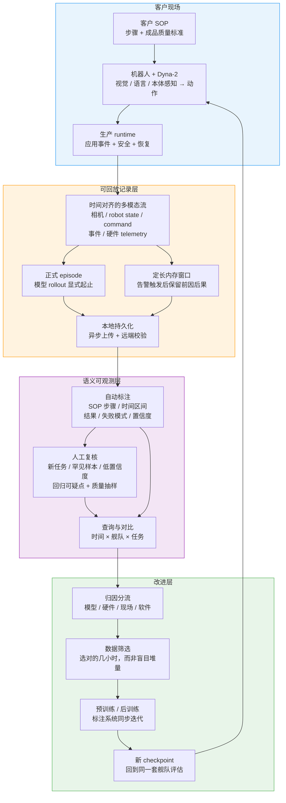

**最重要的系统边界**：生产日志只能证明程序运行了，不能证明餐巾叠好了。Dyna 把客户对“好”的定义变成 episode 级和 SOP-step 级标签，这才是数据飞轮的起点。

---

## 2. 从 demo 到产品：真正的缺口在哪里

实验室 demo 证明的是“能否偶尔完成任务”，生产系统要证明的则是“能否在每天数千次重复中持续达到客户标准，并且经济上划算”。

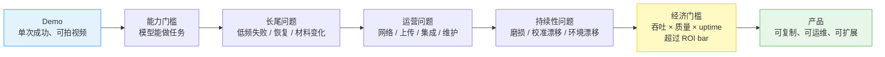

Dyna 对此的组织原则是 **同时做 research 和 product**：

- 产品给研究一个真实、持续变化的目标，而不是静态 benchmark
- 研究避免产品变成每个客户一套的临时 patch
- 现场问题不允许只留下 one-off fix，必须沉淀为更通用的模型能力、工具、基础设施或集成
- 为此专门设立 **Deployment Research** 团队，把现场问题系统化地转成研究问题

---

## 3. 数字背后的生产约束

### 3.1 餐巾任务的吞吐与质量

Din Tai Fung 的目标不是“叠完”，而是每台机器人在 **18 小时 shift 内产出 1,500 条 table-ready 餐巾**。这把速度和质量压到同一个约束中：

| 指标 | Dyna-1（2025-06） | Dyna-2（2026-08） | 变化 |
|---|---:|---:|---:|
| 毛吞吐 | 35 条/小时 | 95 条/小时 | **2.71×** |
| 达到生产质量标准 | 75% | 93% | **+18 个百分点** |
| 不合格率 | 25% | 7% | **相对降低 72%** |
| 原文报告的 table-ready 日产出 | 约 480 | 1,590 | **3.31×** |
| 1,500/天目标 | 未达到 | **超过 6%** | 跨过生产门槛 |

有效产出的基本算式是：

$$
N_{ready} = r_{hour} \times H_{shift} \times p_{quality}
$$

用公开的四舍五入数字计算，Dyna-2 为 $95 \times 18 \times 0.93 = 1590.3$，与原文的 1,590 一致。Dyna-1 为 $35 \times 18 \times 0.75 = 472.5$，与原文“约 480”的差异来自入参的四舍五入。

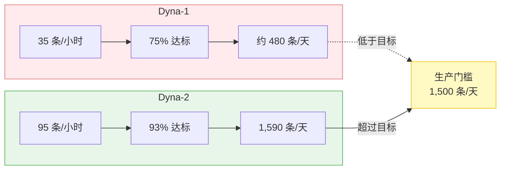

### 3.2 规模化声称

原文还给出了三个业务层数字，它们都应视为 **Dyna 截至 2026-08 的自报口径**：

- Din Tai Fung 正在其餐厅网络中扩大部署
- 连同酒店、物流和数据中心项目，计划到 **2027 年上半年达到数百台机器人**
- 在已有基础设施支持下，新部署从安装到达到生产 ROI bar **最短为 3 天**

原文没有公开 ROI 的分子、分母、人工替代口径、设备成本或维护成本，因此不能从公开材料独立复算“3 天”或“跨过 ROI”。

---

## 4. Dyna-2 为什么能解锁生产任务

部署文章强调的两项模型能力是 **world understanding** 和 **steerability**。它们不是 demo 上的附加分，而是完成客户整个 SOP 的必要条件。

### 4.1 模型侧最小架构

Dyna-2 的补充研究页将它定义为 **World-Action Model (WAM)**：基于 video-diffusion backbone 的 Mixture of Transformers，视频和动作分别 token 化，拥有各自的 DiT 层，在早期层交互。

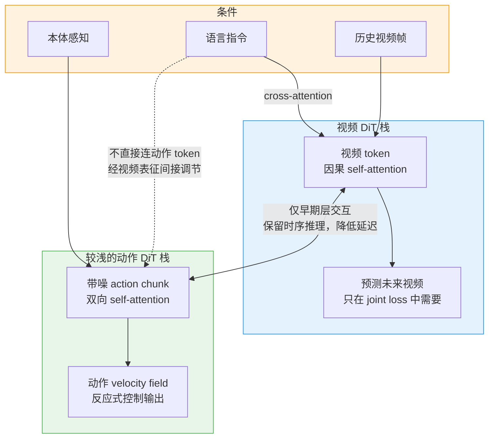

训练使用 flow matching，世界视频与动作是两个边缘 velocity field，共享表征但分别拟合：

$$
z_t = t z + (1-t)\epsilon_z, \qquad
a_t = t a + (1-t)\epsilon_a
$$

$$
\mathcal{L}_{co}(\theta)=
\mathbb{E}\left\|u^{vid}_\theta(z_t;t,c)-(z-\epsilon_z)\right\|^2
+\lambda\mathbb{E}\left\|u^{act}_\theta(a_t;t,c)-(a-\epsilon_a)\right\|^2
$$

由于动作速度场不以带噪未来视频 $z_t$ 为输入，视频 loss 主要通过共享表征改善动作预测；生产推理时策略仍然是 **reactive**，不需要先生成未来视频再执行动作。

### 4.2 steerability 如何替代“每个现场一个模型”

餐巾叠好后还需要整齐地放进箱子。Dyna-1 可以叠，但会把餐巾放在随机位置，工作人员仍要二次整理。Dyna-2 接收指令，将餐巾循环放入 10 个指定 stack。

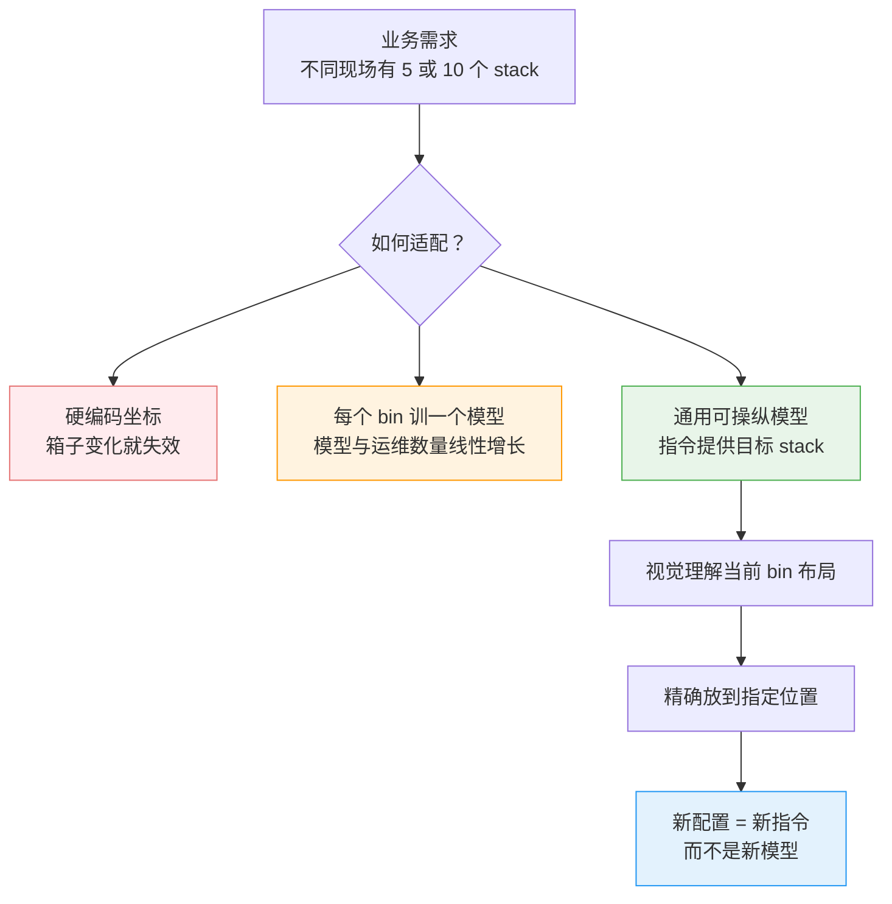

这个例子揭示了一个很实用的研究优先级来源：精确语言跟随之所以进入 roadmap，不是因为 benchmark 要求它，而是生产现场暴露了“能叠餐巾”和“完成整个工作”之间的缺口。

---

## 5. Deployment is the eval

实验室的数十次 trial 能发现一个完全不会做任务的模型，但它不会发现：

- 每 200 次只失败 1 次的长尾问题
- 连续运行一周后才显现的性能下降
- 同一 checkpoint 在两台机器人上的差异
- 站点重新布置、照明改变、供应商更换材料带来的漂移
- 缓慢磨损导致的动作精度下降

因此评估从“某次测试”变成“每个站点、每台机器人、每个 episode 永不停止的测量”。

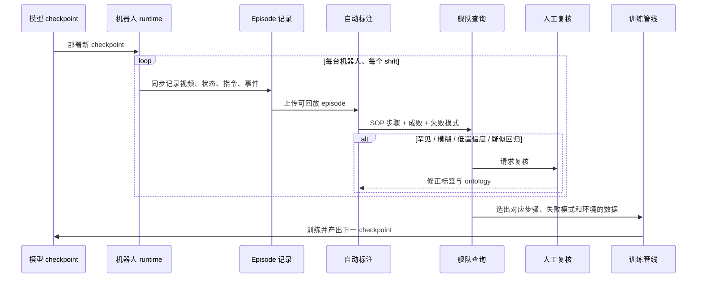

### 5.1 端到端与细粒度观测必须同时存在

| 观测层级 | 要回答的问题 | 典型信号 |
|---|---|---|
| 端到端 | 任务是否成功？成品是否达到客户质量标准？ | episode grade、外观质量、日吞吐、uptime |
| SOP 步骤 | 哪一步最慢？哪一步开始出现失败？ | step start/end、duration、outcome、failure mode |
| 控制与硬件 | 是策略回归、软件问题还是机械磨损？ | joint current、tracking error、command/state 差异、校准指标 |

---

## 6. 生产数据如何在真实世界存活下来

Dyna 舰队持续产生相机流、robot state、control command、应用事件和硬件 telemetry，并保留足够的时间信息来重建各流的对齐。原文报告当时整个舰队已每天产生 **超过 1 TB 原始数据**。

只记录正式 model rollout 不够：服务可能在两个 episode 之间崩溃，机器人也可能在没有 episode 活跃时进入异常状态。因此系统同时保留两条记录通道。

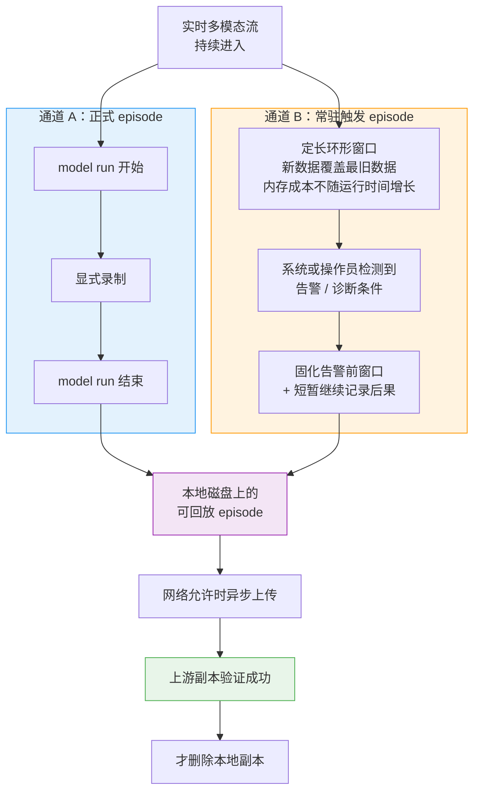

### 6.1 episode 生命周期与不变式

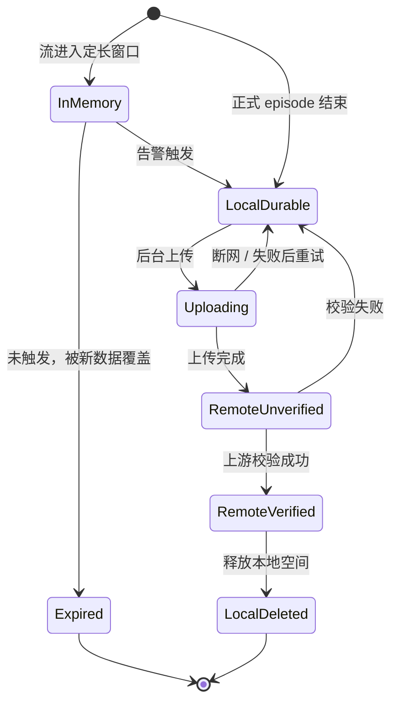

从原文可确定的不变式有：

- **定长内存**：常驻记录器的内存占用不随 shift 时长增长
- **先本地持久化**：不把现场网络当成可靠前提
- **上传与控制解耦**：上传在后台异步运行，不阻塞机器人主任务
- **校验后删除**：本地原件只在确认上游副本后删除

最后一点提供的是“不丢数据”的基础，但它不自动等于 exactly-once：若要避免断网重试产生重复上传，上游仍需要 episode ID、内容 hash 或幂等写入。原文没有披露这一层的具体实现。

---

## 7. 从 episode 到语义可观测性

原始 episode 只是证据，不是答案。相机和结构化信号本身不会说“机器人正在进行 SOP 第 4 步”或“这次是 missed grab”。Dyna 的自动标注系统将每个 episode 转成可查询的时间区间：

### 7.1 为什么是人机混合标注

全量人工观看会把人力浪费在大量例行成功上；完全自动化则会让标注漂移直接污染评估和训练数据。Dyna 的分工是：

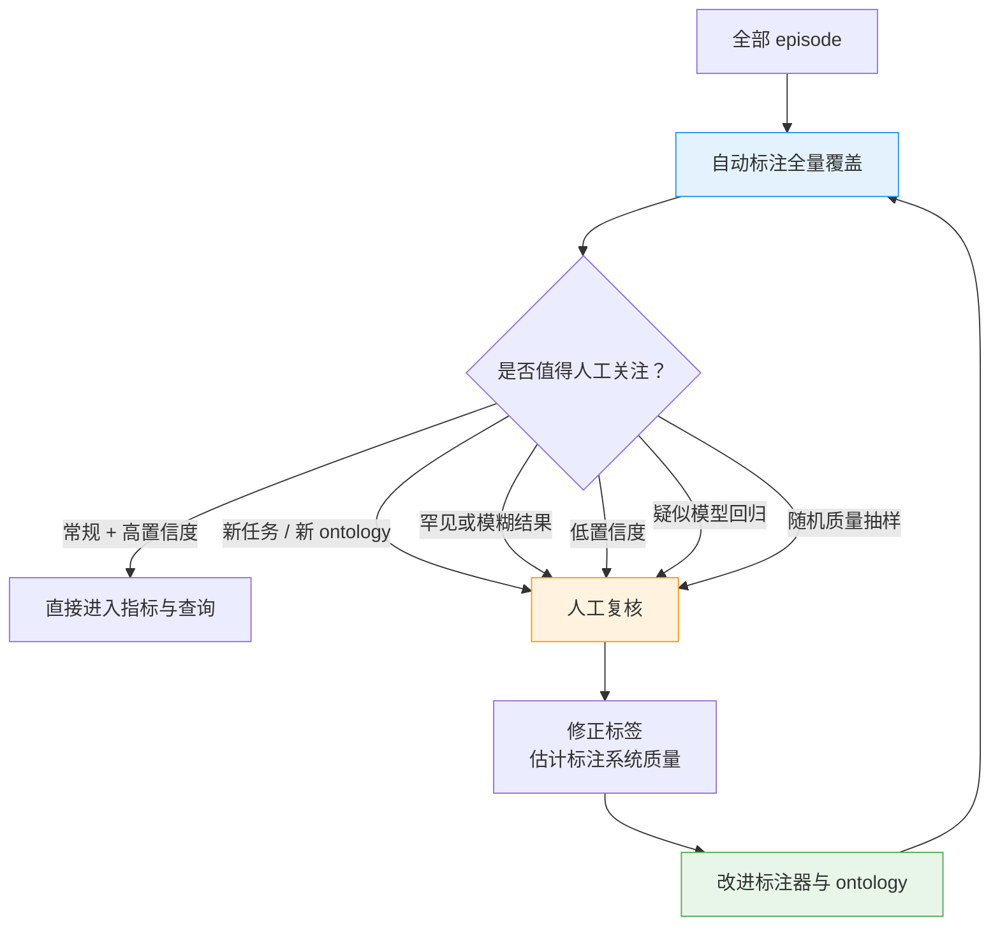

### 7.2 三个查询轴

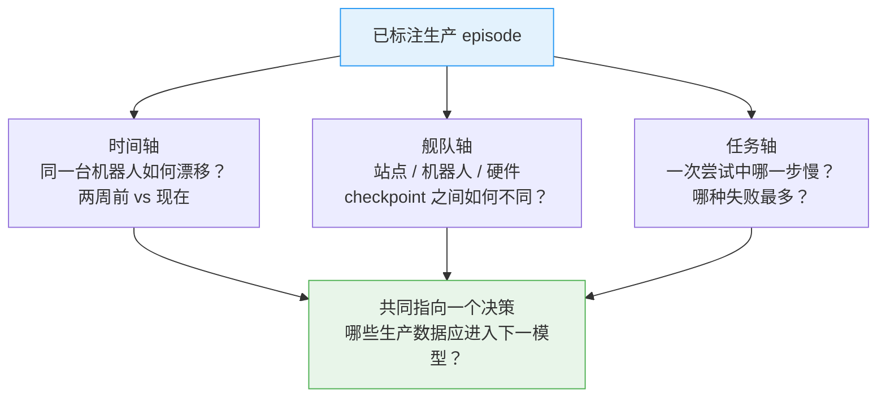

---

## 8. 案例：从吞吐下降定位到磨损的 gripper

某个 Din Tai Fung 站点的吞吐在数周内下降，但系统日志没有异常，现场也没有主动报告问题。自动标签将问题缩小到 SOP **Step 1：从餐巾堆拉出单条餐巾**。

| 指标 | 两周前 | 现在 | 变化 |
|---|---:|---:|---:|
| 每条餐巾总耗时 | 38 s | 46 s | +8 s |
| Step 1 耗时 | 6.4 s | 10.8 s | **+4.4 s**，占总增量 55% |
| 每周标记失败总数 | 357 | 725 | 约 **2.03×** |
| missed grab | 108 | 380 | 约 **3.52×** |

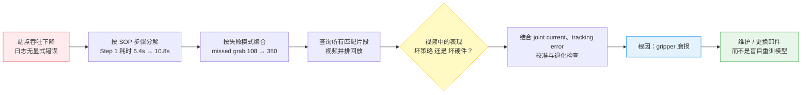

这个案例展示了两层可观测性的分工：

- 语义标签可以快速 **定位表现异常发生在哪一步、哪一类失败**
- 视频中的坏策略和坏 gripper 可能看起来一样，硬件 telemetry 和受控校准才能 **诊断根因**

---

## 9. 预测性维护：在模型性能被拖累前修复硬件

机械部件的退化是缓慢且连续的，但生产中的默认维护往往是反应式的：直到部件在 shift 中失效才被发现。Dyna 的方法将连续生产 telemetry、视频物理结果、定期校准和 degradation check 对齐到每台机器人自己的 baseline。

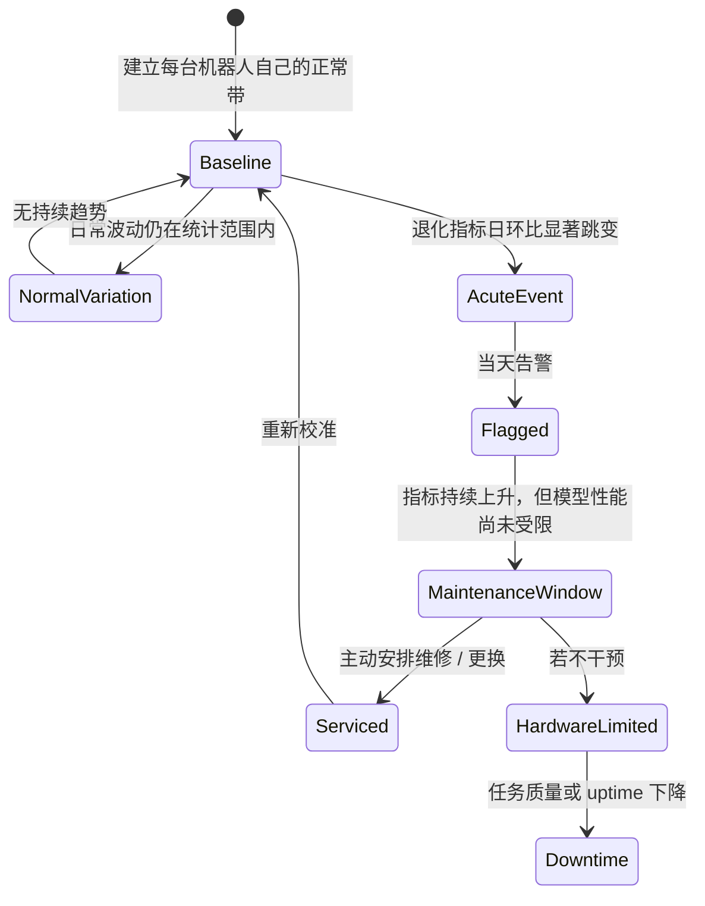

原文的 Figure 7 只公开了这个形状和相对时序，没有公开退化指数的数值、公式、检测器或告警阈值。可确定的设计原则是：

- 与机器人自己的 baseline 比，而不是只用全舰队的统一绝对阈值
- 同时看单机时间趋势、同类硬件舰队分布与软件变更相关性
- 在模型性能真正被硬件限制前打开 maintenance window

---

## 10. 部署飞轮

生产数据的价值不是它的字节数，而是它是否能回答“下一个模型应该看什么”。一个有效查询可以精确选出：特定 SOP 步骤、特定失败模式、特定现场或硬件状态、特定 checkpoint 下的有信息量片段。

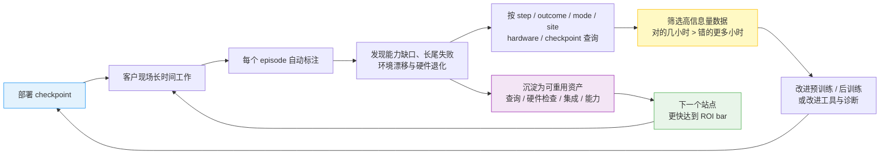

飞轮的可扩展性来自 **一个站点的学习能被其他站点复用**：

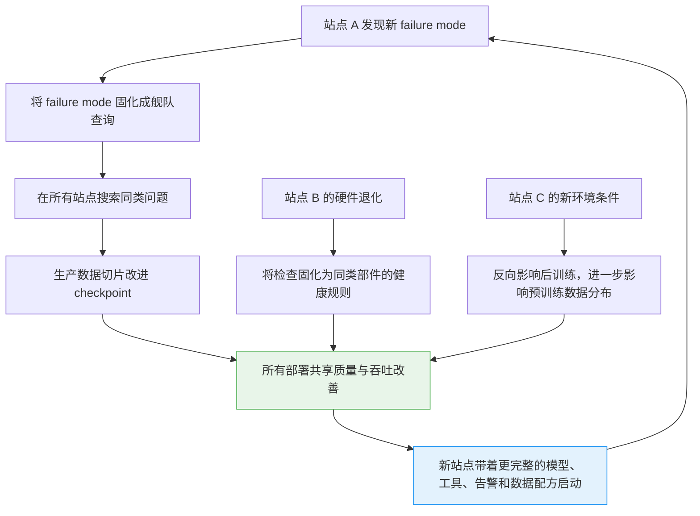

---

## 11. 工程分层与关键契约

原文没有公开具体技术栈，但从数据流可以重建出一个不依赖特定产品的参考分层。下表中“契约”是系统要维持的语义，不是 Dyna 公开的 API 名称。

| 分层 | 责任 | 关键契约 |
|---|---|---|
| Robot runtime | 控制、应用状态机、安全、恢复 | 控制路径不被数据上传阻塞 |
| Time-aligned recorder | 对齐多模态流，生成正式与触发 episode | 每个数据点可映射到同一时间轴 |
| Local durability | 断网缓存、重试、容量管理 | 远端校验前不删原件 |
| Episode store | 持久存储与原始流回放 | 聚合结论必须能追溯原始证据 |
| Semantic labeler | SOP 分段、grade、failure mode、confidence | 版本化 ontology 和标注器，能重放重算 |
| Review queue | 罕见、模糊、低置信度、回归、抽样 | 人工时间投向最高信息增益处 |
| Fleet query | 按时间、站点、机器人、checkpoint、硬件、SOP 查询 | 相同指标在站点间具有可比语义 |
| Curation & training | 生产切片选择、训练、checkpoint 评估 | 新模型回到同一生产评估闭环 |
| Hardware health | baseline、趋势、校准、退化告警 | 模型回归与机械退化必须可分离 |

---

## 12. 这套架构真正解决了什么

### 12.1 优点

- **评估与生产同分布**：不再依赖静态实验室 trial 代理数月运行
- **指标可追溯**：从日吞吐到某一 failure mode，再回到原始视频瞬间
- **稀有失败可被捕获**：定长常驻窗口保留崩溃和 episode 之间的前因后果
- **数据筛选可操作**：用 SOP step、outcome、failure mode 等语义维度组成训练切片
- **软硬件联合归因**：避免把磨损误判为模型回归，也避免无意义地重训
- **经验跨站点复用**：一个现场的查询、检查、数据切片和模型改进可保护整个舰队

### 12.2 公开材料无法回答的问题

- ROI threshold 的具体计算方式、机器人单位经济性和长期维护成本
- 数百台规模中有多少是已签约、已安装、已验收或预测数字
- uptime、MTBF、MTTR、人工介入率和安全事件等生产可靠性指标
- 自动标注模型的架构、训练数据、精度/召回率、置信度校准与 ontology 版本策略
- 原始数据的保留期、压缩比、数据权限、隐私和客户间隔离方式
- 上传幂等性、schema evolution、时钟同步误差和断网缓存爆满时的降级策略
- Dyna-2 模型规模、生产推理延迟、控制频率与实际硬件配置

因此，这篇文章的最高价值是展示了 **生产学习系统应该闭合哪些回路**，而不是提供一个可照抄的完整实现。

---

## 13. 一句话总结

Dyna 的关键不是用一个更大的模型替代整个机器人产品，而是把“模型在客户现场做了什么”变成一个永远可回答的问题，再用可回放的 episode、可查询的 SOP 语义、可分离的模型/硬件归因和可复用的训练切片，让每一个新站点都变成整个舰队的学习信号。

---

## 14. 参考资料

1. Dyna Robotics. [Not Just a Model, But a Product](https://www.dyna.co/research/scaling-customer-deployments). 2026-08.
2. Dyna Robotics. [Dyna-2: A 1-Million-Hour Scaling Law for World-Action Models](https://www.dyna.co/dyna-2). 2026-08.
3. Ye et al. [World Action Models are Zero-shot Policies](https://arxiv.org/abs/2602.15922). 2026.
4. Lipman et al. [Flow Matching for Generative Modeling](https://arxiv.org/abs/2210.02747). 2022.
