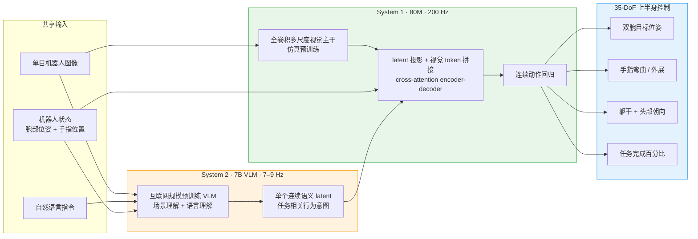
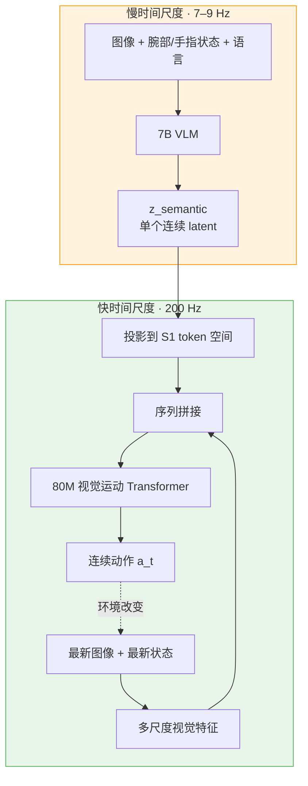
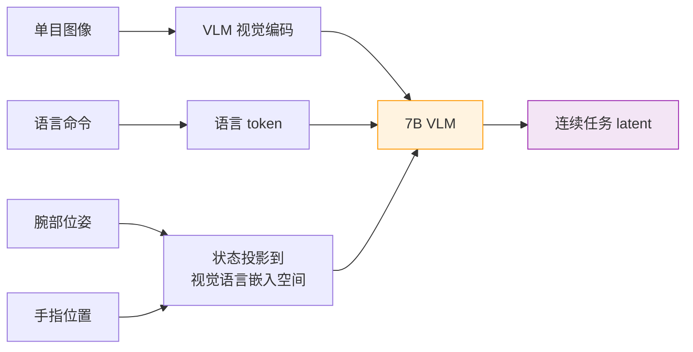
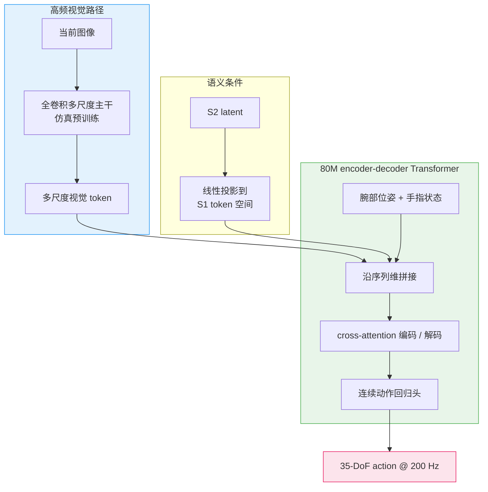
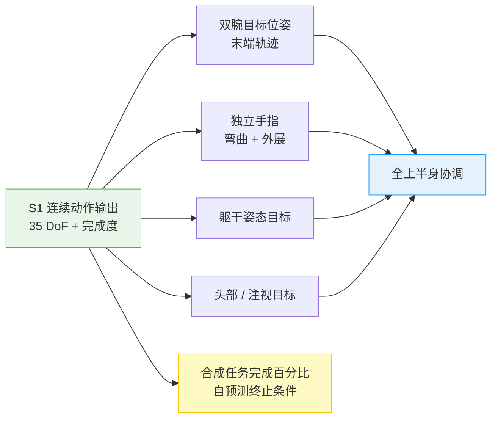
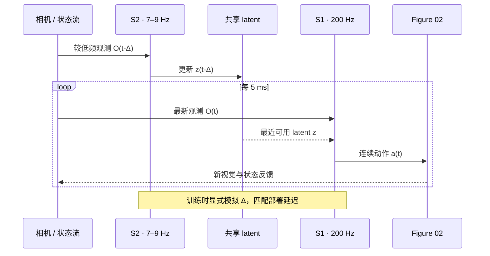
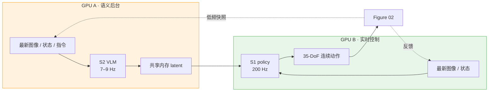
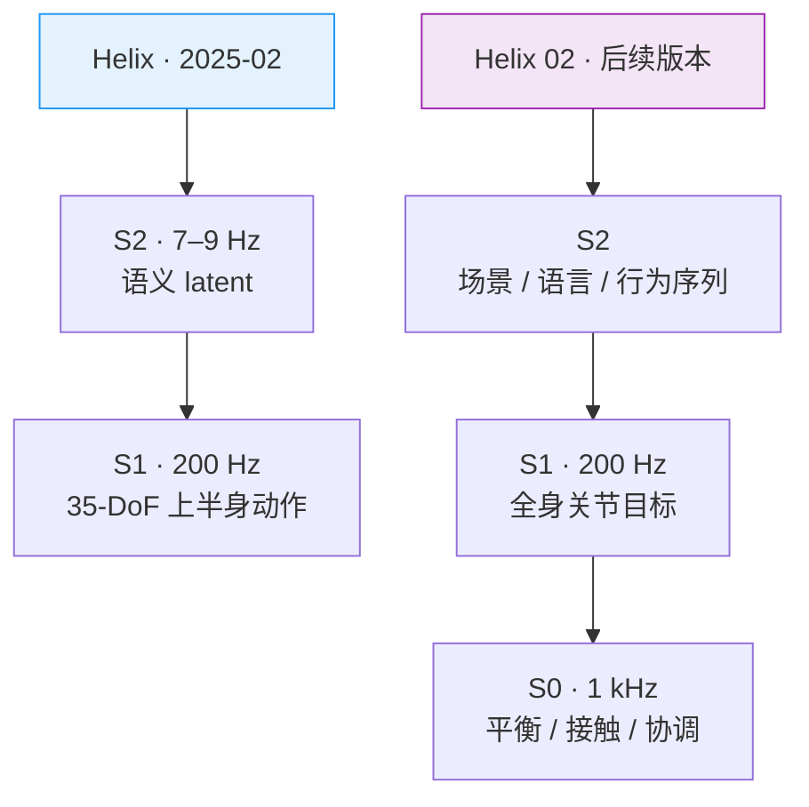

# Helix 模型架构

Helix 是 Figure 于 2025 年 2 月发布的通用人形机器人视觉-语言-动作模型（Vision-Language-Action, VLA）。它面向 Figure 02 的**全上半身灵巧操作**，把互联网预训练视觉语言模型的语义泛化能力，与 200 Hz 反应式视觉运动策略组合成一套端到端系统。Figure 展示的能力包括自然语言指定新任务、抓取训练中未出现的物体、双机器人协作，以及在嵌入式低功耗 GPU 上完全本地运行。

> **资料边界：** Helix 没有公开论文、模型权重或训练代码。本文只整理 Figure 官方技术文章明确披露的结构与数字；VLM 的具体型号、卷积主干层数、token 数量、35-DoF 精确拆分、损失权重和优化器等均未公开，不做猜测。
>
> **版本边界：** 本文讨论 2025 年 2 月发布的初代 Helix。后续 Helix 02 新增 System 0 并扩展到全身 loco-manipulation，见 §8；两者不能混为一套架构。

---

## 1. 核心结论与规格

Helix 的关键不是把一个大型 VLM 直接跑到控制频率，而是用一个**连续语义 latent**连接两个不同时间尺度的系统：

- **System 2（S2）慢思考**：7B 参数 VLM，7–9 Hz，理解图像、机器人状态和语言任务，将当前行为意图压缩为单个连续 latent
- **System 1（S1）快反应**：80M 参数视觉运动 Transformer，200 Hz，结合最新图像、机器人状态与 S2 latent，输出连续上半身动作
- **端到端联合训练**：动作回归损失的梯度通过 latent 接口从 S1 回传到 S2；没有每任务动作头或任务专属微调
- **异步流式部署**：S2 与 S1 分别运行在两块嵌入式 GPU 上，通过共享内存传递最新 latent

| 项目 | Figure 官方披露 |
|---|---|
| 发布日期 | 2025-02-20 |
| 机器人 | Figure 02 |
| System 2 | 7B 开源、开放权重 VLM；具体型号未披露 |
| System 2 频率 | 7–9 Hz |
| System 1 | 80M cross-attention encoder-decoder Transformer |
| System 1 视觉主干 | 全卷积、多尺度；完全在仿真中预训练 |
| System 1 / 动作频率 | 200 Hz |
| 动作空间 | 35 DoF，全上半身连续控制 |
| 训练数据 | 约 500 小时，多机器人、多操作员遥操作数据 |
| 训练方式 | 单阶段、端到端、标准回归损失 |
| 部署 | 两块低功耗嵌入式 GPU，S1/S2 模型并行 |

---

## 2. 为什么拆成 System 1 / System 2

Helix 针对的是 VLA 控制中一个直接的频率矛盾：

| 模型类型 | 优点 | 问题 |
|---|---|---|
| 大型 VLM | 认识大量物体，理解开放语言和场景语义 | 推理慢，无法稳定维持高频闭环 |
| 小型视觉运动策略 | 可以高频反应，动作精确 | 通常只覆盖训练任务，语义泛化弱 |
| Helix 双系统 | S2 提供通用语义，S1 提供实时控制 | 需要设计稳定的跨频率 latent 接口 |

Figure 没有让 S2 输出离散动作 token、文本规划或显式技能 ID，而是把任务相关信息蒸馏到**一个连续 latent 向量**。这个 latent 是系统的语义瓶颈：S2 可以低频更新，S1 在两次更新之间反复使用最新 latent，并根据高频视觉反馈持续修正动作。

### 2.1 这个 latent 表示什么

官方只把它描述为包含“高层行为意图”的任务相关语义表示，没有公开维度或监督目标。可以确定的只有：

1. 它由 S2 根据图像、机器人状态与语言联合生成
2. 它不是离散技能标签，而是连续向量
3. 它被投影到 S1 的 token 空间
4. 投影后的 latent 与 S1 视觉特征沿**序列维**拼接
5. S1 动作损失的梯度会通过它回传到 S2

因此它更接近一个端到端学习的“任务条件”，而不是人可读规划，也不是传统分层控制里的手工子目标。

---

## 3. System 2：低频语义理解层

S2 使用一个 **7B 参数、开源且开放权重的互联网预训练 VLM**。Figure 没有公开具体模型名称，因此不能从参数量反推为某个确定的 VLM。

### 3.1 输入

S2 同时处理三类信息：

- Figure 机器人单目相机图像
- 自然语言行为命令
- 机器人状态，其中官方明确列出**腕部位姿与手指位置**

机器人状态先被投影到视觉语言嵌入空间，再与图像、文本共同送入 VLM。S2 的输出不是语言，而是单个连续 latent。

### 3.2 7–9 Hz 的含义

7–9 Hz 不是机器人控制频率，而是语义目标刷新的频率。S2 每约 111–143 ms 根据最新观测重算一次 latent；在这段时间内，S1 仍以 200 Hz 连续闭环执行。双机器人协作中，S1 可以对另一台机器人突然移动进行快速反应，而不必等待 S2 完成下一次推理。

---

## 4. System 1：200 Hz 反应式视觉运动策略

S1 是一个约 **80M 参数的 cross-attention encoder-decoder Transformer**。它不复用 S2 的视觉特征，而是拥有独立的全卷积多尺度视觉主干，并接收与 S2 相同的图像和状态输入。

这种重复视觉编码是有意的“关注点分离”：

- S2 视觉路径追求语义与泛化，可以慢
- S1 视觉路径追求局部几何、接触反应与低延迟，必须快

### 4.1 S1 数据流

### 4.2 为什么视觉主干在仿真中预训练

Figure 只披露 S1 的多尺度视觉主干“完全由仿真预训练初始化”，没有说明任务、损失或数据规模。结构上的作用很明确：在约 500 小时真机遥操作数据训练前，先给高频视觉路径一个几何与多尺度表征起点，避免从零学习低层视觉控制。

### 4.3 连续回归，而不是动作 token

Helix 明确避开动作 tokenization，直接以标准回归损失预测连续控制量。Figure 的论点是：离散 token 在低维夹爪控制上有效，但扩展到高维人形机器人连续控制会带来困难。

官方没有给出损失公式。若用抽象符号表示，其监督关系只是：

$$
(I_t, s_t, z_t) \longmapsto \hat{a}_t, \qquad
\mathcal{L}_{\text{reg}} = D(\hat{a}_t, a_t)
$$

其中距离函数 $D$、各动作维度权重、是否预测 action chunk 等均未在初代 Helix 文章中披露。

---

## 5. 35-DoF 动作空间

Helix 在 200 Hz 下协调 35-DoF 全上半身动作。官方公开的是**动作类型**，不是逐维索引：

“任务完成百分比”是附加在动作空间上的合成维度，用于让模型自己判断一个行为何时结束，从而更容易串联多个学习到的行为。文章没有说明其标注生成方式、损失或部署阈值。

### 5.1 Helix 是不是 WBC

初代 Helix **不是腿部动力学意义上的全身控制器**。它控制完整上半身，包括手、腕、躯干和头部，但官方没有声称初代模型直接控制双腿、平衡或接触力。这里的 “whole upper body control” 应与 Ψ₀ + AMO/SONIC、GR00T-WBC 以及后续 Helix 02 的 full-body control 区分。

---

## 6. 数据与端到端训练

### 6.1 约 500 小时遥操作数据

Figure 收集约 500 小时的高质量、多机器人、多操作员遥操作行为。训练与评估的物品集合被刻意分开：所有训练中操作过的物品都从评估中排除，以检验新物体泛化。

自然语言标签不是全部由操作员现场输入，而是通过 hindsight relabeling 自动生成：一个标注 VLM 观看切分后的机器人相机视频，并回答“为了得到视频中的动作，应该给机器人什么指令？”

### 6.2 单阶段、单权重集

Helix 不为抓取、抽屉、冰箱或双机器人交互分别训练动作头，也没有按任务微调。所有行为使用同一套 S1/S2 权重，在一个端到端训练阶段中学习。

“单阶段”不代表两个系统不能独立迭代。Figure 所说的 separation of concerns 是架构与工程接口可以分别修改，而最终训练仍让梯度经过 latent 联合优化。

### 6.3 时间偏移训练

部署时 S2 有明显推理延迟，S1 使用的 latent 与当前高频图像天然不同步。Helix 在训练中人为加入 S1/S2 输入时间偏移，并把偏移校准为部署延迟，以缩小训练和推理之间的分布差异。

---

## 7. 异步双 GPU 流式推理

每台 Figure 机器人使用两块低功耗嵌入式 GPU：一块运行 S2，一块运行 S1。两者不是串行阻塞调用，而是独立进程：

这种部署方式把大模型延迟隔离在控制环之外：即使某次 S2 推理较慢，S1 仍会使用上一个 latent 闭环控制，而不是暂停机器人。

---

## 8. 初代 Helix 与 Helix 02 的边界

Figure 后续发布的 Helix 02 沿用 S1/S2 命名，但新增了 1 kHz 的 System 0，并把控制范围从上半身扩展到整个身体。理解初代 Helix 时不能把这些后来能力倒推回去。

| 维度 | 初代 Helix（本文） | Helix 02 |
|---|---|---|
| 主要机器人 | Figure 02 | Figure 03 |
| 层级 | S2 → S1 | S2 → S1 → S0 |
| S2 | 语义理解与 latent | 语义理解与行为序列 |
| S1 | 200 Hz 上半身连续动作 | 200 Hz 全身关节目标 |
| S0 | 未披露 / 不属于 Helix 模型 | 1 kHz 平衡、接触与全身协调 |
| 控制范围 | 35-DoF 全上半身 | 腿、躯干、头、臂、腕、手指全身控制 |
| 新传感器 | 头部相机与机器人状态 | 增加掌心相机和指尖触觉 |

---

## 9. 与其他 VLA 的结构差异

| 模型 | 慢语义层 | 快动作层 | 动作生成 | 控制频率 / 形态 | 关键接口 |
|---|---|---|---|---|---|
| Helix | 7B VLM，7–9 Hz | 80M 视觉运动 Transformer | 连续回归 | 200 Hz，35-DoF 上半身 | 单个连续 latent |
| π₀ | PaliGemma 前缀 | Gemma 动作专家 | Flow matching | action chunk | 双流 Transformer attention |
| Ψ₀ | Qwen3-VL System-2 | MM-DiT System-1 | Flow matching | 全身动作 chunk + 外接 AMO | VLM hidden-state 序列 |
| GR00T N1.x | VLM backbone | DiT action head | Flow matching | 多形态 action chunk | backbone token + embodiment 投影 |

Helix 最鲜明的差异是：**S2 不把整段视觉语言 token 序列传给 S1，而是压成单个 continuous latent；S1 同时保留一条独立高频视觉路径。** 这种设计牺牲了一部分可解释中间结构，换取了语义更新与实时控制的彻底解耦。

---

## 10. 官方结果应该如何解读

Figure 展示或声称的能力包括：

- 同一套权重覆盖抓放、抽屉、冰箱和跨机器人交互
- 对训练中完全未出现的数千种小型家庭物品进行语言条件抓取
- 两台机器人使用相同权重，根据不同语言角色完成物品交接与收纳
- 35-DoF 上半身在 200 Hz 下同时协调腕部、手指、头部与躯干
- 整套模型在机器人本地嵌入式 GPU 上运行

这些结果来自 Figure 自己的技术文章和演示，不是公开 benchmark：文章没有给出标准化成功率、对照实验明细、模型权重或可复现实验脚本。因此合理结论是“官方演示证明了系统可行性和较强的物体泛化”，而不是据此断言它在统一测试集上优于所有开源 VLA。

---

## 11. 尚未公开的关键细节

| 未公开项 | 为什么重要 |
|---|---|
| 7B VLM 的具体型号 | 决定视觉编码、上下文长度和推理成本 |
| S2 latent 维度与归一化 | 决定语义瓶颈容量与跨频率稳定性 |
| S1 视觉主干结构 | 无法复现多尺度 token 数量与延迟 |
| cross-attention 层数、宽度和 query 设计 | 无法重建 80M Transformer |
| 35-DoF 逐维定义 | 无法确认腕部、手指、头与躯干的精确参数化 |
| 回归损失、归一化和时序 horizon | 无法判断单步动作还是 chunk 监督 |
| 时间偏移 Δ 的数值与采样策略 | 无法复现异步训练 |
| 优化器、batch size 与训练步数 | 无法复现端到端训练 |
| 评估协议与逐任务成功率 | 无法与其他 VLA 做严格量化比较 |

---

## 12. 参考资料

1. [Figure — Helix: A Vision-Language-Action Model for Generalist Humanoid Control](https://www.figure.ai/news/helix)，2025-02-20。本文架构、数据、训练、部署与结果的主要来源。
2. [Figure — Helix Accelerating Real-World Logistics](https://www.figure.ai/news/helix-logistics)，补充 S1 多尺度视觉、action chunk 与测试时重采样的后续物流版本；这些细节不默认归入初代通用 Helix。
3. [Figure — Introducing Helix 02: Full-Body Autonomy](https://www.figure.ai/news/helix-02)，用于区分后续 S0 / full-body 架构。
4. [Figure — Helix](https://www.figure.ai/helix)，Helix 产品与后续技术文章索引。
