# Skild S1 上下文机器人学习架构

Skild S1 是一个以**示范视频作为任务提示**的机器人基础模型：用户不必为每个新任务重新采集数百条轨迹并微调权重，而是把一段人类或机器人示范放进上下文，模型在推理时理解任务意图、场景对应关系与执行进度，再将它翻译成当前机器人身体上的动作。它关注的不是普通 VLA 的“用语言选择已学技能”，而是机器人能否从一次演示中执行训练时未见的新技能和最长约十分钟的任务组合。

> **主要来源：** Skild AI, [Introducing S1: In-Context Learning for Robotics](https://skild.ai/blogs/s1), 2026-08。
>
> **资料边界：** 官方首篇文章没有公开 S1 的参数规模、视觉/动作 backbone、上下文长度、动作表示、控制频率、训练损失、机器人型号或权重。本文的“输入—上下文—动作”结构是根据官方描述整理的**功能架构**，不是官方网络层图；所有结果均为 Skild 内部评测，尚不能独立复现。
>
> **相关页面：** [Dyna 部署飞轮](21.Dyna-Deployment-Flywheel_Architecture.html)解释模型进入生产现场后的数据、评估和运维闭环；[Helix](22.Helix_Architecture.html)展示语言条件、双时间尺度 VLA 的另一种路线。

---

## 1. 一张图看懂 S1

S1 把“任务是什么”从语言字符串换成了一段视频。视频不需要与执行现场、相机视角或机器人 embodiment 完全相同，因此模型不能逐像素或逐关节照抄，而必须抽取示范背后的功能关系。

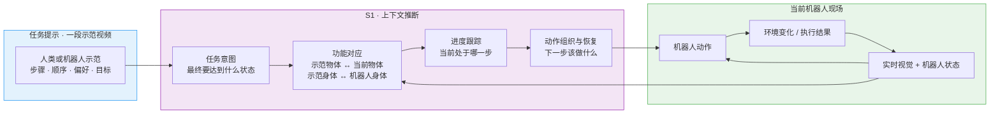

这里最关键的约束是：**推理时模型权重不更新**。不同任务使用同一组权重，变化的是放进上下文的视频提示。

---

## 2. 它与普通语言 VLA 有什么不同

语言适合表达目标类别和简单命令，例如“把杯子递给我”；但面对“如何打一个结”“以什么手法翻煎饼”或一串此前从未组合过的步骤，语言往往太粗。示范视频同时给出物体关系、动作风格、执行顺序和终止条件。

| 路线 | 任务条件 | 新任务如何适配 | 优势 | 主要限制 |
|---|---|---|---|---|
| 语言条件 VLA | 一句语言指令 | 依靠预训练技能，必要时后训练 | 提示紧凑，适合已知原子技能 | 很难精确描述新动作和新组合 |
| 任务专属策略 | 固定任务 ID 或单一数据集 | 为新任务采集数据并微调 | 充分数据下成功率可以很高 | 每个任务都产生采集、训练和验证成本 |
| S1 式 ICL | 一段示范视频 | 推理时从上下文学习，不改权重 | 显式展示动作模式、步骤和偏好 | 需要理解跨场景、跨视角和跨身体对应关系 |

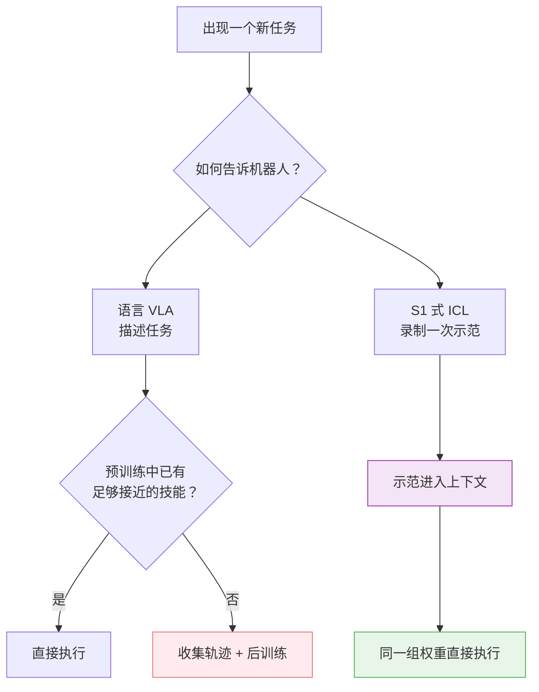

这并不意味着视频永远优于语言。原子任务、训练分布内任务和容易命名的目标，语言提示通常更便宜；S1 的价值主要出现在**动作本身难以描述、执行模式有歧义，或者任务由许多步骤组成**的时候。

---

## 3. 外循环与内循环：为什么它属于元学习

S1 的训练可以用 meta-learning 的两层结构理解：

- **外循环（预训练）**：在大量 episode 上训练“怎样根据示范判断当前该做什么”
- **内循环（推理）**：一段新示范临时规定任务，模型从上下文适配，但不做梯度更新

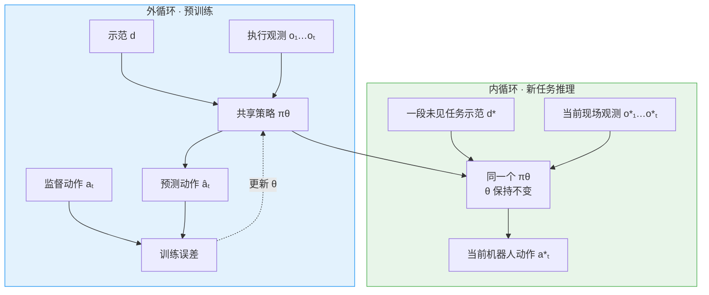

用抽象概率关系表示，它希望学习：

$$
a_t \sim \pi_\theta\!\left(a_t \mid o_{\le t}, d\right)
$$

其中 $d$ 是任务示范视频，$o_{\le t}$ 是执行到当前时刻的观测。新任务到来时改变的是 $d$，而不是参数 $\theta$：

$$
\theta_{\text{after prompt}} = \theta_{\text{before prompt}}
$$

这两个式子只是对官方范式的抽象，不代表 Skild 已经公开了真实损失或动作分布实现。

---

## 4. 为什么跨场景与跨 embodiment 很难

如果示范来自另一个房间、相机视角或人类身体，机器人不能复现示范中的绝对像素轨迹。它需要把表面差异压缩为“哪些对象承担相同功能、步骤是否完成、当前身体怎样实现同一效果”。

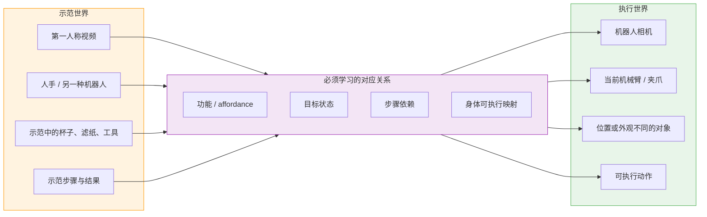

官方描述明确要求策略隐式学习三件事：

1. **示范者意图**：不是复刻每一个偶然动作，而是完成示范表达的任务
2. **功能对应关系**：外观和位置变化后，仍找到承担相同作用的对象和动作
3. **任务进度**：长程执行时知道已经完成什么、下一步是什么

“示范纠错”是这种目标理解的一个迹象：官方展示中，人类示范者提前掉落鸡蛋，S1 没有照抄失误，而是用更受控的动作完成对应步骤。但这仍是定性案例，不能据此断言模型拥有一般性的因果理解。

---

## 5. 数据引擎：四类数据为什么必须混合

Skild 用三个维度衡量机器人数据：

- **硬件接近度**：与最终机器人传感器和动作空间有多相似
- **多样性**：覆盖多少任务、环境和行为
- **可扩展性**：继续增加数据的成本有多高

没有一种来源同时占优，因此 S1 混合扩展机器人遥操作、UMI、第一人称视频和仿真。

| 数据来源 | 硬件接近度 | 多样性 | 可扩展性 | 在体系中的作用 |
|---|---:|---:|---:|---|
| 机器人遥操作 | 高 | 低 | 低 | 提供真实动作和硬件动力学监督 |
| UMI | 中 | 中 | 中 | 连接人类操作多样性与机器人可执行表示 |
| 第一人称视频 | 低 | 高 | 高 | 扩展任务、场景和长程行为覆盖 |
| 仿真 | 中 | 低 | 高 | 廉价扩展身体、环境与可控变化 |

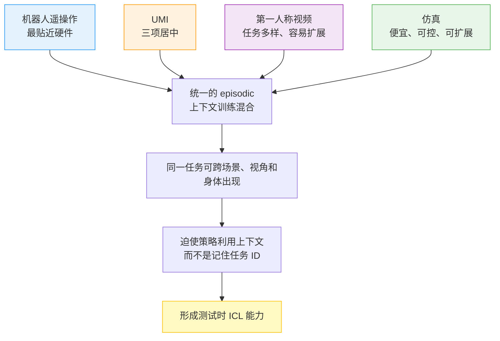

这里的核心不是简单把四种数据拼接，而是让训练集具有足够的**任务歧义**：只看当前场景无法唯一确定下一动作，模型必须查看上下文示范才能解除歧义。官方没有公开不同数据的比例、统一表示方式或跨 embodiment 对齐方法。

---

## 6. S1 重点评估的两个轴

Skild 认为，仅展示短时、训练分布内的 pick-and-place 不能充分证明 ICL。评估至少需要同时区分：

1. 任务或技能在预训练中是否出现
2. 任务是短时原子动作，还是需要组合、记忆和恢复的长程过程

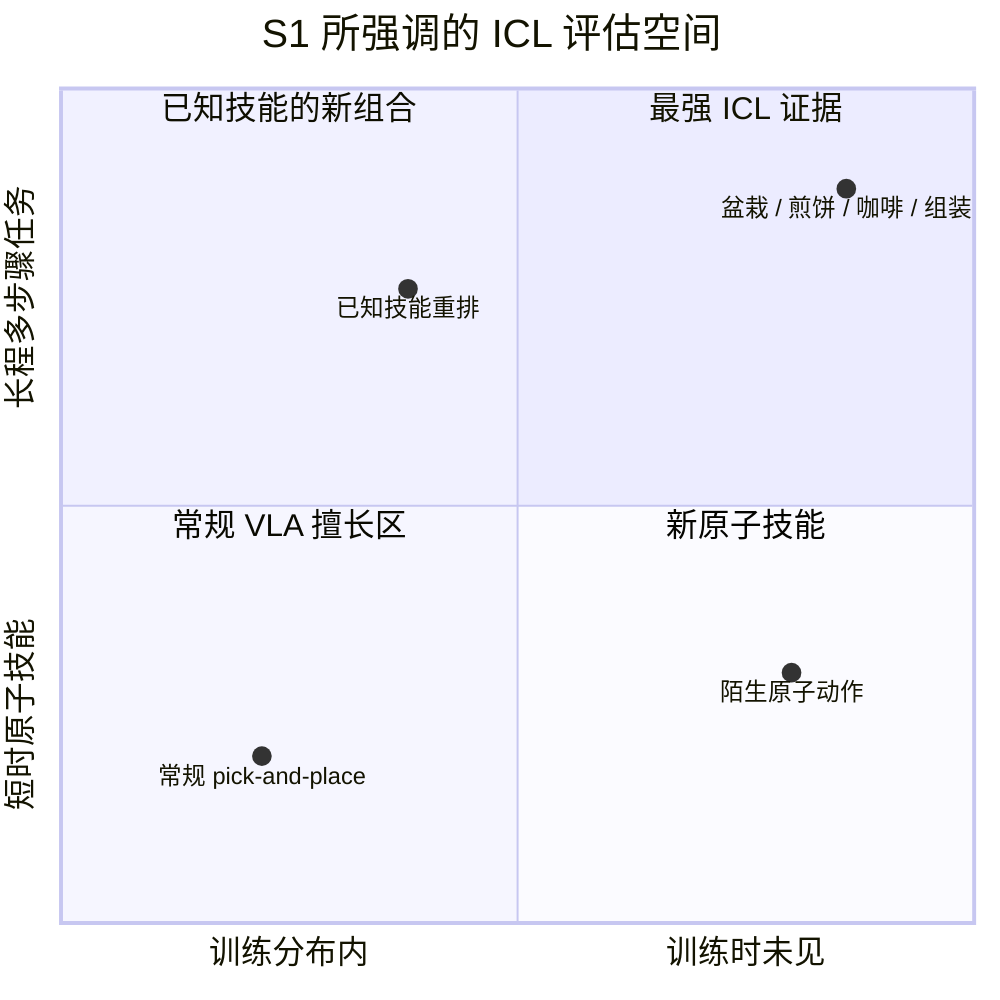

官方展示的四个训练时未见任务是：

- 盆栽：挖土、放入植物、整理并浇水
- 煎饼：包含翻面的新动作和多阶段烹饪顺序
- 手冲咖啡：放滤纸、加咖啡、分阶段注水
- 套件组装：连续处理零件与装配关系

任务最长约十分钟。长时程不只是“动作更多”，还会同时放大几个问题：

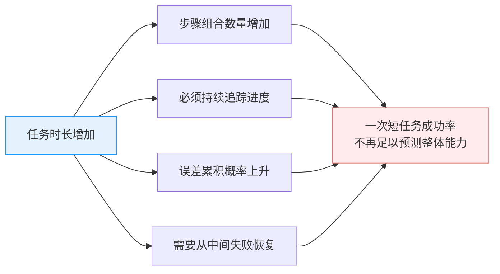

---

## 7. 从示范到执行：11 分钟意味着什么

盆栽实验给出了一个具体时间线：录制一段第一人称人类示范后，机器人在 11 分钟内开始自主执行。这里的 11 分钟是“示范录完到开始执行”，不是完成整个盆栽任务的时长。

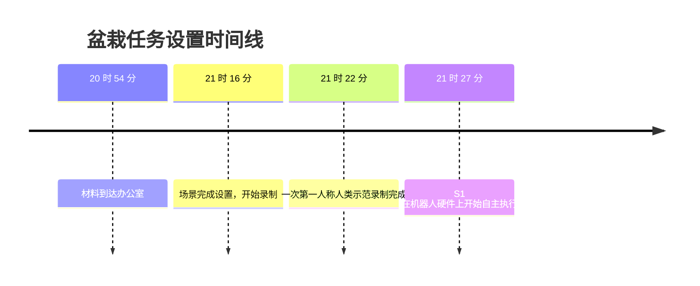

传统任务后训练通常是：

$$
T_{deploy}^{SFT} = T_{collect} + T_{train} + T_{validate} + T_{iterate}
$$

S1 希望把首轮部署压缩为：

$$
T_{deploy}^{ICL} \approx T_{record} + T_{load\ context} + T_{run}
$$

但是这个结果不能被理解为“11 分钟得到一个生产级策略”。场景搭建、安全验证、失败处理、吞吐、稳定性和硬件维护仍然存在；它只展示了**首次任务适配不再必然经过模型权重更新**。

---

## 8. 官方量化结果怎样解读

### 8.1 预训练规模：语言提示与视频上下文

Skild 在 1,000 到 100,000 小时的受控数据规模上比较了 ICL 策略与语言条件 VLA；除 prompt embedding 外，两者使用相同数据、架构和算力。报告指标是所有任务的平均逐步骤成功率。

| 评测条件 | 语言 VLA | S1 式 ICL | 读法 |
|---|---:|---:|---|
| 已见任务，1k 小时 | 53% | 43% | 小数据时，紧凑语言条件反而更容易学习 |
| 已见任务，扩大到 100k 小时 | 未披露精确终点 | 96% | ICL 随数据规模提升并反超 |
| 未见任务，100k 小时 | 9% | 66% | 官方概括为约 7×，差距集中在新技能和新组合 |

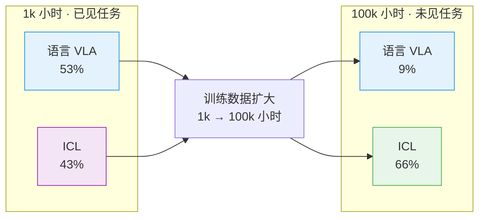

这些数字不能直接横向比较其他论文：任务集、成功标准和数据都不是公共 benchmark，而且长 rollout 中使用人工干预把失败步骤恢复后继续评后续步骤，以确保每一步都能被评分。

### 8.2 一次上下文示范约等于多少后训练数据

在未见任务上，一次上下文示范的 S1 达到 66%；语言 VLA 经过任务后训练，大约需要 380 个 episode 才与它相交。对于超过四分钟的任务，这些数据需要约 50–100 小时遥操作。继续增加到 2,000 个 episode 后，后训练策略达到 86%，超过单示范 ICL。

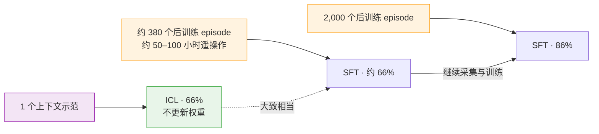

正确结论不是“一个 demo 永远胜过 SFT”，而是：**ICL 显著降低了获得第一个可用策略的边际成本；当任务值得持续优化时，足够多的后训练数据仍能提高上限。**

---

## 9. 鲁棒性、恢复与两种分布偏移

S1 的部署条件可能同时远离两个参照物：训练数据和上下文示范。官方分别测试了这两个轴，并把扰动从 L1 增加到 L5。

| 等级 | 变化 |
|---|---|
| L1 | 与训练分布或示范相同的物体和摆放 |
| L2 | 所有物体随机平移 15 cm、旋转 30° |
| L3 | 所有物体随机平移 30 cm、旋转 45° |
| L4 | 换成功能相同但外观不同的物体，并加入约 15 cm 垂直位移 |
| L5 | 重新摆放，使一半动作必须换另一只手执行 |

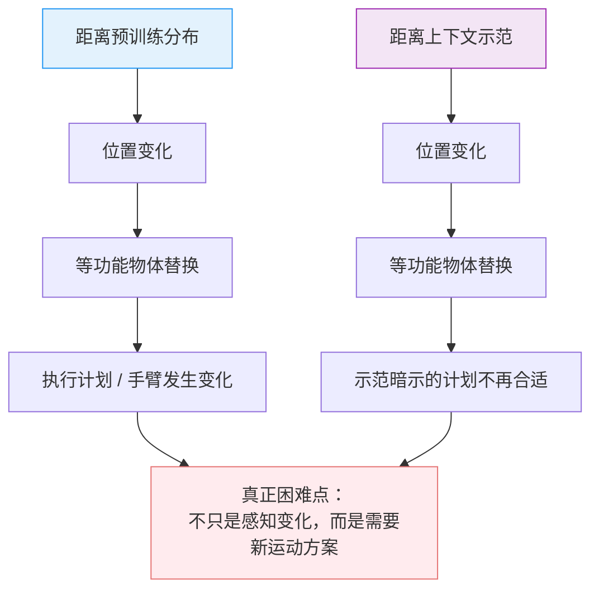

官方称，在 L5 下语言 VLA 的性能下降幅度最高可达 ICL 的三倍。文章还展示了推开物体、替换物体、改变照明、失败重试、使用具有相同用途的替代容器，以及根据当前状态省略不必要动作等案例。

这些现象支持“策略不是逐帧复刻示范”，但仍需注意：公开视频中的成功案例不能替代跨任务的失败率、置信区间和独立测试。

---

## 10. S1 与生产部署飞轮怎样连接

S1 解决的是**新任务冷启动**，Dyna 文章解决的是**生产系统长期运行**。两者可以组成一条从客户示范到舰队持续学习的完整链路。

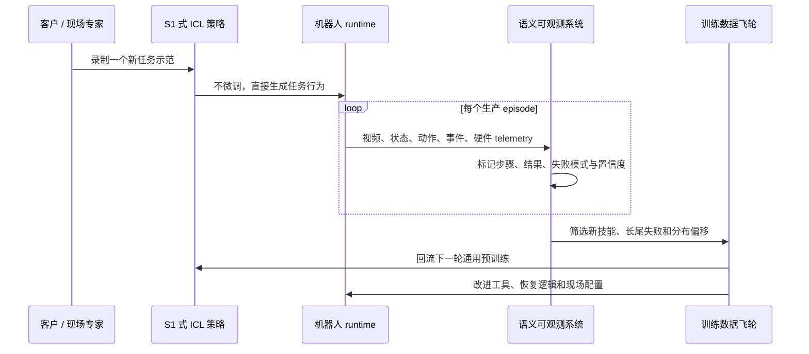

| 层级 | S1 主要减少的成本 | 仍然需要的系统 |
|---|---|---|
| 任务定义 | 把复杂 SOP 的一部分变成可观看的视频提示 | 权限、安全边界、任务验收标准 |
| 首次适配 | 减少专门采集和任务微调 | 现场标定、工具、动作约束与回退 |
| 日常运行 | 可用新示范快速纠正任务意图 | episode 记录、故障归因、硬件维护 |
| 长期改进 | 新任务可以更快产生真实交互数据 | 数据筛选、预训练、回归测试与舰队发布 |

因此，ICL 不是部署飞轮的替代品。更准确的关系是：它让飞轮的入口从“先采集几百条训练轨迹”缩短为“先给一个示范开始运行”，再由真实生产数据决定哪些能力值得进入下一轮权重更新。

---

## 11. 公开材料仍没有回答的问题

- S1 的参数规模、上下文窗口及一段十分钟视频如何压缩和编码
- 示范视频和实时观测是否共享视觉编码器、怎样进行时间对齐
- 动作是单步、action chunk、离散 token、flow/diffusion，还是其他表示
- 人类、UMI、仿真和不同机器人的动作空间怎样统一
- 控制频率、推理延迟、硬件配置以及长程上下文的显存开销
- 训练目标如何避免只记住表面轨迹，并学出任务意图和阶段
- 内部 benchmark 的任务数量、每项 trial 数、方差和完整成功判定
- 人工恢复介入率，以及不允许介入时的端到端十分钟成功率
- 安全机制、力控制、碰撞处理和对错误或恶意示范的防护
- 商业部署中的 uptime、吞吐、单位经济性与人工监督比例

这些缺口意味着，目前最可靠的定位是：S1 展示了一种很有前景的**视频提示机器人策略范式**和一组内部 scaling 证据，而不是一套已经公开、可复现的网络实现。

---

## 12. 一句话总结

S1 试图让机器人从“每个新任务都要重新训练”跨到“给我看一次，我就在当前身体和场景中尝试完成”：大规模、多来源 episodic 预训练是外循环，一段新示范是推理时内循环；它显著压缩首次任务适配成本，但生产可靠性、失败归因、硬件健康和持续训练仍需要完整的部署飞轮。

---

## 13. 参考资料

1. Skild AI. [Introducing S1: In-Context Learning for Robotics](https://skild.ai/blogs/s1). 2026-08.
2. Brown et al. [Language Models are Few-Shot Learners](https://papers.nips.cc/paper/2020/hash/1457c0d6bfcb4967418bfb8ac142f64a-Abstract.html). NeurIPS 2020.
3. Liu et al. [LocoFormer: Generalist Locomotion via Long-context Adaptation](https://arxiv.org/abs/2509.23745). 2025.
4. Jiang et al. [RoboTTT: Context Scaling for Robot Policies](https://arxiv.org/abs/2607.15275). 2026.
5. Oh et al. [FACTR 2: Learning External Force Sensing for Commodity Robot Arms Improves Policy Learning](https://arxiv.org/abs/2606.12406). 2026.
