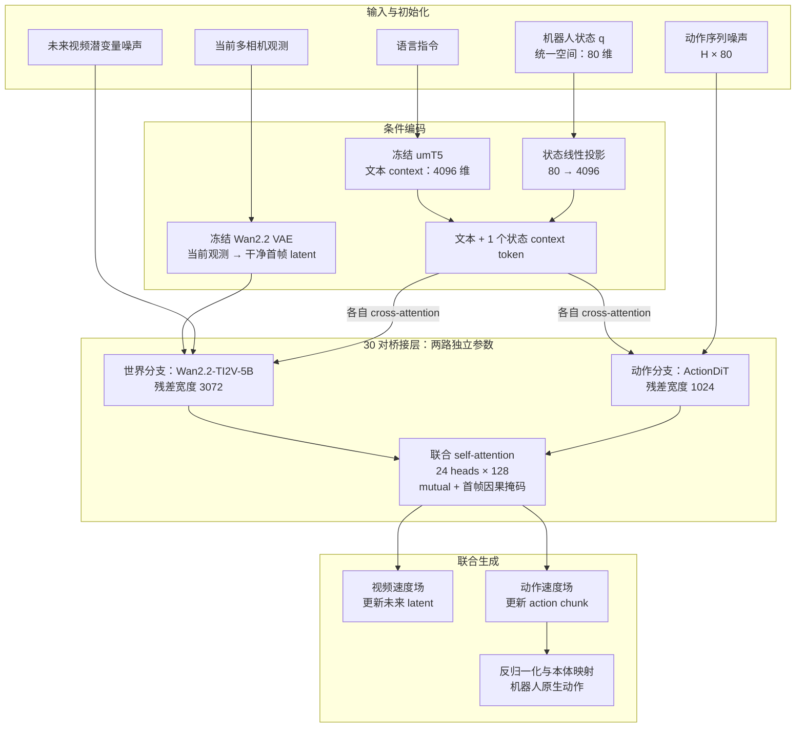
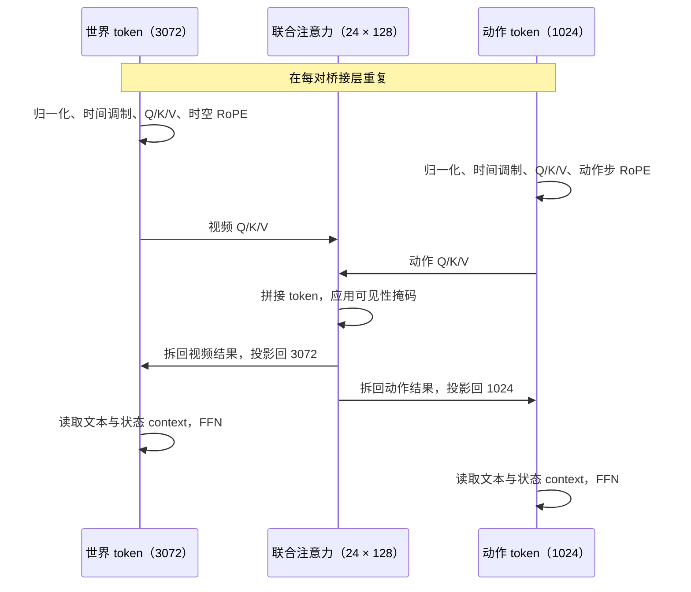

# OpenWAM：世界模型与动作联合建模

OpenWAM 是面向**世界动作模型（World-Action Model，WAM）**的开放研究框架。其发布模型 **OpenWAM-α** 以 Wan2.2 视频生成模型为世界分支，配合独立的 ActionDiT 动作分支，通过逐层联合注意力与 Flow Matching，同步预测未来视觉潜变量和机器人动作序列，让动作生成持续读取正在形成的未来世界表征。

本文依据[官方论文](https://arxiv.org/abs/2609.07398)、[项目页](https://openwam-official.github.io/)和[官方源码](https://github.com/OpenWAM-Official/OpenWAM)整理，核对日期为 **2026-10-29**，源码版本为 `3dfc9a7`。下文以 α 的双系统架构为主；配置值与研究变体分别标注。

---

## 1. 从世界模型到 WAM

### 1.1 世界模型学什么

世界模型学习环境随时间变化的规律：给定当前观测、任务条件，以及模型设计中可能包含的动作条件，预测未来观测或潜在状态。机器人需要的不只是“未来可能长什么样”，还包括“接下来怎样行动”。WAM 把未来世界表征与动作放进同一套生成过程，让两者可以相互约束。

OpenWAM-α 的目标可以概括为：

$$
p_\theta(z_{\mathrm{future}}, a_{1:H}\mid o_{\mathrm{now}},\ell,q)
$$

其中 $o_{\mathrm{now}}$ 是当前多相机观测，$\ell$ 是语言指令，$q$ 是机器人状态，$z_{\mathrm{future}}$ 是未来视频的潜变量，$a_{1:H}$ 是一段连续动作。这里的联合分布是对模型目标的概括；实现上使用两路速度场进行联合去噪。

### 1.2 OpenWAM 的三个层次

| 名称 | 作用 | 阅读时应区分的范围 |
|---|---|---|
| **OpenWAM-Infra** | 可组合的模型、表征、训练、推理与评测基础设施 | 支持多种研究架构，不代表 α 同时使用全部组件 |
| **OpenWAM-Study** | 控制变量比较设计选择 | 研究信息流、预训练、噪声轨迹与跨域数据的作用 |
| **OpenWAM-α** | 将研究结论组合后训练的具体模型 | 本文重点：Wan2.2 + ActionDiT、双系统、双向信息交换 |

α 的控制路径采用**视频与动作同步联合去噪**。Infra 中另有 IDM 两阶段路径，那是另一种实验变体。参见[官方项目说明](https://openwam-official.github.io/)。

---

## 2. 整体架构概览

图中展示一个联合前向过程；实际推理会重复去噪步骤。当前首帧保持为干净条件，未来视觉与动作从噪声逐步变清晰。语言和状态通过 **cross-attention context** 进入两路，而不是加入动作 self-attention 序列。

### 2.1 α 的核心组件

| 组件 | α 的选择 | 作用 |
|---|---|---|
| 视觉编码器 | 冻结 Wan2.2 VAE，48 通道 latent | 压缩观测和训练视频，保留首帧锚点 |
| 世界分支 | 预训练 Wan2.2-TI2V-5B DiT，宽度 3072 | 建模视觉变化，预测视频潜变量速度 |
| 动作分支 | 独立 ActionDiT，宽度 1024、FFN 4096 | 每个动作步一个 token，预测动作速度 |
| 桥接 | 全部 30 对层，公共注意力空间 24 × 128 | 在两路之间交换信息 |
| 文本条件 | 冻结 umT5，context 宽度 4096 | 表达任务指令 |
| 状态条件 | `Linear(state_dim, 4096)` | 将状态编码为一个额外 context token |
| 动作接口 | 80 维统一空间 + 有效维度 mask | 容纳多种机器人本体的动作与状态 |

这些数值对应 α / Wan2.2 配方；更换视频骨干时，层数和注意力几何需要重新匹配。来源：[视频配置](https://github.com/OpenWAM-Official/OpenWAM/blob/3dfc9a7d9230f0e1382e6b22639278f1a86e5eb5/openwam/model/video_backbone/wan/shared/configs/model_configs.py#L435)、[ActionDiT 配置](https://github.com/OpenWAM-Official/OpenWAM/blob/3dfc9a7d9230f0e1382e6b22639278f1a86e5eb5/configs/model/action_backbone/separate_action_dit.yaml)、[VAE 封装](https://github.com/OpenWAM-Official/OpenWAM/blob/3dfc9a7d9230f0e1382e6b22639278f1a86e5eb5/openwam/model/video_backbone/encoder/wan22_vae.py#L96)。

---

## 3. 两路 Transformer 怎样交换信息

### 3.1 不同残差宽度，共同注意力空间

世界分支的 token 是 3072 维，动作分支是 1024 维。两路各自的 Q/K/V 投影都输出 `24 × 128 = 3072` 维，因此可以沿 token 轴拼接：

$$
Q=[Q_v;Q_a],\quad K=[K_v;K_a],\quad V=[V_v;V_a]
$$

对拼接序列执行一次带掩码的注意力，再把结果拆回视频段和动作段。两路各自保留输出投影、cross-attention、FFN 和时间条件调制；MoT driver 负责组织计算，本身不引入一套共享 Transformer 权重。

这种桥接使动作每次更新都能读取世界分支的中间表征，未来视觉也能读取动作信息。源码：[双系统前向](https://github.com/OpenWAM-Official/OpenWAM/blob/3dfc9a7d9230f0e1382e6b22639278f1a86e5eb5/openwam/model/architectures/dual_system/joint_self_attn.py)、[MoT driver](https://github.com/OpenWAM-Official/OpenWAM/blob/3dfc9a7d9230f0e1382e6b22639278f1a86e5eb5/openwam/model/architectures/dual_system/mot_driver.py#L191)。

### 3.2 状态与 80 维动作接口

状态投影到文本宽度后，追加为一个 context token。它向两个分支提供“机器人现在处于什么姿态”的条件；动作 token 则表示“未来每一步要执行什么”。二者在网络中的位置与用途不同。见[状态 context 路径](https://github.com/OpenWAM-Official/OpenWAM/blob/3dfc9a7d9230f0e1382e6b22639278f1a86e5eb5/openwam/model/architectures/base.py#L504)。

80 维是统一接口的**槽位数**：左右各 34 维，包含末端位置 3、6D 旋转 6、夹爪 1、灵巧手 24，另有 12 个本体相关保留位。不同数据集把原生状态与动作映射到对应槽位，只监督有效坐标；推理输出再映射回机器人接口。因此 80 维不意味着每台机器人都有 80 个受控自由度。见[官方微调与动作空间约定](https://github.com/OpenWAM-Official/OpenWAM/blob/3dfc9a7d9230f0e1382e6b22639278f1a86e5eb5/assets/openwam_usage_docs/openwam-alpha-finetuning.md)。

---

## 4. 注意力掩码：信息可以往哪里走

### 4.1 跨模态可见性

Infra 提供四种模式，用同一套组件比较信息流方向：

| `attention_mask_mode` | 动作读取未来视频 | 未来视频读取动作 | 动作读取当前首帧 |
|---|---|---|---|
| **`mutual`（α）** | 是 | 是 | 是 |
| `action_sees_video` | 是 | 否 | 是 |
| `video_sees_action` | 否 | 是 | 是 |
| `isolated` | 否 | 否 | 是 |

各模式中，动作序列内部均双向可见。表格描述的是前向信息读取方向；训练参数是否获得某条损失的梯度，还需结合计算图、冻结设置及 detach 行为判断。

### 4.2 `first_frame_causal` 保留干净观测锚点

视频内部可见性由另一个配置 `video_attention_mask_mode` 控制。α 采用 `first_frame_causal`：

- 干净首帧只读取首帧视频 token，不读取含噪未来；首帧行也不读取动作 token。
- 未来视频 token 可以读取首帧及其他未来视频 token；在 `mutual` 下还可以读取动作。
- 未来帧之间保持双向可见，并非逐帧自回归生成。

首帧因此始终提供由当前观测形成的锚点。训练样本中的未来视频是去噪目标；部署时对应位置从噪声开始，不能当成已经观测到的未来真值。来源：[跨模态掩码](https://github.com/OpenWAM-Official/OpenWAM/blob/3dfc9a7d9230f0e1382e6b22639278f1a86e5eb5/openwam/model/architectures/utils/mask_modes.py)、[视频内部掩码](https://github.com/OpenWAM-Official/OpenWAM/blob/3dfc9a7d9230f0e1382e6b22639278f1a86e5eb5/openwam/model/video_backbone/wan_backbone.py#L219)。

---

## 5. 训练：联合 Flow Matching 与跨域共训

### 5.1 两路独立采样噪声等级

用 $\sigma$ 表示噪声比例，$\sigma=0$ 为干净端、$\sigma=1$ 为噪声端。视频潜变量和动作分别构造：

$$
x_\sigma=(1-\sigma)x+\sigma\epsilon,\qquad
v^*=\epsilon-x
$$

训练时视频的 $\sigma_v$ 与动作的 $\sigma_a$ **独立采样**，模型学习在不同联合噪声状态下预测两路速度。干净首帧作为条件固定，不计入未来视频预测损失；动作只在有效时间与有效维度上监督。

$$
\mathcal L=\lambda_v\mathcal L_{\mathrm{video}}+
\lambda_a\mathcal L_{\mathrm{action}}
$$

两项是带时间权重和有效性 mask 的速度回归损失，α 取 $\lambda_v=\lambda_a=1$。这里使用噪声比例说明公式，阅读论文或调度器时需注意其时间变量的方向约定。见[训练目标与噪声采样实现](https://github.com/OpenWAM-Official/OpenWAM/blob/3dfc9a7d9230f0e1382e6b22639278f1a86e5eb5/openwam/model/architectures/base.py#L1044)。

### 5.2 α 的预训练配方

作者报告 α 使用约 **5.185 亿帧、6,369 小时**的五来源数据进行单阶段共训：自建第一视角人类视频、AgiBotWorld-Beta、RoboCOIN、DROID 和 InternData-A1。样本中约 30% 来自人类视频，其余为真实或仿真机器人数据。

人类视频没有机器人动作标签：动作和状态通道完全 mask，只监督世界流；机器人数据同时提供视觉变化与动作监督。视频 DiT、ActionDiT 和状态编码器参与更新，VAE 与文本编码器冻结。数据规模与配方属于作者报告，见[论文 §5.1–5.2、表 4](https://arxiv.org/pdf/2609.07398)。

当前开源 `dataloader=mixture` 配置启用的是**四个机器人数据源**，没有包含论文自建的人类视频来源。运行这条命令不能直接等同于复现完整的五来源 α 预训练，见[当前 mixture 配置](https://github.com/OpenWAM-Official/OpenWAM/blob/3dfc9a7d9230f0e1382e6b22639278f1a86e5eb5/configs/dataloader/mixture.yaml)。

### 5.3 Study 结论怎样理解

官方 Study 的价值在于受控比较。其 RoboTwin2.0 实验支持以下设计判断：世界到动作的信息传递有益；预训练后双向耦合优于所比较的单向方案；同步去噪优于所测的非同步轨迹；人类视频与机器人数据共训有助于 OOD 表现。

这些结论有各自的数据、骨干与评测范围。顺序训练与共训的差距较小，也不能把某个实验的优势推广为所有世界模型上的固定排序。详见[论文 §4 的实验设置与消融](https://arxiv.org/pdf/2609.07398)。

---

## 6. 推理：世界与动作一起变清晰

### 6.1 α 的同步联合去噪

1. 编码当前观测得到干净首帧 latent，编码语言与状态 context。
2. 为未来视频 latent 和动作 chunk 分别初始化高斯噪声。
3. 按同步噪声轨迹重复联合前向，分别用预测速度进行 Euler 更新，并重新固定首帧。
4. 将生成动作反归一化并映射回本体动作空间，由外部执行器消费。

α 采用 10 步同步去噪；两路使用相同调度形状时，沿联合噪声平面的对角线推进。**训练时噪声时刻独立采样，推理时同步推进**，这是两个不同阶段的选择。参见[生成循环](https://github.com/OpenWAM-Official/OpenWAM/blob/3dfc9a7d9230f0e1382e6b22639278f1a86e5eb5/openwam/model/architectures/base.py#L1380)与[噪声轨迹调度](https://github.com/OpenWAM-Official/OpenWAM/blob/3dfc9a7d9230f0e1382e6b22639278f1a86e5eb5/openwam/deploy/denoise_schedule.py)。

### 6.2 三种容易混淆的开关

| 配置 | 实际控制什么 | 阅读要点 |
|---|---|---|
| `decode_video=false` | 是否把未来 latent 解码成像素视频 | 仍然进行视频 latent 联合计算，只省略 VAE 解码 |
| `denoise_mode=sync / async` | 视频与动作的噪声轨迹是否错开 | 属于生成算法的调度 |
| `inference_mode=sync / async` | 执行动作与后台推理是否重叠 | 属于服务执行器的调度 |

当前部署配置还提供 `torch.compile`、文本 embedding LRU 缓存与 DiT velocity cache。后者按预测稳定性复用相邻去噪步的速度，属于有条件的计算跳过；每次生成开始重置。它与固定观测的精确 K/V 复用是不同机制，实际速度与误差需在选定配置上测量。来源：[部署配置](https://github.com/OpenWAM-Official/OpenWAM/blob/3dfc9a7d9230f0e1382e6b22639278f1a86e5eb5/configs/deploy.yaml)、[velocity cache](https://github.com/OpenWAM-Official/OpenWAM/blob/3dfc9a7d9230f0e1382e6b22639278f1a86e5eb5/openwam/deploy/optimizations/dit_cache.py)。

### 6.3 原始时间窗、视频帧与 latent 帧

以当前 [LIBERO 配置](https://github.com/OpenWAM-Official/OpenWAM/blob/3dfc9a7d9230f0e1382e6b22639278f1a86e5eb5/configs/dataloader/libero.yaml)和[微调约定](https://github.com/OpenWAM-Official/OpenWAM/blob/3dfc9a7d9230f0e1382e6b22639278f1a86e5eb5/assets/openwam_usage_docs/openwam-alpha-finetuning.md#L38)为例：

| 层级 | 数量 | 含义 |
|---|---|---|
| 原始窗口 `num_frames=33` | 33 个原始时间点 | 动作 chunk 为 32 步 |
| 视频抽帧 `video_stride=4` | 9 帧 | 从原始窗口每隔 4 步取一帧，包含当前帧 |
| Wan2.2 VAE 时间压缩 | 3 个 latent 时间步 | 首帧独立编码，其余 8 帧按 4 帧一组压缩 |
| `inference_horizon` | 由执行配置决定 | 决定消费 chunk 中多少步，不改变生成 chunk 的长度 |

“33 帧窗口”“9 帧视频”“3 个 latent 时间步”描述不同层级。相机布局、分辨率、原生动作维数与执行频率也由数据集和部署配置决定。

---

## 7. 可选架构与实验边界

### 7.1 Infra 的架构选择

| 架构 | 组织方式 | 与 α 的关系 |
|---|---|---|
| `single_system` | 视频、动作等 token 进入单个共享 DiT；支持 vanilla / MoE 变体 | 可选对照 |
| `dual_system / joint_self_attn` | 独立视频与动作分支，逐层联合 self-attention | **α 采用的组织方式** |
| `dual_system / joint_cross_attn` | 视频分支先计算，动作分支 cross-attend 桥接特征 | 可选对照，支持控制桥接梯度 |
| `dual_system / idm` | 逆动力学式训练与两阶段推理 | 可选对照 |
| `tri_system / joint_self_attn` | 加入冻结 VLM 提取的特征及可训练理解专家，参与三路联合注意力 | 扩展研究架构 |

Infra 还支持替换视频骨干和视觉表征。存在配置入口表示框架提供该组合能力；性能结论仍需对应的训练与评测证据。见[架构扩展指南](https://github.com/OpenWAM-Official/OpenWAM/blob/3dfc9a7d9230f0e1382e6b22639278f1a86e5eb5/assets/openwam_usage_docs/architecture-extension.md)与[三系统配置](https://github.com/OpenWAM-Official/OpenWAM/blob/3dfc9a7d9230f0e1382e6b22639278f1a86e5eb5/configs/model/tri_system.yaml#L12)。

### 7.2 官方评测说明了什么

官方 α 实验覆盖多个仿真基准与真实机器人任务；下游结果基于经过监督微调的策略，其中 LIBERO-Plus 直接使用 LIBERO checkpoint，不额外微调。论文中的“预训练未见灵巧手本体”，指的是随后进行任务微调再评测，并非直接零样本控制该本体。

论文后续 benchmark 使用**同步执行**：动作 buffer 耗尽后，暂停等待基于当前观测生成的新 chunk。作者报告 RTX 5090 加速栈约 170 ms/chunk；这个数值是特定硬件与配置下的模型推理报告，不能直接换算成本机实测频率或连续异步控制效果。参见[论文 §5.1.3、§5.3–5.4](https://arxiv.org/pdf/2609.07398)和[官方完整结果](https://openwam-official.github.io/results/)。

阅读部署结果时，应分别记录模型输入输出检查、离线预测误差、仿真任务结果和真机执行结果。生成视频可以帮助观察模型预测，但任务成功仍需环境或机器人执行后的独立反馈。

---

## 8. 关键源文件与延伸阅读

| 官方文件 | 建议关注的内容 |
|---|---|
| [`configs/model/dual_system.yaml`](https://github.com/OpenWAM-Official/OpenWAM/blob/3dfc9a7d9230f0e1382e6b22639278f1a86e5eb5/configs/model/dual_system.yaml) | 模型变体、动作/状态宽度、掩码与桥接层设置 |
| [`joint_self_attn.py`](https://github.com/OpenWAM-Official/OpenWAM/blob/3dfc9a7d9230f0e1382e6b22639278f1a86e5eb5/openwam/model/architectures/dual_system/joint_self_attn.py) | 双分支准备、状态 context、联合前向 |
| [`mot_driver.py`](https://github.com/OpenWAM-Official/OpenWAM/blob/3dfc9a7d9230f0e1382e6b22639278f1a86e5eb5/openwam/model/architectures/dual_system/mot_driver.py) | Q/K/V 拼接、混合注意力和逐层调度 |
| [`mask_modes.py`](https://github.com/OpenWAM-Official/OpenWAM/blob/3dfc9a7d9230f0e1382e6b22639278f1a86e5eb5/openwam/model/architectures/utils/mask_modes.py) | 四种跨模态可见性模式 |
| [`architectures/base.py`](https://github.com/OpenWAM-Official/OpenWAM/blob/3dfc9a7d9230f0e1382e6b22639278f1a86e5eb5/openwam/model/architectures/base.py) | 状态投影、训练损失、生成循环 |
| [`configs/deploy.yaml`](https://github.com/OpenWAM-Official/OpenWAM/blob/3dfc9a7d9230f0e1382e6b22639278f1a86e5eb5/configs/deploy.yaml) | 去噪步数、执行模式、编译和缓存开关 |

同板块还可以阅读 [DreamZero 架构](./13.DreamZero_Architecture.html)与 [Fast-WAM 架构](./14.FastWAM_Architecture.html)，比较视频与动作的组织方式、跨模态信息流，以及推理时世界分支参与计算的程度。

官方入口：[GitHub 仓库](https://github.com/OpenWAM-Official/OpenWAM) · [论文](https://arxiv.org/abs/2609.07398) · [项目页](https://openwam-official.github.io/) · [模型权重](https://huggingface.co/OpenWAM)。源码链接固定到本文核对的提交，便于后续追踪版本变化。
