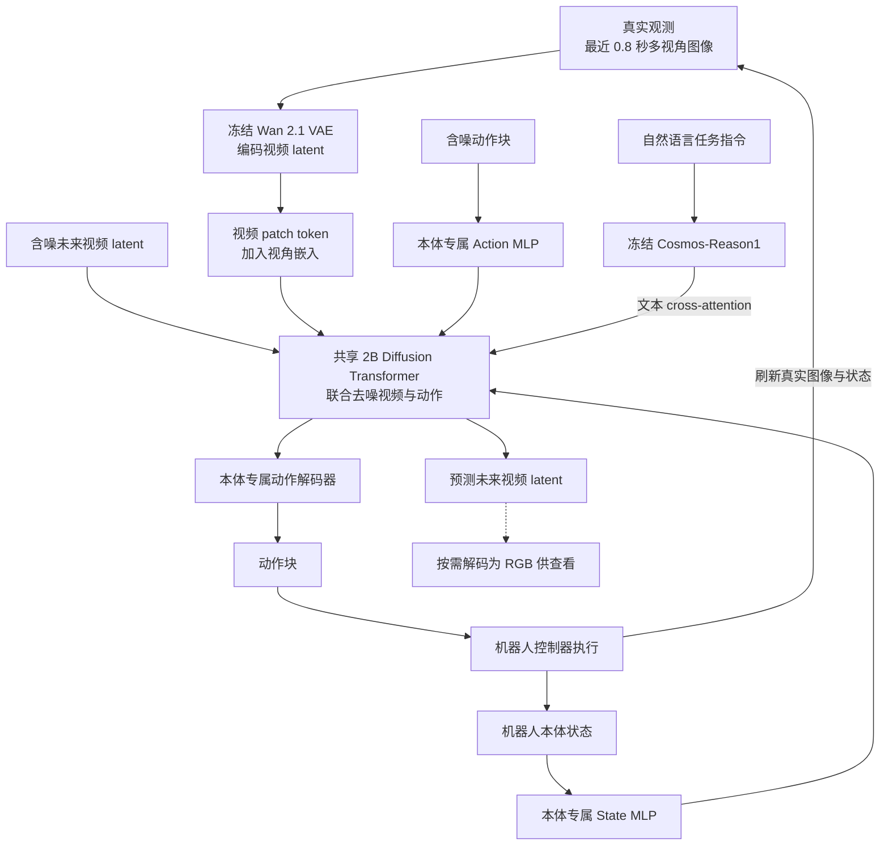
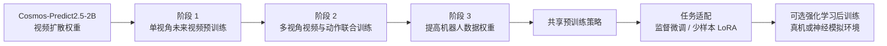

# GR00T 2 世界动作模型架构

GR00T 2 是 NVIDIA GEAR 的世界动作模型。它用同一个 2B Transformer 联合预测未来多视角视频与机器人动作，把人类第一视角视频、手持 UMI 示范和机器人遥操作接入同一套预训练流程。Turbo 沿用联合预测，通过更紧凑的视频表示降低推理开销，可在 Unitree G1 机载运行并通过 SONIC 执行全身动作。

> 本文依据 2026 年 11 月公开的 NVIDIA 白皮书。官方项目页截至 2026-11-10 标注代码计划于 12 月发布。文中的实现细节与实验数字均来自公开报告。[白皮书原文](https://research.nvidia.com/labs/gear/gr00t-2/assets/gr00t2_whitepaper.pdf) · [官方项目页](https://research.nvidia.com/labs/gear/gr00t-2/)

## 1. 从装配玩具卡车看模型在做什么

以 YAM 装配玩具自卸卡车为例。给定任务指令、最近的相机画面和机械臂状态，模型预测一段操作动作，同时预测各相机可能看到的未来场景。拿对齐零件这一步帮助理解接口，未来视频 token 表示模型预期的视觉变化，动作块则给出机械臂接下来的运动。控制器执行动作后，新采集的真实画面进入下一轮预测。白皮书将手持 UMI 示范向 YAM 的迁移归入 X-Adapt。[白皮书图 1](https://research.nvidia.com/labs/gear/gr00t-2/assets/gr00t2_whitepaper.pdf#page=4) · [UMI 实验表 4](https://research.nvidia.com/labs/gear/gr00t-2/assets/gr00t2_whitepaper.pdf#page=49)

## 2. 输入、联合骨干与输出

| 部分 | 白皮书描述 | 对应作用 |
|---|---|---|
| 真实观察 | 最多四个相机槽位，224 × 320，5 fps，最近 0.8 秒，另有本体状态 | 头部和腕部画面提供物体与手的当前几何关系 |
| 视频编码 | 冻结 Wan 2.1 VAE，时间压缩 4 倍，每个空间轴压缩 8 倍。标准版每视角每 latent 帧为 280 个 patch token | 将多视角历史与未来视频放入同一套表示，并用视角嵌入区分来源 |
| 语言 | 冻结 Cosmos-Reason1 编码指令，骨干通过交叉注意力读取 | 给联合预测提供任务目标 |
| 联合骨干 | 从 Cosmos-Predict2.5-2B 初始化。动作 token 可关注正在生成的未来视频 token | 在同一生成过程里让动作与预测的场景变化相互关联 |
| 本体接口 | 各本体使用专属的状态和动作编码 MLP，以及动作解码器 | 共享骨干通过对应接口读入状态、输出目标本体的动作块 |

推理时未来视频 latent 会参与动作预测，RGB 解码可按需用于可视化。去噪还可交替运行联合步与仅更新动作的步。后者复用最近一次联合步的视频与状态注意力缓存。例如 2v4a 指两次视频更新、四次动作更新。实际步数随本体和部署配置变化。[白皮书 §2](https://research.nvidia.com/labs/gear/gr00t-2/assets/gr00t2_whitepaper.pdf#page=5) · [附录 F.1](https://research.nvidia.com/labs/gear/gr00t-2/assets/gr00t2_whitepaper.pdf#page=84) · [附录 I.1](https://research.nvidia.com/labs/gear/gr00t-2/assets/gr00t2_whitepaper.pdf#page=113)

## 3. 三类数据怎样产生训练信号

| 数据来源 | 白皮书所述预训练数据 | 主要学习信号 |
|---|---:|---|
| Human-1M 第一视角人类视频 | 402,730 小时 | 观察手和物体怎样交互。有有效手部位姿轨迹的样本也可提供动作监督 |
| 手持夹爪 UMI | 10,184 小时 | 任务示范及可用于机器人策略训练的动作表示 |
| 机器人遥操作 | 23,500 小时 | 目标本体的状态、动作与场景变化，覆盖夹爪、灵巧手和人形机器人 |

人类视频规模为从 Human-1M 筛选的训练用量。官方另发布了 Human-1M-100K 数据子集。[白皮书 §4.2](https://research.nvidia.com/labs/gear/gr00t-2/assets/gr00t2_whitepaper.pdf#page=15) · [Human-1M-100K 数据卡](https://huggingface.co/datasets/nvidia/PhysicalAI-Human-1M-100K)

第一阶段先学人和机器人操作时画面如何演变。第二阶段加入各本体的状态和动作接口，对未来视频 latent 与动作各做 Flow Matching。有有效动作标签时才计算动作损失，因此纯视频样本仍可用于视频预测训练。第三阶段提高机器人示范占比，让共享表征更贴近真实执行。白皮书另报告了成功轨迹自模仿与残差 RL 等适配方式。[白皮书 §4.1](https://research.nvidia.com/labs/gear/gr00t-2/assets/gr00t2_whitepaper.pdf#page=14)

## 4. 跨本体迁移与少样本适配

X-Adapt 实验把任务示范与目标本体数据分开。玩具自卸卡车装配由手持 UMI 示范，YAM 仍提供其他任务的遥操作数据，用于学习它自身的观察和动作接口。白皮书还报告了带手部追踪的人类示范到 Dexter，以及可穿戴 DexUMI 到灵巧手的迁移。评估口径是目标本体缺少该项任务的遥操作示范。[白皮书 §3.2 与附录 B](https://research.nvidia.com/labs/gear/gr00t-2/assets/gr00t2_whitepaper.pdf#page=9)

| 实验 | 白皮书报告 | 读数口径 |
|---|---|---|
| Dexter-50，0 / 1 / 5 条目标本体示范 | 平均成功率 40% / 71% / 95% | 40/50 是零样本至少成功一次的任务数。50 项任务从五条示范后成功率达到 80% 的任务中选出 |
| UMI → YAM，玩具自卸卡车装配 | 端到端成功率 60% | UMI 提供目标任务示范，YAM 的已有数据来自其他任务 |
| 72 个 Dexter 任务的人类视频规模实验 | 真机平均任务进度 50% → 70% | 从零到使用全部选定人类视频，目标任务的 Dexter 遥操作用量相同。任务进度和成功率分别计量 |

这些结果分别衡量少样本适配、示范跨本体迁移和人类视频规模效应。Dexter-50 的 95% 对应上述筛选任务和训练配置。[白皮书图 2](https://research.nvidia.com/labs/gear/gr00t-2/assets/gr00t2_whitepaper.pdf#page=6) · [图 4](https://research.nvidia.com/labs/gear/gr00t-2/assets/gr00t2_whitepaper.pdf#page=8) · [图 10](https://research.nvidia.com/labs/gear/gr00t-2/assets/gr00t2_whitepaper.pdf#page=15)

## 5. Agent、Turbo 与机器人控制怎样分工

| 组成 | 输入与职责 | 实验与配置 |
|---|---|---|
| Agentic Control | 外部推理 Agent 观察、分解任务和检查进度，通过 WAM API 调策略，也可调用恢复技能 | 三种从散乱零件开始的装配中，含纠错数据、Agent 与恢复技能的系统分别成功 98、97、97 次，每种 100 次 |
| Visual Steering | Agent 把抓取和放置位置画成相机图像上的标记，并给出文字步骤。策略经中期训练学习读取这些标记 | 这是与纯文字指令分开评估的视觉引导设置 |
| GR00T 2 Turbo | 2B 联合骨干，换用 Wan 2.2 VAE。每个空间轴的压缩率从 8 倍到 16 倍，空间 latent 网格缩到四分之一 | 论文 G1 配置在机载 Jetson Thor 上测得约 124 ms 模型预测延迟 |
| SONIC | 将 Turbo 输出的全身运动 latent 转为关节控制指令 | 白皮书中 Turbo 约每秒生成一个 1.6 秒动作块，SONIC 以 50 Hz 控制 G1 |

装配成功率对应完整的 Agent 系统。124 ms 对应报告的机载模型预测配置，50 Hz 对应低层全身控制。把这三个量分开，才能判断系统的任务能力与时延预算。[白皮书 §3.4](https://research.nvidia.com/labs/gear/gr00t-2/assets/gr00t2_whitepaper.pdf#page=10) · [§3.5](https://research.nvidia.com/labs/gear/gr00t-2/assets/gr00t2_whitepaper.pdf#page=13) · [§4.6](https://research.nvidia.com/labs/gear/gr00t-2/assets/gr00t2_whitepaper.pdf#page=23) · [站内 GEAR-SONIC](17.GEAR-SONIC_Architecture.html)

### 5.1. 异步执行与 RTC

机器人客户端执行缓冲区里的动作，同时向推理服务请求下一块。白皮书的 noisy-prefix RTC 在微调时给已承诺执行的动作前缀加高斯噪声，推理时用干净的已承诺前缀作为条件。这样让策略在生成续段时兼顾连续性和新观测。报告中的固定延迟对照在 RoboDojo 模拟任务上测量成功率与动作平滑度，真实机器人评估另有独立口径。[白皮书 §4.6.2](https://research.nvidia.com/labs/gear/gr00t-2/assets/gr00t2_whitepaper.pdf#page=23) · [附录 I.2](https://research.nvidia.com/labs/gear/gr00t-2/assets/gr00t2_whitepaper.pdf#page=115)

## 6. 与站内相关模型的关系

| 条目 | 架构角色 |
|---|---|
| GR00T 2 | Cosmos-Predict2.5-2B 初始化的 WAM，联合生成未来视频 latent 与动作 |
| [GR00T N1.7](20.Isaac-GR00T-N1.7_Architecture.html) | N1 系列 VLA，用视觉语言特征调节动作生成头 |
| [DreamZero](13.DreamZero_Architecture.html) | NVIDIA 的早期联合视频与动作研究。首发配置使用 Wan2.1-I2V-14B |
| DreamDojo | 白皮书中的独立神经模拟环境，以动作作为条件，供部分 GR00T 2 强化学习后训练实验使用 |

GR00T 2 的 Cosmos 组件分别提供视频骨干初始权重与语言条件。DreamZero 提供相关的世界动作建模研究背景。不同模型的评估需要对齐本体、任务、数据和执行协议。[白皮书 §2](https://research.nvidia.com/labs/gear/gr00t-2/assets/gr00t2_whitepaper.pdf#page=5) · [附录 F.5](https://research.nvidia.com/labs/gear/gr00t-2/assets/gr00t2_whitepaper.pdf#page=92) · [NVIDIA 对下一代 GR00T 的研究预告](https://nvidianews.nvidia.com/news/nvidia-expands-open-model-families-to-power-the-next-wave-of-agentic-physical-and-healthcare-ai)

## 7. 阅读与核对入口

- 系统总览、模型架构和 Turbo 配置见白皮书图 1 与 §2。[第 4–6 页](https://research.nvidia.com/labs/gear/gr00t-2/assets/gr00t2_whitepaper.pdf#page=4)
- 三阶段预训练、数据来源和真实机器人评估见白皮书 §4。[第 14 页起](https://research.nvidia.com/labs/gear/gr00t-2/assets/gr00t2_whitepaper.pdf#page=14)
- 推理配置、加速对照和 RTC 结果见附录 I。[第 113 页起](https://research.nvidia.com/labs/gear/gr00t-2/assets/gr00t2_whitepaper.pdf#page=113)
- 演示、数据链接和后续发布状态见 NVIDIA 项目页。[GR00T 2 官方项目](https://research.nvidia.com/labs/gear/gr00t-2/)
