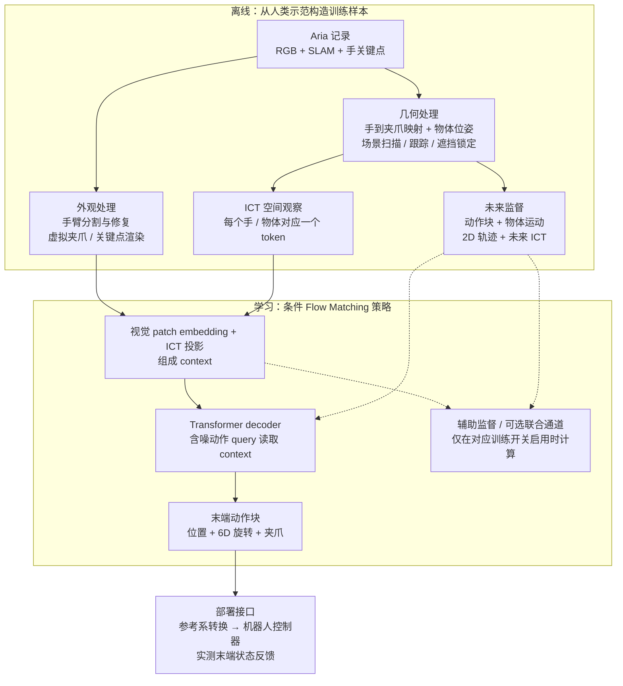
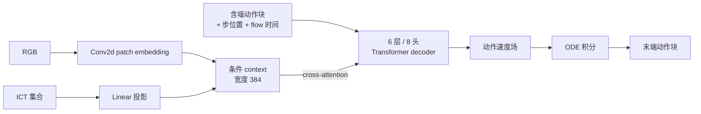

# HumanEgo：从第一视角人类示范到机器人策略

HumanEgo 把人类第一视角示范转换为手与物体的空间关系，再用 Flow Matching 学习机器人末端动作块。它的关键是 Interaction-Centric Tokens（ICT）与从同一段示范提取的多种监督信号：策略学习的是“手怎样相对物体运动”，而不是直接模仿人手的外观。本文区分论文完整方法与当前开源配置，说明数据、模型、训练和执行之间的接口。

> **类别：** Egocentric / 第一视角学习 
> **论文：** [HumanEgo, arXiv:2605.24934](https://arxiv.org/abs/2605.24934)，2026-05 首发；本文按 [v3](https://arxiv.org/html/2605.24934v3) 核对。 
> **实现快照：** [TX-Leo/HumanEgo · 239affb](https://github.com/TX-Leo/HumanEgo/tree/239affbc24b8b4a3ab2987cdd76436bea7ca9411)，核验于 2026-11-01。论文配置与仓库默认配置分别说明。

## 1. 从一个端面包任务理解整条链路

以 `serve_bread` 为例：人戴着 Aria 眼镜，把面包从初始位置送到目标位置。记录包含 RGB、相机运动与手部轨迹；预处理恢复物体和手的空间状态，把手映射为一个虚拟平行夹爪。模型在每个训练时刻读入图像与 ICT，学习接下来一段末端位姿和夹爪动作。

机器人运行时，把自身末端状态和任务物体也装进相同的表示，策略输出机器人可以跟踪的末端目标。**Zero-shot 指这种任务策略不需要再用目标机器人的示范微调；它仍需要相机标定、物体初始化和机器人的运动控制接口。** 不能把它理解为任意网络视频直接生成任意机器人的关节命令。

图中虚线表示训练监督。辅助目标帮助学习表示，不是部署时必须先执行的三个规划模块。数据与感知流程见[官方预处理文档](https://github.com/TX-Leo/HumanEgo/blob/239affbc24b8b4a3ab2987cdd76436bea7ca9411/preprocess/README.md)。

## 2. 数据、输入、标签与输出

| 接口 | 内容 | 在端面包例子中的含义 |
|---|---|---|
| 采集数据 | 第一视角 RGB、标定、SLAM 与手关键点 | 知道眼镜和手怎样运动，避免把头动当成手动 |
| 图像输入 | 处理后的 RGB 观察 | 保留面包和目标区域的外观信息 |
| 空间输入 | 手与物体的 ICT 集合 | 显式说明夹爪、面包和目标之间的位置与朝向 |
| 动作标签 | 由人手轨迹重定向得到的虚拟夹爪未来动作块 | 接近、抓取、搬运与释放的末端目标 |
| 模型输出 | $K$ 步连续动作；每手 10 维，另有完成状态预测 | 位置 3 维、旋转 6D 表示、夹爪 1 维；当前默认以独立 done head 判断完成 |
| 执行端 | 将策略参考系中的末端目标转换为机器人控制目标 | 由机器人控制器跟踪；不是策略直接输出电机电流 |

公开数据集是 [Leo-TX/HumanEgo](https://huggingface.co/datasets/Leo-TX/HumanEgo)：122 段记录，覆盖 `serve_bread` 和 `water_flowers`，包含原始 Aria 数据、MPS 结果和预处理输出。**论文的四任务评估与公开的两任务数据集是不同范围。** 当前策略模型没有自然语言指令输入；前处理的物体检测文本提示属于感知配置，这里应把它归为人类示范学习策略，而非直接套用通用 VLA 的语言接口。

## 3. ICT 到底编码了什么？

双手设置中，每个实体 token 是 29 维：

$$
\mathrm{ICT}_{E}=
[\tau\;\Vert\;{}^{\mathrm{REF}}T_E\;\Vert\;{}^E T_{LH}\;\Vert\;{}^E T_{RH}\;\Vert\;g]
\in\mathbb{R}^{29}.
$$

| 字段 | 维数 | 含义 |
|---|---|---|
| $\tau$ | 1 | 实体类型，例如手或物体 |
| ${}^{\mathrm{REF}}T_E$ | 9 | 实体在共同参考系中的位置与 6D 旋转 |
| ${}^{E}T_{LH}$ | 9 | 左手相对这个实体的位姿 |
| ${}^{E}T_{RH}$ | 9 | 右手相对这个实体的位姿 |
| $g$ | 1 | 手的夹爪状态；物体使用约定标志 |

单手设置只保留一组手相对位姿，所以是 20 维。**这里的 6D rotation 是旋转矩阵的一种连续表示，不是六个转动自由度。**

当面包是实体 $E$ 时，手相对面包的位姿可以直接表达“接近还是已经抓住”。相对位姿部分减少了对相机视角的依赖；但 ${}^{\mathrm{REF}}T_E$ 仍依赖参考系的选择，不能宣称整条 29 维向量在任意相机变化下天然完全不变。开源配置还区分 `camera_frame` 等参考系，训练与部署必须保持同一约定。

## 4. 模型主干与动作生成

当前实现的核心是一个较小的条件 Transformer，而非视频生成大模型：图像经 patch embedding，ICT 经线性投影，组成上下文；含噪动作、动作步位置和 flow 时间共同构成 decoder 的输入。

它没有预训练 VLM 的语言推理入口，也不需要像 OpenWAM / DreamZero 那样联合生成未来视频 latent。三者可以使用 Flow Matching，但**生成的变量、条件接口与模型规模不能因此视为相同架构**。图像 patch embedding 在这里也不等同于加载一个预训练 ViT。

实现依据：[FlowMatchingModel.py](https://github.com/TX-Leo/HumanEgo/blob/239affbc24b8b4a3ab2987cdd76436bea7ca9411/training/FlowMatchingModel.py)。

## 5. 训练：动作标签之外还能学什么？

令 $x_0$ 是高斯噪声，$x_1$ 是经过归一化的目标动作块，$s$ 是图像与 ICT 条件。沿线性路径构造训练样本：

$$
x_t=(1-t)x_0+t x_1,\qquad
\mathcal L_{\mathrm{FM}}=
\mathbb E\left[\left\|v_\theta(x_t,t\mid s)-(x_1-x_0)\right\|_W^2\right].
$$

$W$ 对位置、旋转和夹爪字段赋予不同权重。它拟合的是**动作空间的速度场误差**；这个 loss 下降不能直接当作真实机械臂位置误差下降，更不能代替任务成功率。

论文完整方法还让同一段示范提供三种额外监督：

| 辅助目标 | 预测对象 | 为什么有用 |
|---|---|---|
| Object Motion | 被操作物体的未来位姿轨迹 | 学习手动以后物体怎样运动 |
| 2D Trace | 手 / 物体锚点的未来图像坐标 | 让几何交互与视觉轨迹对齐 |
| Latent Consistency | 未来手部 ICT token 的一致性目标 | 约束未来手部交互状态；当前实现是 masked MSE |

最后一项沿用作者的命名，但不应据此描述成视频 VAE latent 生成，或带负样本的对比学习。训练代码中的名字 `use_aux_temporal_contrastive` 也不能替代对实际计算的检查。

三项监督在代码中并非三个完全相同的 head：Object Motion 启用时，把未来物体的 9 维位姿并入联合 flow 目标；2D Trace 和未来 ICT 则通过辅助预测计算损失。上图按监督用途归组，不能据此假定它们都使用相同解码结构。

### 5.1 论文方法与公开默认配置

截至本文核验的提交，`serve_bread/HumanEgo.yaml` 与 `water_flowers/HumanEgo.yaml` 的三项辅助目标开关均为 `false`。因此：

- 上面的三目标图表示论文方法及代码提供的能力。
- 按仓库默认任务配置启动训练，不等于已经启用论文的完整辅助损失组合。
- 复现实验时应同时记录任务配置、参考系、单 / 双手、动作窗口、采样步数，以及辅助目标开关。

以 [`serve_bread/HumanEgo.yaml`](https://github.com/TX-Leo/HumanEgo/blob/239affbc24b8b4a3ab2987cdd76436bea7ca9411/cfg/training/serve_bread/HumanEgo.yaml) 为例，当前配置使用单右手、`camera_frame`、50 步预测窗口和 20 个采样步。这个单手输出是 $50\times10$，不能直接套用论文双手的 $K\times20$ 接口。另一任务配置见 [`water_flowers/HumanEgo.yaml`](https://github.com/TX-Leo/HumanEgo/blob/239affbc24b8b4a3ab2987cdd76436bea7ca9411/cfg/training/water_flowers/HumanEgo.yaml)。

## 6. 部署时仍需补齐的接口

跨本体的公共接口是末端位姿、夹爪与 ICT。换机械臂时，仍要把相机参考系、机器人基座系和末端工具系连接起来，并保证工作空间、夹爪含义与控制节奏一致。

对象位姿也不是模型“看视频就自然知道”的：初始化和上游感知构成了策略条件的一部分。抓取阶段使用的 kinematic latching 假定被抓物体与手保持刚性关系；如果面包滑落或抓空，几何估计可能继续随夹爪移动。策略调用形成循环，不代表系统已经具备持续视觉物体纠错或接触反馈。

### 6.1 论文执行栈与参考模板的区别

论文附录 G 报告的执行栈每轮读取新图像和末端状态，约 10 Hz 重规划，每轮执行一个动作。公开仓库的简化模板则先执行 `exec_horizon` 个控制步，再读取下一张图重规划；示例配置为 10 Hz 控制、8 步执行窗口，因此不能把它称作 10 Hz 视觉重规划。

另外，当前模板中的 `Perception.estimate_objects()` 仍需用户实现，`make_clean_image()` 是返回原图副本的占位实现。采集、训练代码已公开，不代表参考推理模板在任意机器人上开箱即用。具体见 [`run_inference.py`](https://github.com/TX-Leo/HumanEgo/blob/239affbc24b8b4a3ab2987cdd76436bea7ca9411/inference/run_inference.py)、[`controller.py`](https://github.com/TX-Leo/HumanEgo/blob/239affbc24b8b4a3ab2987cdd76436bea7ca9411/inference/controller.py) 与[论文执行细节](https://arxiv.org/html/2605.24934v3#A7.SS1)。

因此，把方法移到自己的机器人上，应先验证端面包这类单一任务的坐标和动作接口，再报告完整闭环任务结果；仅下载权重、离线采样或轨迹可视化不能算真机复现。

## 7. 实验数字应该怎样读？

| 论文报告 | 正确的比较口径 |
|---|---|
| 每任务 30 分钟人类示范，四任务平均成功率 92.5% | 原论文任务、装置、随机化和成功定义下的结果 |
| 每任务 15 分钟时平均成功率 75% | 同一研究的数据预算实验，不是任意新任务的保证 |
| 30 分钟人类示范 92.5%，匹配采集时长的机器人示范训练 ACT 约 51.2% | 比较的是训练后策略成功率；差值约 41 个百分点，不是遥操作本身的成功率或相对提升 41% |

这支持“在该实验设置下，结构化人类示范具有较高数据效率”，还不足以推出人类视频在所有任务上都优于机器人数据。比较自己的方法时，需要固定任务、采集预算、策略配置、评价次数及成功判据，并把公开两任务的复现结果与原论文四任务均值分开。

实验来源：[论文 v3 §4.1、图 4](https://arxiv.org/html/2605.24934v3#S4.F4)，每任务评估 40 次。

## 8. 适用范围与限制

- **适合先验证的场景：** 可用刚性物体位姿和末端运动描述的抓取、搬运等任务。
- **上游误差会传递：** SLAM、手追踪、物体姿态与标定误差都会进入训练标签或部署条件；相对坐标不能消除这些误差。
- **需要谨慎外推：** 柔性物体、精密插入、高动态交互、手内灵巧操作和接触力控制没有因为采用 ICT 就自动解决。
- **硬件兼容与效果分开看：** 能提供相同信号的设备可能接入这条链路；是否达到原论文性能，需要重新验证数据精度和真实机器人结果。

项目网页还展示了模拟器、Real2Sim 等后续内容，应分别按对应发布版本理解，不能倒推为原论文全部具备的能力。作者对局限的说明见[官方 FAQ](https://humanego-ai.github.io/#faq)。

## 9. 一手资料与复现入口

| 资料 | 用途 |
|---|---|
| [官方项目页](https://humanego-ai.github.io/#overview) | 方法概览、演示和作者说明 |
| [arXiv 论文与版本历史](https://arxiv.org/abs/2605.24934) | 首发日期、方法与实验口径 |
| [官方代码快照](https://github.com/TX-Leo/HumanEgo/tree/239affbc24b8b4a3ab2987cdd76436bea7ca9411) | 核对实际接口、训练目标和任务配置 |
| [公开数据集](https://huggingface.co/datasets/Leo-TX/HumanEgo) | 两任务记录、MPS 与预处理结果 |

代码采用 [PolyForm Noncommercial 1.0.0](https://github.com/TX-Leo/HumanEgo/blob/239affbc24b8b4a3ab2987cdd76436bea7ca9411/LICENSE)；[数据卡](https://huggingface.co/datasets/Leo-TX/HumanEgo#license)标注 CC-BY-NC-4.0。公开发布不等于无限制商用许可。

首次尝试可以按仓库 Quick Start 跑少量样本，检查预处理与训练链路；随后使用独立记录评估，再进行坐标对齐和真实机器人执行验证。这几步提供的证据不同，应分别记录。
