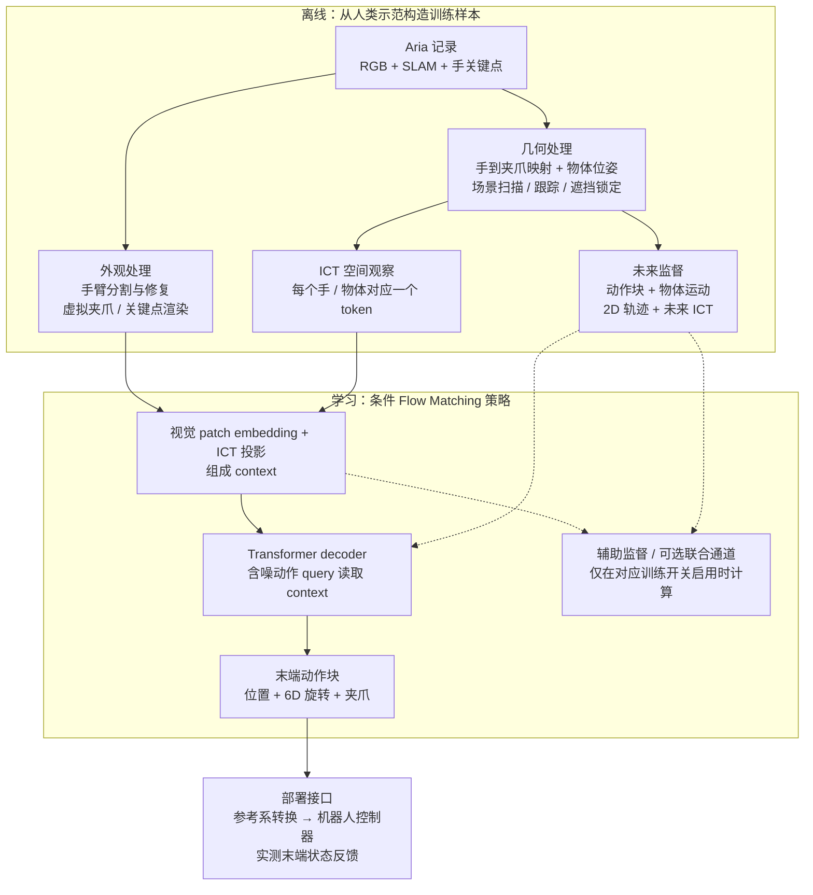
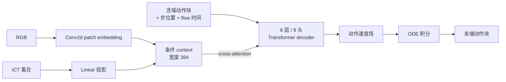

# HumanEgo：从第一视角人类示范到机器人策略

戴一副带相机的眼镜，把一件家务做上几十遍，就可以训练机器人策略。HumanEgo 的关键取舍是只保留示范里“手相对物体在哪儿”，丢掉“人手长什么样”。本文先用五分钟讲清它在做什么，再展开数据、表示、训练与部署，并区分论文方法与当前开源默认配置。

> **类别：** Egocentric / 第一视角学习 
> **论文：** [HumanEgo, arXiv:2605.24934](https://arxiv.org/abs/2605.24934)，2026-05 首发；本文按 [v3](https://arxiv.org/html/2605.24934v3) 核对。 
> **实现快照：** [TX-Leo/HumanEgo · 239affb](https://github.com/TX-Leo/HumanEgo/tree/239affbc24b8b4a3ab2987cdd76436bea7ca9411)，核验于 2026-11-01。论文配置与仓库默认配置分别说明。

## 速读：5 分钟理解 HumanEgo

**问题。** 人做示范、机器人执行，中间差两层：看起来不像（画面里是人手，不是夹爪），动起来也不像（人手的关节和活动范围与机械臂不同）。多数方法在第一层想办法，把画面修得更像机器人。

**办法。** HumanEgo 认为第一层没那么重要。它只记录“手相对物体在哪儿”：假设手在面包左前方、还差几厘米、尚未合拢——这句描述里没有一个像素，却已经足够决定下一步怎么动。换成机器人时，这句话一个字都不用改：夹爪在面包左前方几厘米，和人手在面包左前方几厘米，对模型是同一件事。这种“每个实体一句话”的编码叫 **ICT**（Interaction-Centric Token）。

**为什么够用。** 作者给过一个类比：扫一眼桌面，然后闭上眼睛，你仍然能把花插进花瓶。看一眼得到的粗略空间关系，加上本体感觉，足以完成大部分操作，并不需要持续盯着看。

**还做了一件事。** 几十分钟的数据很少，所以同一段示范被要求回答更多问题：物体接下来会去哪、手和物体在画面上会划出什么轨迹、几步之后交互状态会变成什么。答案都由同一套预处理自动算出，不需要额外标注。

**效果。** 每任务 30 分钟人类示范，四个任务平均成功率 92.5%。

**边界。** 你闭着眼能做的事它大概能做；穿针、插 USB、追移动物体它做不了，精度天花板约 1 厘米。

---

## 1. 为什么不是“拿网络视频直接训”

官方 FAQ 把第一视角数据分成三层：底层是被动拍摄的网络视频，数量最大，但没有动作标签、头部晃动未补偿、多数不是为某个任务拍的；中层是有人特意戴相机做任务、手部位姿被跟踪的示范；顶层是结构化、标定过、动作标签准确的遥操作级人类数据，质量最高也最稀缺。作者对底层的评价是“数量极其丰富，质量其实很差”。

HumanEgo 不解决底层，而是**假定你只有顶层的几十分钟数据**，于是问题变成：怎样把每一段示范榨干。这个前提决定了后面的全部设计——空间表示（§3）用来跨过具身差距，辅助监督（§5）用来放大每段轨迹的信息量。

采集端用 Aria 眼镜，是因为 Meta 的 MPS 服务直接给出标定过的 SLAM、3D 手部位姿和同步 RGB。作者强调**上游 SLAM 与手部跟踪的精度直接决定下游策略上限**：位姿噪声会沿标签和表示一路传下去。

## 2. 跟着一块面包走一遍

以 `serve_bread` 为例：人戴着 Aria 眼镜，把面包从初始位置送到目标位置。

采集阶段记录 RGB、相机运动与手部关键点——眼镜本身在动，所以必须先把“头动”和“手动”分开，否则手的轨迹是错的。预处理阶段恢复物体与手的空间状态，把人手映射为一个虚拟平行夹爪，顺带算出 ICT 与各种未来标签。训练阶段，模型在每个时刻读入图像与 ICT，预测接下来一段末端位姿和夹爪动作。部署阶段，把机器人自身末端状态和任务物体装进同一套表示，策略输出机器人可以跟踪的末端目标。

**Zero-shot 指这种任务策略不需要再用目标机器人的示范微调；它仍需要相机标定、物体初始化和机器人的运动控制接口。** 不能把它理解为任意网络视频直接生成任意机器人的关节命令。

虚线表示训练监督。辅助目标帮助学习表示，不是部署时必须先执行的三个规划模块。流程细节见[官方预处理文档](https://github.com/TX-Leo/HumanEgo/blob/239affbc24b8b4a3ab2987cdd76436bea7ca9411/preprocess/README.md)。

各段接口对应如下：

| 接口 | 内容 | 在端面包例子中的含义 |
|---|---|---|
| 采集数据 | 第一视角 RGB、标定、SLAM 与手关键点 | 知道眼镜和手怎样运动，避免把头动当成手动 |
| 图像输入 | 处理后的 RGB 观察 | 保留面包和目标区域的外观信息 |
| 空间输入 | 手与物体的 ICT 集合 | 显式说明夹爪、面包和目标之间的位置与朝向 |
| 动作标签 | 由人手轨迹重定向得到的虚拟夹爪未来动作块 | 接近、抓取、搬运与释放的末端目标 |
| 模型输出 | $K$ 步连续动作；每手 10 维，另有完成状态预测 | 位置 3 维、旋转 6D 表示、夹爪 1 维；当前默认以独立 done head 判断完成 |
| 执行端 | 把策略参考系中的末端目标转换为机器人控制目标 | 由机器人控制器跟踪，不是策略直接输出电机电流 |

公开数据集是 [Leo-TX/HumanEgo](https://huggingface.co/datasets/Leo-TX/HumanEgo)：122 段记录，覆盖 `serve_bread` 和 `water_flowers`。**论文的四任务评估与公开的两任务数据集是不同范围。** 当前策略模型没有自然语言指令输入，前处理的物体检测文本提示属于感知配置，不要按通用 VLA 的语言接口来理解。

## 3. ICT：一个实体一句话

速读里那句“手在面包左前方、还差几厘米、尚未合拢”，写成模型能读的格式就是一个 token。双手设置中每个实体 token 是 29 维：

$$
\mathrm{ICT}_{E}=
[\tau\;\Vert\;{}^{\mathrm{REF}}T_E\;\Vert\;{}^E T_{LH}\;\Vert\;{}^E T_{RH}\;\Vert\;g]
\in\mathbb{R}^{29}.
$$

| 字段 | 维数 | 含义 |
|---|---|---|
| $\tau$ | 1 | 实体类型，例如手或物体 |
| ${}^{\mathrm{REF}}T_E$ | 9 | 实体在共同参考系中的位置与 6D 旋转 |
| ${}^{E}T_{LH}$ | 9 | 左手相对这个实体的位姿 |
| ${}^{E}T_{RH}$ | 9 | 右手相对这个实体的位姿 |
| $g$ | 1 | 手的夹爪状态；物体使用约定标志 |

单手设置只保留一组手相对位姿，所以是 20 维。token 数量随场景实体数变化，同一套格式可以描述一个物体或多个物体的任务。当面包是实体 $E$ 时，${}^{E}T_{RH}$ 直接表达“还在接近，还是已经抓住”——这正是动作策略需要的量，而它在像素空间里要经过一长串推断才能得到。

两个容易误读的地方：**6D rotation 是旋转矩阵的一种连续表示（取前两列），不是六个转动自由度**；相对位姿项减少了对相机视角的依赖，但 ${}^{\mathrm{REF}}T_E$ 仍依赖参考系的选择，**不能宣称整条 29 维向量在任意相机变化下天然完全不变**。开源配置区分 `camera_frame` 等参考系，训练与部署必须保持同一约定。

## 4. 模型：把一团噪声推成一段动作

策略不是一步回归出动作，而是学一个“把噪声推向动作”的速度场。训练时在高斯噪声 $x_0$ 与真实动作块 $x_1$ 之间的直线上取一点 $x_t$，模型读入 $x_t$、时间 $t$ 和条件（图像 + ICT），预测这一点该朝哪个方向移动；推理时从纯噪声出发，沿预测的速度场积分若干步，终点就是一段动作块。好处是一次输出一整段连续动作，便于在较低的重规划频率下执行，代价是推理要跑多步积分（当前任务配置为 20 步）。

当前实现的核心是一个较小的条件 Transformer，而非视频生成大模型：

它没有预训练 VLM 的语言推理入口，也不需要像 [OpenWAM](./24.OpenWAM_Architecture.html) / [DreamZero](./13.DreamZero_Architecture.html) 那样联合生成未来视频 latent：那两者生成的是视频 latent 加动作、条件包含语言与多相机观测、规模是数十亿参数的视频骨干。三者都可以使用 Flow Matching，但**生成的变量、条件接口与模型规模不能因此视为相同架构**；这里的图像 patch embedding 也不等同于加载一个预训练 ViT。实现见 [FlowMatchingModel.py](https://github.com/TX-Leo/HumanEgo/blob/239affbc24b8b4a3ab2987cdd76436bea7ca9411/training/FlowMatchingModel.py)。

## 5. 训练：一段示范能榨出多少监督

主损失沿线性路径回归速度场：

$$
x_t=(1-t)x_0+t x_1,\qquad
\mathcal L_{\mathrm{FM}}=
\mathbb E\left[\left\|v_\theta(x_t,t\mid s)-(x_1-x_0)\right\|_W^2\right],
$$

其中 $s$ 是图像与 ICT 条件，$W$ 对位置、旋转和夹爪字段赋予不同权重。它拟合的是**动作空间的速度场误差**，这个 loss 下降不能直接当作真实机械臂位置误差下降，更不能代替任务成功率。

只用动作标签时，一段示范在每个时刻只提供“看到这些 → 输出这段动作”一条信号；数据只有几十分钟时，流过梯度的信息量很有限。于是论文让同一段示范再回答三个问题：**Object Motion** 预测被操作物体的未来位姿轨迹（3D 物理空间），**2D Trace** 预测手与物体锚点的未来图像坐标（2D 视觉空间），**Latent Consistency** 预测未来手部 ICT token（表示空间）。三者共享同一个编码器，合起来是在要求它预测场景如何演化，作者称之为装在策略内部的轻量“手–物交互世界模型”。

命名与实现要分开看：最后一项不应描述成视频 VAE latent 生成或带负样本的对比学习，当前实现是 masked MSE，代码里的名字 `use_aux_temporal_contrastive` 不能替代对实际计算的检查；三项在代码中也不是三个相同的 head，Object Motion 启用时把未来物体的 9 维位姿并入联合 flow 目标，另外两项通过辅助预测计算损失。

**论文方法 ≠ 仓库默认配置。** 截至本文核验的提交，`serve_bread/HumanEgo.yaml` 与 `water_flowers/HumanEgo.yaml` 的三项辅助目标开关均为 `false`；按默认配置启动训练，不等于已经启用论文的完整辅助损失组合。以 [`serve_bread/HumanEgo.yaml`](https://github.com/TX-Leo/HumanEgo/blob/239affbc24b8b4a3ab2987cdd76436bea7ca9411/cfg/training/serve_bread/HumanEgo.yaml) 为例，当前配置使用单右手、`camera_frame`、50 步预测窗口和 20 个采样步，单手输出是 $50\times10$，不能直接套用论文双手的 $K\times20$ 接口。复现时应同时记录任务配置、参考系、单/双手、动作窗口、采样步数和辅助开关。

## 6. 部署：从策略坐标系接到真机

跨本体的公共接口是末端位姿、夹爪与 ICT。换机械臂时仍要把相机参考系、机器人基座系和末端工具系连接起来，并保证工作空间、夹爪含义与控制节奏一致。物体位姿同样不是模型“看视频就自然知道”的，它来自上游感知，构成策略条件的一部分；抓取阶段使用的 kinematic latching 假定被抓物体与手保持刚性关系，如果面包滑落或抓空，几何估计可能继续随夹爪移动。策略反复调用形成循环，不代表系统已经具备持续视觉纠错或接触反馈。

还有一处差别值得注意：论文附录 G 的执行栈每轮读取新图像和末端状态，约 10 Hz 重规划，每轮执行一个动作；而公开仓库的简化模板先执行 `exec_horizon` 个控制步再读取下一张图重规划，示例配置为 10 Hz 控制、8 步执行窗口，**因此不能把它称作 10 Hz 视觉重规划**。模板中的 `Perception.estimate_objects()` 仍需用户实现，`make_clean_image()` 是返回原图副本的占位实现。采集与训练代码已公开，不代表参考推理模板在任意机器人上开箱即用。见 [`run_inference.py`](https://github.com/TX-Leo/HumanEgo/blob/239affbc24b8b4a3ab2987cdd76436bea7ca9411/inference/run_inference.py)、[`controller.py`](https://github.com/TX-Leo/HumanEgo/blob/239affbc24b8b4a3ab2987cdd76436bea7ca9411/inference/controller.py) 与[论文执行细节](https://arxiv.org/html/2605.24934v3#A7.SS1)。

## 7. 实验数字应该怎样读

| 论文 / 官方页报告 | 正确的比较口径 |
|---|---|
| 每任务 30 分钟人类示范，四任务平均成功率 92.5% | 原论文任务、装置、随机化和成功定义下的结果，每任务评估 40 次 |
| 每任务 15 分钟时平均成功率 75% | 同一研究的数据预算实验，不是任意新任务的保证 |
| 对比匹配采集时长的机器人示范训练的 ACT（约 51.2%） | 比较的是训练后策略成功率；差值约 41 个百分点，不是遥操作本身的成功率，也不是“提升 41%” |
| 8 分钟人类数据训练的策略超过 30 分钟机器人数据训练的 ACT | 官方数据效率曲线上的一个交点，口径同上 |
| 纯视觉输入停在 32.5%，加入空间 token 后 +52.5 个百分点；`water_flowers` 从 7.5% 升到 85% | 支持“空间表示是关键”，范围是作者的任务与实现；换任务或换视觉骨干需重新验证 |
| 辅助目标消融（15 分钟数据）：Object Motion 单项 +17.5 个百分点，三项合计 +25 个百分点 | 低数据预算下的增益；注意仓库默认配置并未开启这三项（§5） |

这些结果支持“在该实验设置下，结构化人类示范具有较高数据效率”，还不足以推出人类视频在所有任务上都优于机器人数据。比较自己的方法时需要固定任务、采集预算、策略配置、评价次数与成功判据，并把公开两任务的复现结果与原论文四任务均值分开。来源：[论文 v3 §4.1、图 4](https://arxiv.org/html/2605.24934v3#S4.F4)与[官方项目页](https://humanego-ai.github.io/#overview)。

## 8. 边界在哪里

作者给了一个与 ICT 直觉对称的说法：**HumanEgo 大致能做“看一眼、闭上眼仍然能完成”的那类任务**——取放、倒水这类粗粒度大幅度操作；插 USB、穿针、追逐移动物体这类闭眼做不到的任务，它同样做不到。每条边界都对应一个具体原因：约 1 厘米的精度天花板来自物体位姿依赖现成基础模型估计、误差会累积；形变物体没有良定义的刚体位姿，ICT 构造本身就失败；高动态与手内操作需要高频视觉反馈和逐指接触控制，而策略基于的是粗略空间快照。上游的 SLAM、手追踪、物体姿态与标定误差也都会进入训练标签或部署条件，相对坐标不能消除这些误差。

另外两点按“已验证 / 未验证”区分：灵巧手尚未在真实硬件上验证，作者只说明跟踪了 21 个手部关键点、原理上可以重定向；第三视角（exocentric）视频作者认为可行甚至更简单，但那是展望而非本论文的实验结论。硬件兼容与效果也要分开看——能提供 RGB、相机运动和手部跟踪的设备可能接入这条链路，是否达到原论文性能需要重新验证。项目网页还展示了模拟器、Real2Sim 等后续内容，应按对应发布版本理解。作者对局限的说明见[官方 FAQ](https://humanego-ai.github.io/#faq)。

## 9. 一手资料与复现入口

| 资料 | 用途 |
|---|---|
| [官方项目页](https://humanego-ai.github.io/#overview) | 方法概览、演示、结果图与作者 FAQ |
| [arXiv 论文与版本历史](https://arxiv.org/abs/2605.24934) | 首发日期、方法与实验口径 |
| [官方代码快照](https://github.com/TX-Leo/HumanEgo/tree/239affbc24b8b4a3ab2987cdd76436bea7ca9411) | 核对实际接口、训练目标和任务配置 |
| [公开数据集](https://huggingface.co/datasets/Leo-TX/HumanEgo) | 两任务记录、MPS 与预处理结果 |

代码采用 [PolyForm Noncommercial 1.0.0](https://github.com/TX-Leo/HumanEgo/blob/239affbc24b8b4a3ab2987cdd76436bea7ca9411/LICENSE)；[数据卡](https://huggingface.co/datasets/Leo-TX/HumanEgo#license)标注 CC-BY-NC-4.0。公开发布不等于无限制商用许可。

首次尝试可以按仓库 Quick Start 跑少量样本，检查预处理与训练链路；随后使用独立记录评估，再进行坐标对齐和真实机器人执行验证。这几步提供的证据不同，应分别记录。
