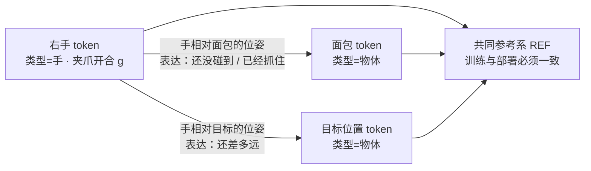
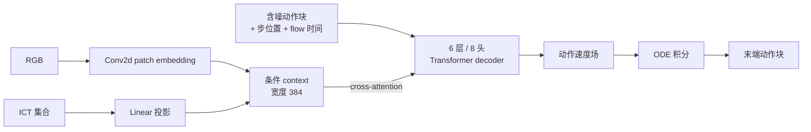

# HumanEgo：从第一视角人类示范到机器人策略

戴一副带相机的眼镜，把一件家务做上几十遍，就可以训练机器人策略。HumanEgo 的关键取舍是**只保留示范里“手相对物体在哪儿”，丢掉“人手长什么样”**，再用 Flow Matching 生成机器人末端的动作块。本文沿一个端面包任务走完采集、表示、训练、部署四段接口，并区分论文方法与当前开源默认配置。

> **类别：** Egocentric / 第一视角学习 
> **论文：** [HumanEgo, arXiv:2605.24934](https://arxiv.org/abs/2605.24934)，2026-05 首发；本文按 [v3](https://arxiv.org/html/2605.24934v3) 核对。 
> **实现快照：** [TX-Leo/HumanEgo · 239affb](https://github.com/TX-Leo/HumanEgo/tree/239affbc24b8b4a3ab2987cdd76436bea7ca9411)，核验于 2026-11-01。论文配置与仓库默认配置分别说明。

读之前可以先记住全文的四个落点：人类视频和机器人动作之间差了什么（§1）、一块面包怎样变成训练样本（§2）、策略真正读到的是什么（§3）、哪些结论属于论文、哪些只属于当前开源配置（§5.3、§6.2、§7）。

---

## 1. 先把问题摆正

### 1.1 具身差距有两层，不只是“看起来不像”

人做示范、机器人执行，中间隔着两层差距：

| 层次 | 差在哪里 | 常见做法 |
|---|---|---|
| **外观** | 画面里是人手和人臂，不是夹爪和连杆 | 手臂分割与修复、把手渲染成夹爪、域随机化 |
| **运动学** | 人手的关节数、活动范围和运动习惯与机械臂不同 | 重定向（retarget）：把手的位姿映射成末端执行器的位姿 |

多数工作把力气花在第一层，希望画面“看起来更像机器人”。HumanEgo 的判断相反：**真正需要跨过去的是空间关系，而不是像素**。只要把“手在物体的哪个方位、有多近、是否已经合拢”说清楚，画面里是人手还是夹爪就没那么重要。

### 1.2 为什么不是“拿 YouTube 直接训”

官方 FAQ 给出一个好用的分层，称为第一视角数据金字塔：

| 层 | 典型来源 | 数量 | 问题 |
|---|---|---|---|
| 底层 | 被动视频，例如网络视频 | 最大 | 没有动作标签、头部晃动未补偿、多数不是为某个任务拍的 |
| 中层 | 第一视角示范：有人特意戴相机做任务，手部位姿被跟踪 | 中等 | 比底层干净，但仍不足以直接训练可部署策略 |
| 顶层 | 遥操作级人类数据：结构化、标定过、动作标签准确 | 最小 | 稀缺，采集成本高 |

作者对底层的评价是“数量极其丰富，质量其实很差”。HumanEgo 不去解决金字塔底层，而是**假定你只有金字塔顶端的几十分钟数据**，于是问题变成：怎样把每一段示范榨干。

### 1.3 三个赌注，以及各自的代价

| 赌注 | 具体做法 | 代价 / 前提 | 本文位置 |
|---|---|---|---|
| 空间表示优先于视觉保真 | 把每个实体编码成相对位姿 token（ICT） | 需要可靠的物体位姿与手部跟踪；形变物体没有良定义的位姿 | §3、§8 |
| 一段示范可以回答更多问题 | 除动作标签外再预测物体运动、2D 轨迹和未来 token | 论文方法的组合；仓库默认任务配置并未开启 | §5 |
| 跨本体接口放在末端位姿与夹爪 | 策略只输出末端目标，由机器人控制器跟踪 | 需要标定、参考系对齐和一套可跟踪末端目标的控制接口 | §6 |

---

## 2. 跟着一块面包走一遍

以 `serve_bread` 为例：人戴着 Aria 眼镜，把面包从初始位置送到目标位置。整条链路分四段，每段的输入输出都可以单独检查。

| 阶段 | 读入什么 | 产出什么 | 容易误解的地方 |
|---|---|---|---|
| **采集** | 人戴眼镜做任务 | RGB、相机运动（SLAM）、3D 手部位姿 | 眼镜在动，所以必须先把“头动”和“手动”分开，否则手的轨迹是错的 |
| **预处理** | 原始记录 | 物体位姿、手到虚拟夹爪的映射、修复后的图像、ICT 与未来标签 | 物体位姿来自上游感知模型，不是模型“看一眼就知道” |
| **训练** | 图像 + ICT | 一段未来末端动作（动作块） | 学的是“手相对物体怎样运动”，不是模仿人手外观 |
| **部署** | 机器人末端状态 + 当前物体位姿，装进同一套表示 | 末端位姿与夹爪目标 | 策略不输出关节力矩，需要机器人侧的控制器跟踪 |

**关于 Zero-shot 的准确含义：** 这里指任务策略不需要再用目标机器人的示范微调；它仍需要相机标定、物体初始化和机器人的运动控制接口。不能把它理解为任意网络视频直接生成任意机器人的关节命令。

```mermaid
flowchart TB
    subgraph DATA["离线：从人类示范构造训练样本"]
        ARIA["Aria 记录<br/>RGB + SLAM + 手关键点"]
        VIS["外观处理<br/>手臂分割与修复<br/>虚拟夹爪 / 关键点渲染"]
        POSE["几何处理<br/>手到夹爪映射 + 物体位姿<br/>场景扫描 / 跟踪 / 遮挡锁定"]
        ICT["ICT 空间观察<br/>每个手 / 物体对应一个 token"]
        LABEL["未来监督<br/>动作块 + 物体运动<br/>2D 轨迹 + 未来 ICT"]
        ARIA --> VIS
        ARIA --> POSE
        POSE --> ICT
        POSE --> LABEL
    end
    subgraph POLICY["学习：条件 Flow Matching 策略"]
        CTX["视觉 patch embedding + ICT 投影<br/>组成 context"]
        FM["Transformer decoder<br/>含噪动作 query 读取 context"]
        ACT["末端动作块<br/>位置 + 6D 旋转 + 夹爪"]
        AUX["辅助监督 / 可选联合通道<br/>仅在对应训练开关启用时计算"]
        VIS --> CTX
        ICT --> CTX
        CTX --> FM --> ACT
        CTX -.-> AUX
        LABEL -.-> FM
        LABEL -.-> AUX
    end
    ACT --> CONTROL["部署接口<br/>参考系转换 → 机器人控制器<br/>实测末端状态反馈"]
```

图中虚线表示训练监督。辅助目标帮助学习表示，不是部署时必须先执行的三个规划模块。数据与感知流程见[官方预处理文档](https://github.com/TX-Leo/HumanEgo/blob/239affbc24b8b4a3ab2987cdd76436bea7ca9411/preprocess/README.md)。

### 2.1 数据、输入、标签与输出

| 接口 | 内容 | 在端面包例子中的含义 |
|---|---|---|
| 采集数据 | 第一视角 RGB、标定、SLAM 与手关键点 | 知道眼镜和手怎样运动，避免把头动当成手动 |
| 图像输入 | 处理后的 RGB 观察 | 保留面包和目标区域的外观信息 |
| 空间输入 | 手与物体的 ICT 集合 | 显式说明夹爪、面包和目标之间的位置与朝向 |
| 动作标签 | 由人手轨迹重定向得到的虚拟夹爪未来动作块 | 接近、抓取、搬运与释放的末端目标 |
| 模型输出 | $K$ 步连续动作；每手 10 维，另有完成状态预测 | 位置 3 维、旋转 6D 表示、夹爪 1 维；当前默认以独立 done head 判断完成 |
| 执行端 | 将策略参考系中的末端目标转换为机器人控制目标 | 由机器人控制器跟踪；不是策略直接输出电机电流 |

采集侧使用 Aria 眼镜，是因为 Meta 的 MPS 服务可以直接给出标定过的 SLAM、3D 手部位姿和同步 RGB；作者也强调**上游 SLAM 与手部跟踪的精度直接决定下游策略上限**，噪声会沿标签和表示一路传下去。

公开数据集是 [Leo-TX/HumanEgo](https://huggingface.co/datasets/Leo-TX/HumanEgo)：122 段记录，覆盖 `serve_bread` 和 `water_flowers`，包含原始 Aria 数据、MPS 结果和预处理输出。**论文的四任务评估与公开的两任务数据集是不同范围。** 当前策略模型没有自然语言指令输入；前处理的物体检测文本提示属于感知配置，这里应把它归为人类示范学习策略，而非直接套用通用 VLA 的语言接口。

---

## 3. ICT：把“画面长什么样”换成“谁在谁的哪边”

### 3.1 先看直觉：看一眼，闭上眼，你还能把花插进瓶里

作者在 FAQ 里用了一个很直接的类比：扫一眼桌面，然后闭上眼睛，你仍然能把花插进花瓶。看一眼得到的粗略空间地图，加上本体感觉和手物之间的几何关系，足以完成大部分操作；持续的视觉确认并不是必需品。

ICT 就是把这张“粗略空间地图”写成模型能读的格式：场景里每个实体（一只手或一个物体）对应一个 token，token 的主要内容是**它相对其他任务实体的位姿**，而不是它在画面里的样子。

### 3.2 一个 token 里到底装了什么

双手设置中，每个实体 token 是 29 维：

$$
\mathrm{ICT}_{E}=
[\tau\;\Vert\;{}^{\mathrm{REF}}T_E\;\Vert\;{}^E T_{LH}\;\Vert\;{}^E T_{RH}\;\Vert\;g]
\in\mathbb{R}^{29}.
$$

| 字段 | 维数 | 含义 |
|---|---|---|
| $\tau$ | 1 | 实体类型，例如手或物体 |
| ${}^{\mathrm{REF}}T_E$ | 9 | 实体在共同参考系中的位置与 6D 旋转 |
| ${}^{E}T_{LH}$ | 9 | 左手相对这个实体的位姿 |
| ${}^{E}T_{RH}$ | 9 | 右手相对这个实体的位姿 |
| $g$ | 1 | 手的夹爪状态；物体使用约定标志 |

单手设置只保留一组手相对位姿，所以是 20 维。token 数量随场景实体数变化，所以同一套格式可以描述只有一个物体或多个物体的任务。

当面包是实体 $E$ 时，${}^{E}T_{RH}$ 直接表达“手还在接近，还是已经抓住”——这正是动作策略需要的量，而它在像素空间里要经过一长串推断才能得到。

### 3.3 哪些不变性是真的，哪些靠约定

- **6D rotation 是旋转矩阵的一种连续表示，不是六个转动自由度。** 它用旋转矩阵的前两列避免角度表示的不连续问题。
- 相对位姿部分减少了对相机视角的依赖；但 ${}^{\mathrm{REF}}T_E$ 仍依赖参考系的选择，**不能宣称整条 29 维向量在任意相机变化下天然完全不变**。
- 开源配置区分 `camera_frame` 等参考系，训练与部署必须保持同一约定，否则策略输出的坐标会落在错误的空间里。

---

## 4. 模型：怎样把一团噪声推成一段动作

### 4.1 Flow Matching 的直觉

策略不是一步回归出动作，而是学一个“把噪声推向动作”的速度场：

1. 训练时，随机取一段高斯噪声 $x_0$ 和真实动作块 $x_1$，在两者之间的直线上取一个中间点 $x_t$。
2. 模型读入 $x_t$、时间 $t$ 和条件（图像 + ICT），预测这一点上应该朝哪个方向、以多快的速度移动。
3. 推理时从纯噪声出发，按预测的速度场积分若干步，终点就是一段动作块。

好处是输出的是**一整段连续动作**而非单步指令，便于在较低的重规划频率下执行；代价是推理要跑多步积分（当前任务配置为 20 步）。

### 4.2 当前实现的结构与规模

当前实现的核心是一个较小的条件 Transformer，而非视频生成大模型：图像经 patch embedding，ICT 经线性投影，组成上下文；含噪动作、动作步位置和 flow 时间共同构成 decoder 的输入。

实现依据：[FlowMatchingModel.py](https://github.com/TX-Leo/HumanEgo/blob/239affbc24b8b4a3ab2987cdd76436bea7ca9411/training/FlowMatchingModel.py)。

### 4.3 同样用 Flow Matching，不等于同一类模型

它没有预训练 VLM 的语言推理入口，也不需要像 [OpenWAM](./24.OpenWAM_Architecture.html) / [DreamZero](./13.DreamZero_Architecture.html) 那样联合生成未来视频 latent。三者可以使用 Flow Matching，但**生成的变量、条件接口与模型规模不能因此视为相同架构**：

| | 生成什么 | 条件入口 | 规模量级 |
|---|---|---|---|
| HumanEgo | 末端动作块 | 图像 patch + ICT | 小型 decoder，宽度 384 |
| OpenWAM-α / DreamZero | 未来视频 latent + 动作 | 语言、状态、多相机观测 | 视频生成骨干，数十亿参数 |

图像 patch embedding 在这里也不等同于加载一个预训练 ViT。

---

## 5. 训练：一段示范能榨出多少监督

### 5.1 主损失：拟合动作空间的速度场

令 $x_0$ 是高斯噪声，$x_1$ 是经过归一化的目标动作块，$s$ 是图像与 ICT 条件。沿线性路径构造训练样本：

$$
x_t=(1-t)x_0+t x_1,\qquad
\mathcal L_{\mathrm{FM}}=
\mathbb E\left[\left\|v_\theta(x_t,t\mid s)-(x_1-x_0)\right\|_W^2\right].
$$

$W$ 对位置、旋转和夹爪字段赋予不同权重。它拟合的是**动作空间的速度场误差**；这个 loss 下降不能直接当作真实机械臂位置误差下降，更不能代替任务成功率。

### 5.2 三个辅助目标：装进策略里的轻量世界模型

只用动作标签时，一段示范在每个时刻只提供“看到这些 → 输出这段动作”一条信号。数据只有几十分钟时，流过梯度的信息量很有限。作者的做法是让同一段示范再回答三个问题——这些答案由同一套预处理自动算出，**不需要额外标注或额外数据**：

| 辅助目标 | 预测对象 | 相当于在问 |
|---|---|---|
| Object Motion | 被操作物体的未来位姿轨迹 | 手这样动之后，物体会去哪里（3D 物理空间） |
| 2D Trace | 手 / 物体锚点的未来图像坐标 | 看这段视频时，视线会沿什么路径移动（2D 视觉空间） |
| Latent Consistency | 未来手部 ICT token 的一致性目标 | 若干步之后，交互状态会变成什么（表示空间） |

三者共享同一个编码器，合起来是在要求编码器预测场景如何演化，作者称之为**装在策略内部的轻量“手–物交互世界模型”**。

需要分清命名与实现：最后一项沿用作者的命名，但不应据此描述成视频 VAE latent 生成，或带负样本的对比学习；训练代码中的名字 `use_aux_temporal_contrastive` 也不能替代对实际计算的检查，当前实现是 masked MSE。三项在代码中也并非三个完全相同的 head：Object Motion 启用时，把未来物体的 9 维位姿并入联合 flow 目标；2D Trace 和未来 ICT 则通过辅助预测计算损失。

### 5.3 论文方法与公开默认配置的差别

截至本文核验的提交，`serve_bread/HumanEgo.yaml` 与 `water_flowers/HumanEgo.yaml` 的三项辅助目标开关均为 `false`。因此：

- 上一节的三目标表描述的是论文方法及代码提供的能力。
- 按仓库默认任务配置启动训练，**不等于**已经启用论文的完整辅助损失组合。
- 复现实验时应同时记录任务配置、参考系、单 / 双手、动作窗口、采样步数，以及辅助目标开关。

以 [`serve_bread/HumanEgo.yaml`](https://github.com/TX-Leo/HumanEgo/blob/239affbc24b8b4a3ab2987cdd76436bea7ca9411/cfg/training/serve_bread/HumanEgo.yaml) 为例，当前配置使用单右手、`camera_frame`、50 步预测窗口和 20 个采样步。这个单手输出是 $50\times10$，不能直接套用论文双手的 $K\times20$ 接口。另一任务配置见 [`water_flowers/HumanEgo.yaml`](https://github.com/TX-Leo/HumanEgo/blob/239affbc24b8b4a3ab2987cdd76436bea7ca9411/cfg/training/water_flowers/HumanEgo.yaml)。

---

## 6. 部署：从策略坐标系接到真机

### 6.1 仍然需要自己补齐的接口

跨本体的公共接口是末端位姿、夹爪与 ICT。换机械臂时，仍要把相机参考系、机器人基座系和末端工具系连接起来，并保证工作空间、夹爪含义与控制节奏一致。

物体位姿也不是模型“看视频就自然知道”的：初始化和上游感知构成了策略条件的一部分。抓取阶段使用的 kinematic latching 假定被抓物体与手保持刚性关系；如果面包滑落或抓空，几何估计可能继续随夹爪移动。策略调用形成循环，不代表系统已经具备持续视觉物体纠错或接触反馈。

### 6.2 论文执行栈与参考模板的区别

| | 论文附录 G 的执行栈 | 公开仓库的简化模板 |
|---|---|---|
| 循环方式 | 每轮读取新图像与末端状态，约 10 Hz 重规划，每轮执行一个动作 | 先执行 `exec_horizon` 个控制步，再读取下一张图重规划 |
| 示例配置 | —— | 10 Hz 控制、8 步执行窗口 |
| 因此 | 可称作 10 Hz 视觉重规划 | **不能**称作 10 Hz 视觉重规划 |

另外，当前模板中的 `Perception.estimate_objects()` 仍需用户实现，`make_clean_image()` 是返回原图副本的占位实现。采集、训练代码已公开，不代表参考推理模板在任意机器人上开箱即用。具体见 [`run_inference.py`](https://github.com/TX-Leo/HumanEgo/blob/239affbc24b8b4a3ab2987cdd76436bea7ca9411/inference/run_inference.py)、[`controller.py`](https://github.com/TX-Leo/HumanEgo/blob/239affbc24b8b4a3ab2987cdd76436bea7ca9411/inference/controller.py) 与[论文执行细节](https://arxiv.org/html/2605.24934v3#A7.SS1)。

因此，把方法移到自己的机器人上，应先验证端面包这类单一任务的坐标和动作接口，再报告完整闭环任务结果；仅下载权重、离线采样或轨迹可视化不能算真机复现。

---

## 7. 实验数字应该怎样读

| 论文 / 官方页报告 | 正确的比较口径 |
|---|---|
| 每任务 30 分钟人类示范，四任务平均成功率 92.5% | 原论文任务、装置、随机化和成功定义下的结果，每任务评估 40 次 |
| 每任务 15 分钟时平均成功率 75% | 同一研究的数据预算实验，不是任意新任务的保证 |
| 30 分钟人类示范 92.5%，匹配采集时长的机器人示范训练 ACT 约 51.2% | 比较的是训练后策略成功率；差值约 41 个百分点，不是遥操作本身的成功率或相对提升 41% |
| 8 分钟人类数据训练的策略超过 30 分钟机器人数据训练的 ACT | 官方数据效率曲线上的一个交点，口径同上 |
| 表示消融：纯视觉输入停在 32.5%，加入空间 token 后 +52.5 个百分点；`water_flowers` 从 7.5% 升到 85% | 支持“空间表示是关键”，范围是作者的任务与实现；换任务或换视觉骨干需重新验证 |
| 辅助目标消融（15 分钟数据）：Object Motion 单项 +17.5 个百分点，三项合计 +25 个百分点 | 低数据预算下的增益；注意仓库默认配置并未开启这三项（§5.3） |

这些结果支持“在该实验设置下，结构化人类示范具有较高数据效率”，还不足以推出人类视频在所有任务上都优于机器人数据。比较自己的方法时，需要固定任务、采集预算、策略配置、评价次数及成功判据，并把公开两任务的复现结果与原论文四任务均值分开。

实验来源：[论文 v3 §4.1、图 4](https://arxiv.org/html/2605.24934v3#S4.F4)与[官方项目页结果区](https://humanego-ai.github.io/#overview)。

---

## 8. 它适合做什么，不适合做什么

作者给了一个与 ICT 直觉对称的边界说法：**HumanEgo 大致能做“看一眼、闭上眼仍然能完成”的那类任务**——取放、倒水这类粗粒度大幅度操作；而插 USB、穿针、追逐移动物体这类闭眼做不到的任务，它同样做不到。

| 限制 | 直接原因 |
|---|---|
| 约 1 cm 的精度天花板 | 物体位姿依赖现成的基础模型估计，误差会累积；亚毫米级插装不在范围内 |
| 形变物体（布、绳、软包装） | ICT 用刚体 6-DoF 位姿描述实体，形变物体没有良定义的位姿，ICT 构造本身就失败 |
| 高动态任务与手内操作 | 策略基于粗略空间快照动作，而不是高频视觉反馈与逐指接触控制 |
| 上游误差传递 | SLAM、手追踪、物体姿态与标定误差都会进入训练标签或部署条件；相对坐标不能消除这些误差 |

另外两点按“已验证 / 未验证”区分：灵巧手尚未在真实硬件上验证，作者只说明跟踪了 21 个手部关键点、原理上可以重定向；第三视角（exocentric）视频作者认为可行甚至更简单，但那是展望而非本文论文的实验结论。硬件兼容与效果也要分开看：能提供 RGB、相机运动和手部跟踪的设备可能接入这条链路，是否达到原论文性能需要重新验证信号精度和真机结果。

项目网页还展示了模拟器、Real2Sim 等后续内容，应分别按对应发布版本理解，不能倒推为原论文全部具备的能力。作者对局限的说明见[官方 FAQ](https://humanego-ai.github.io/#faq)。

---

## 9. 容易混淆的说法对照

| 常见说法 | 更准确的表述 |
|---|---|
| 看网络视频就能直接生成机器人动作 | 需要标定过的第一视角示范、物体位姿初始化和机器人控制接口（§1.2、§2） |
| 6D 旋转 = 六个转动自由度 | 6D 是旋转矩阵的连续表示方式，自由度仍是 3（§3.3） |
| ICT 对任意视角天然不变 | 相对位姿项减少视角依赖，但参考系项仍依赖约定（§3.3） |
| 和 OpenWAM / DreamZero 同属一类世界模型 | 都用 Flow Matching，但生成变量、条件接口与规模不同（§4.3） |
| 克隆仓库跑默认配置 = 复现论文方法 | 默认任务配置的三项辅助目标为 `false`（§5.3） |
| 官方模板支持 10 Hz 视觉重规划 | 模板按 `exec_horizon` 执行多步后才重规划（§6.2） |
| 比遥操作“提升 41%” | 是约 41 个百分点的成功率差值（§7） |
| 下载权重并采样成功 = 真机复现 | 真机复现需要坐标对齐与闭环任务结果（§6.2） |

---

## 10. 术语速查

| 术语 | 含义 |
|---|---|
| Egocentric | 第一视角，相机戴在示范者头上，随头部运动 |
| MPS | Meta 为 Aria 眼镜提供的机器感知服务，输出 SLAM、标定和 3D 手部位姿 |
| ICT | Interaction-Centric Token，按实体组织的相对位姿 token |
| 6D rotation | 旋转矩阵的连续表示（取前两列），避免欧拉角 / 四元数的不连续问题 |
| 重定向（retarget） | 把人手位姿映射为机器人末端执行器位姿的过程 |
| 动作块（action chunk） | 一次预测的一段未来动作，而非单步指令 |
| Flow Matching | 学习从噪声指向目标的速度场，推理时积分若干步得到样本 |
| kinematic latching | 抓取后假定物体与手保持刚性关系，用手的运动推算物体位姿 |
| done head | 独立的完成状态预测分支，用于判断任务是否结束 |
| Zero-shot 迁移 | 不用目标机器人的示范微调；仍需标定、感知与控制接口 |

---

## 11. 一手资料与复现入口

| 资料 | 用途 |
|---|---|
| [官方项目页](https://humanego-ai.github.io/#overview) | 方法概览、演示、结果图与作者 FAQ |
| [arXiv 论文与版本历史](https://arxiv.org/abs/2605.24934) | 首发日期、方法与实验口径 |
| [官方代码快照](https://github.com/TX-Leo/HumanEgo/tree/239affbc24b8b4a3ab2987cdd76436bea7ca9411) | 核对实际接口、训练目标和任务配置 |
| [公开数据集](https://huggingface.co/datasets/Leo-TX/HumanEgo) | 两任务记录、MPS 与预处理结果 |

代码采用 [PolyForm Noncommercial 1.0.0](https://github.com/TX-Leo/HumanEgo/blob/239affbc24b8b4a3ab2987cdd76436bea7ca9411/LICENSE)；[数据卡](https://huggingface.co/datasets/Leo-TX/HumanEgo#license)标注 CC-BY-NC-4.0。公开发布不等于无限制商用许可。

首次尝试可以按仓库 Quick Start 跑少量样本，检查预处理与训练链路；随后使用独立记录评估，再进行坐标对齐和真实机器人执行验证。这几步提供的证据不同，应分别记录。
